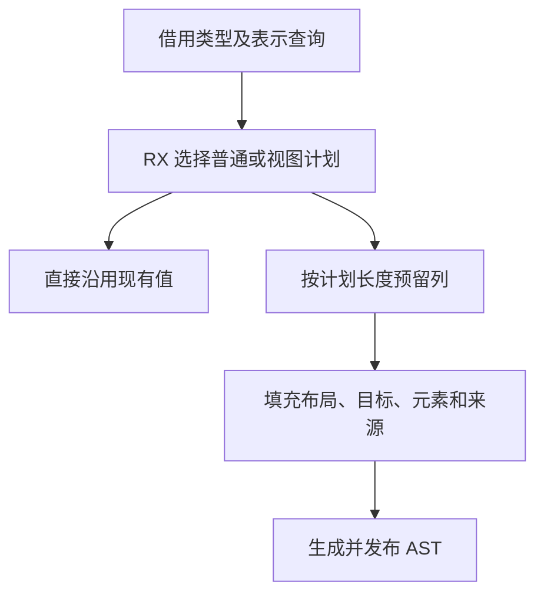

# genz 转换资源准备自举

## Intent

从 `ed63f3760` 接续，让 RX 在同一入口选择普通或视图计划、保留无需
转换的值，并在计划确定后分配和填充资源列。转换与所有权投影在 Source
确认片段有效性及正式发布顺序。

## Data

元素转换、列表 pop、结果元组和直接转换共用 Zig 资源准备。普通计划
和视图计划分别交接，视图还从第三个生成入口检查是否需要转换。逐行的
布局、元素和来源资源规则已有 ZX 实现。

## Edges

保持视图按需构造、分配失败清理和缓存可见性。三列整数共用一块
内存，来源文本继续借用。宿主负责实际分配、布局句柄、文件 AST 列及
辅助声明写入。

## Answer

沿普通和视图转换、pop、元素读写和所有权投影核对正式调用链。复用
批首 Source 引导器，验收生成文件、应用行为、分配失败和固定清单冷暖
开销。

- 一个 RX 入口连接普通计划、视图适用性和视图遍历。无需视图
  转换时直接沿用原值。转换、元素和 pop 等调用共用资源准备。
- 资源列按计划行数预留，三列整数共享一次分配，来源名称继续借用。
  检查生成 Zig，同一计划只物化原有描述符，列数据直接借用。
- 四个独立生成入口和 Zig 视图规划桥退出。转换与投影的片段校验
  和状态提交由 Source 负责，宿主保留 AST 列、名称及实体声明写入。
- 以 `ed63f3760` 的 Source 引导器构建 ReleaseSmall 候选，主清单
  使用 16 个分区。372 项编译器测试通过，含逐一注入分配失败。
- 候选与批首使用同样五份引导清单。除编译器输入戳外，17,885 个
  文件逐字节一致。
- 八组应用回归通过，共 413 个构建步骤、601 项测试。覆盖借用调用
  视图、脱离原容器的读取、共享上下文、字段所有权与循环列、reduce、
  pop 和迭代缓冲。

三个工具均由 Source 引导，运行时使用 Source 分析与生成。固定
清单、Zig 0.17.0、16 个分区和关闭常驻生成的配置一致。下表为三次
交错运行的冷生成中位数。

| 引导器                             |   墙钟 |    CPU | 采样进程树峰值 RSS | 单进程峰值 RSS |
| ---------------------------------- | -----: | -----: | -----------------: | -------------: |
| 固定基线 `declaration-preparation` | 2.05 s | 8.96 s |          737.84 MB |      795.71 MB |
| 批首 `ed63f3760`                   | 1.93 s | 9.42 s |          518.14 MB |      542.80 MB |
| 候选                               | 1.93 s | 9.41 s |          517.98 MB |      538.94 MB |

较批首，冷生成墙钟持平，CPU 减少 0.01 秒，进程树峰值减少
0.16 MB，单进程峰值减少 3.87 MB。较固定基线，墙钟减少
0.12 秒，CPU 增加 0.45 秒，进程树峰值减少 219.86 MB。
热生成墙钟减少 0.01 秒、CPU 减少 0.02 秒，无修改生成墙钟
保持 0.03 秒。冻结清单冷暖和批首对照的 9,894 个文件逐字节一致。
