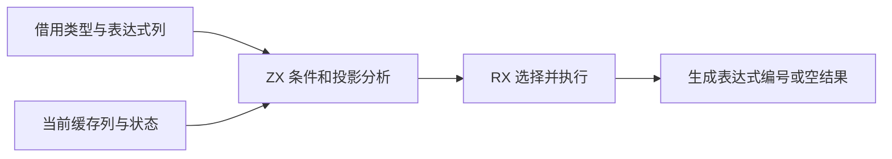

# genz 迭代消费者阶段选择自举

## Intent

让普通语句和表达式作用域的迭代消费者由同一个 Source 入口选择向量化、布局和标量执行路径。

## Data

起点为 `e5fd90fce`。旧入口先通过 Zig 调用独立的 Source 决策模块，再从 Zig 帧读取下一阶段。向量化尝试可能改变当前表达式缓存。

## Edges

保持准入、向量化尝试、布局判定和标量投影的先后顺序。向量化失败后从宿主重新读取缓存、事务与捕获状态。列表投影回退只借用稳定的 IR 列。缓存接口传递切片及标量描述，返回值由当次调用的栈帧持有。Zig 保留 SIMD 与循环 AST 写入、物理缓冲和异常释放。

布局可用性分析继续使用缓冲优先分配器，暂存分配随消费者调用统一释放。旧路径在决策返回时释放该区。

## Answer

正式入口直接运行 `consumer/execute/run.rx`。`decideLoopConsumer`、`nextLoopConsumer`、阶段字段及独立 `consumer_decision` 生成入口退出。生成 Zig 中两次缓存读取位于向量化尝试两侧，布局和表达式表通过引用传递。

使用 `e5fd90fce` 的 Source 引导器构建 ReleaseSmall 候选，主清单使用 16 个分区。372 项编译器测试通过。批首与候选分别生成当前清单，除输入戳外，五份清单的 17,895 个文件逐字节一致。

九组应用回归的 501 个构建步骤和 713 项测试通过，包含浮点向量化尾部、标量回退、WASM、列布局、迭代缓冲、产品转移及分配失败清理。

固定基线、批首和候选均由 Source 引导器生成，运行 Source 分析与生成。冻结清单使用 Zig 0.17.0、16 个分区，关闭常驻生成。以下为三次交错冷生成的中位数。

| 引导器                             |   墙钟 |    CPU | 采样进程树峰值 RSS | 单进程峰值 RSS |
| ---------------------------------- | -----: | -----: | -----------------: | -------------: |
| 固定基线 `declaration-preparation` | 2.06 s | 8.99 s |          737.56 MB |      760.04 MB |
| 批首 `e5fd90fce`                   | 1.92 s | 9.45 s |          519.96 MB |      539.59 MB |
| 候选                               | 1.91 s | 9.43 s |          519.03 MB |      538.69 MB |

较批首，墙钟减少 0.01 秒，CPU 减少 0.02 秒，采样进程树峰值减少 0.93 MB，单进程峰值减少 0.90 MB，采样物理占用高水位减少 0.92 MB。较固定基线，墙钟减少 0.15 秒，CPU 增加 0.44 秒（4.9%），采样进程树峰值减少 218.53 MB。

热生成墙钟减少 0.01 秒，CPU 增加 0.01 秒。无修改生成墙钟与 CPU 均保持 0.03 秒。冻结清单冷暖和批首对照的 9,894 个文件逐字节一致。
