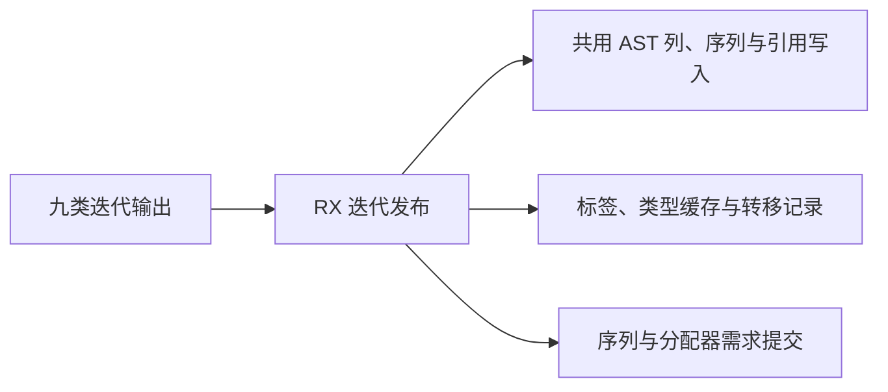

# genz 迭代片段 AST 交付自举

## Intent

将迭代片段接入普通 AST 发布共用的写入操作。RX 决定写入方式、标签修复、类型缓存、转移记录和状态提交的先后。

## Data

起点为 `c939c1fd3`。迭代借用、类型、输入、返回、投影、更新、转移、缓冲及其准备共有九个入口模式。此前迭代发布单独绑定并写入表达式、语句、字段、正文和引用列。更新需要持有同一份标签，并写回块与 break；类型布局使用独立的表达式载荷。

## Edges

保持原来的稠密和稀疏写入、独立文本或借用文本、标签修复先后以及可见失败前缀。缓冲准备只提交分配器需求。返回的引用在状态提交后写入，输入正文也在提交后追加。通过现有列描述符借用生成结果。

## Answer

使用同一 Source 引导器核验迭代输入、返回、缓冲、转移、标签和普通片段应用行为。比较完整引导清单和固定输入的冷暖开销。

- 九个模式借用共用发布描述符。普通片段与迭代片段共用表达式、语句、字段、正文、引用与提交，退出六个迭代专用发布操作。
- Source 选择借用或复制文本、密集或选中行、以及是否更新序列。更新模式只持有一次标签，分别在表达式和语句发布成功后修复对应列。布局载荷、缓存和转移记录保持原顺序。
- 宿主提供实体列写入、标签持有和修复、物理类型缓存与转移记录。发布仍用空暂存分配器，描述符直接借用生成列。
- 使用 `c939c1fd3` 的 Source 引导器构建 ReleaseSmall 候选，主清单使用 16 个分区。372 项编译器测试通过。五份清单除输入戳外，17,913 个生成文件逐字节一致。
- 同一批首引导器生成当前源码的应用。九组回归共 759 个构建步骤、12,265 项测试通过，覆盖迭代调用、缓冲和更新、循环列、产品转移、对象 reduce、字段所有权和集合。

固定基线、批首和候选均由 Source 引导，运行 Source 分析与生成。冻结清单使用 Zig 0.17.0、16 个分区，关闭常驻生成。下表为三次交错运行的冷生成中位数。

| 引导器                             |   墙钟 |    CPU | 采样进程树峰值 RSS | 单进程峰值 RSS |
| ---------------------------------- | -----: | -----: | -----------------: | -------------: |
| 固定基线 `declaration-preparation` | 2.01 s | 8.85 s |          737.97 MB |      760.00 MB |
| 批首 `c939c1fd3`                   | 1.86 s | 9.30 s |          524.47 MB |      542.24 MB |
| 候选                               | 1.87 s | 9.29 s |          532.37 MB |      542.29 MB |

较批首，冷生成墙钟增加 0.01 秒，CPU 减少 0.01 秒。采样进程树峰值增加 7.90 MB，单进程峰值增加 0.05 MB。候选进程树样本为 519.70 至 539.54 MB，批首为 520.06 至 524.73 MB。采样物理占用峰值中位数减少 2.98 MB。较固定基线，冷墙钟减少 0.14 秒，CPU 增加 0.44 秒（5.0%），进程树峰值减少 205.60 MB。

热生成墙钟减少 0.01 秒，CPU 减少 0.04 秒。无修改生成墙钟保持 0.03 秒。冻结清单冷暖和批首对照的 9,894 个文件逐字节一致。
