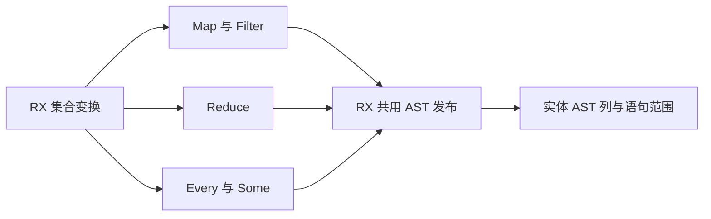

# genz 集合变换与谓词发布自举

## Intent

让 Map、Filter、Reduce、Every 和 Some 的生成与交付留在正式 Source 调用链中。RX 连接求值、结果准备、片段生成和发布，ZX 处理片段和语句范围。

## Data

起点为 `075356d4a`。Map 与 Filter 分两次经 Zig 调用 Source 构造输出。Reduce 和谓词也从 Zig 进入独立的片段生成入口。最终发布通过 Zig 帧按编号取回语句区和文本借用方式。

## Edges

保留 Map 分配与绑定、Filter 写入转换及 Reduce 初值、续借和回调的求值次序。Reduce 继续使用原有范围合并，空范围沿用原规则，赋值前后以原回调范围长度切分。AST 基址在各自的物理语句范围确定后读取。Map、Filter 与谓词借用文本，Reduce 借用原有完整载荷。一般变换由一次调用持有暂存区，续借 Reduce 复用既有工作区。

## Answer

正式 RX 入口直接接入准备和发射模块。五个独立生成入口、集合变换的 Zig 发布帧和谓词发布实现退出。Source 明确传递表达式编号、捕获名、语句范围和借用模式。宿主提供物理列导入、语句范围装配、最终列表包装和原有异常释放。

使用 `075356d4a` 的 Source 引导器构建 ReleaseSmall 候选，主清单使用 16 个分区。372 项编译器测试通过。批首与候选生成当前五份引导清单，除输入戳外，17,755 个文件逐字节一致。

Map、Filter、Reduce、谓词行为、迭代初值所有权及 SIMD 的 12 组回归通过。批量构建汇总为 396/413 步，268 项 Zig 测试通过。`test-predicate-allocation` 的 16 个运行步骤失败，涉及带捕获的谓词。用批首与候选的编译器对 24 组源码和库消费输入分别生成，108 个文件逐字节一致。批首的 `every/scalar` 源码产物也复现拒绝分配时的 18 次失败。生成的 Zig 在建立本地 Loop 状态前通过分配器构造了捕获元组和初值对象。这项已有缺陷进入下一批，修复后按同一矩阵复验。

固定基线、批首和候选均由 Source 引导器生成，运行 Source 分析与生成。冻结清单使用 Zig 0.17.0、16 个分区，关闭常驻生成。以下为三次交错冷生成的中位数。

| 引导器                             |   墙钟 |    CPU | 采样进程树峰值 RSS | 单进程峰值 RSS |
| ---------------------------------- | -----: | -----: | -----------------: | -------------: |
| 固定基线 `declaration-preparation` | 2.08 s | 8.99 s |          737.72 MB |      798.26 MB |
| 批首 `075356d4a`                   | 1.91 s | 9.39 s |          530.66 MB |      547.55 MB |
| 候选                               | 1.92 s | 9.37 s |          518.36 MB |      548.72 MB |

较批首，冷墙钟增加 0.01 秒，CPU 减少 0.02 秒。进程树峰值减少 12.30 MB，单进程峰值增加 1.16 MB，采样物理占用峰值增加 1.15 MB，系统物理占用高水位增加 1.43 MB。较固定基线，冷墙钟减少 0.16 秒，CPU 增加 0.38 秒（4.2%），进程树峰值减少 219.37 MB。

热生成墙钟保持 1.43 秒，CPU 减少 0.01 秒。无修改生成墙钟与 CPU 均保持 0.03 秒。冻结清单冷暖生成和批首对照的 9,894 个文件逐字节一致。
