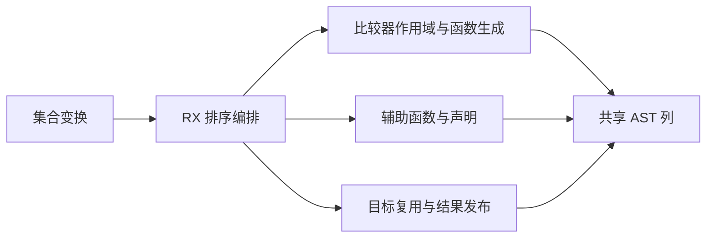
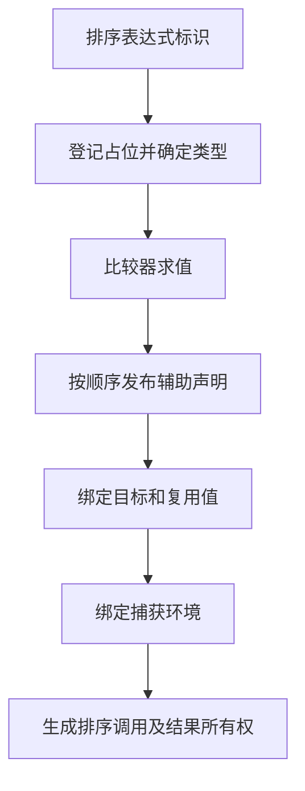

# genz 集合排序自举

## Intent

沿正式集合变换入口迁移排序的声明占位、比较器构建、输入复用与结果发布。保持排序算法、辅助声明的编号和顺序、捕获环境和出错顺序。

## Data

以 `f00df2762` 为起点。正式集合变换经 `transform/execute/run.rx` 进入 `sorting/root.zig`。已有 Source 生成比较器函数体、排序辅助函数和调用表达式，多个独立 Zig 调用把结果写回专用可变帧，再由下一步读取。排序占位在递归降低比较器前登记，辅助声明完整后替换。目标在比较器和声明发布后求值，复用判断在目标绑定后执行。

## Edges

相同目标只求值一次。比较器具有原有分配、I/O、进程和错误上下文。保留类型读取、语句范围和原生分配区的最短有效寿命，异常退出按原范围恢复比较器名称。引导 seed 独立保留。

## Answer

沿正式入口核对仍在执行的原生代码，合并变更后集中验证列表排序、不可变数据与库调用、编译器测试、自举生成和固定基线性能。以远端提交记载结果。

RX 现在直接发布声明占位和比较器产出的 AST，按序合并比较器、排序谓词与排序函数，再替换原占位。在目标和捕获环境求值后，RX 发布排序表达式、语句和字段，持有所需文本并提交序列号。目标、存储选择、捕获和比较器效果作为调用结果向下传递。

三个排序专用 Zig 发射文件及六个独立生成入口退出。原生层保留类型与表达式物化、比较器暂存区和异常退出时的名称恢复，并提供通用实体 AST 列、区间与辅助声明写入。排序规则和发布顺序由 Source 执行。

以 `f00df2762` 的 Source 引导器构建候选，372 项编译器测试通过。集合源码与库消费、局部自有集合、回调和嵌套集合的整批回归通过 458 个步骤和 12,114 项测试。调整最后一处内存表示后，复跑受影响的不可变集合回归，50 个步骤和 504 项测试通过。不可变排序的源码与库路径各有 14 个命名用例，校验排序结果、输入保留及分配失败行为。使用旧、新正式应用编译器直接生成对应夹具的源码、库程序与两份 ABI，四个文件逐字节相同。

用批首及最终候选 Source 工具运行当前五份自举清单，17,737 份 Zig 与辅助产物逐字节一致。两套工具均在 Source 分析与生成配置运行。

### 峰值内存诊断

首轮比较固定清单发现热生成的单进程峰值约增 40 MB。用同一个 Source 引导器重建 `f00df2762` 后仍可复现。三次排序降低的暂存区共使用约 0.25 MB 后备容量。阶段采样显示，两版热生成发射结束时均约 494 MB，差值从写出阶段的原始分区根文件开始。关闭分区后，写出峰值只差约 0.25 MB。

对照两版生成的分区根文件构造函数确认，排序发布新增的原生标签列对象改变了同结构 ZX 值的表示。分区根在循环内反复把标签和偏移从可复用数组降为普通切片。排序发布改为分别借用两列后，该构造函数恢复与批首生成代码逐字节一致，循环中多出的分配退出。排序阶段的临时数据在各自最后使用后释放。

### 性能验收

固定的兼容清单与 16 个分区，逐场景交错运行三次，比较中位数。批首与候选均由同一个 `f00df2762` Source 工具生成，运行时均采用 Source 分析与生成。固定基线沿用此前通过验收的 Source 工具。冷生成清空输出和缓存，热生成复用缓存并重建输出，无修改复用两者。

| 场景与版本        | 墙钟（秒） | CPU（秒） | 采样进程树峰值 RSS（MB） | 系统单进程峰值 RSS（MB） |
| ----------------- | ---------: | --------: | -----------------------: | -----------------------: |
| 冷生成 · 固定基线 |       2.02 |      8.91 |                   737.66 |                   760.14 |
| 冷生成 · 批首     |       1.86 |      9.29 |                   519.57 |                   542.92 |
| 冷生成 · 候选     |       1.87 |      9.30 |                   523.37 |                   542.08 |
| 热生成 · 固定基线 |       1.58 |      6.32 |                   705.92 |                   729.84 |
| 热生成 · 批首     |       1.40 |      6.14 |                   502.28 |                   502.33 |
| 热生成 · 候选     |       1.40 |      6.14 |                   501.99 |                   502.04 |
| 无修改 · 固定基线 |       0.04 |      0.03 |                     0.26 |                    17.96 |
| 无修改 · 批首     |       0.03 |      0.03 |                     0.41 |                    15.86 |
| 无修改 · 候选     |       0.03 |      0.03 |                     0.15 |                    15.89 |

候选较批首冷墙钟与 CPU 各增加 0.01 秒。冷生成进程树采样峰值增加 3.80 MB，系统单进程峰值减少 0.84 MB，采样物理占用峰值增加 0.52 MB。热生成墙钟和 CPU 持平，两项 RSS 峰值均减少约 0.29 MB。较固定基线冷墙钟减少 0.15 秒，CPU 增加 0.39 秒，进程树采样峰值减少 214.29 MB。固定输入的 9,894 个生成文件逐字节一致。
