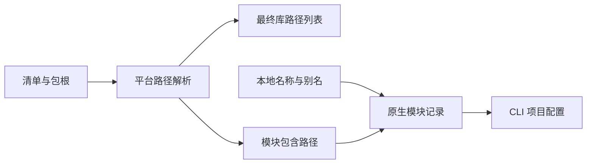

# 包作用域原生配置自举

## Intent

迁移 CLI 装载包作用域时的原生声明、库路径、模块及设置发布，使源码包和编译
库按同一套 RX 步骤执行。

## Data

批首为 `ce4681159`。`project.loadWithInputs` 取得包清单和依赖作用域后，进入
`scopes.zig::load`。原 Zig 循环依次读取原生源码与编译库、解析名称、发布声明、
建立库路径，最后逐个装配原生模块和包含路径。声明和设置的列投影已由 Source 执行。

## Edges

保留每包及各行顺序、错误先后和已登记的观察路径。身份和别名沿用原生配置规则。
编译库视图和名称暂存表随各包处理释放。文件读取、平台路径解析、物理列借用和
容器存储仍使用 Zig 标准库。库路径写入最终列表，模块包含路径只分配一份结果。

## Answer

正式入口由 RX 推进包作用域。ZX 遍历原生声明、库路径和模块包含路径，复用
同一个路径写入函数。发布阶段借用列，库路径写进最终列表，模块包含路径使用
一次分配。宿主负责文件读取、平台路径解析、名称表与结果容器，并为模块写入
保留原来的借用与分配行为。

### 生成与运行核验

- 以两套已验收的 Source 引导器读取同一份正式 CLI 清单，1,144 个文件逐字节
  一致。生成子图使用栈上的游标与宿主借用的行视图，未发现临时堆对象分配点。
- 第一次安装版运行暴露了宿主引用的指针层级差异。按仓库现有 CLI ABI 借用
  指针本身后，重新构建并执行实际包与原生库入口。
- 使用最近验收的 Source 引导器重新构建 ReleaseSmall CLI，生成时使用 Source
  分析和生成实现。包清单、原生别名、原生包、原生库发布及编译包五个回归目标
  全部通过，构建共 95 步。
- 与批首正式 CLI 对照，同一输入用两套 CLI 各交替运行七次，禁用应用缓存。
  源码包发布和编译包再发布的墙钟中位数均为 0.01 秒。CPU 中位数从
  0.01 秒降至计时器精度下的 0.00 秒，单进程峰值 RSS 分别下降 16 KiB 和
  32 KiB。两组分别有 20 和 21 个产物逐字节一致，编译库工件的 SHA-256
  分别为 `50404ff380d0d52b1ac42aaba34dfbaa0961df51cc04b3e1ac9bf085621f949b`
  和 `f4c3b0c5fe352086d641ddeae37450c65131f61609a965863c98e53a3ff6f30c`。
  完整编译器未修改，本批沿用既有固定冷生成对照。
- 本阶段新增了专用宿主接线，Zig 总量增加。下一批从 `scopes/host.zig` 和
  `native_configuration.zig` 合并名称索引、声明绑定和模块写入接线。
