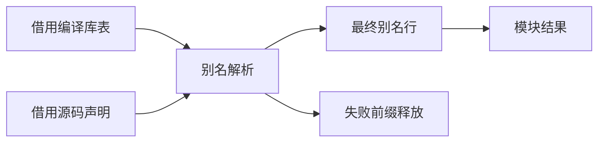

# 包原生别名与结果交接自举

## Intent

让 CLI 包作用域直接读取编译库声明视图并执行别名解析、失败清理和结果发布，
把同一调用链所需的声明、模块和设置交接收进一批。

## Data

批首为 `fd52765f3`。正式入口为 `scopes.zig::load`。当前 RX 已安排包作用域，
但编译库打开和别名绑定经 `compiled_native.zig` 调回编译器的专用生成入口，
声明和设置经 `scopes/publish.zig` 再进入 Source。可复用已有别名解析、尾部裁剪
和释放函数。

## Edges

保持编译库加载、声明校验、路径解析、别名校验和模块登记的顺序。借用编译库与
清单列，动态别名写进最终行存储。读取文件、预留缓冲、释放物理存储和容器写回
通过 Zig 标准库。异常退出释放已写入前缀和当前未提交的别名。

## Answer

包作用域由 RX 选择编译库并执行打开、声明写回、逐模块别名构建和设置发布。
ZX 直接查找编译库声明身份，复用已有的源码与编译库别名算法。已删除
`compiled_native.zig`、旧声明及设置调用层和编译器的别名转接。原生层
负责库 I/O、列借用、登记容器及拥有者释放。

旧的独立生成入口退出正式调用链。异常退出时，宿主复用同一份 ZX 释放逻辑，
先释放别名的有效前缀和待提交文本，再关闭编译库。正式生成文件中，包和模块
的循环游标与参数视图均借用原存储。

### 已核验的构建

两套已验收的 Source 引导器对正式 CLI 清单生成的 1,210 个文件逐字节一致。
首轮构建发现物理写入列的类型推导有误，修正后正式 CLI 编译成功。使用
既有 Source 引导器生成并构建 ReleaseSmall CLI。原生联结及声明回归合计
63 项通过。用修正后的安装版独立执行包清单、原生别名、原生包、原生库发布和
编译包回归，95 个构建步骤全部通过。

用已有的原生编译包先发布完整结果，再在第一个有效别名之后添加未知目标。
批首和候选均报告 `UnknownNativeAbiAlias`，既有发布目录内的 21 个文件
逐字节保留。

### 发布性能

使用包作用域迁移前的固定 CLI、批首 CLI 和本批候选。三套 CLI 在相同工具链
和包输入下禁用应用缓存，每个场景各交错运行七次。墙钟和 CPU 为秒，RSS 是
单进程峰值；0.00 秒表示计时分辨率下读数为零。

| 场景                 | 墙钟（固定 / 批首 / 候选） | CPU（固定 / 批首 / 候选） | RSS 较批首 / 固定 | 相同产物 |
| -------------------- | -------------------------- | ------------------------- | ----------------- | -------: |
| 源码包发布           | 0.01 / 0.01 / 0.01         | 0.00 / 0.00 / 0.00        | +48 / −32 KiB     |       20 |
| 编译包再发布         | 0.01 / 0.01 / 0.01         | 0.01 / 0.01 / 0.00        | −32 / −80 KiB     |       21 |
| 含包内原生依赖的发布 | 0.01 / 0.01 / 0.01         | 0.01 / 0.01 / 0.01        | +16 / −64 KiB     |       22 |

三组编译库工件 SHA-256 依次为
`f4363f4bd0937c2ddb3a788e391026624d4e8eab3432c9b1edb4d9fd2ed99f74`、
`b6305471240a5197f90ff6242379918468af727f951451f992d4884cd271fca9` 和
`85cb3ee144a75b6f3cd643949dd85cfa2631c7d375bfcfd071533892cf183b65`。
