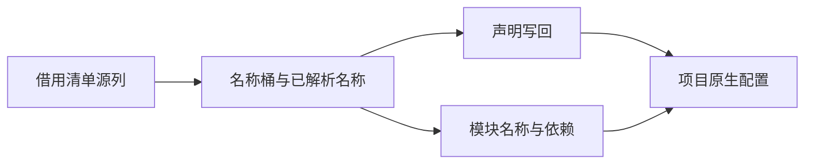

# 包原生名称与依赖绑定自举

## Intent

让正式 CLI 的包作用域直接执行 Source 的原生声明准入、本地名称索引、声明绑定
和模块依赖重映射，退出已经迁到 Source 的规则经手写 Zig 二次调用的路径。

## Data

批首为 `98c1a6eca`。从 `scopes.zig::load` 经 `scopes/scope.rx`、`bind.zx`
和 `modules.zx` 进入 `scopes/host.zig`。宿主再调用
`compiler.project.native_configuration` 验证清单、解析名字并重映射依赖。
此组规则的正式调用方为 CLI。

## Edges

保留编译库打开、外部声明和接口准入、库路径及模块别名登记的失败顺序。
名称桶、列及结果表继续使用原存储。中间名字在暂存区计算；供后续步骤引用
的名字和依赖字符串由项目分配器持有。平台 I/O、容器存储、编译库视图与
别名清理仍需 Zig 边界。

## Answer

原来的 `native_configuration.zig`、公开转接及八个专用生成入口已删除。RX
直接安排声明准入、名称索引、声明绑定与模块写入。ZX 借用清单列及索引，完成
名字选择、依赖重映射与结果写入。平台和容器边界预留物理存储，编译库表的读取
及其别名发布仍通过 Zig。名称构造的暂存数据按行释放，复核
生成的正式调用子图后，遍历过程中没有新增视图、循环状态或参数对象的堆分配。

### 验收

- 使用先前已验收的 Source 引导器生成并构建 ReleaseSmall CLI，执行正式
  Source 分析与生成。包清单、原生别名、原生包、原生库发布、编译包、原生联结
  和原生声明七个目标全部通过，共 123 个构建步骤和 63 项 Zig 回归。
- 两套 Source 引导器对同一正式 CLI 清单生成的 1,174 个文件逐字节一致。
  现有原生包样本的临时副本加入了包内显式名称依赖，成功发布。两套 CLI
  构建出的应用在输入 27 时均输出 `{"left":32,"right":49}`。将目标换成未登记
  名称，两套 CLI 都返回 `UnknownNativeDependency`。

### 性能与产物

使用原生作用域迁移前的固定 CLI、批首 CLI 和本批候选。三套 CLI 使用同一
工具链和包输入，禁用应用缓存，每个场景交错运行七次。墙钟、CPU 为秒，
RSS 为单进程峰值。0.00 秒表示计时分辨率下读数为零。

| 场景                 | 墙钟（固定 / 批首 / 候选） | CPU（固定 / 批首 / 候选） | RSS 较批首 / 固定 | 相同产物 |
| -------------------- | -------------------------- | ------------------------- | ----------------- | -------: |
| 源码包发布           | 0.01 / 0.01 / 0.01         | 0.01 / 0.00 / 0.01        | −16 KiB / 持平    |       20 |
| 编译包再发布         | 0.01 / 0.01 / 0.01         | 0.01 / 0.01 / 0.00        | −64 / −80 KiB     |       21 |
| 含包内原生依赖的发布 | 0.01 / 0.01 / 0.01         | 0.01 / 0.01 / 0.01        | −32 / −48 KiB     |       22 |

三组编译库工件 SHA-256 依次为
`65a029a758c91e4d3d78681dfb1552aa89827fb5c21aa6c849cc87e482de8e82`、
`1b6537a30261546a15e386f54de28cbc532a50706274b23a344ef1dd407147a4` 和
`7f8ab68701bd2ebaa2e1f2d2406836aa6d9df475c1fb6a57e49070f9e99de1ad`。
