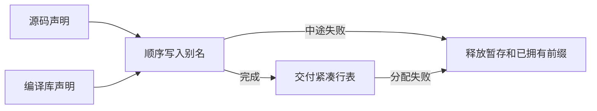
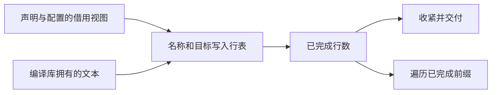

# 原生别名输出与释放自举

## Intent

让源码声明和编译库共用原生别名的输出交付，迁移已写前缀和暂存字符串的错误
清理，并去掉编译库按行分派产生的临时对象。

## Data

批首为 `29762ccf2`。CLI 的包作用域加载从 `identity.aliases` 或
`identity.sourceAliases` 进入 `native_abi_aliases`。原 Source 负责选择并写行，
Zig 读取完成数量、收紧结果切片，并在错误时逐行释放已拥有的字符串。
编译库逐行经过 RX 循环、推进模块与处理单行的模块，三处都构造临时描述符。

## Edges

源码行借用名称与标识，编译库行拥有标识，只有自动推导时拥有名称。
保留显式配置的次序、重复检查、冲突与缺失的诊断，以及紧凑返回切片的分配器
契约。收紧行表失败时原存储和有效前缀保持可用，异常清理按原拥有关系释放。

## Answer

源码与编译库共用 RX 的交付顺序。ZX 从已完成前缀计算结果长度，并在失败时释放
暂存目标和相应的拥有列。Zig 只提供原分配器的行存储收紧与释放。编译库的逐行
选择、解析与写入由一个 ZX 循环推进，移除三个 RX 循环与推进文件。生成前后均
无可达的临时对象堆分配点，文本有效载荷的分配继续按原先拥有关系进行。

### 回归修复与验收

- 初次构建安装版时发现上一批删除的 `compiled_import_find` 入口仍由 CLI 的
  `requireExport` 调用。恢复其生成登记和借用列的 Zig 调用，继续执行同一个
  ZX 查找。`WAY.md` 要求移除公开接口时用最终候选编译实际的跨包调用者。
- 372 项 Source 编译器、39 项初始引导配置的 RX 和 111 项原生链接、编译库
  链接及原生模块列检查通过。五份清单的 17,711 个同输入文件逐字节一致。
- 最终安装版 CLI 构建通过，原生别名、原生库重新发布与编译包回归共 24 项。
- 本批非 seed 包源码 Zig 新增 67、删除 68。全仓新增 69、删除 68，包含
  恢复 CLI 的入口。固定起点 `4c11902b6` 至本批累计净减 3,611 / 2,218 行。

### 性能与产物

候选工具由 `29762ccf2` 的 Source 引导器生成。三个工具都走 Source 分析和
生成，沿用固定清单、16 分区与 ReleaseSmall，关闭常驻生成器。三轮交错取
中位数。进程树 RSS 来自采样峰值，单进程 RSS 来自系统峰值。

| 工具                    | 冷墙钟 / CPU（秒） | 热墙钟 / CPU（秒） | 无修改墙钟（秒） | 冷进程树 / 单进程 RSS（MB） |
| ----------------------- | -----------------: | -----------------: | ---------------: | --------------------------: |
| 固定 Source 对照        |        2.08 / 9.02 |        1.62 / 6.33 |             0.04 |             738.30 / 763.08 |
| 批首 Source `29762ccf2` |        1.90 / 9.35 |        1.39 / 6.14 |             0.03 |             518.55 / 546.14 |
| 本批 Source             |        1.93 / 9.33 |        1.47 / 6.26 |             0.03 |             518.28 / 542.39 |

较批首，冷墙钟增加 0.03 秒、CPU 减少 0.02 秒、进程树 RSS 减少 0.28 MB，
单进程峰值减少 3.75 MB。热墙钟增加 0.08 秒、CPU 增加 0.12 秒。较固定对照，
冷墙钟减少 0.15 秒、CPU 增加 0.31 秒、进程树 RSS 减少 220.02 MB。固定清单的
9,894 个产物和所有权 memo 均与批首一致。

沿用原生库重新发布夹具，从同一份含两个原生实现的编译库重新发布。两个由
Source 构建的 CLI 禁用缓存交错测七轮，墙钟和 CPU 中位数均为 0.01 秒，
单进程 RSS 为 13.09 / 13.06 MB。21 个发布文件逐字节一致，编译库 SHA-256 为
`441d5921f9b0a7d8bb377f0b03d28d31995456ad429bbc47d5e8b450a73829ef`。

下一批从 `packages/cli/src/cli/project/scopes.zig` 追踪包作用域的原生声明、
模块与路径发布，将共用数据的前置读取、次序与写回一并迁移。
