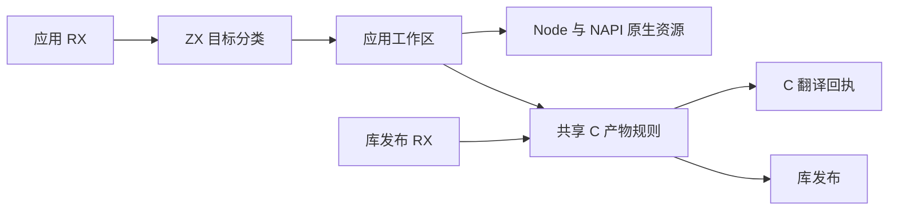
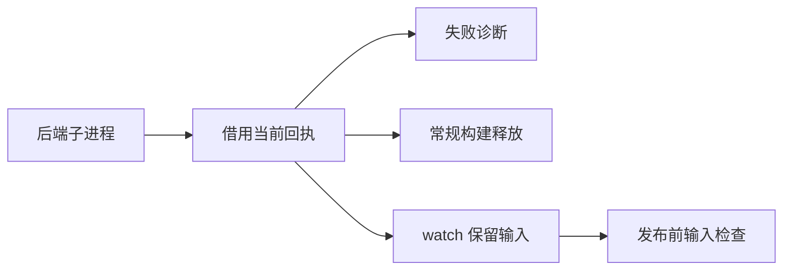

# 原生后端准备与翻译交付自举

## Intent

让应用和库共享原生 C 头文件与适配器的产物规则。让应用 RX 明确表达目标选择、Node 资源保留和 C 翻译回执的所有权转交。

## Data

批首为 `47016f945`。应用从 `backend/prepare.rx` 进入目标准备和模块翻译，库从发布的资源遍历进入同一种头文件与适配器写入。原生 Zig 分别组装相同的路径及包含语句，翻译会话还在 Zig 内解释 Source 已给出的回执分类。

## Edges

复用 Zig 的目标语法校验、子进程 I/O、原生诊断、按操作块释放的 arena，以及统一生成器产生的 Zig 适配器。保留目标错误、工作区写入、C 翻译诊断和各入口的写入顺序。回执不重复解析，watch 保留成功的回执，常规构建在交付路径后释放回执。

## Answer

应用与库共用 ZX 计算 C 包含语句和头文件、适配器路径。应用沿用相同内容时跳过写入，库沿用原子写入。头文件路径通过 RX 的调用结果传给翻译，删除写入函数内用同一字段保存头文件名和生成路径的做法。

RX 明确选择 C 回执的去向，顶部的应用后端在失败时接管原回执。成功后先把路径交给模块，常规构建立即释放回执 arena，watch 将原回执移入后端依赖列表。两种状态均持有各自所需的路径或回执，调用时沿用原有存储，无二次解析。删除独立的 Zig 翻译执行流程、临时枚举调度和从命令参数猜测协议模式的实现。

ZX 分类目标，RX 使用分类结果生成运行入口和保留 Node 资源。同一份 Zig 语法解析结果同时供 Wasm 与 Node 规则使用。工作区复用已有资源保留流程，Node 和 NAPI 的文件名及内容继续借用原有数据列。Zig 保留目标语法解析、通用 JSON 字符串编码、子进程 I/O 和 arena 的物理管理。

两套独立生成的 Source 引导器对同一输入生成 1,268 个逐字节一致的文件。实际 CLI 核对了 `wasm32-freestanding`、`wasm32-wasi` 与 Windows 缺少 Node 导入库的原诊断。

最终 ReleaseSmall 候选通过真实后端、后端发布、C 头文件 watch、原生 ABI 别名、原生库发布、Node 绑定和 Wasm/WASI 七个目标。C 头文件 watch 覆盖首次缺失、创建、编辑、删除与恢复。普通构建覆盖后端失败时保留已发布的二进制和汇编。

### 性能与产物

三版 CLI 使用同一个 Zig 0.17.0、同一份项目输入和共享全局缓存。每次重置项目缓存，记录一轮墙钟、CPU 和系统单进程峰值。候选由已自编译的 Source 引导器生成。

| 场景与指标               | 固定对照 |   批首 |   候选 |
| ------------------------ | -------: | -----: | -----: |
| C 常规构建墙钟（秒）     |     6.73 |   6.67 |   6.69 |
| C 常规构建 CPU（秒）     |     6.73 |   6.72 |   6.74 |
| C 常规单进程峰值（MB）   |   387.92 | 382.70 | 385.76 |
| C watch 首次墙钟（秒）   |     7.03 |   7.08 |   7.05 |
| C watch 重建墙钟（秒）   |     7.22 |   7.25 |   7.11 |
| C watch 两轮 CPU（秒）   |    13.79 |  13.85 |  13.81 |
| C watch 单进程峰值（MB） |   386.33 | 386.63 | 384.81 |
| Node 构建墙钟（秒）      |     0.55 |   0.57 |   0.58 |
| Node 构建 CPU（秒）      |     0.61 |   0.63 |   0.63 |
| Node 单进程峰值（MB）    |   164.58 | 164.84 | 165.05 |

三版的常规应用、watch 编辑前后机器代码、生成的包含头和适配器逐字节一致。Node 实际执行输出一致，机器代码、两份绑定及五份工作区资源一致。常规 C 峰值比批首增加 3.06 MB，比固定对照低 2.16 MB。Node 峰值分别增加 0.21 MB 和 0.48 MB。C watch 重建墙钟较批首下降 0.14 秒，单进程峰值下降 1.82 MB。
