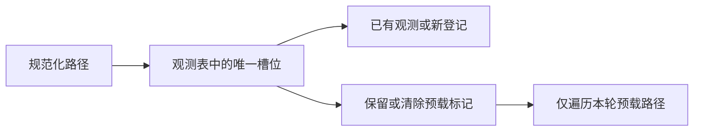

# 后端依赖预载与过期观测自举

## Intent

从正式应用构建链退出 `Attempt.prepareBackend` 和 `finishBackend`。
让 RX 明确安排预载、归并与清理，ZX 遍历借用的依赖路径，复用已有观测表。

## Data

批首为 `20e8b8570`。每轮先预载尚未观测的上一轮路径，后端汇报完成后再
构建完整路径哈希集合，清除未重新出现的预载项。注册后端行还会单独查询
路径是否已见。上一批已让最终路径直接归下一轮 arena 所有。

## Edges

预载跳过已有观测，只忽略既有规则容许的读错误。保留路径顺序、重复行、
原始失败、绑定创建后的交接时机、报告不完整时的发布行为与重试语义。
后端重新报告时借用同一观测槽清除预载标记。失败恢复继续使用已有快照。
文件系统、哈希表探测及物理路径分配保留在原生边界。

## Answer

正式 `observed.rx` 在启动后端前预载，在结果和绑定就绪后清理预载项、
交付路径，再判断报告完整性。ZX 只遍历借用的上轮列表与实际预载列表。
删除两个旧 `Attempt` 流程和按本轮全部路径建立的临时哈希表。普通观测
写回保留预载标记，只有后端报告同一路径才清除标记。新增依赖直接取自
观测登记结果，省掉单独的存在性查询。后端的路径顺序和重复行继续保留。

正式 ReleaseSmall CLI 由 Zig 0.17.0 和已自编译的 Source 引导器生成。
正式产物与另一套 Source 引导器的 1,242 个文件逐字节一致。后端发布、
真实后端进程、watch 恢复、库 watch、C 头文件 watch 五个目标全部通过。

直接调用生成的 ZX 预载、登记和清理，核对同一张观测表。已有观测在预载
时跳过，重复路径只观测一次，重新报告的路径清除标记，过期路径及其已记录
或读失败状态按原规则移除。相对路径归一后仍保留报告顺序与重复行，重放
同一报告不再认定新依赖。两个 ZX 遍历使用空分配器通过。外部绝对路径头文件
的补充 watch 夹具在固定对照及批首均持续重复发布，过期清除以直接观测表
检查为证据。

### 性能与产物

固定对照、批首与候选使用相同 Zig。三种禁用缓存的库发布各交错执行七次，
63 个产物逐字节一致。三版墙钟和 CPU 中位数均为 0.01 秒，候选峰值 RSS
较批首分别变化 +16、+16、−16 KiB。

三套安装版各执行一次 `--watch --run`，两次应用产物的本机机器代码段在
三版间逐字节一致。候选、批首和固定对照的编辑后重建墙钟均约 5.46 秒。
候选两轮合计 CPU 为 9.20 秒，较批首增加 0.01 秒。系统报告的单进程峰值为
363.20 MB，较批首增加 0.39 MB，较固定对照下降 2.13 MB。单次应用数据
记录本轮波动，当前批次未重复测量全仓构建。
