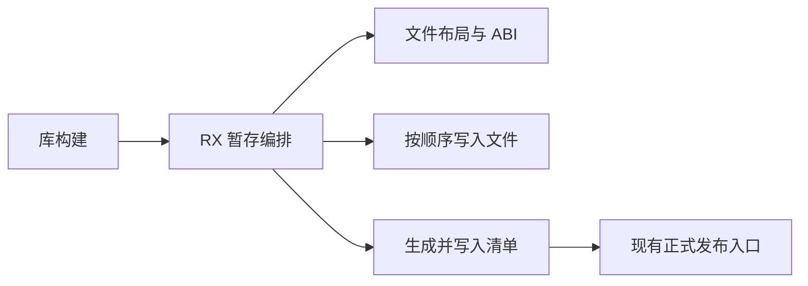

# 库发布阶段文件写入自举

## Intent

让库发布的 RX 编排层直接选择、排序并写入根 ABI、别名视图和模块文件。
把构建配置的原生模块映射和 ABI 绑定一起迁入 Source，移除文件组索引、
逐行宿主调用及每个文件的绝对路径分配。

## Data

批首为 `f6baa924b`。库构建创建隔离目录后进入 `library/publish.zig`。
当前 `stage/output.zig` 按组查询、拼接并写入每个文件，
`library_config.zig` 另行复制构建所需的原生模块行，genz 再把原生及普通
模块的行描述符复制进临时表。工作区文件已有通用原子写入原语，内存模块
支持借用行字段和直接写入最终列。

## Edges

保持 ABI、内部模块、公开模块、清单、构建文件和目录清单的顺序。
所有写入留在当前暂存目录。流式编码和文件替换保留现有错误语义及最终
提交时机。发布格式与最终目录的预检、历史文件清理和失败恢复沿用原入口。

## Answer

`library/stage/write.rx` 直接按根 ABI、别名视图、内部模块和公开模块
的顺序写入。文件路径与源码列借用布局和编译结果。删除文件组枚举、
查询及逐行 Zig 桥。阶段开始时打开暂存目录，所有阶段产物复用这个目录
句柄进行原子写入，移除逐文件的绝对路径拼接。现有原生资源打包路径
仍由独立资源阶段管理。

构建文件的原生模块行由 ZX 映射并绑定最后一个匹配的 ABI 视图。
生成器借用映射后的原生行和已有模块布局，仅保留生成入口使用的指针表。
源文件、依赖和包含路径继续借用原内存。

使用正式安装版的 CLI 清单，两个已经自编译的 Source 引导器生成的
1,230 个文件逐字节一致。安装版使用 Zig 0.17.0 和 ReleaseSmall，
实际执行 Source 分组、写入及构建 AST 生成。

完整库发布、原生别名和编译包回归通过，共 105 个构建步骤。独立的后端
运行测试通过。产物对比发现生成结构体的字段顺序影响了 `library.json`
的字节，因此清单序列化显式沿用原来的键顺序，并流式读取借用的行。
修正后清单和原生库发布回归通过，共 81 个构建步骤。保留了格式修正前
已通过且输入不变的回归结果。

### 性能与产物

源码包、编译包再发布和含原生包含目录的发布样本各交错运行七次。
固定、批首与候选安装版的墙钟和 CPU 中位数均为 0.01 秒。
63 个发布文件逐字节一致。候选的峰值 RSS 较批首分别变化
+32、0、−16 KiB。

应用构建沿用同一个 Zig 0.17.0 后端并禁用应用缓存。三套安装版各交错
运行五次，以下为中位数。15 次构建的 13 个后端模块输入和机器代码段一致。

| 指标                     | 固定基线 |   批首 |   候选 |
| ------------------------ | -------: | -----: | -----: |
| 墙钟（秒）               |     4.57 |   4.56 |   4.56 |
| CPU（秒）                |     4.61 |   4.60 |   4.61 |
| 采样进程树峰值 RSS（MB） |   366.20 | 364.36 | 365.58 |
| 系统单进程峰值 RSS（MB） |   365.58 | 367.66 | 367.28 |
| CLI 采样峰值 RSS（MB）   |     9.99 |   9.95 |   9.95 |

应用机器代码段 SHA-256 为
`910a479dcb43307384c929f2947c6ef83adf69df3a7b43e2b2dab7999a807917`。
