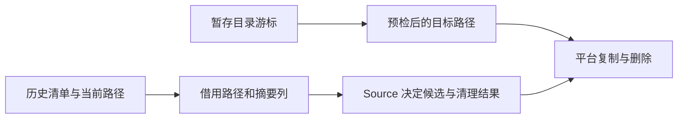

# 库正式发布与旧文件清理自举

## Intent

让 Source 形成并消费同一份已预检的发布计划。将文件配对、清单最后提交、
历史文件的身份和摘要判断从逐行 Zig 状态交给 RX/ZX。

## Data

批首为 `9a615b3b4`。公开发布入口从 `watch/library.zig` 进入
`publication/library/publish.rx`。预检目前在 Zig 内写入内容文件队列和
最终清单路径，复制与删除再逐项回到 Zig 查询。旧文件检查还把当行路径、
记录、摘要和物理路径留在宿主状态中。

## Edges

先验证输入快照，再读历史清单并完整预检新目标。保持目录遍历顺序、逻辑与
物理路径各自的检查、旧内容摘要校验、缺失文件行为及清单最后提交。
保留平台目录、路径规范化、原子文件操作、JSON 解码与流式摘要原语。
借用已解析清单和输入快照，继续按行回收临时路径。

## Answer

预检直接借用输入快照的路径列。ZX 按目录遍历顺序维护已校验的目标路径，
每个文件只存一个绝对路径。复制时从同一份路径借用相对后缀。RX 依次复制
内容、删除经过验证的旧文件并写入清单，删除原 Zig 文件队列及逐行复制拾取。

旧文件检查借用解析后的路径和摘要。候选准入、物理范围判断和摘要匹配由
ZX 完成，RX 决定何时读旧内容及提交清理结果。保留 Zig 的平台路径解析、
目录游标、流式摘要和目标索引存储。每行解析产生的临时路径继续由同一个
短生命周期 arena 回收，真正需要删除的绝对路径复制到发布阶段存储。

正式安装版使用同一 Zig 0.17.0 和 ReleaseSmall。最近两套已经自编译的
Source 引导器对同一 CLI 清单生成的 1,226 个文件逐字节一致。

库发布、库 watch 和后端发布三个目标全部通过，共 107 个构建步骤，
构建摘要记录 18 项测试通过。库集成覆盖旧清单、摘要大小写、路径越界、
符号链接、用户文件保留和失败恢复。

### 性能与产物

关闭应用缓存，沿用固定安装版、批首安装版与最终候选，每组各交错运行七次。
三类新目录发布共 63 个文件一致。另用同一份已有产物目录重新发布并减少一项
公开导出，三版均删除同一个受管理文件，剩余 19 个文件逐字节一致。
下表顺序为固定、批首、候选。0.00 秒为计时分辨率下的零读数。

| 场景               | 墙钟（秒）         | CPU（秒）          | 候选 RSS 较批首 / 固定 |
| ------------------ | ------------------ | ------------------ | ---------------------- |
| 源码包发布         | 0.01 / 0.01 / 0.01 | 0.01 / 0.01 / 0.01 | −16 / −96 KiB          |
| 编译包再发布       | 0.01 / 0.01 / 0.01 | 0.01 / 0.01 / 0.00 | 0 / −128 KiB           |
| 带包含目录的发布   | 0.01 / 0.01 / 0.01 | 0.01 / 0.01 / 0.01 | −48 / −112 KiB         |
| 再发布并清理旧文件 | 0.01 / 0.01 / 0.01 | 0.00 / 0.00 / 0.00 | −32 / −160 KiB         |
