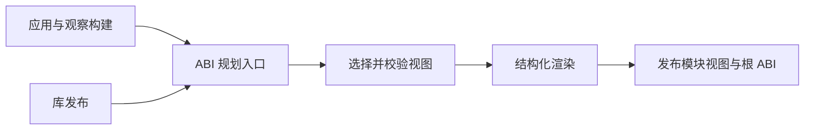

# 应用与库的 ABI 视图自举

## Intent

让应用和库发布共用一条 RX 入口完成 ABI 规划、逐视图渲染和最终交付。
去掉按原生模块分配的临时描述符和指针表。

## Data

批首为 `ee1d7a0e1`。应用经 `build/prepare.zig`，库经
`library/publish.zig` 进入 `cli/abi.zig::render`。原生别名目前由
`cli/abi/input.zig::borrowNatives` 逐行装入两个临时数组。随后 Zig 依次执行
规划、渲染、最终结果写回。核心内存接口已有可空列表列的借用与读取。

## Edges

保持无作用域快速路径、显式空别名与缺失别名的差异、冲突优先级、视图顺序和
输出字节。渲染仍使用现有 genz AST 与统一 printer。规划所需的短期数据保持
原有释放时机，最终视图文本写入结果存储。

## Answer

应用和库共用 `abi/run.rx`，按需选择作用域、规划视图、拒绝冲突并发布
根 ABI 与模块视图。旧 Zig 规划转接与逐模块渲染循环已删除。模块名借用
清单存储，生成名称和路径在交付时进入结果分配器，渲染继续使用 genz 的
结构化 AST 和统一 printer。

清单原生模块直接提供名称列和两列可空别名视图。删除两块随模块数增长的
暂存数组。规划仍在阶段 arena 中执行，发布阶段只有固定大小的参数记录，
没有新增逐模块参数对象分配。失败时返回冲突类型，避免构造占位视图。

两套 Source 引导器对同一正式 CLI 清单生成的 1,235 个文件逐字节一致。
正式安装版使用 Zig 0.17.0 和 ReleaseSmall。首轮安装版编译暴露渲染接口
错误地声明了按值别名切片，已改用引导器生成的指针切片 ABI。编译器侧的
原生联结、借用原生负载通过。修正后的 CLI 通过原生别名、已安装原生包、
原生库发布、编译包及原生生成缓存五个回归目标，总计 91 个构建步骤。

将现有原生包样本的临时副本添加冲突名称，批首与候选都返回
`NativeModuleNameConflict`，诊断内容逐字节一致，发布目录未创建。

### 库发布性能

固定 CLI、批首 CLI 和候选各交错运行七次，禁用应用缓存。RSS 为单进程
峰值，时间为秒。0.00 秒表示计时分辨率下的零读数。

| 场景               | 墙钟（固定 / 批首 / 候选） | CPU（固定 / 批首 / 候选） | RSS 较批首 / 固定 | 相同产物 |
| ------------------ | -------------------------- | ------------------------- | ----------------- | -------: |
| 源码包发布         | 0.01 / 0.01 / 0.01         | 0.01 / 0.01 / 0.01        | −96 / −112 KiB    |       20 |
| 编译包再发布       | 0.01 / 0.01 / 0.01         | 0.01 / 0.00 / 0.00        | −32 / −112 KiB    |       21 |
| 含打包包含目录的包 | 0.01 / 0.01 / 0.01         | 0.01 / 0.01 / 0.01        | −64 / −80 KiB     |       22 |

三组编译库工件 SHA-256 依次为
`2d22462d09f6debb923a6c3d2f98062b80292064b786a544e01250d7b7c71e68`、
`f15832727c2b88ee8664f51895bf9ff42e3447b88710c6e0de8a8d66cd998ab5` 和
`ee1fa3133896f07813e598cd13221473e49b9b0a23988c561097b3dc705a6c88`。

### 应用构建性能

固定 `ZXC_ZIG` 到同一个 Zig 0.17.0，禁用应用缓存，在同一后端缓存中
为三版 CLI 各交错运行五次。表中为墙钟、CPU 和峰值 RSS 的中位数。

| 指标                     | 固定基线 |   批首 |   候选 |
| ------------------------ | -------: | -----: | -----: |
| 墙钟（秒）               |     4.59 |   4.57 |   4.57 |
| CPU（秒）                |     4.64 |   4.62 |   4.63 |
| 采样进程树峰值 RSS（MB） |   365.18 | 364.31 | 362.59 |
| 系统单进程峰值 RSS（MB） |   367.90 | 368.44 | 365.66 |
| CLI 采样峰值 RSS（MB）   |    10.03 |  10.01 |   9.93 |

15 次构建的后端参数只在暂存输出路径上有差异，13 个模块输入逐字节一致，
应用机器代码段 SHA-256 均为
`42b6e7ca6c5e62e71f52a331df057d2da80f43591090ca55aaa760877c2bdac0`。
