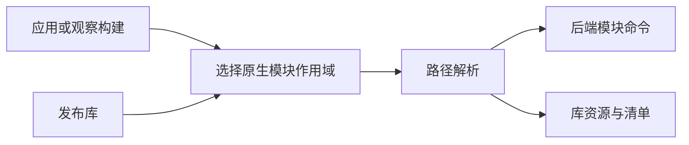

# 应用与库的原生模块准备自举

## Intent

让应用构建、观察构建与库发布共用原生模块作用域和路径解析。让 RX 直接
连接模块选择、ABI 视图查找、源文件或头文件分支及最终发布，移除旧 Zig
查找转接与逐路径遍历。

## Data

批首为 `8dec6ccc9`。应用路径从 `backend/modules/append.rx` 进入
`build/modules.zig::prepareNativeModule`，库路径从 `resources/modules.rx`
进入 `resources.zig::selectNativeModule`。两者通过 `project.zig::nativeScope`
再次调用 Source。应用和库还各有一套原生路径循环。

## Edges

保留首匹配 ABI、包根包含路径和显式路径覆盖的优先级。保持平台路径解析与
原生模块顺序。视图借用现有表，路径只写入最终列表。头文件翻译、文件 I/O
和容器协调仍使用宿主边界。

## Answer

应用构建和库发布的 RX 直接连接模块选择、根路径、包含路径与写回。ZX 从
借用列中选择作用域和首个 ABI 视图，按显式路径、包配置、项目默认值的顺序
选取包含路径，再写入最终路径列表。平台路径操作继续调用 Zig 标准库。

已删除 `project.zig` 的独立查找转接、应用的手写路径循环、库发布的逐路径
回调，以及应用独立的源文件路径转接。两条正式入口复用栈上的模块游标，生成
检查确认没有新增临时对象或路径片段数组的堆分配。

两套已验收的 Source 引导器，对同一正式 CLI 清单生成的 1,211 个文件逐字节
一致。候选由既有 Source 引导器生成，使用 ReleaseSmall CLI 和 Zig 0.17.0。

现有工作区样本的临时副本加入原生依赖、显式包含路径和库路径。固定基线、
批首与候选构建的应用在输入 27 时均输出 `{"left":32,"right":49}`。

正式安装版的七个回归目标共 101 个构建步骤全部通过，覆盖包清单、编译包、
原生包、原生别名、原生库发布、真实后端和 C 头文件观察。后端失败及观察到
头文件删除时保留原结果，恢复后可重新构建。

### 性能与产物

库发布采用固定 CLI、批首 CLI 和本批候选，禁用应用缓存，每个场景各交错
运行七次。墙钟和 CPU 为秒，RSS 为单进程峰值。0.00 秒表示计时分辨率下
的零读数。

| 库发布场景         | 墙钟（固定 / 批首 / 候选） | CPU（固定 / 批首 / 候选） | RSS 较批首 / 固定 | 相同产物 |
| ------------------ | -------------------------- | ------------------------- | ----------------- | -------: |
| 源码包             | 0.01 / 0.01 / 0.01         | 0.01 / 0.01 / 0.00        | 持平 / −64 KiB    |       20 |
| 编译包再发布       | 0.01 / 0.01 / 0.01         | 0.01 / 0.01 / 0.01        | +32 / −16 KiB     |       21 |
| 含打包包含目录的包 | 0.01 / 0.01 / 0.01         | 0.01 / 0.01 / 0.01        | +48 KiB / 持平    |       22 |

三组编译库工件 SHA-256 依次为
`948c5d3f63489c08b8edc534ea70eeb39d9eaccdb54d859e9168e4d98b0bdf78`、
`c7fb0054eb1aac9d1056174c54edb8a770d95270a3ed1a3011aa0b1101b4ec49` 和
`a096e4ddd37dd0457386ea1d25698e5d1d7e4e7fe49851033afa2b88a9e55736`。
包含目录无法完整打包时，固定 CLI 和候选都返回 `IncompleteNativeIncludeBundle`。

首次应用性能测量中，候选的峰值 RSS 较批首高 82.23 MB。采样确认差异出现在
Zig 子进程，解包的工具链路径也存在差异。随后用 `ZXC_ZIG` 为三版 CLI 指定
同一个 Zig 0.17.0，复用同一后端缓存，禁用应用缓存并各交错测量五次。

| 应用构建指标             | 固定基线 |   批首 |   候选 |
| ------------------------ | -------: | -----: | -----: |
| 墙钟中位数（秒）         |     4.53 |   4.52 |   4.52 |
| CPU 中位数（秒）         |     4.58 |   4.57 |   4.58 |
| 采样进程树峰值 RSS（MB） |   366.00 | 364.43 | 363.68 |
| 系统单进程峰值 RSS（MB） |   364.69 | 368.98 | 365.97 |
| CLI 采样峰值 RSS（MB）   |    10.01 |   9.95 |  10.01 |

15 次构建的后端参数除临时输出目录外一致，所有 13 个模块输入逐字节一致。
Mach-O 机器代码段的 SHA-256 均为
`e2e08c3732af7bdf06ad1fa7640867114dccd05bc4da6a84e87e2c80ff102a2d`。
完整二进制还包含每次构建的差异，应用一致性以相同的输入、代码段及运行结果
核对。
