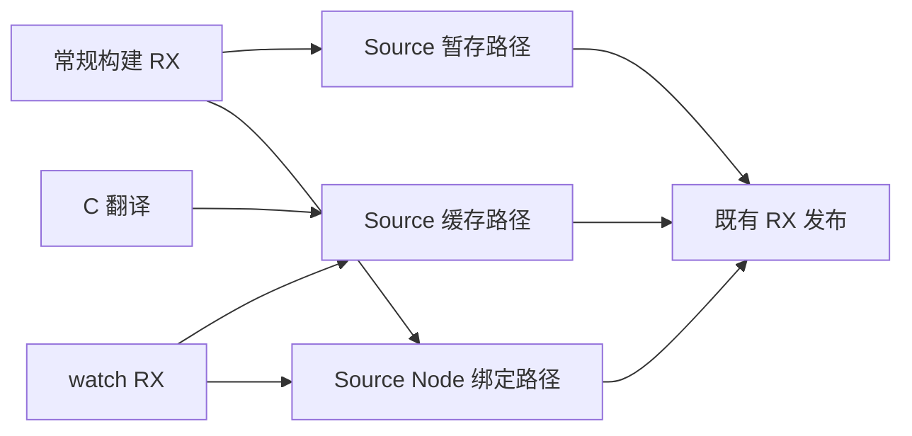
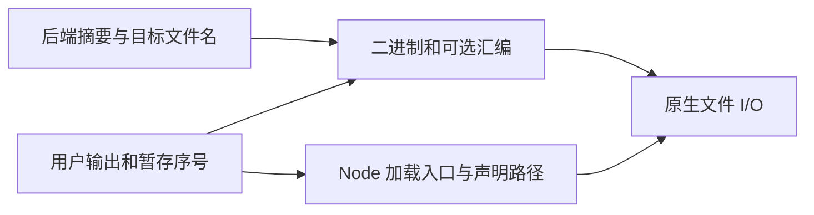

# 应用产物定位自举

## Intent

让 Source 决定常规构建、watch、C 翻译缓存和 Node 绑定的产物路径。退出 Zig 中重复的路径组装，沿用两种发布流程的顺序与保护规则。

## Data

批首为 `fafa0a4c4`。常规构建从 `staged.rx` 进入 `Staged.init`，watch 在后端回执后进入 `Observed.resolveBatches`。C 翻译复用同一缓存目录，Node 绑定两条路径都经过 `node/bindings.zig`。

## Edges

沿用 Zig 目标命名、系统路径规则、随机数和文件 I/O。保留常规发布冲突检查、watch 失败响应只登记依赖、Node 绑定保护及原有发布顺序。C 翻译保留供 Zig 源码引用的正斜杠路径。

## Answer

正式入口的暂存、watch 缓存、C 翻译缓存和 Node 绑定路径均由 ZX 生成。`std.fmt.bytesToHex` 在栈上编码已有摘要。缓存产物在最终字符串中一次写入父目录、摘要和文件名，C 翻译也直接生成完整路径。结果以值传回 Zig，组装过程中无临时堆路径数组。暂存路径在创建目录前全部算好，失败时没有新建的暂存子目录需要回滚。

Zig 仍处理目标解析和平台产物命名、随机数、文件 I/O 与 Node 包装器和声明的生成。暂存发布和 watch 发布继续复用各自 RX 流程，保持诊断和失败保护。两套独立生成的 Source 引导器对最终输入生成 1,256 个逐字节一致的文件。

最终候选通过后端发布、真实后端进程、Node 绑定、C 头文件 watch 和应用 watch 恢复。包含后端路径的 Linux 与 Windows 目标名称、汇编开关和失败回执检查。Node 绑定回归覆盖 TypeScript 声明、异步执行、所有权和旧产物保护。

### 性能与产物

固定对照、批首和候选均用 Zig 0.17.0 运行相同应用，分别重置项目缓存，共用已经准备好的工具链和全局缓存。候选是由已自编译的 Source 引导器生成的 ReleaseSmall CLI。三套 CLI 初次执行均输出 5，编辑后均输出 11，两轮产物的本机机器代码段逐字节一致。

| watch 指标         | 固定对照 |   批首 |   候选 |
| ------------------ | -------: | -----: | -----: |
| 首次构建墙钟（秒） |     5.18 |   5.22 |   5.16 |
| 编辑后墙钟（秒）   |     5.51 |   5.47 |   5.47 |
| 两轮 CPU（秒）     |     9.27 |   9.28 |   9.25 |
| 单进程峰值（MB）   |   363.87 | 366.08 | 363.13 |

| 常规构建含汇编   | 固定对照 |   批首 |   候选 |
| ---------------- | -------: | -----: | -----: |
| 构建墙钟（秒）   |     6.55 |   6.54 |   6.55 |
| CPU（秒）        |     6.60 |   6.59 |   6.61 |
| 单进程峰值（MB） |   380.80 | 379.86 | 380.32 |

三版均生成相同的应用机器代码。汇编仅归一化调试文件指令中的工作区和后端缓存摘要，归一化后逐字节一致。使用含空格的输出目录成功发布，等价的二进制与汇编路径仍被拒绝，已有产物保留，暂存目录无残留。性能数据为本轮应用路径的单次对照。
