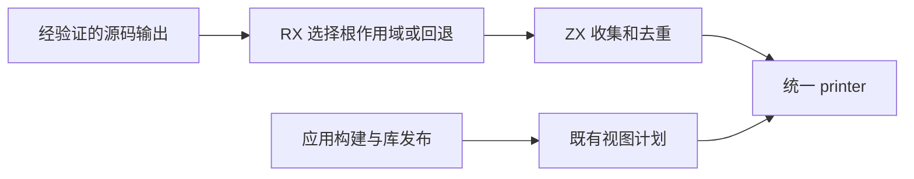
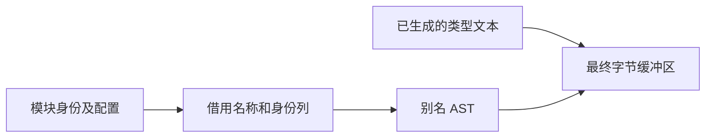

# 根 ABI 选择与打印交付

## Intent

让正式编译入口用 RX 决定根 ABI 的作用域与回退。让应用和库发布从统一
printer 直接交付根 ABI 文本，省去独立的别名文本缓冲区及其拼接。

## Data

批首为 `7882d3835`。`verified_compile.zig` 通过两个生成入口完成
作用域检查和别名收集，Zig 在两次调用之间选择配置。应用和库经
`cli/abi/run.rx` 规划视图，生成根视图后由 Zig 拼接类型文本。

## Edges

保持第一个精确匹配作用域及无匹配时的全局配置回退。区分没有作用域身份
和有作用域身份但没有别名。维持接口和外部声明顺序、冲突处理及生成字节。
应用和库的既有作用域选择规则独立保留。沿用结构化 AST 和统一 printer。

## Answer

经验证的源码输出由 `source_abi/select.rx` 判断模块身份、选择作用域、
收集并去重。删除独立规划入口和 Zig 的作用域选择转接。命中的作用域与
全局配置共用列表列读取。无作用域身份时保持空结果。应用和库通过统一
printer 直接把根视图追加到含有类型正文的结果缓冲区。

两套 Source 引导器对同一份正式清单生成的编译器 6,359 个文件与 CLI
1,235 个文件逐字节一致。安装版 `--out` 在双子包工作区根目录及两个
子包目录输出了完全相同的入口和 ABI 文件。根目录保留空别名命名空间，
两个子包各自得到 `zig:bridge`，仍绑定各自的规范身份。

ReleaseSmall 安装版由上一套 Source 引导器构建，执行 Source 编译器、
根作用域选择与统一 printer。原生联结、声明、原生运行、借用负载、
生成缓存、别名、原生包、原生库发布和编译包九个目标通过，构建汇总为
160 个步骤、141 项测试。

### 性能与产物

固定 Zig 0.17.0，禁用应用缓存。三套安装版各交错构建五次，采用中位数。
13 个后端模块输入和机器代码段在 15 次构建中逐字节一致。生成程序输入 3 时
均执行两路原生调用，候选结果为 `{"left":8,"right":25}`。

| 指标                     | 固定基线 |   批首 |   候选 |
| ------------------------ | -------: | -----: | -----: |
| 墙钟（秒）               |     4.66 |   4.65 |   4.66 |
| CPU（秒）                |     4.71 |   4.70 |   4.71 |
| 采样进程树峰值 RSS（MB） |   367.66 | 364.33 | 361.69 |
| 系统单进程峰值 RSS（MB） |   368.25 | 367.10 | 368.12 |
| CLI 采样峰值 RSS（MB）   |    10.01 |   9.96 |   9.93 |

三个库发布样本各交错运行七次，三套安装版墙钟和 CPU 中位数均为 0.01 秒，
63 个发布文件逐字节一致。候选较批首的单进程峰值 RSS 分别变化
+32、−16、−32 KiB。子包 `--out` 各交错运行 25 次，生成的入口和
ABI 文件一致，三版墙钟中位数均为 2.93 毫秒。

应用机器代码段 SHA-256 为
`910a479dcb43307384c929f2947c6ef83adf69df3a7b43e2b2dab7999a807917`。
保留原生打印接口和 seed 路径，Source 的 CLI 不再单独渲染并拼接别名正文。
