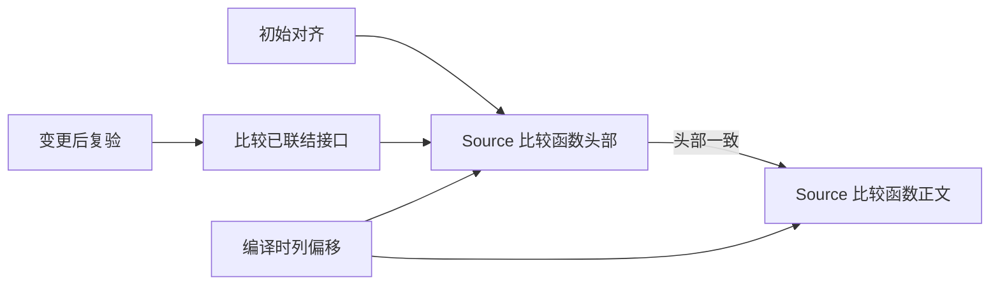
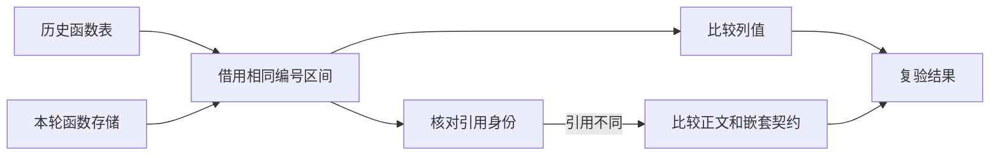

# 混合历史函数区间比较自举

## Intent

让混合项目的初始对齐和重放复验直接执行 Source 函数表比较，移除两次 Zig
比较分派和临时函数表视图。联结比较复用现有的具名类型导出视图，并与正文
发布共用 Store 初始化器的字节行。

## Data

批首为 `f7babb220`。初始对齐检查函数头部，变更后的模块先检查联结，
再比较该模块的函数头部与正文。现有头部比较按列处理字节、标签、可空编号、
文本和原生声明，正文先比较引用区间，失配后按行逐张表比较，并核对嵌套契约。

## Edges

保留空区间、联结失配、头部失配和引用共享的快速返回。按编译时的字段偏移
借用历史函数表和增长中的函数存储。借用沿用原列的存储和有效期。初始 seed
沿用先前的引导入口。

## Answer

沿正式入口核对已删除的比较回调和生成入口。用现有混合项目、Store、编译库
和 seed 回归验证，集中核对相同输入的生成产物和受影响的增量路径。

## 实现

初始对齐和复验直接调用共用的 Source 头部比较。复验命中联结、头部与引用
比较后再决定是否重用。正文和编译库初始化器比较共用静态列描述。将描述的
类型标签、原生偏移、元素宽度和标签掩码分别存为标量列，使生成的借用入口
可直接传递切片；嵌套对象数组的初次实现会物化描述符数组，本批调整后的
最小闭包中，相关生成代码使用现有切片，已消除该转换分配。

旧的头部和正文比较回调、`comparison.zig` 及两个独立生成入口均退出正式
调用链。历史链接仍由宿主借用联结结果，其中类型导出使用通用具名行视图，
Store 初始化器与源码发布共用按字段偏移借用字节行的实现。

## 验证

Source 372 项、seed 39 项、项目、编译库及缓存 209 项、磁盘 CLI 与 Store
17 项回归通过。以相同的五份清单分别运行批首和候选 Source 引导器，17,712
个生成文件逐字节一致。比较排除输入快照戳。

常驻 Source 对同一输入做两次合法正文编辑，再恢复原文。每次编辑重分析
2 个模块、复用 4,091 个模块。候选和批首在各次编辑及恢复后的产物哈希一致。
编辑墙钟中位数从 0.150 秒降至 0.148 秒，CPU 均为 0.345 秒，编辑采样
RSS 从 626.5 MB 降至 617.5 MB。

使用 `826d6602d` 的 Source 引导器生成候选，再由候选运行 Source 分析与
生成。Zig 0.17.0、ReleaseSmall、16 分区，固定输入三轮交错中位数。
冷生成墙钟从 1.90 秒降至 1.87 秒、CPU 从 9.35 秒降至 9.31 秒。
进程树采样峰值增加 4.8 MB，单进程峰值增加 15.0 MB。热生成墙钟从
1.43 秒降至 1.42 秒、CPU 从 6.21 秒降至 6.19 秒。较固定基线，冷
墙钟少 0.17 秒，CPU 多 0.34 秒，进程树采样峰值少 216.7 MB。固定清单
产物对照一致。

全仓手写 Zig 新增 230 行、删除 233 行，净减 **3 行**。非 seed 包源码
新增 230 行、删除 231 行，净减 **1 行**。从固定起点 `4c11902b6` 起，
两项累计净减 **2,031 / 3,431 行**。沿用 11 月 24 日 08:40 回查的起点
`970ba1a5c`，两项仍净增 **1,739 / 191 行**。候选引导器 SHA-256 为
`1d0bb3397e3139a18b64d372a24777121f53594a29fdc5248522408ab95ffad7`。
