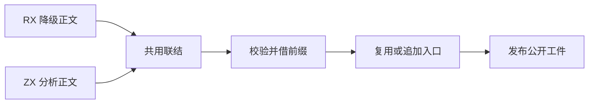
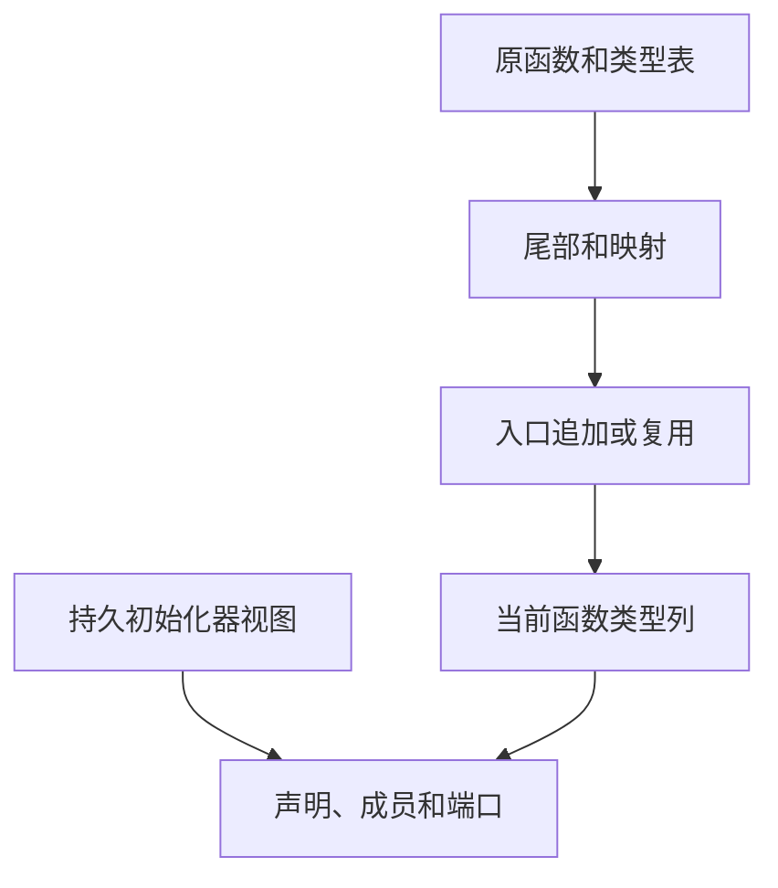

# 混合正文入口与工件联结自举

## Intent

从 `25b867990` 接续。收口混合项目中 RX 和 ZX 正文公用的函数前缀、Store 初始化器视图和公开工件发布。让入口函数选择、追加及结果提交由 Source 串联，并删去已无用途的独立生成入口。

## Data

`mixed/body/link.zig` 为两个正式入口准备已验证的函数和类型前缀，按需留存初始化器视图，再走 `source_link.appendBodyInto`。共用的 `source.finish` 先通过生成入口选择与追加入口函数，再调用另一生成入口写公开声明、初始化器、成员和端口。后一步使用追加完成后的函数列。

## Edges

保留错误顺序、前缀验证、已链接模块的初始化器切片寿命及诊断位置。追加可能使存储移动，公开端口在追加后读取实体列。seed 继续使用现有原生兼容路径。

## Answer

从 Source 模式的正文联结和编译库发布验收。核查正常返回、类型模块、入口函数复用、跨模块调用、Store 和出错前缀。用相同清单及固定基线对照生成和性能。

共有的工件发布流程接入已有入口选择规则。选择复用时直接发布已有函数号，需要新增时执行一次物理追加，再发布声明、初始化器、成员和端口。函数列由存储字段借用，端口读取看到追加后的切片。入口候选的正文和末行共用同一借用结构，删除独立生成入口和两次调用之间的 Zig 分派。

混合正文 RX 根据两个初始化器长度判断是否刷新持久视图，按正文来源决定是否使用共享初始化器。联结失败由 RX 选择诊断，成功才提交验证行和结果标记。宿主执行物理视图复制与工件行追加，诊断位置直接由调用者传入。临时验证和入口元数据继续借原列，不产生临时堆分配。

后续从共享前缀后的工件追加与导入选择推进。两类调用仍由 Zig 持有函数尾部、类型映射和导入结果，优先消除可以与现有 Source 选择和列发布一起退出的中间状态。

### 行为与引导验证

- 批首 Source 工具生成候选。正式引导通过 35 个步骤与 372 项编译器测试，初始 seed 通过 53 个步骤与 39 项 RX 测试。
- 两套工具在五份同输入清单上生成的 17,718 个文件逐字节一致。候选 SHA-256 为 `6d0c2f8bba8423953ef3db8c6d819022116ff8de8cdc5bc8055f9d5a5a7d3c0c`。
- 定向生成检查覆盖混合正文联结的 `executeIn` 和工件发布的 `executeValue`，两条实际调用链均未生成临时结构分配。物理追加与持久声明仍按原要求分配。
- 209 项应用、库联结与边界回归通过。17 项磁盘项目及 Store 命令行检查通过。
- 原有 RX 项目宿主声明文件已经超过默认长度。该文件本批只改联结接口的参数，lint 使用 `--max-lines 0` 检查其余规则，接口也经正式引导生成和应用测试验收。

### 性能

三套工具均由 Source 引导器生成，运行各自的 Source 分析与生成。固定输入、16 个分区，关闭常驻生成器，三轮交错取中位数。候选和批首的 9,894 个固定清单生成文件及所有权 memo 一致，各工具的冷、热输出分别一致。

| 对照     | 冷生成墙钟 | 冷生成 CPU | 冷进程树峰值 RSS | 冷系统单进程峰值 RSS | 热生成墙钟 | 热生成 CPU |
| -------- | ---------: | ---------: | ---------------: | -------------------: | ---------: | ---------: |
| 固定基线 |     2.10 s |     9.05 s |        737.59 MB |            761.45 MB |     1.64 s |     6.45 s |
| 批首     |     1.94 s |     9.45 s |        516.82 MB |            544.62 MB |     1.44 s |     6.26 s |
| 本批     |     1.96 s |     9.43 s |        516.49 MB |            536.64 MB |     1.43 s |     6.28 s |

较批首，冷墙钟增加 0.02 秒、CPU 减少 0.02 秒、采样进程树峰值减少 0.33 MB、系统单进程峰值减少 7.98 MB。热墙钟减少 0.01 秒、CPU 增加 0.02 秒。无修改生成墙钟同为 0.03 秒。较固定基线，冷墙钟减少 0.14 秒、CPU 增加 0.38 秒、进程树采样峰值减少 221.10 MB。本次回测覆盖引导生成阶段。
