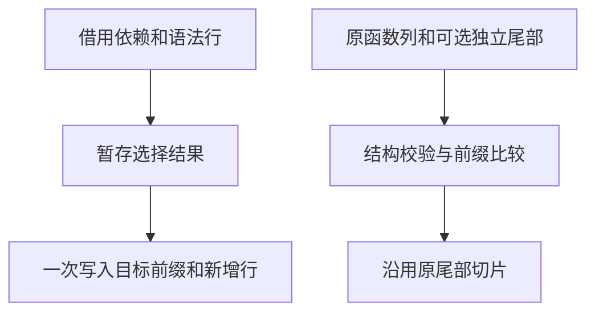

# 混合正文导入与函数尾部自举

## Intent

从 `15ef2667c` 接续，在正式混合项目路径由 Source 执行依赖符号选择、导入和再导出写入。把共享函数前缀的实际列比较接入 Source 的尾部选择，保持调用导入与正文联结使用同一校验。

## Data

批首的索引导入由 ZX 循环逐条回调 `selectMixedImport`，Zig 装载依赖并执行 `binding/bind.rx`，再回传选择与借用行。解析缓存也可以复用原生布局的语法树，这条路径使用独立的 Zig 循环选择、预留和追加。混合正文和 RX 调用通过 `function_table.extend` 执行尾部选择及独立的前缀比较。

## Edges

保留类型导入跳过、库加载、错误优先级、原有位置和所有权。选择结果在暂存区，导入与再导出的绑定名及新增行由原有持久分配器拥有。函数表长度和结构检查通过后才访问前缀数据，快路径保持指针相同即沿用。

## Answer

两种解析布局共用混合导入和再导出的 Source 流程。保留独立 seed，退出正式路径的 Zig 选择回调和逐行写回、单独的绑定生成入口及尾部前缀判定。使用同一 Source 引导配置验证混合项目、库联结、错误路径、生成文件一致性和固定性能基线。

## 当前验证

两种解析布局都由 `collect.rx` 驱动，`step.rx` 直接调用共用符号选择流程。宿主只解析依赖位置、装载依赖并借出语法和成员行。选择结果暂存在原有 scratch 区域，导入和再导出的绑定名字及新增行由原有结果分配器持有。选择和写入期间借用成员表，保留原有名字以外的字段。函数尾部选择在结构检查之后复用 Source 前缀扫描，相关的原生宿主继续提供列视图。

旧 `selectMixedImport`、正式路径调用的 `collectSeed` 和原生逐行预留、追加方法退出。删除 `project_binding` 独立生成入口，借用结构直接来自既有的 `project_binding_delivery` 接口。seed 原生选择照常执行，并共用一次预留和逐行发布实现，分别保留既有命名空间规则。

开发中，初版生成代码在宿主填充借用行以前尝试构造数组，候选重生成崩溃。修正后宿主装载依赖时返回已初始化的借用行，RX 取得结果再写入。正式 Source 构建通过 372 项测试，初始 seed 验证通过 39 项。209 项应用与库回归、17 项 CLI 与 Store 集成通过。相同输入下五份清单的 17,728 个生成文件逐字节一致，比较跳过输入快照戳。

用 `15ef2667c` 的 Source 引导器生成候选，再由候选走 Source 分析和生成执行冻结清单。Zig 0.17.0、ReleaseSmall、16 分区，三轮交错中位数。较批首，冷生成墙钟从 1.95 秒降至 1.92 秒，CPU 从 9.43 秒降至 9.31 秒，进程树采样峰值减少 4.2 MB，系统单进程峰值增加 6.5 MB。热生成墙钟从 1.44 秒降至 1.43 秒，CPU 从 6.26 秒降至 6.20 秒。较固定基线，冷墙钟减少 0.17 秒、CPU 增加 0.31 秒，进程树采样峰值减少 221.4 MB。冷暖与前一版本的固定清单比较覆盖 9,894 个相同文件。

全仓 Zig 净减 10 行，非 seed 包源码 Zig 净减 18 行。连续两批分别净减，固定起点的两项累计均净减，两日统计的累计增量仍待消化。候选引导器 SHA-256 为 `3bbf3f59ad4227a47262934b9a0b7481b14958b5a212d320f1671fcd698f9437`。[净减记录](../手写Zig净减少长执行计划.md)

下一批沿混合正文的状态写回与增量重放路径继续。`mixed/reuse.zig` 已将初始对齐和分析后登记交给 Source，仍分别经 `history/start.zig`、`history/record.zig` 和 `history/snapshot.zig` 准备或写入前缀。优先统一借用边界与检查点写入，退出专用检查点生成入口和原生回接。保留分析失败与匹配失败各自的重放顺序。
