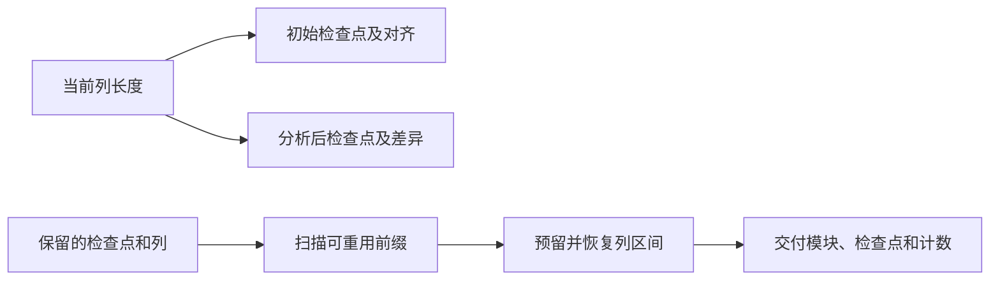
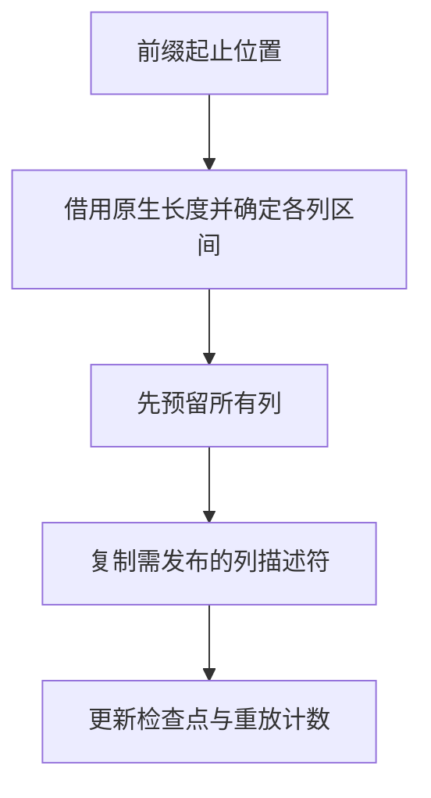

# 混合正文检查点与前缀重放自举

## Intent

从 `7eb238a3e` 接续，迁移混合分析的检查点记录和前缀重放。将正式路径上的长度捕获、区间选择、列恢复和检查点交付接入 Source。

## Data

正式入口从 `mixed.zig` 进入 `Reuse.begin`、`Reuse.analyzed` 和 `Reuse.reuse`。初始化与分析后登记分别调用专用的 Zig 检查点生成适配。重放先得到可用前缀，再由 Zig 按检查点裁切类型、来源和函数列，通过两个独立生成入口恢复表和发布元数据。按字宽选择的单行与批量判断还有各自的宿主入口。

## Edges

列描述符借用保留分析与当前表。按原生字宽读取检查点，保留已有源码摘要和 Store 结构比较。恢复先为整组预留，再写入引用和长度。只有恢复成功才发布保留模块与计数；错误沿原分配失败路径向上返回。

## Answer

退出专用的检查点调用、单行重放判定和 Zig 区间分派。核对未命中、失败及重放后的模块行为，集中运行 Source、seed 和缓存回归，并对照固定冷暖性能与生成产物。

## 实现与验证

`start.rx` 和 `record.rx` 共享检查点捕获，分别在对齐校验和登记前写入。对齐准备借用当前列尾和已有范围，不需要返回 Zig 读取刚写入的检查点。恢复入口依次运行前缀选择、整组预留和列写入，再发布模块表、检查点和计数。列转移描述符在初始对齐通过时绑定一次，重放从同一份保留长度视图计算范围。保留列中引用的底层负载由原有分析内存持有。

删除独立的 `rx_history_snapshot`、`rx_mixed_history_reuse`、`rx_mixed_history_advance`、`rx_mixed_history_publish` 入口。批量重放与并行候选筛选复用同一前缀判断，原生字宽由 `ReadColumn` 和 `WriteColumn` 表达。Zig 仍绑定现有列和分配器，初始 seed 保有旧流程。

Source 372 项、seed 39 项、应用与库 209 项、CLI 与 Store 17 项检查通过。五份同输入引导清单的 17,714 个生成文件逐字节一致，跳过输入快照戳。另尝试构建 `x86-linux` 引导器，编译停在本批范围之外的 64 位原子操作、libc 配置及可选整数转换问题，该目标的运行验证尚缺。

使用 `7eb238a3e` 的 Source 引导器生成候选，再由候选执行 Source 分析和生成。Zig 0.17.0、ReleaseSmall、16 分区，固定清单三轮交错中位数。较批首，冷生成墙钟从 1.93 秒降至 1.92 秒，CPU 从 9.42 秒降至 9.34 秒，进程树采样峰值减少 6.9 MB，单进程峰值增加 5.8 MB。热生成墙钟同为 1.44 秒，CPU 增加 0.01 秒。较固定基线，冷墙钟减少 0.18 秒、CPU 增加 0.30 秒、进程树采样峰值减少 219.2 MB。固定清单 9,894 个文件一致。

常驻清单对同一 ZX 函数执行两次函数体编辑，再恢复初始内容。每次编辑，批首和候选均重分析 2 个模块、重用 4,091 个模块，只重新生成一个文件。各快照哈希在两工具间一致，恢复后的哈希与初始相同。编辑墙钟中位数为 145.3 → 146.1 毫秒，服务 CPU 同为 0.345 秒，服务采样 RSS 中位数增加 2.1 MB。固定基线同场景墙钟 298.1 毫秒、服务 CPU 0.525 秒。

本批全仓 Zig 新增 241 行、删除 326 行，净减 **85 行**。非 seed 包源码新增 240 行、删除 322 行，净减 **82 行**。固定起点 `4c11902b6` 到本批，全仓、非 seed 包源码分别累计净减 **1,938**、**3,340** 行。两日比较起点 `c1726aca3` 至本批仍分别净增 **2,438**、**861** 行。候选引导器 SHA-256 为 `267ab0c9736102b460f76cc786dd35690c3e8fe45ddfd361572206b08047946b`。
