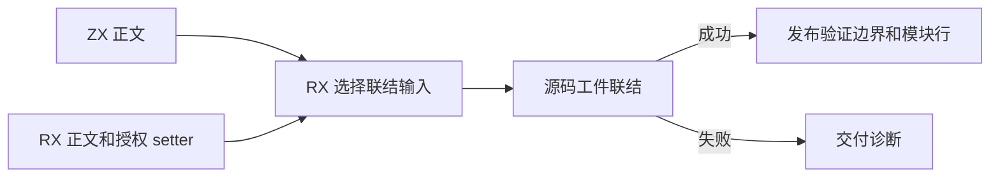

# 混合正文联结和共享初值自举

## Intent

让混合正文复用源码工件联结的原子入口。RX 明确选择函数前缀、Store
初始化器和诊断，成功后发布验证边界。让已发布的初始化器前缀直接借用
项目存储，去掉混合正文的整表快照及专用效果回调。

## Data

批首为 `504905d00`。顺序、并行完成以及授权 setter 的正文均通过
`mixed/body/link.zig`。它调用通用源码工件联结前会重建函数和初始化器视图。
只有导入编译库会追加项目初始化器，原有前缀发布后保持只读。

## Edges

初始化器增长发生在链接库之前。追加写入未发布区间，原前缀随结果 arena
保留。延续原有重编译判断、错误优先级、资源失败传播和验证边界发布时机。

## Answer

沿三个正式正文入口核对原 Zig 路径和快照退出。用现有工程、编译库、
Store 和增量回归检查结果、资源错误和发布顺序，集中配对测量。

## 实现

混合项目借用签名期初始化器，标记这段容量已全部使用。编译库先预留
未发布的尾部，再在联结成功后追加。需要增长时按原容量公式分配并搬运
已发布行，先前的缓冲区由项目 arena 持有，供已联结的工件继续借用。
这使正文可以按调用时的前缀直接发布，移除 `retained_initializers`、
打开阶段的重复复制和正文阶段的刷新快照。

RX 选择函数前缀、类型边界和初始化器来源，联结成功后写入已验证长度
和结果可见位。联结失败由 RX 选择原有诊断，宿主使用原位置写入已有
诊断槽。源码工件联结借当前函数表和正文尾部，原始输入保持只读。
移除 `appendMixedBodyLink`、`rejectMixedBodyLink` 以及仓库内无调用方
的旧源码联结入口。物理列绑定和工件构造仍通过源码工件联结入口执行。

## 验证

Source 372 项和 seed 39 项回归通过。项目推导、编译库、链接边界、语义
缓存、磁盘 CLI 和 Store 目标全部通过，末次运行的 117 个构建步骤成功，
含 71 项本轮执行的 Zig 测试及 17 项 CLI 与 Store 检查。编译库覆盖同实例
共享、不同实例隔离、初始化器再发布和逐次分配失败清理。

批首与候选使用相同的五份清单，17,710 个生成文件逐字节一致。比较跳过
输入快照戳。

以 `504905d00` 的 Source 引导器生成候选，再由候选运行 Source 分析和
生成。Zig 0.17.0、ReleaseSmall、16 分区，固定输入三轮交错中位数。
冷生成墙钟从 1.93 秒降至 1.91 秒，CPU 从 9.46 秒降至 9.37 秒。
进程树峰值变化小于 0.1 MB，单进程峰值增加 7.7 MB。热生成墙钟从
1.45 秒降至 1.44 秒，CPU 从 6.29 秒降至 6.22 秒。较固定基线，冷
墙钟减少 0.17 秒，CPU 增加 0.33 秒，进程树峰值减少 219.3 MB。
固定清单的 9,894 个文件一致。

常驻工具对同一函数执行两次有效正文编辑并恢复。每次编辑重分析 2 个
模块，复用 4,091 个模块。候选各步哈希与批首一致，恢复后哈希与初始
相同。编辑墙钟中位数从 149.8 毫秒降至 147.2 毫秒，CPU 从 0.350
降至 0.345 秒，采样 RSS 从 631.8 MB 降至 627.7 MB。

全仓和非 seed 包源码均新增 100 行手写 Zig、删除 117 行，净减
**17 行**。固定起点 `4c11902b6` 至本批，两项分别净减 **2,048 /
3,448 行**。沿用 11 月 24 日 08:40 对照起点 `970ba1a5c`，两项仍
净增 **1,722 / 174 行**。引导器 SHA-256 为
`d66c511952c46038265a5b535a53d38a280f12ab3d10a6b05d0aa26be0428178`。
