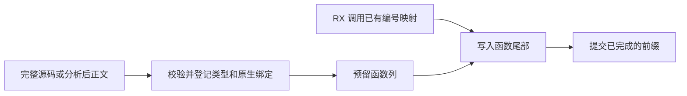
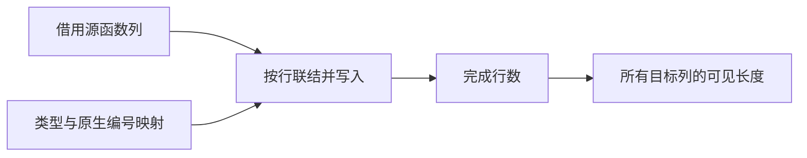

# 源码联结与函数尾部事务自举

## Intent

由同一条 RX 调用链执行源码联结的类型登记、函数尾部预留、填充和长度提交。
普通源码工件与 RX 调用的函数尾部复用同一个发布入口。

## Data

批首为 `5daafa3da`。`source/workflow/host.zig` 先运行准备入口，再组装
函数与原生编号映射并启动另一生成入口。函数发布在本轮保留区写入每行，
宿主按完成数更新可见长度。

## Edges

保持 IR 验证、类型登记、原生绑定和列分配的顺序。完整写入一行后才增加
完成数。准备使用临时区，函数负载使用结果区，准备临时区在填充前释放。
写入失败时提交已经完成的前缀，容量错误沿原错误通道返回。

## Answer

核对旧宿主分派及独立生成入口实际退出，对照生成产物、分配失败回归、
冷暖生成和增量编辑，记录手写 Zig 净变化。

### 正式路径

`source_link_publication` 取代准备、批量函数、单入口函数和 Store 初值写入
四个生成入口。类型和原生模块登记直接写入后续阶段借用的编号映射。RX 在列
预留后释放准备区，并按已完成行数提交长度。原生宿主只借用列、绑定分配器，
并在异常退出时提交已写完的前缀。删除 `artifact/materializing/publication/host.zig`。

发布帧中所有被引用的对象存活至生成入口返回，默认空列指向静态表。这个约束
覆盖原生函数、Store 初值和错误清理路径。五份相同输入清单的 17,709 个生成
文件逐字节一致。Source 编译器 372 项和初始 seed 39 项通过。

最终应用验收通过 209 项 Zig 回归和 33 项 CLI 集成，覆盖编译库联结、RX 推导、
模块边界、Store 和语义缓存。候选以 `5daafa3da` 的 Source 工具生成，随后用
候选工具对五份清单重新生成。候选引导器的 SHA-256 为
`d881cd56930db90f8786766d487b69fc98033c88f7a6a0959740070249736308`。

### 性能回测

Zig 0.17.0、ReleaseSmall、16 分区，固定清单的三组交错测量取中位数。批首、
候选和固定基线均为 Source 生成的引导器，固定基线沿用声明准备批次。候选与
批首在该清单上另有 9,894 个生成文件一致。

| 指标                      |      批首 |      候选 |  固定基线 |
| ------------------------- | --------: | --------: | --------: |
| 冷生成墙钟                |   1.96 秒 |   1.98 秒 |   2.09 秒 |
| 冷生成 CPU                |   9.49 秒 |   9.39 秒 |   9.02 秒 |
| 冷生成进程树 RSS 采样峰值 | 522.13 MB | 520.22 MB | 737.43 MB |
| 冷生成系统单进程峰值      | 535.82 MB | 537.10 MB | 774.32 MB |
| 热生成墙钟                |   1.44 秒 |   1.45 秒 |   1.67 秒 |
| 热生成 CPU                |   6.28 秒 |   6.26 秒 |   6.45 秒 |
| 无修改生成墙钟            |   0.03 秒 |   0.03 秒 |   0.04 秒 |

常驻正文编辑的墙钟中位数从 147.7 增至 149.9 毫秒，CPU 从 0.345 增至
0.350 秒，采样进程树峰值从 604.79 降至 601.50 MB。每次编辑重分析 2 个模块、
复用 4,091 个模块，恢复结果与各工具首次生成一致。

原始记录位于 `.zig-cache/verification-tmp/source-tail-publication/`，包括
`source-stage-verified.log`、`seed-final.log`、`application-verified.log`、
`final-generation.log`、`frozen-perf.log` 和 `resident-edits.log`。
