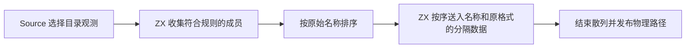

# 目录观测与文件摘要自举

## Intent

让普通目录和工作区目录的观测共用一个正式的 Source 流程，迁出目录枚举、
成员筛选和摘要输入的遍历。共享文件观测与库发布的文件读取和散列原语。

## Data

批首为 `411233347`。`observation/read.rx` 分别进入 `watch/directory.zig`
和 `package/workspace/directory.zig`，两处重复枚举、复制成员名、排序和散列。
文件观测与库清单分别维护相同的固定缓冲流式读取。

## Edges

普通目录仍以原始名称排序，按名称、零分隔符和原生文件种类编码散列。
工作区只记录未忽略的子目录，摘要仍只有名称和零分隔符。操作系统迭代器
的名称只借用至下一次读取，保留的名称复制一次。兼容非 UTF-8 名称、符号链接、
任意目录大小和原始错误。保留 Zig 标准库排序与流式散列实现。

## Answer

普通目录和工作区目录经 `observation/read.rx` 进入同一目录流程。RX
连接收集、排序、送入散列三步。ZX 遍历所借用的目录迭代器，复用工作区
忽略规则并确定行编码。删除两套 Zig 目录摘要、独立工作区过滤入口及
文件观测和库清单之间重复的流式散列。保留的目录宿主操作是系统迭代器、
持久化一行所需的字节分配、标准库排序和 SHA-256。

目录名和末尾编码写入同一段内存。列中只保留一个切片，排序仍仅比较名称
部分，送入散列时每项一次更新。生成的收集与散列循环没有堆分配指令。
首次 ReleaseSmall 核验发现栈上目录引用经匿名元组传入闭包时被错误优化。
正式流程使用具名输入，并只在循环捕获该输入。独立的 ReleaseSmall 探针
核对修复，避免在每次生成变化后重新构建完整 CLI。

两个目录夹具各以两种模式对比旧实现在收集后的摘要。第一个含同名前缀、
符号链接、忽略项及非 ASCII 名称，第二个含 1,500 项。四份 SHA-256
全部一致。测试环境的文件系统拒绝创建无效 UTF-8 名称，当前实测覆盖
原始 ASCII 字节、非 ASCII 名称和排序前缀边界。

正式 ReleaseSmall CLI 使用 Zig 0.17.0 与已经自编译的 Source 引导器生成，
运行 Source 观测流程。正式构建与两套 Source 引导器的 52 个生成文件逐字节
一致。最终候选通过后端发布、库 watch、C 头文件 watch、包安装 watch，
包清单与工作区查询组使用修正前的候选通过，修正范围是目录摘要调用接口和循环。

### 性能与产物

同一个 ReleaseSmall 验证程序交错执行旧、新摘要，每次处理同一个
1,500 项目录 120 次，各测七次。完整目录的墙钟和 CPU 中位数分别均为
0.05、0.04 秒，RSS 峰值中位数从 2,192 KiB 降至 2,144 KiB。
工作区目录的墙钟、CPU 与峰值 RSS 中位数持平，分别为 0.04 秒、0.03 秒
和 1,984 KiB。

固定对照沿用上一批安装版。三种禁用缓存的库发布各交错测量七次，三版的
墙钟中位数均为 0.01 秒，63 个发布文件逐字节一致。候选峰值 RSS 较批首
分别变化 0、−32、−16 KiB。

三个安装版各交错执行五次库 watch。编辑前和编辑后各有 20 个发布文件在三版
间逐字节一致。以下为中位数。

| 指标                 | 固定对照 |   批首 |   候选 |
| -------------------- | -------: | -----: | -----: |
| 首次发布墙钟（毫秒） |    22.86 |  22.74 |  23.49 |
| 编辑至再发布（毫秒） |   404.98 | 404.23 | 396.70 |
| CLI CPU（毫秒）      |    66.49 |  67.51 |  67.26 |
| CLI 峰值 RSS（MiB）  |    13.70 |  13.53 |  13.42 |
