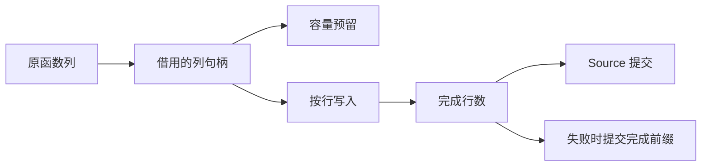

# 编译库类型与公开接口发布自举

## Intent

将类型尾部、原生模块、函数和公开接口的发布次序交给同一条 RX 流程。
完整联结、增量导入与 RX Call 的签名装载共用这条路径。

## Data

批首为 `7e8985e0c`。`compiled/host/root.zig::loadPrepared` 取得 Source
联结计划后进入 `host/publish.zig::apply`。旧宿主先执行独立准备入口，随后
构造函数和接口视图，执行另一生成入口，并在离开宿主时提交函数列长度。
函数容量预留和函数写入分别绑定了同一组物理列。原生模块按行发布时还经过
独立的读取、单行编排和游标生成，部分临时描述符由准备期分配器持有。

## Edges

保留类型尾部和原生模块的提交时机、函数分配的拥有者和公开接口省略模式。
准备期使用原暂存分配器，准备完成后 Source 切换到原来的函数分配器。
准备阶段失败按原路径报告内存不足。进入物化后沿用原有错误分类。普通成功
在 Source 交付函数长度，异常解绕只提交写完的前缀。类型字符串已提交时，
类型进度归零，未提交的字符串由原释放路径回收。

## Answer

正式安装入口合并准备和发布，移除独立准备生成入口及 Zig 的阶段调用。
函数预留复用写入所持有的列句柄。普通原生联结和编译库安装复用同一个
ZX 循环，按原顺序重映射每行编号、持有名称并发布字段。移除原生发布时
独立的读取请求、单行编排和循环推进。

从生成的准备路径追踪到分配点，原生行的 RX 循环曾为游标和阶段参数创建
临时对象。较初版合并路径，准备子图的直属临时分配点由十处降为五处。
剩余描述符仍随准备期暂存释放。

### 验收

- 372 项正式 Source 编译器回归、39 项初始引导配置的 RX 回归通过。
- 210 项应用回归和 9 项项目 CLI 回归通过。应用回归覆盖编译库导入与
  原生模块冲突、Store 初值、分配失败时的回收与 RX 推导。
- 用批首引导器和本批新生成的引导器读取同一份候选源码。main、execution、
  host、collections、growth 的 17,697 个文件逐字节一致。
- 非 seed 包源码 Zig 新增 36 行、删除 50 行。全仓 Zig 新增 36 行、删除
  51 行。固定起点 `4c11902b6` 至本批，两项累计净减 3,529 / 2,183 行。

### 固定输入性能

候选工具由批首 Source 引导器构建。实际测量使用各工具的 Source 分析和生成，
采用固定清单 `genz-inline-publication/compatible-manifest.json`、16 分区和
ReleaseSmall，关闭常驻生成器。三轮交错运行取中位数。进程树 RSS 为采样峰值，
单进程 RSS 为系统峰值，内存单位为 MB。这组测量覆盖生成阶段。

| 工具                    | 冷生成墙钟 / CPU（秒） | 热生成墙钟 / CPU（秒） | 无修改墙钟（秒） | 冷进程树 / 单进程 RSS（MB） |
| ----------------------- | ---------------------: | ---------------------: | ---------------: | --------------------------: |
| 固定 Source 对照        |            2.08 / 8.95 |            1.63 / 6.37 |             0.04 |             737.62 / 760.10 |
| 批首 Source `7e8985e0c` |            1.91 / 9.33 |            1.39 / 6.15 |             0.03 |             521.54 / 543.72 |
| 本批 Source             |            1.93 / 9.38 |            1.41 / 6.17 |             0.03 |             516.92 / 538.89 |

较批首冷墙钟增加 0.02 秒，CPU 增加 0.05 秒，进程树 RSS 降低 4.62 MB。
较固定对照，冷墙钟减少 0.15 秒、CPU 增加 0.43 秒、进程树 RSS 降低 220.71 MB。
9,894 个固定清单的生成文件与批首一致，所有权 memo 内容也一致，SHA-256 为
`984e382f78689fc61e6fb15444b1471529da5044b6c90e34de90c3609d1db586`。

下一批从 `compiled/host/root.zig::loadPrepared` 追踪公开导出索引、联结计划
状态和安装入口的交接，保留跨阶段共用的暂存区与独立的交付存储。
