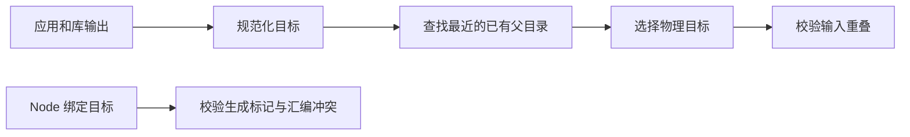

# 输出路径与发布保护自举

## Intent

让应用、汇编副产物和库共享一条 Source 输出校验流程。迁移父目录查找、
末段符号链接策略及输入重叠判断。一起处理 Node 绑定文件的覆盖保护。

## Data

批首为 `9b1219e1d`。`watch/output.zig` 当前递归查找已有父目录，每回退
一层后重新分配并拼接字符串，再遍历输入快照。Node 绑定还会为判断生成
标记读入整个已有文件。

## Edges

保留输入重叠与目标冲突诊断、符号链接替换行为、缺失路径的创建顺序及现有
文件的覆盖保护。平台规范化、文件读取与复制仍使用 Zig 标准库。只把需要
返回给调用方的物理路径交给最终分配器。

## Answer

应用与库通过同一 RX 入口选择输出目标。ZX 在有界缓冲区中逐级查找已有
父目录，保留剩余逻辑路径的偏移，最终路径只构造一次。逻辑重叠直接查现有
观测索引，物理重叠逐项借用记录。已知符号链接末段仍按原策略替换链接本身。

Node 绑定的覆盖规则和汇编目标冲突判断迁入 ZX。流式标记匹配复用产物读取
接口，保留已有文件读错误和缺失文件行为。读取期间使用固定大小的缓冲区。

正式安装版以 Zig 0.17.0 和 ReleaseSmall 构建并运行 Source 实现。
两套已经自编译的 Source 引导器对同一 CLI 清单生成的 1,237 个文件逐字节
一致。后端发布、NAPI 绑定、库清单、原生库发布和库 watch 全部通过，
共 93 个构建步骤。后端路径回归覆盖嵌套缺失父目录、符号链接与分配失败。

### 性能与产物

三套安装版禁用应用缓存，分别交错执行七次。新目录发布的 63 个文件和
向 20 层缺失目录发布的 20 个文件均逐字节一致。四组的墙钟和 CPU
中位数均为 0.01 秒。候选单进程峰值 RSS 较批首分别为
−80、−16、−16、−112 KiB，较固定基线分别为 −176、−176、−160、−240 KiB。

使用现有 Node 记录样本和 16 MiB 预置用户绑定文件测量覆盖拒绝。
三套安装版都返回 `NodeBindingWouldOverwriteFile`，没有生成二进制，
已有文件 SHA-256 一致。单进程峰值 RSS 的中位数从固定基线 24.00 MiB、
批首 23.98 MiB 降为 7.97 MiB。三版墙钟和 CPU 中位数在计时
分辨率下均为 0.00 秒。

应用构建指定同一个 Zig，三版各交错运行五次。13 个后端模块输入与机器
代码段在 15 次构建中逐字节一致。

| 指标                     | 固定基线 |   批首 |   候选 |
| ------------------------ | -------: | -----: | -----: |
| 墙钟（秒）               |     4.50 |   4.51 |   4.51 |
| CPU（秒）                |     4.56 |   4.55 |   4.57 |
| 采样进程树峰值 RSS（MB） |   368.44 | 364.89 | 373.19 |
| 系统单进程峰值 RSS（MB） |   369.38 | 367.58 | 366.03 |
| CLI 采样峰值 RSS（MB）   |    10.01 |   9.95 |   9.93 |

首轮进程树采样峰值较批首增加 8.31 MB。三版各补测三次，记录每次达到
进程树峰值时的进程成员。所有峰值均由后端 Zig 与 CLI 组成，当时 Zig 的
RSS 为 356.65～362.40 MB，CLI 在 9.93～10.01 MB。补测的进程树
中位数依次为 369.44、371.26、367.79 MB。九次的后端命令、模块输入
和机器代码均相同，未复现首轮候选的增加。机器代码段 SHA-256 为
`910a479dcb43307384c929f2947c6ef83adf69df3a7b43e2b2dab7999a807917`。
