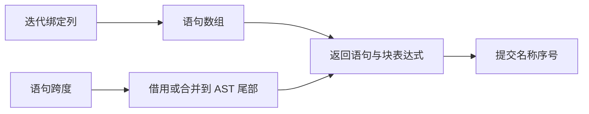

# genz 作用域绑定与结果交付

## Intent

沿普通、值 ABI 与迭代表达式的作用域入口，将绑定缓冲预留和最终 AST 写入顺序交给 Source。保留现有语句与表达式编号、临时分配边界及绑定求值次序。

## Data

批首 `6ee9fd22e`。`zx/scope/execute.zig` 负责选择并预留两种输出布局，回调通过一个双字段暂存区回传跨度；迭代结果经 `zx/iteration_value/scope.zig` 写入原始语句、块返回及表达式列。正式 Source 已经按反向顺序求值绑定，再按词法顺序交付语句。

## Edges

普通跨度继续优先使用固定栈缓冲并一次分配溢出空间。迭代临时列留在原作用域，持久 AST 的标签只保留一次。不得提早分配深层递归用的最终生成缓冲。保持绑定错误及持久发布失败的原有顺序。

## Answer

确认正式入口移除 Zig 的输出布局分支及迭代行提交逻辑。用同一套回归覆盖标量和值 ABI、迭代、集合回调和分配失败。对照五份清单的生成文件以及冻结清单冷暖用时、CPU 和峰值内存。

## 正式调用链

`scope/bindings/run.rx` 准备结果后预留所需缓冲，按原顺序反向求值绑定，再分别完成跨度汇合或迭代行交付。普通和值 ABI 将起点与长度打包为一个 `u64`，绑定回调直接返回该值，避免在 Zig 帧里摆放共享的结果暂存区。跨度仍能借用连续的 AST 尾部。空跨度在检查连续性时跳过，整组为空则返回当前尾部。

普通路径保留 32 条栈内跨度的容量，另外给准备结果留出 32 字节。溢出的跨度和生成器临时结果使用当前作用域的 arena，退出时一并释放。迭代继续用已有作用域分配区保存值、类型与名称的借用视图。最终 RX 先验证结果块并一次保留新标签，然后提交绑定语句、返回语句与块表达式，成功后才发布序号。两个紧凑的 AST 写入原语只借用源列。Zig 保留分配器、递归回调及通用 AST 列写入。

## 候选引导修复

候选接手生成时，输入目录扫描在带子目录的情况下报 `IndexOutOfBounds`，故障早于 AST 生成。给原生内存访问的失败分支加入诊断会改变 ReleaseSmall 的结果。把目录扫描使用的字符串写入、文本列列表读取和列表长度读取保留为非内联调用后，候选在无探针的 ReleaseSmall 配置下通过复现。两次调整扫描状态布局未修复问题，已移除。暂未定位到具体的后端优化指令。

## 验收与性能

用批首已验收的 Source 工具构建候选，ReleaseSmall、16 分区。批首与候选分别走正式 Source 前端和生成器。五份当前正式清单生成的 17,560 个文件逐字节一致。冻结清单生成的 9,894 个文件也逐字节一致。

最终候选通过 372 项编译器测试，以及八个专项回归目标中的 695 项测试。专项覆盖独立与嵌套迭代、集合缓冲、值 ABI、源码与编译库调用，以及现有的分配失败和恢复用例。

下表为同一冻结清单交错测量三轮的中位数。内存按 MB 记录。

| 指标                 | 固定基线 | 批首 Source | 候选 Source |
| -------------------- | -------: | ----------: | ----------: |
| 冷墙钟（秒）         |     2.06 |        1.91 |        1.90 |
| 冷 CPU（秒）         |     8.98 |        9.39 |        9.38 |
| 冷进程树采样峰值 RSS |   737.97 |      518.46 |      521.08 |
| 冷系统单进程峰值 RSS |   775.93 |      544.67 |      542.38 |
| 热墙钟（秒）         |     1.62 |        1.42 |        1.43 |
| 热 CPU（秒）         |     6.41 |        6.23 |        6.24 |
| 无变更墙钟（秒）     |     0.04 |        0.03 |        0.03 |

较批首，冷墙钟和 CPU 各减少 0.01 秒，进程树峰值增加 2.62 MB，单进程峰值减少 2.29 MB。较固定基线，冷墙钟减少 0.16 秒，CPU 增加 0.40 秒，进程树峰值减少 216.89 MB。
