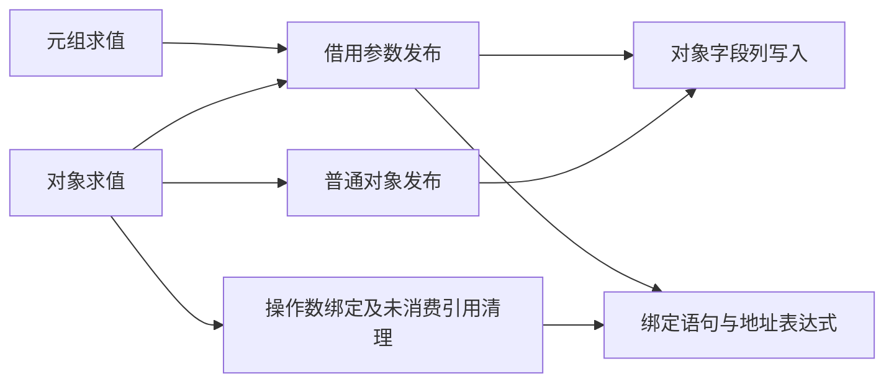
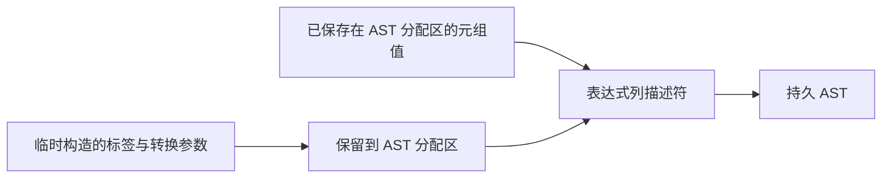

# genz 借用参数发布

## Intent

让普通对象和借用调用参数共用对象字段发布规则。借用参数的名称保留、元组转换参数持久化、绑定语句与 AST 表达式写入由 RX/ZX 决定。同批将对象操作数的绑定和未消费引用清理直接发布到语句序列。

## Data

批首 `1f08c03d4`。`argument.zig` 和 `argument_object.zig` 完成元组与对象的求值后进入 `borrowed_argument.zig`，由后者重绑名称列、持久化元组转换参数并发布字段和 AST。普通对象入口 `aggregate/object.zig` 使用同一列构造规则，但自行发布。`aggregate/operands.zig` 通过 `executeValue` 接收临时列，检查有效性并按形状写回语句。

## Edges

名称和转换参数仍先于字段和语句写入保留。原元组值列继续借用；转换只持久化实际需要的编号。字段、绑定语句和表达式的写入顺序及序号提交保持一致。种子引导保留既有实现。

## Answer

核对普通对象及借用参数的生成入口，集中运行值调用、迭代和对象分配失败回归。对照正式清单产物及固定输入的墙钟、CPU 和峰值内存。

普通对象与借用参数共用对象字段写入。借用参数从既有的元组值列构造表达式，只把生成的转换编号保留到 AST 分配区。绑定名称作为同一份持久文本由语句和标识符共用。操作数发布和清理在 Source 中沿用既有语句列算法，直接向调用方的语句序列发布。空序列直接跳过。宿主保留临时分配器、视图适配和种子实现。

### 正式生成

372 项编译器测试通过。七个专项目标共 454 项测试通过，覆盖原生借用与分配失败、值返回、迭代调用、对象求值顺序、对象展开调用、聚合循环和表达式绑定。候选和批首用本批五份正式清单生成的 17,521 个文件逐字节一致，修改的 RX/ZX 源码均通过 lint。候选 Source 引导器 SHA-256 为 `62b655e36849d6ffda13766229a042c2febd846d4e6a598d327ac569395e3fc3`。

### 性能

批首已验收的 Source 引导器构建候选，采用 ReleaseSmall 和 16 分区。候选、批首和固定对照都使用 Source 分析和生成。三轮交错核验覆盖冻结输入的编译器生成阶段，9,894 个生成文件逐字节一致。

| 指标                 |  固定对照 | 批首 Source | 候选 Source |
| -------------------- | --------: | ----------: | ----------: |
| 冷墙钟（秒）         |      2.07 |        1.91 |        1.96 |
| 冷 CPU（秒）         |      8.98 |        9.40 |        9.39 |
| 冷进程树采样峰值 RSS | 737.10 MB |   516.55 MB |   516.96 MB |
| 冷系统单进程峰值 RSS | 758.55 MB |   537.05 MB |   546.62 MB |
| 热墙钟（秒）         |      1.63 |        1.43 |        1.44 |
| 热 CPU（秒）         |      6.43 |        6.23 |        6.22 |
| 无变更墙钟（秒）     |      0.04 |        0.03 |        0.03 |

较批首，冷墙钟增加 0.05 秒，冷 CPU 减少 0.01 秒，进程树峰值增加 0.41 MB。冷单进程 RSS 的样本区间分别为批首 535.13～556.22 MB、候选 538.54～549.80 MB，中位数增加 9.57 MB。系统物理占用采样峰值的中位数分别为 511.71 MB 和 511.43 MB。较固定对照，冷墙钟减少 0.11 秒，冷 CPU 累计增加 0.41 秒，进程树峰值下降 220.14 MB。
