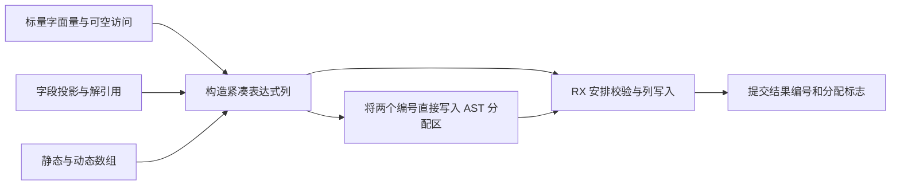
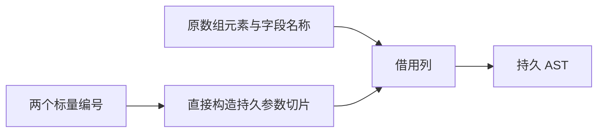

# genz 字面量与访问表达式发布

## Intent

将标量字面量、静态与动态数组、字段投影和可空值访问的 AST 发布迁入 Source。由 RX 决定检查、写入和分配标志的顺序，由 ZX 构造表达式和需要长期保存的参数。

## Data

批首 `ceb0f2bbe`。现有 `zx/literals.zig`、`zx/static_list/emit.zig`、`zx/aggregate/list.zig` 与 `zx/access/emit.zig` 接收临时列，并分别决定检查结果、保留编号和提交表达式。固定两项转换与分配参数只需在 AST 持久存储内构造一次。

## Edges

动态集合先提交数组和取址节点，再验证分配计划、保存调用参数并追加调用，最后标记分配器。其他入口写入前检查结果有效性。借用已有元素、名称和错误捕获文本。旧 seed 保留初始引导所需行为。

## Answer

核对正式生成入口退出旧的参数复制、AST 列重绑和宿主结果分支。对照正式清单与固定输入性能，集中执行受影响的访问、集合、值类型和分配失败回归。

### 当前进度

已准备表达式列声明、AST 写入接口及持久编号对构造。正式生成入口仍走现有发布流程。下一步将通过 RX 接入这些接口，按同一规则集中核验和回测。
