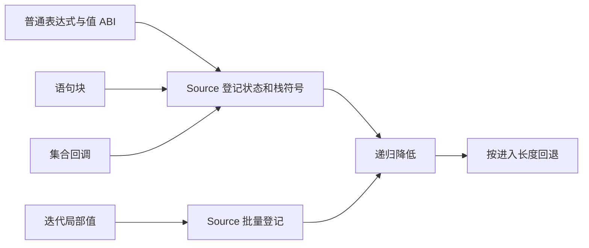
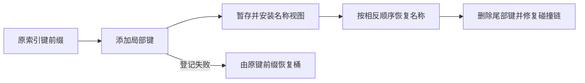

# genz 局部作用域收敛

## Intent

普通表达式、值 ABI、迭代表达式与语句块共用局部符号登记和解绕契约。把表项写入、作用域尾部删除及名称安装中的规则移入 Source，去掉每轮登记使用的重复符号清单和专用 Zig 批量写入步骤。

## Data

批首 `eb1784e1d`。`scope.zig` 的普通和值 ABI 共用 `value_call/locals.zig`，语句遍历也复用该安装器。迭代通过独立局部表登记符号。转换回调在 state 表中临时引入参数。正式路径的局部登记只追加未出现的符号，内部作用域结束时先解除自己的借用。作用域结束时保留原索引键前缀和已分配的容量。

## Edges

保留借用列及现有 arena 的生命周期。释放局部符号须保留同一张表内先前登记的键，更新过程不能复制整张表。登记失败后的桶恢复使用原来的有效前缀。初始 seed 独立保留旧索引实现。

## Answer

核对正式路径退出键清单与 Zig 批量预留，验收名称别名、状态值、迭代、语句块、回调和分配失败。固定清单对照生成内容、时间和峰值内存。

## 正式调用链

`scope.zig` 和语句遍历共用 `value_call/locals.zig` 的状态、栈符号登记。集合回调通过 `state_value/locals.zig` 登记状态参数，迭代局部值通过 `iteration_value/scope.zig` 登记表示后的符号。各入口保存进入时的索引长度。Source 退出时从后往前移除新键，修复开放寻址碰撞链，保留前缀的行号和缓冲区容量。登记失败沿用原前缀恢复桶，集合回调也使用同一恢复规则。

无符号和单符号批次仍走原有快捷路径，多符号批次由 ZX 一次预留再写入。最初用 `.with` 生成的循环会续借数组并可能触发复制，最终让内部 `memory` 绑定已预留的可写切片。生成的批量写入只传递切片描述符，循环内无数组复制或额外预留。常规和值 ABI 的复用计划由 RX 在计划有别名时安装名称，旧 Zig 名称分配和安装步骤退出。

Zig 仍持有索引和 arena，并在递归退出时调用 Source 恢复。普通、值 ABI 和迭代路径中的语句跨度缓冲、AST 写入和失败解除将在同一表达式调用链继续迁移。

## 验收与性能

使用 `native-alias-output` 阶段的已自编译 Source 工具构建候选，ReleaseSmall、16 分区。编译器 372 项测试通过。候选和参考工具对当前五份正式清单生成的 17,547 个文件逐字节一致。固定清单另外生成 9,894 个一致的文件，memo 载荷 SHA-256 一致，值为 `984e382f78689fc61e6fb15444b1471529da5044b6c90e34de90c3609d1db586`。

用候选生成并执行集合、迭代、表达式绑定、原生值 ABI 和 reduce 运行时的八个回归目标。414 个构建步骤与 794 项 Zig 测试通过，包含现有分配失败测试、源码及重新导入编译库的执行。迭代编译库发布与重发的独立 CLI 检查也通过。

同一冻结清单在固定基线、参考 Source 与候选 Source 之间交错测量三轮，中位数如下。三版均使用正式 Source 路径。参考 Source 沿用现存引导产物，早于批首提交 `eb1784e1d`。内存按 MB 记录。

| 指标                 | 固定基线 | 参考 Source | 候选 Source |
| -------------------- | -------: | ----------: | ----------: |
| 冷墙钟（秒）         |     2.02 |        1.87 |        1.89 |
| 冷 CPU（秒）         |     8.88 |        9.29 |        9.32 |
| 冷进程树采样峰值 RSS |   736.80 |      517.67 |      518.11 |
| 冷系统单进程峰值 RSS |   758.69 |      541.25 |      544.83 |
| 热墙钟（秒）         |     1.59 |        1.40 |        1.41 |
| 热 CPU（秒）         |     6.31 |        6.14 |        6.18 |
| 无变更墙钟（秒）     |     0.03 |        0.03 |        0.03 |

候选较参考工具冷墙钟增加 0.02 秒、CPU 增加 0.03 秒，进程树峰值增加 0.44 MB、系统单进程峰值增加 3.59 MB。较固定基线冷墙钟减少 0.13 秒、CPU 增加 0.44 秒，进程树峰值下降 218.69 MB。
