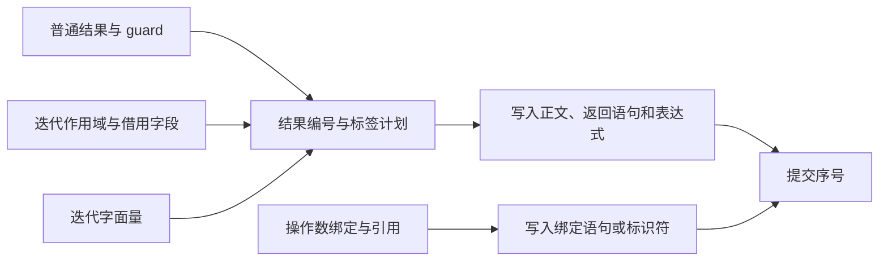
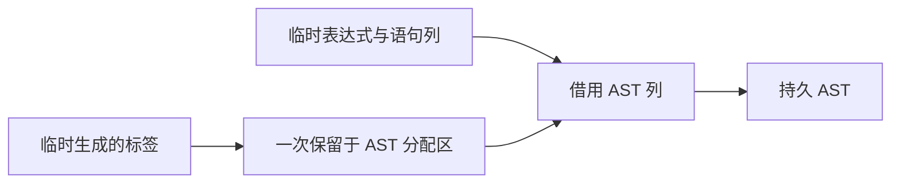

# genz 结果块与操作数发布

## Intent

普通结果、带 guard 的结果、借用字段、迭代作用域和迭代字面量共用 Source 结果块发布。操作数的绑定和引用由 Source 保留名称、写入语句与标识符。移除 Zig 根据结果种类重绑 AST 列并提交序号的逻辑。

## Data

批首 `f84e3d06a`。普通结果、guard 和操作数进入 `zx/aggregate/binding.zig` 的不同分支。迭代字面量在 `zx/iteration_value/literals.zig` 先写字面量表达式和对象字段，再写结果块。迭代作用域已通过 RX 按顺序写出语句和块，现有紧凑 AST 接口可复用。

## Edges

保留相同节点编号和写入失败顺序。迭代字面量仍先提交其表达式及对象字段。guard 的条件与块表达式作为同一组行发布。标签只在持久 AST 中保留一次，已有文本继续借用。对象字段列以借用引用传给通用写入接口。

## Answer

沿正式生成入口核实旧发布逻辑退出，对照五份正式清单、冻结清单性能及集合、值 ABI、迭代和分配失败回归。

普通和 guard 结果走 `binding/result.rx`，借用字段和两个迭代入口在各自准备完输入后调用同一 `binding/publish.rx`。`binding/operand.rx` 和 `binding/publish_reference.rx` 共享标识符行构造并各自发布。宿主继续借出工作区、描述符和目标 AST 存储，由通用接口写入借用的列。下一批处理 `zx/value_call/borrowed_argument.zig` 剩余的标签保留、元组参数列持久化及对象字段写入。

### 正式生成与性能

用批首已验收的 Source 工具构建候选，采用 ReleaseSmall 和 16 分区。372 项编译器测试通过，五份正式清单共 17,538 个输出逐字节一致。候选、批首与固定对照都使用 Source 分析和生成。性能覆盖冻结输入的编译器生成阶段，冻结清单的 9,894 个输出逐字节一致。

八个专项回归目标中的 695 项测试通过，覆盖循环规则、聚合循环和列、嵌套缓冲、对象归约、迭代调用、原生值边界和表达式绑定。

语句序列的原生声明归入 `statement_sequence.d.zx`。拆分前后的合并声明和引导器二进制逐字节相同，变更的 RX 和 ZX 源码均通过 lint。引导器 SHA-256 为 `da524e282d8a201652dbb54721cf0fe294022ab81fb4638577218b24a020d3f2`。

| 指标                 |  固定对照 | 批首 Source | 候选 Source |
| -------------------- | --------: | ----------: | ----------: |
| 冷墙钟（秒）         |      2.11 |        1.92 |        1.95 |
| 冷 CPU（秒）         |      9.02 |        9.43 |        9.42 |
| 冷进程树采样峰值 RSS | 737.28 MB |   516.87 MB |   515.85 MB |
| 冷系统单进程峰值 RSS | 760.37 MB |   536.18 MB |   534.28 MB |
| 热墙钟（秒）         |      1.64 |        1.44 |        1.43 |
| 热 CPU（秒）         |      6.46 |        6.28 |        6.26 |
| 无变更墙钟（秒）     |      0.03 |        0.03 |        0.03 |

表中数据取三轮交错测量的中位数。较批首，冷墙钟增加 0.03 秒，冷 CPU 减少 0.01 秒，进程树峰值下降 1.02 MB，系统单进程峰值下降 1.90 MB。较固定对照，冷墙钟减少 0.16 秒，冷 CPU 累计增加 0.40 秒，进程树峰值下降 221.43 MB。
