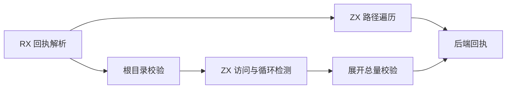
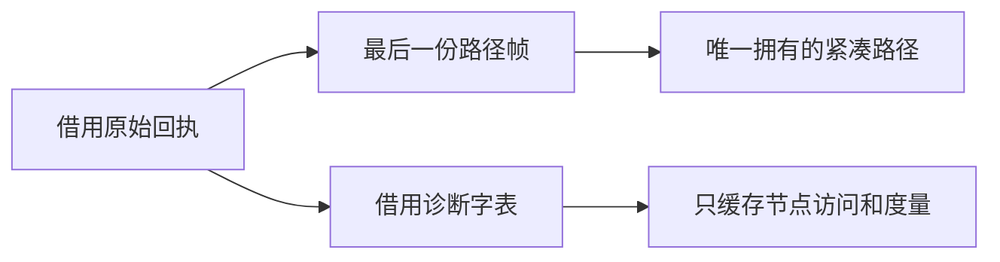

# 后端回执路径与诊断状态自举

## Intent

让 ZX 持有后端依赖路径的遍历和诊断图的访问状态。删除诊断专用 Zig 哈希表、待访问队列和边表，保留格式校验及错误顺序。

## Data

批首为 `e0aac205e`。后端解析已通过 RX/ZX 校验帧，路径在原生循环中写回。诊断节点校验在 ZX，访问记录、队列及复制的边仍在 Zig。

## Edges

保留原有错误优先级、图环与复杂度限制、重复路径、空路径快照及失败清理。消息节点和源码位置节点保持不同的 64 位键，避免收窄线上索引范围。访问循环借用已经校验的诊断字表，紧凑路径的所有权留在回执 arena。

## Answer

依赖路径仍只物化最后一份快照。ZX 从已经校验的借用帧选择路径范围、前缀和输出位置，原生层只分配两块紧凑存储并将每条路径复制到最终位置。重复路径、空快照及错误回滚沿用原协议。

ZX 持有诊断访问队列、访问状态和复杂度计算。校验根后逆序读取已有根索引，避免把整份根再次装入队列。展开阶段从已校验的字表读取边，删除 Zig 专用边表、子范围游标、待访问列表和阶段状态。所有节点的新度量使用一个 32 位值存储深度和展开数。

初版 ZX 不可变整数映射在分支写入时复制在用列。5,000 个子节点的探针峰值达到约 742 MB。保留 ZX 遍历，改用编译器内部通用整数表原地写入，复用 Zig 标准库哈希表。专用宿主只创建验证 arena、提供通用表句柄及翻译结果错误。以后迁移循环内的映射写入，宽图对照应早于安装版回归。

宽图稳定后，独立叶节点仍重复推入和弹出完成项。现在校验完没有子节点的记录便直接写入度量，深度和展开数仍各为一。原来需要递归查看源码位置或注释的节点继续按原顺序处理。

两套独立的 Source 引导器生成 63 个逐字节一致的文件。

整条调用链贯通后，后端协议、真实后端、后端发布、C 头文件 watch 和应用 watch 恢复五个目标通过。叶节点优化后，后端协议、真实后端和 C 头文件 watch 均使用最终候选补验，通过 43 项 Zig 测试和两项端到端回归。既有协议用例覆盖所有权、失败分配、循环、共享子图、深度和展开上限。

### 性能与产物

下表为 ReleaseSmall 后端回执驱动的交错五轮中位数。每轮处理 50,000 个子节点、独立根或输入路径，并重复 30 次。

| 场景     | 批首墙钟（秒） | 候选墙钟（秒） | 批首 CPU（秒） | 候选 CPU（秒） | 批首峰值（MB） | 候选峰值（MB） |
| -------- | -------------: | -------------: | -------------: | -------------: | -------------: | -------------: |
| 宽诊断图 |         0.1053 |         0.0944 |         0.1045 |         0.0936 |           8.60 |           5.75 |
| 独立根   |         0.1010 |         0.0868 |         0.1002 |         0.0861 |           7.98 |           4.78 |
| 输入路径 |         0.0204 |         0.0228 |         0.0196 |         0.0219 |           5.16 |           5.16 |

应用对照使用同一个 Zig 0.17.0 和相同 C 项目，重置项目缓存。用于该对照的 ReleaseSmall CLI 与最终候选均由已自编译的 Source 引导器生成。成功回执无诊断节点，和叶节点优化使用不同执行路径。常规构建 6.69 秒，较批首增加 0.03 秒，单进程峰值下降 5.26 MB。watch 修改后重建 7.33 秒，增加 0.07 秒，两轮 CPU 增加 0.09 秒，峰值下降 0.36 MB。固定对照的常规构建与 watch 重建分别为 6.76 秒和 7.25 秒。三版应用机器代码、C 头文件及适配器均逐字节一致。
