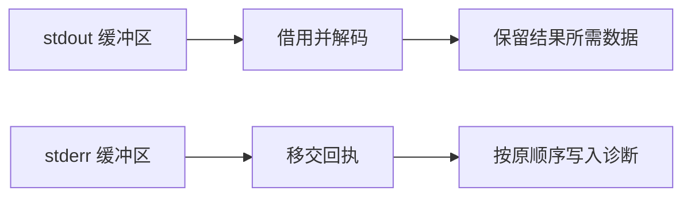

# 后端进程协议与诊断自举

## Intent

让 Source 持有 Zig 后端的请求顺序、读取策略和输出上限。合并常规构建与 watch 的诊断写入，消除捕获 stderr 时的复制，并让子进程环境借用上游键值。

## Data

批首为 `872209e99`。普通后端直接继承管道，C 翻译和 watch 通过同一个协议入口捕获两条输出流。回执解析已由 RX/ZX 执行，原生 Zig 仍逐轮检查输出大小、构造握手，并将 stderr 再复制到结果 arena。

## Edges

保留 Zig 标准库的环境表、文件与并行管道操作、进程生命周期和 ErrorBundle 渲染。两个流仍分别受限，失败时关闭并回收同一个进程。保留直接解码 API 对调用方缓冲区的独立所有权。

## Answer

ZX 用已有整数 writer 在栈上编码 `update`、`exit` 两个请求帧。捕获循环由 ZX 决定每次读入空间、结束条件及两条流的 128 MiB 独立上限。Zig 继续执行标准库的并行管道读写和进程回收。两个构建入口共用同一个诊断输出顺序，原始 stderr 在 ErrorBundle 之前输出。

子进程环境借用上游键值，派生表只复制哈希表结构，沿用 Zig 的平台键比较。Zig 释放派生表时不释放借用的字符串。后端解码同步借用 stdout，捕获的非空 stderr 将原缓冲区交给回执。能原地缩小时减少尾部容量，回执释放时回收所有权。直接解码入口仍由回执持有独立的 stderr 内容。

正式 ReleaseSmall 候选通过后端协议、后端发布、真实后端、原生别名、应用 watch 恢复和 C 头文件 watch 六个目标。两套 Source 引导器对同一输入生成 61 个逐字节一致的文件。独立进程验证了握手顺序、输入关闭、两条输出流的上限，以及 stderr 的完整内容和释放。DebugAllocator 核对的空、1 MiB 和 64 MiB 输出均无泄漏。

### 性能与产物

固定请求由同一个后端驱动捕获两次。64 MiB 的 stderr 单次输入使进程峰值从 310.79 MB 降到 218.63 MB。恰好 128 MiB 时，峰值从 701.45 MB 降到 405.47 MB。两版都接收上限值，额外一个字节时拒绝 stdout 或 stderr。峰值为同机 `wait4` 记录的系统单进程峰值。

实际应用对照使用同一个 Zig 0.17.0 和原生 C 项目，每版重置项目缓存。候选是由已自编译的 Source 引导器生成的 ReleaseSmall CLI。

| 实际应用单轮对照         | 固定对照 |   批首 |   候选 |
| ------------------------ | -------: | -----: | -----: |
| 常规构建墙钟（秒）       |     6.76 |   6.69 |   6.70 |
| 常规构建 CPU（秒）       |     7.02 |   6.74 |   6.75 |
| 常规构建进程峰值（MB）   |   463.41 | 386.70 | 382.03 |
| watch 首次构建墙钟（秒） |     7.06 |   7.06 |   7.07 |
| watch 修改后墙钟（秒）   |     7.31 |   7.30 |   7.27 |
| watch 两轮 CPU（秒）     |    13.87 |  13.88 |  13.87 |
| watch 进程峰值（MB）     |   383.45 | 386.89 | 387.37 |

常规构建和两轮 watch 的应用机器代码、C 头文件和适配器逐字节一致，应用执行结果分别为 6 和 9。候选的重建墙钟较批首下降 0.03 秒，进程峰值增加 0.48 MB。

本批新增的手写 Zig 主要用于标准库管道适配和缓冲区所有权。依赖路径的物化循环与诊断节点物理存储仍在原生代码，下一批沿回执交付继续迁移。
