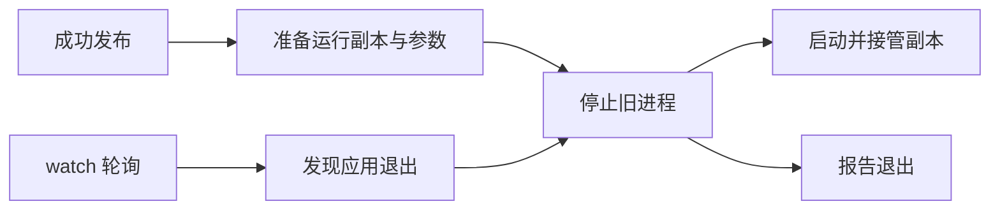
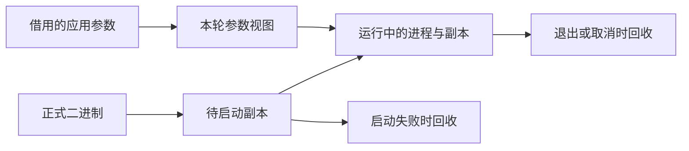

# 常驻应用进程交付自举

## Intent

让 RX 编排 `watch --run` 的应用替换和退出交付，ZX 负责运行副本命名和启动参数。收口运行中与待启动进程的文件所有权。

## Data

批首为 `a980adc75`。构建成功后，watch 会复制发布产物、准备参数、停止原进程、启动新进程。轮询发现进程退出后会回收文件并报告退出信息。

## Edges

旧进程继续运行到新副本与参数准备就绪。所有分配、复制和启动错误遵循原诊断路径。进程组和 Job Object 仍由平台原语管理。

## Answer

验收普通 watch、实际应用启动、编辑后的替换、自然退出及取消清理。配对核对同输入的机器代码、参数与真实运行输出。

## 正式入口

构建成功后从 `driver/build.zig` 进入 `application/restart.rx`。RX 依次准备运行副本和参数、停止旧进程并启动新进程。`driver/poll.rx` 调用 `application/poll.rx` 检查退出，再走共享的回收与报告路径。原来由 `process.zig` 执行的替换顺序、轮询退出分支与命名、参数组装退出正式路径。Zig 保留进程句柄、文件操作、错误通道和取消保护。

名称和参数描述符由本轮构建的 arena 分配，参数字符串借用 CLI 输入，正在运行的副本路径独立持有。启动前的路径由待启动记录持有，启动成功后随子进程句柄交接，错误时由构建驱动删除文件并释放路径。正式产物在原位置保留。批首可复现 `--out` 只传文件名时启动失败，平台启动现在直接使用副本路径，避免按 `PATH` 搜索。

## 验收结果

同一个已自编译的 Source 引导器构建 ReleaseSmall CLI。应用 watch 恢复、头文件变化、编译库与 RX watch 四个目标通过，构建图 85 项成功。调整平台启动入口后，用最终候选补验应用 watch 恢复，构建图 79 项成功。两套 Source 生成器对同一 watch 清单产生的 58 个文件逐字节一致。

macOS 原生验证使用带空格的相对输出文件名和含空格的 Unicode 参数。编辑后旧进程、其子进程与副本被回收，新进程收到完整参数。自然退出按原格式报告，终止 watch 也回收第二次运行的进程组和副本。另通过 Zig 工具链替换让后端成功发布 ELF，macOS 启动返回 `InvalidExe`，待启动副本被删除，正式产物保留。

### 应用 watch 性能

沿用固定 CLI `4a3d61f3` 与批首 CLI `65687376` 的 ReleaseSmall 对照。三版走正式 Source 分析与生成，批首和候选由 `native-alias-output` 的 Source 引导器生成。每版重置项目缓存，用同一个 Zig 0.17.0 和同一应用，测首次构建运行及替换源码后的再次运行。`wait4` 记录两轮合计 CPU 和系统报告的单进程峰值 RSS。三版首次、编辑后各自发布的 `__TEXT,__text` 字节一致，应用分别打印 `5` 与 `11`。

| 版本     | 首轮墙钟（秒） | 编辑后墙钟（秒） | 两轮 CPU（秒） | 峰值 RSS（MiB） |
| -------- | -------------: | ---------------: | -------------: | --------------: |
| 固定对照 |          5.265 |            5.473 |          9.317 |          345.70 |
| 批首     |          5.181 |            5.476 |          9.260 |          346.45 |
| 候选     |          5.170 |            5.483 |          9.216 |          345.92 |

候选较批首首轮墙钟减少 0.010 秒，编辑后增加 0.007 秒，两轮 CPU 减少 0.045 秒，RSS 下降 0.53 MiB。较固定对照首轮墙钟减少 0.095 秒，编辑后增加 0.010 秒，CPU 减少 0.101 秒，RSS 增加 0.22 MiB。
