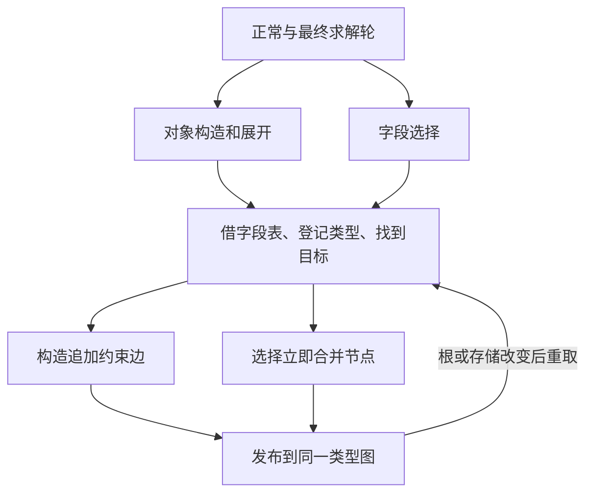

# 手写 Zig 净减少长执行计划

## Intent · 执行到什么位置

从 `master` 的 `4c11902b6` 起，以对象字段推导作为第一条完整调用链。先让正式编译器在对象构造、展开和字段选择时少依赖手写 Zig，再用同一口径判定主线是否进入净减少阶段。计划持续记录已退出的职责、实际数字和仍在执行的原生边界。

**本计划对“进入收敛”的执行定义**：至少两个相邻且可单独验收的迁移批次都让正式源码的手写 Zig 净减少；从固定起点到收口版本，全仓受跟踪的 Zig 和非 seed 包源码 Zig 也都净减少。每批要移除实际调用和对应的专用职责，行为、错误顺序及受影响性能有证据。文档提交、换名、移动文件、删 seed、删测试和压缩排版不计为一个迁移批次。上游若同时增加 Zig，分别公布本任务的差异和主线实际差异；主线未转负就继续。完整三阶段自举另按仓库完成标准验收。

## Data · 起点与已有证据

- 三个对象专用宿主文件合计 270 行。加上共有字段回放桥是 350 行；两个外层入口及两个投影交接文件另有 214 行。共同依赖是图节点、字段列、类型登记和写入后的视图刷新。三个文件对外提供 12 个专用回调，共有字段桥提供 5 个。[状态归属、源码与行数](2026-11-23/对象字段推导的宿主状态与迁移边界调查.md)
- 构造先取得目标字段，再登记来源，将带位置的赋值约束加入队列。选择先按顺序登记全部声明成员，再计算投影，立即合并目标与来源。普通轮能等待，最终轮要验证覆盖。共享视图可以复用，两种提交动作应分别保留。[构造应用](../packages/compiler/src/rx/analysis/inference/construction/application/advance.rx) · [字段选择入口](../packages/compiler/src/rx/analysis/inference/selection/apply.rx)
- 工具链以构建清单指定的 Zig 0.17.0 为准。初始 seed 生成引导器，再用固定 Source 引导器验收正式路径。性能沿用已有基线与实际受影响工作负载，同机比较时固定分区、优化模式和输入。[工具链清单](../packages/cli/build/toolchain/releases.json) · [前一阶段对照](2026-11-22/RX对象投影与字段写回自举.md)

## Edges · 范围与顺序

| 阶段                       | 应一起完成的工作                                                                                                                                                                       | 验收后怎样决定下一步                                                                                   |
| -------------------------- | -------------------------------------------------------------------------------------------------------------------------------------------------------------------------------------- | ------------------------------------------------------------------------------------------------------ |
| 0 固定基线                 | 记录远端起点、构建版本、现有入口和回归。准备可执行的初始引导器与正式 Source 对照工具。                                                                                                 | 先证明既有版本走通相同入口；基线自身的失败单独定位。                                                   |
| 1 字段读写和选择           | 沿字段查找、追加、声明类型登记、选择合并和最终诊断。将选择计划与应用接在同一 RX 流程，复用图的读写与原有物理存储。连同上层调用清理选择专用桥。                                         | 既有行为通过、同职责回调退出、记录本批净变化。若额外 Zig 抵消删除，在本链解决拥有者或适配问题再继续。  |
| 2 对象展开和构造字段       | 在同一对象的临时区中完成名字收集、展开就绪、候选选择和字段写回。复用第一批的字段视图、登记与共享求解状态，保留展开诊断位置和按需分配。清理两个构造专用桥及失去调用者的交接与生成登记。 | 从正式构造与选择入口重新追踪全部依赖，累计计算删除和新增。若两批已满足收敛定义，在这里停止。           |
| 3 仍不满足时沿写入端追     | 先处理本链留下的赋值登记、节点合并或就绪快照中的专用状态。优先选择上一批实际仍被调用、可让多个入口一起删桥的拥有者。将容量、长度、错误、刷新及调用方合并交付。                         | 每结束一个完整职责就重算相邻两批与累计指标。仍有增长时，写明增长的目录、函数和下一个能消除它的调用方。 |
| 4 本链已收口而主线仍净增时 | 从最新主线差异中取出增长最大的实际编译路径。按旧计划核对共享项目联结、缓存与 genz 生成，选一个仍在正式调用链的共同状态继续同样的整批迁移。                                             | 满足上述定义立即登记收敛版本。后续完整自举在已有总计划继续，避免为追求行数扩大到不相关产品工作。       |

保留共享图存储、名字寿命、并查集根、两个版本号以及对象就绪快照的原有契约。允许 Zig 提供通用分配、保留前缀及错误的最终交付。手写的字段选择、遍历、状态提交或诊断规则无论移进哪个目录都要列入待迁。仓库已有源码、回归和基线足够时直接复用。

## Answer · 每批怎么执行并交付

1. 固定批首提交、正常入口、要退出的具体函数、仍须保留的原生操作。先验证最可能阻塞本批的状态所有权或生成形态，再贯通同一职责的各调用方。
2. 在实际 Source 配置构建候选，运行已有的 RX 推导和受影响的对象回归；单独核对 seed。对运行路径或分配发生变化的部分复用既有固定输入，比较输出、诊断、运行时间与内存。失败时定位最早差异，修复并重跑有影响的检查。
3. 用 `git diff --no-renames --numstat "$base" "$tip" -- '*.zig'` 计算新增行减删除行。分别汇总全仓、`packages/*/src/` 下路径不含 `seed` 的文件和本批改到的共享实现。构建、测试、seed 与其他并行提交的变化列明归属。批内草稿可以增长，整批数字按已提交的两端快照核对。
4. 每一批把结果填入下表，连同代码、必要的总计划进度更新以英文规范提交推送。核对远端提交、净变化和正式调用关系后，按阶段表接续。只有真实验收、技术阻塞或用户改变执行范围才改变状态。

| 批次             | 起点与终点                | 实际退出的职责                                                                                     | 非 seed 包源码 / 全仓 Zig 净变化 | 验证与下一步                                                                                                                 |
| ---------------- | ------------------------- | -------------------------------------------------------------------------------------------------- | -------------------------------: | ---------------------------------------------------------------------------------------------------------------------------- |
| 基线             | `4c11902b6`               | 尚未开展代码迁移                                                                                   |                            0 / 0 | 固定本轮起点；先建立本机引导与回归对照。                                                                                     |
| 前置共用字段流程 | `98fadd8dd` → `081286a82` | 普通、开放与重放字段共用 Source，退出三个专用读写回调，合并字段索引与新增列由 Source 准备。        |                       −40 / +101 | 17,650 个生成文件一致，153 项 Zig、17 项 CLI 和 39 项 seed 通过。冷生成墙钟 +0.02 秒、CPU −0.02 秒。继续完成选择的整行切换。 |
| 1 字段选择       | `c4f7a907c` → `3b0f2d813` | 删除选择的 Zig 投影交接文件和应用宿主，Source 一次执行来源校验、成员登记、投影、合并与最终诊断。   |                        −51 / −52 | 17,651 个生成文件一致，153 项 Zig、17 项 CLI 与 39 项 seed 回归通过。冷生成墙钟 +0.04 秒、CPU −0.01 秒、进程树峰值 −1.9 MB。 |
| 2 对象构造       | `3b0f2d813` → `fa9b8d8d3` | 删除构造的 Zig 投影交接、展开宿主及应用宿主，Source 在同一对象暂存区校验、展开、选候选并写入约束。 |                      −104 / −106 | 17,640 个生成文件一致，153 项 Zig、17 项 CLI 与 39 项 seed 回归通过。冷生成墙钟持平、CPU −0.04 秒、进程树峰值 +1.1 MB。      |

截至远端 `081286a82`，固定起点 `4c11902b6` 的累计差异为非 seed 包源码 **−9**、全仓 Zig **+131**。其中 `0fa6c515d` 带来非 seed 包源码 +31、全仓 +30。同期选择整合与撤回的源码差异相抵。前置流程的非 seed 数字包含切出独立 seed 文件的影响，作为阶段 1 的输入，连续净减批次从阶段 1 开始计算。[前置验收](2026-11-22/RX字段访问与合并准备自举.md)

阶段 1 的非 seed 包源码新增 50 行、删除 101 行，全仓 Zig 新增 51 行、删除 103 行。固定起点 `4c11902b6` 到 `3b0f2d813` 累计为非 seed 包源码 **−60**、全仓 Zig **+79**。[字段选择验收](2026-11-22/RX字段选择整行自举.md)

阶段 2 的非 seed 包源码新增 164 行、删除 268 行，全仓 Zig 新增 165 行、删除 271 行。固定起点 `4c11902b6` 到远端收敛提交 `fa9b8d8d3` 累计为非 seed 包源码新增 641 行、删除 805 行，净减 **164** 行。全仓 Zig 新增 791 行、删除 818 行，净减 **27** 行。累计按两端仓库快照直接比较，计入同期提交。远端 `master` 已核对。两批为相邻实现提交，逐批和累计均达到本计划的收敛标准。[对象构造验收](2026-11-22/RX对象构造整行自举.md)

收敛后的自举继续按[总计划](2026-11-20/自举收敛计划.md)验收。固定起点到 `18e126ed3` 已累计净减非 seed 包源码 252 行、全仓 Zig 116 行。接续的图节点发布批次移除了节点、已知类型和端口的专用发布代码，增加了通用批量写入和借用视图，两项 Zig 口径均净增 32 行。含这批的主线累计差异为非 seed 包源码 **−220** 行、全仓 Zig **−84** 行。[图节点发布验收](2026-11-22/RX图节点可见行发布自举.md)

### 远端回查与继续收敛

重新核对远端 `master` 的 `93d704f8c`，从固定起点 `4c11902b6` 比较，
非 seed 包源码新增 1,761 行、删除 1,677 行，净增 84 行。全仓 Zig 新增
1,935 行、删除 1,713 行，净增 222 行。原有两批的数据继续保留，主线后续
提交已抵消累计净减。

| 接续批次       | 起点与终点                | 退出的职责                                                               | 非 seed 包源码 / 全仓 Zig 净变化 | 固定起点累计 | 验证                                                                                               |
| -------------- | ------------------------- | ------------------------------------------------------------------------ | -------------------------------: | -----------: | -------------------------------------------------------------------------------------------------- |
| 长度与下标投影 | `93d704f8c` → `fbeea3b93` | 两套独立回放宿主、独立未决扫描入口、默认列表与最终长度检查的求解转发     |                       −194 / −97 |  −110 / +125 | 17,679 个引导产物一致，153 项 Zig、17 项 CLI、39 项 seed 通过。冷生成墙钟 −0.01 秒、CPU −0.07 秒。 |
| 赋值类与物化   | `fbeea3b93` → `aef53020c` | 赋值载荷交接、深度规划和物化两个宿主、序列默认适配，以及六个独立生成入口 |                      −279 / −187 |   −389 / −62 | 17,632 个引导产物一致，153 项 Zig、17 项 CLI、39 项 seed 通过。冷生成墙钟 −0.01 秒、CPU +0.04 秒。 |

两批连续实现提交均让非 seed 包源码净减少。固定起点 `4c11902b6` 到
本表末行的收敛提交，全仓 Zig 新增 2,472 行、删除 2,534 行，净减 **62** 行。
非 seed 包源码新增 2,092 行、删除 2,481 行，净减 **389** 行。累计以完整 Git
快照比较，计入起点以来所有同期提交。两批逐批和累计均达到本计划的收敛标准。

[长度与下标投影验收](2026-11-23/RX长度与下标投影自举.md) ·
[赋值类与物化验收](2026-11-23/RX赋值类与物化自举.md)

2026-11-23 再次核对远端 `master`，当时指向 `1ad5dedf6`。从固定起点
`4c11902b6` 到该提交，全仓 Zig 新增 3,249 行、删除 3,317 行，净减 **68** 行。
非 seed 包源码 Zig 新增 2,825 行、删除 3,244 行，净减 **419** 行。该差异包含
`aef53020c` 之后的三个主线提交，其中 `af1f69c54` 和 `1ad5dedf6` 各自净增，
三个提交合计仍增加了净减幅度。两个相邻迁移批次和远端累计差异均满足收敛标准。

重新核对远端 `master` 的 `83d4e7de4`。从固定起点 `4c11902b6` 比较，
非 seed 包源码 Zig 新增 5,003 行、删除 4,637 行，净增 **366** 行。全仓 Zig
新增 5,464 行、删除 4,732 行，净增 **732** 行。上一轮回查之后，正文遍历、
帧效果、语句执行、表达式联结和操作数列提交共五批均增加了手写 Zig，主线
需继续收敛。

| 主线新增迁移                  | 非 seed 包源码 / 全仓 Zig 净变化 |
| ----------------------------- | -------------------------------: |
| `339e198c5` RX 正文遍历       |                      +106 / +134 |
| `0b096d57f` RX 调用与帧效果   |                      +296 / +295 |
| `3d0e7174d` RX 语句执行与联结 |                      +225 / +224 |
| `9326262a8` RX 表达式联结     |                        +83 / +79 |
| `83d4e7de4` RX 操作数列事务   |                        +75 / +68 |

| 接续批次       | 批首                      | 退出的职责                                           | 非 seed 包源码 / 全仓 Zig 净变化 | 固定起点累计 | 验证                                                                                                             |
| -------------- | ------------------------- | ---------------------------------------------------- | -------------------------------: | -----------: | ---------------------------------------------------------------------------------------------------------------- |
| Store 初始化器 | `83d4e7de4` → `c34eb7c75` | 字段迭代、初值阶段表、专用列尾适配和三个独立生成入口 |                      +119 / +165 |  +485 / +897 | 17,667 个引导产物、10 项常驻编辑一致。1,313 项 Zig、66 项 CLI 和 39 项 seed 通过。冷生成墙钟持平、CPU −0.02 秒。 |

这批布局仍由 Zig 用七类专用视图向 Source 交接，接续阶段沿同一条正式链
把列选择和成员范围迁入 Source。源表与预留尾部直接借用，统一的 Zig 绑定
负责物理列。以两端快照比较，该批非 seed 包源码净减 **178** 行、全仓净减
**177** 行。自固定起点累计仍为非 seed 包源码 **+307** 行、全仓 Zig
**+720** 行。这是当前一轮的第一批净减。 17,677 个引导产物和 10 项常驻编辑一致，1,313 项 Zig、66 项 CLI 和 39 项 seed 通过。固定输入冷生成墙钟 +0.12 秒、CPU +0.10 秒、进程树峰值 −11.3 MB。

表达式载荷列绑定已推送为 `e4bcf1b84`。以它为批首，正文 Return、Task、
Call、Parallel、Case 和 Store getter 共用 Source 控制列发布，退出七个
独立 Zig 写入交接。该批非 seed 包源码净减 **113** 行，全仓净减 **120**
行。17,657 个引导产物、10 项常驻编辑一致，1,313 项 Zig、66 项 CLI 和
39 项 seed 通过。固定输入的冷生成墙钟 +0.07 秒、CPU +0.13 秒，进程树
峰值 −3.0 MB。[正文控制列发布验收](2026-11-23/RX正文控制列发布自举.md)

两批连续净减均已独立验收。固定起点至本批，非 seed 包源码新增 5,268 行、
删除 5,074 行，累计 **+194** 行。全仓 Zig 新增 5,779 行、删除 5,179 行，
累计 **+600** 行。继续迁移 RX 分析和 genz 降低共用的原生函数绑定，移除
正式生成链逐函数重复接线。
[表达式载荷绑定验收](2026-11-23/RX表达式载荷列绑定自举.md)

### 本轮收敛验收

| 最近两个相邻迁移批次 | 起点与终点                 | 非 seed 包源码 Zig 净变化 | 全仓 Zig 净变化 |
| -------------------- | -------------------------- | ------------------------: | --------------: |
| RX 正文控制列发布    | `e4bcf1b84` → `363c0d9dc`  |                      −113 |            −120 |
| 编译器内部原生绑定   | `363c0d9dc` → 本次迁移提交 |                      −712 |            −691 |

第二批把 RX 图、项目分析、genz 降低及所有权的内部调用目标构造统一放到
Source，Zig 编译期直接取得定义，退出 766 个逐函数转发。两条引导路径生成
的 17,669 个文件、固定性能清单的 9,894 个生成文件和所有权 memo，以及
10 项常驻编辑结果均一致。227 项 Zig 回归、11 项 CLI 和 39 项 seed
通过，同名原生命名空间的执行结果与批首一致。
固定清单冷生成墙钟较批首增加 0.13 秒、CPU
减少 0.01 秒、进程树峰值 RSS 减少 1.8 MB。实际受影响的 execution 清单
冷生成墙钟与 CPU 持平。共同引导器的配对冷构建墙钟和 CPU 各增加
0.95 秒，单进程峰值 RSS 增加 4.4 MB。[内部原生绑定验收](2026-11-23/编译器内部原生绑定自举.md)

固定起点 `4c11902b6` 到本次迁移提交，非 seed 包源码 Zig 增加 5,236 行、
删除 5,754 行，累计净减 **518** 行。全仓 Zig 增加 5,778 行、删除
5,869 行，累计净减 **91** 行。累计直接比较两端完整快照，含同期其他提交。
本轮两个相邻批次各自净减，两项主线累计同时转负，达到本计划标准。

### RX 依赖图接续收敛

远端 `master` 推进到 `4232a8e62` 后再次比较固定起点 `4c11902b6`。
非 seed 包源码 Zig 新增 5,786 行、删除 6,182 行，净减 396 行；
全仓 Zig 新增 6,343 行、删除 6,302 行，净增 41 行。
`8e72e0cbc` 后三批合计增加全仓 Zig 132 行，覆盖依赖图准备、
引用收集及 XML 发布。接续迁移同一项目依赖图的根列表和可达扫描。

| 批次           | 起点与终点                | 非 seed 包源码 / 全仓 Zig 净变化 | 固定起点累计 | 验证                                                                                                                                                                                       |
| -------------- | ------------------------- | -------------------------------: | -----------: | ------------------------------------------------------------------------------------------------------------------------------------------------------------------------------------------ |
| 项目依赖根写入 | `4232a8e62` → `14f8b4c16` |                        −33 / −34 |    −429 / +7 | 17,719 个引导产物一致，285 项 Zig、45 项 CLI 和 39 项 RX 通过。冷生成墙钟持平、CPU −0.06 秒、进程树 RSS −5.0 MB。[批次验收](2026-11-23/RX项目依赖根写入自举.md)                            |
| 项目可达扫描   | `14f8b4c16` → `598bb5682` |                        −38 / −39 |   −467 / −32 | 17,710 个引导产物一致，285 项 Zig、45 项 CLI 和 39 项 RX 通过。冷生成墙钟 −0.02 秒、CPU −0.06 秒、进程树 RSS +5.5 MB、单进程峰值 RSS −5.2 MB。[批次验收](2026-11-23/RX项目可达扫描自举.md) |

第一批退出四个专用根写入接口和一个生成入口。第二批退出旧的起始与
逐模块推进接口及独立生成入口。两批为相邻的独立验收提交。

从固定起点 `4c11902b6` 到远端已验收的迁移提交 `598bb5682`，
非 seed 包源码 Zig 新增 5,821 行、删除 6,288 行，累计净减 **467** 行。
全仓 Zig 新增 6,379 行、删除 6,411 行，累计净减 **32** 行。两端 Git 快照的差异
包含同期所有主线提交，达到本计划的收敛标准。

### RX Schema 与 Store 接续收敛

自 `598bb5682` 之后，RX Schema 解码 `dd7d2b004` 增加非 seed 包源码
Zig 221 行、全仓 Zig 226 行，抵消此前的全仓累计净减。

| 相邻迁移批次                 | 起点与终点                | 非 seed 包源码 / 全仓 Zig 净变化 | 固定起点累计 |
| ---------------------------- | ------------------------- | -------------------------------: | -----------: |
| RX 子节点序列校验            | `dd7d2b004` → `192e9e571` |                        −19 / −18 |  −265 / +176 |
| Store 对象分组与字段校验     | `192e9e571` → `3f0b4ea68` |                        −67 / −24 |  −332 / +152 |
| Store 字段与 RX 类型文本发布 | `3f0b4ea68` → `c91143fa9` |                        −25 / −15 |  −357 / +137 |
| ZX 首部引用扫描共用          | `c91143fa9` → `6820dfdd5` |                          −4 / −4 |  −361 / +133 |
| 项目依赖目标选择与边发布     | `6820dfdd5` → `1018dab0d` |                          −4 / −5 |  −365 / +128 |

本批退出正式字段遍历、Store 与 Args 的 Zig 文本写入编排及独立 Args
写入入口。423 项 Zig、39 项 RX、11 个 RX CLI 场景和 46 项应用入口
检查通过，17,788 个引导产物一致。冷生成墙钟 +0.05 秒、CPU +0.03 秒、
进程树峰值 +2.2 MB。[批次验收](2026-11-23/Store字段与RX类型文本发布自举.md)

Store 批次的暂存数字在最终格式化后重新计算，以上表的已提交快照为准。
ZX 首部批次移除 CLI 的逐条 Zig 导入读取及暂存解析状态，项目图与文件发现
共用 Source 扫描。17,788 个引导产物一致，433 项 Zig、39 项 RX、11 个 RX
CLI 场景及独立 `watch` 复验通过。冷生成墙钟 +0.01 秒、CPU +0.02 秒、
进程树峰值 −0.9 MB。[批次验收](2026-11-23/RX依赖引用交付合并自举.md)

项目依赖目标与直接调用共用 Source 的文件和成员选择，移除两个独立
生成入口、两套手写适配与两个专用边写入回调。17,794 个引导产物一致，
433 项 Zig、39 项 RX、11 个 RX CLI 场景和 `watch` 回归通过。固定
清单的冷生成墙钟 +0.03 秒、CPU +0.01 秒、进程树峰值 +2.6 MB。
[批次验收](2026-11-23/项目依赖目标选择与边发布自举.md)

固定起点到当前批次，全仓 Zig 新增 7,306 行、删除 7,178 行，非 seed 包源码
新增 6,640 行、删除 7,005 行。全仓仍累计净增 128 行。接续将 CLI 的
项目分析、库发布、检查与编译共用接口切换到 Source 的定义绑定机制。

### CLI 定义绑定与本轮收敛

| 最近两个相邻迁移批次 | 起点与终点                | 非 seed 包源码 Zig 净变化 | 全仓 Zig 净变化 |
| -------------------- | ------------------------- | ------------------------: | --------------: |
| 项目依赖目标与边发布 | `6820dfdd5` → `1018dab0d` |                        −4 |              −5 |
| CLI 原生定义绑定     | `1018dab0d` → 本批提交    |                      −363 |            −363 |

CLI 的九个内部接口改用 Source 生成的编译期定义查找，移除 450 个
逐函数转发。独立的初始 seed 和正式 Source 工具各生成 1,143 个文件，
逐字节一致。固定 CLI 清单冷生成墙钟持平、CPU 增加 0.01 秒、峰值
增加约 0.13 MB。安全安装回归通过，包含应用、迁移后的 Zig 与 ZX
库、原生调用及压缩。该批数字包含所有权工人槽位的安全构建修复。
最终 ReleaseSmall 工具通过 46 项 Zig 测试、11 个 RX CLI 场景和
`watch` 回归。两个 RX 执行入口生成的 Zig 完全一致，1,200 模块
依赖图的墙钟、CPU 和峰值内存中位数持平。
[CLI 批次验收](2026-11-23/CLI原生定义绑定自举.md)

固定起点 `4c11902b6` 到本批，全仓 Zig 新增 7,395 行、删除 7,630 行，
累计净减 **235** 行；非 seed 包源码 Zig 新增 6,729 行、删除 7,457 行，
累计净减 **728** 行。累计使用两端完整 Git 快照，计入期间所有主线提交。
两批为相邻且分别验收的迁移，两项主线累计均转负，达到收敛标准。

远端迁移验收提交为 `e3efb09da`。后续校正了 ReleaseSafe 的 RX 调用操作数
及编译库标志切片借用，两项 Zig 口径的净变化均为零。核对原故障入口、语义
lint、编译库与磁盘项目执行后，收敛数字沿用上述两批。
[安全构建复验](2026-11-23/RX单行列借用与安全构建修复.md)

### 远端 master 最终回查

2026-11-23 核对远端 `master`，当时指向 `e5fd82e04`。从固定起点
`4c11902b6` 到该提交，非 seed 包源码 Zig 新增 6,842 行、删除 7,528 行，
累计净减 **686** 行。全仓 Zig 新增 7,510 行、删除 7,704 行，累计净减
**194** 行。数字来自两端完整 Git 快照，包含期间所有主线提交。

| 收敛验收后进入主线的提交         | 非 seed 包源码 Zig 净变化 | 全仓 Zig 净变化 |
| -------------------------------- | ------------------------: | --------------: |
| `dc0476ac0` 单行列借用修复       |                         0 |               0 |
| `c1d9f46f1` RX 表达式列长度发布  |                       +10 |             +10 |
| `e5fd82e04` RX 程序 Store 槽登记 |                       +32 |             +31 |

两批连续净减的独立验收仍对应 `6820dfdd5` → `1018dab0d` 和
`1018dab0d` → `e3efb09da`。后续提交均已纳入累计，两项累计仍为负，
本轮主线满足收敛标准。[依赖图批次验收](2026-11-23/项目依赖目标选择与边发布自举.md) ·
[CLI 批次验收](2026-11-23/CLI原生定义绑定自举.md) ·
[最近一次主线验收](2026-11-23/RX程序Store槽登记自举.md)

### 项目导入批次后的远端核对

远端 `master` 推进到 `255616474` 时，固定起点 `4c11902b6` 到该提交的
非 seed 包源码 Zig 新增 7,303 行、删除 7,873 行，净减 570 行。全仓 Zig
新增 7,972 行、删除 8,050 行，净减 78 行。上次远端核对之后的四批已全部
计入。

| 后续迁移                             | 非 seed 包源码 / 全仓 Zig 净变化 |
| ------------------------------------ | -------------------------------: |
| `1db8755f8` 混合正文结果             |                        +18 / +18 |
| `6a9ebe523` 混合函数导入             |                        +35 / +35 |
| `cd90691d6` 导入名称借用             |                          +3 / +3 |
| `255616474` 导入选择与发布           |                        +60 / +60 |
| `0f224e34f` 签名再导出与导入统一发布 |                        +40 / +39 |

本批删除签名再导出的专用调用、独立生成入口和导入帧中的选中列表。Source
直接消费同一次选择，借用签名存储并提交前缀。17,811 个生成文件及 10 次
常驻请求逐项一致，159 项 Zig 回归与 138 项 ReleaseSafe 推导通过。
固定清单的冷生成墙钟持平，CPU 减少 0.05 秒，进程树峰值增加 2.2 MB，
单进程峰值减少 5.5 MB。

从 `4c11902b6` 到远端 `0f224e34f`，非 seed 包源码 Zig 新增 7,401 行、删除
7,931 行，累计净减 **530** 行。全仓 Zig 新增 8,070 行、删除 8,109 行，
累计净减 **39** 行。按两端完整快照计算，包含同期所有提交及提交钩子增加的
空行。满足连续净减
条件的两批仍为 `6820dfdd5` → `1018dab0d` 和 `1018dab0d` → `e3efb09da`，
两批分别净减非 seed 包源码 4 行和 363 行，全仓 5 行和 363 行。
[签名再导出批次验收](2026-11-23/签名再导出与导入统一发布自举.md)

### 项目入口与验证接续收敛

远端 `master` 到 `973ff2e4d` 时，从固定起点 `4c11902b6` 比较，
非 seed 包源码 Zig 新增 7,861 行、删除 8,191 行，净减 330 行。
全仓 Zig 新增 8,531 行、删除 8,371 行，净增 160 行。计入签名
再导出后的同期主线提交。

| 后续迁移                       | 非 seed 包源码 / 全仓 Zig 净变化 |
| ------------------------------ | -------------------------------: |
| `f6a61253f` 最终签名发布       |                        +36 / +36 |
| `a293a1577` 正文导出发布       |                        +63 / +63 |
| `973ff2e4d` 正文安装与记录发布 |                      +101 / +100 |

接续批次优先移除正式 Source 项目的缓存逐行转接与项目接口转发，然后
清理验证和硬件图共用的原生调用绑定及验证查询的专用写出接口。

| 批次                   | 起点与终点                | 非 seed 包源码 / 全仓 Zig 净变化 | 固定起点累计 |
| ---------------------- | ------------------------- | -------------------------------: | -----------: |
| 项目入口与缓存记录     | `973ff2e4d` → `fa559ecd6` |                        −88 / −88 |   −418 / +72 |
| 验证查询与硬件原生绑定 | `fa559ecd6` → 本批提交    |                      −114 / −113 |   −532 / −41 |

第一批退出项目缓存的逐行读取和缺少来源计数回调，Source 提交验证
前缀，项目原生调用从定义直接链接。两种引导工具的 17,825 个产物和
10 次常驻请求一致。166 项 ReleaseSmall、39 项 RX 和 5 项 ReleaseSafe
回归通过。固定清单冷生成墙钟增加 0.04 秒、CPU 减少 0.04 秒、进程树
峰值减少 4.5 MB、单进程峰值增加 7.4 MB。全仓累计仍为正，继续验证
与硬件绑定批次。[项目入口批次验收](2026-11-23/项目入口视图与缓存读取自举.md)

第二批退出验证查询的专用缓冲接线、文本写入和长度读取回调，验证与
硬件调用直接静态链接定义。17,822 个引导产物和 10 次常驻请求一致。
39 项 RX、8 项验证及硬件 Zig 回归、82 项枚举和公开入口 CLI 场景
通过。组合与带时钟 RTL、查询及证据逐字节一致。正式 CLI 在四组求解
场景的墙钟差异为 −0.25 至 +0.09 毫秒，CPU 为 −0.27 至 +0.03 毫秒，
单进程峰值 RSS 增加最多 0.02 MB。[验证与硬件批次验收](2026-11-23/验证查询与硬件原生绑定自举.md)

固定起点 `4c11902b6` 到本批，非 seed 包源码 Zig 新增 7,934 行、
删除 8,466 行，累计净减 **532 行**。全仓 Zig 新增 8,610 行、
删除 8,651 行，累计净减 **41 行**。累计由完整 Git 快照直接计算，
计入同期其他提交。两批相邻且均独立验收，两项累计同时为负，
达到本轮收敛标准。

### 原生接口接续收敛

远端 `master` 推进到 `f6b587074` 后，从固定起点 `4c11902b6` 重新比较。
非 seed 包源码 Zig 新增 9,151 行、删除 9,128 行，累计净增 23 行。
全仓 Zig 新增 9,317 行、删除 9,244 行，累计净增 73 行。上次收敛之后
的四批全部计入。

| 进入主线的迁移                     | 非 seed 包源码 / 全仓 Zig 净变化 |
| ---------------------------------- | -------------------------------: |
| `c1526677b` 项目入口正文           |                        +33 / +33 |
| `e45f9fb5a` 语义缓存工件提取与写回 |                        +64 / +63 |
| `d8023c736` 项目与原生缓存命中     |                        +28 / +27 |
| `f6b587074` 语义缓存恢复事务       |                          −7 / −9 |

接续沿原生声明的两个正式入口完成迁移。缓存入口先把冷创建与归属区
发布放在同一条 Source 调用链，删除交接宿主。直接入口接续解析、共享
类型和函数写入及原生模块登记，清理同一职责的分段 Zig 调用。

冷缓存原生声明工件从 `f6b587074` 起，非 seed 包源码 Zig 新增 76
行、删除 106 行，净减 **30** 行；全仓新增 76 行、删除 107 行，净减
**31** 行。删除旧工件发布宿主和专用成员写入布局，Source 在同一入口
发布类型、签名和工件。17,834 个引导产物一致，214 项 ReleaseSmall
回归、39 项 RX 回归和初始 seed 解析器构建通过。固定清单冷生成墙钟
增加 0.07 秒、CPU 增加 0.09 秒、进程树峰值增加 4.3 MB，单进程峰值
减少 3.1 MB；实际原生接口的冷、热和声明重排墙钟变化均小于
0.04 毫秒。[原生工件批次验收](2026-11-23/原生声明工件创建与发布自举.md)

固定起点至此，非 seed 包源码 Zig 新增 9,227 行、删除 9,234 行，
累计净减 7 行；全仓 Zig 新增 9,393 行、删除 9,351 行，累计净增
42 行。继续收口无缓存项目入口。

| 最新两个相邻迁移批次   | 起点与终点                | 非 seed 包源码 / 全仓 Zig 净变化 | 从固定起点累计 |
| ---------------------- | ------------------------- | -------------------------------: | -------------: |
| 原生缓存工件创建与发布 | `f6b587074` → `49d582a00` |                        −30 / −31 |       −7 / +42 |
| 无缓存原生加载与发布   | `49d582a00` → 本批提交    |                        −49 / −51 |       −56 / −9 |

无缓存入口删除接口分析宿主、原生模块登记宿主和两个独立的生成入口。
Source 写入共享类型、导出与函数行，并发布原生模块和函数列长度。
17,846 个引导产物一致，122 项 ReleaseSmall、39 项 RX 及 4 项
ReleaseSafe 回归通过。实际无缓存原生接口生成的 Zig 和 ABI 一致，
墙钟增加 0.051 毫秒、CPU 增加 0.015 毫秒，单进程峰值持平。
固定清单冷生成较上一批墙钟增加 0.04 秒，CPU 增加 0.07 秒，
进程树峰值 RSS 减少 4.5 MB。较固定基线墙钟减少 0.09 秒，CPU
增加 0.51 秒。[无缓存批次验收](2026-11-23/无缓存原生声明加载与发布自举.md)

本批非 seed 包源码 Zig 新增 99 行、删除 148 行，全仓 Zig 新增
100 行、删除 151 行。从固定起点 `4c11902b6` 到本批，非 seed 包
源码 Zig 新增 9,326 行、删除 9,382 行，累计净减 **56** 行。
全仓 Zig 新增 9,493 行、删除 9,502 行，累计净减 **9** 行。
累计由两端完整 Git 快照直接比较，计入同期全部提交。上述两批相邻、
均独立验收，两项主线累计同时为负，达到本计划的收敛标准。

### 生成发布与包管理接续收敛

远端 `d4126a9c5` 之后，解析类型发布净减全仓 Zig 46 行。随后三个
批次分别增加 19、69 和 27 行。到远端 `bfba9d3c6`，从固定起点
`4c11902b6` 按两端快照计算，全仓新增 9,901 行、删除 9,841 行，
累计净增 **60 行**。非 seed 包源码新增 9,210 行、删除 9,633 行，
累计净减 **423 行**。

本节非 seed 包源码同时排除 `packages/*/src/` 下的 `seed` 目录及
`seed.zig`、`*_seed.zig`、`seed_*.zig` 文件。旧表排除 `seed`
目录，含独立 seed 文件时在 `bfba9d3c6` 的累计差异为 +14 行。
两批自身的差异在这两种源码口径下相同。

| 接续批次               | 批首                      | 退出的职责                                           | 非 seed 包源码 / 全仓 Zig 净变化 | 固定起点累计 |
| ---------------------- | ------------------------- | ---------------------------------------------------- | -------------------------------: | -----------: |
| 生成与产物发布原生绑定 | `bfba9d3c6` → `d9c375978` | 四个 Source 接口的逐函数根模块转发                   |                        −43 / −43 |   −466 / +17 |
| 包安装与存储原生绑定   | `d9c375978` → 本批提交    | 安装、依赖图、存储、解包、收据与下载的两套逐函数转发 |                       −98 / −111 |   −564 / −94 |

编译器生成缓存、函数文件、编译库、引导输出、Gateway、State 和 Verilog
通过既有的 Source 编译期定义绑定直接静态链接。消除旧转发，无新增手写
运行时代码。17,875 个引导产物与 10 次常驻请求一致，76 项
ReleaseSmall 和 39 项 RX 回归通过。固定清单冷生成墙钟和 CPU
较批首分别增加 0.05 秒和 0.06 秒，进程树峰值减少 0.3 MB，单进程
峰值增加 7.5 MB。[生成发布批次验收](2026-11-23/生成与产物发布原生绑定自举.md)

第一批后全仓仍累计净增 17 行。第二批把包管理的六套 Source 原生
声明切到编译期定义绑定，并删除安装、包存储两份 Zig 转发文件。
161 个引导产物逐字节一致，59 项 Zig 回归及包安装、原生包、HTTP
下载和 watch 集成通过。五组实测中墙钟较批首最多增加 0.621 毫秒，
CPU 最多增加 0.493 毫秒，峰值 RSS 持平。[包管理批次验收](2026-11-23/包安装与存储原生绑定自举.md)

固定起点 `4c11902b6` 到本批，全仓 Zig 新增 9,954 行、删除 10,048
行，累计净减 **94 行**。非 seed 包源码新增 9,250 行、删除 9,814 行，
累计净减 **564 行**。沿旧表口径，含独立 seed 文件时净减 127 行。
累计使用完整 Git 快照，计入同期所有主线提交。两批相邻、分别验收，
两项累计同时为负，达到本计划的收敛标准。

### 引导生成输入接续收敛

远端 `master` 到达 `a13a44abd` 后，从固定起点 `4c11902b6` 直接比较，
非 seed 包源码新增 9,658 行、删除 10,077 行，累计净减 419 行。全仓
Zig 新增 10,640 行、删除 10,398 行，累计净增 242 行。继续核对净减门槛，
按上一节口径统计非 seed 包源码。

| 接续批次           | 批首与终点                | 退出的职责                                 | 非 seed 包源码 / 全仓 Zig 净变化 | 固定起点累计 |
| ------------------ | ------------------------- | ------------------------------------------ | -------------------------------: | -----------: |
| 1 输入指纹与快照行 | `a13a44abd` → `512624fd1` | 源码及模板的指纹分块、快照行分块和专用缓冲 |                        −85 / −21 |  −504 / +221 |

本批非 seed 包源码新增 13 行、删除 98 行，全仓 Zig 新增 126 行、
删除 147 行。固定起点到本批的非 seed 包源码新增 9,671 行、删除
10,175 行，累计净减 504 行。全仓 Zig 新增 10,757 行、删除 10,536
行，累计净增 221 行。直接比较两端 Git 快照，计入主线同期变更。
本批的 17,884 个引导产物、7,691 条快照和 39 项 RX 回归通过，
冷生成墙钟变化 +0.01 秒，CPU 变化 +0.05 秒。全仓累计仍为正。
下一批从目录观察、已观察文件载入及接口登记的正式依赖继续移除
原生算法和专用桥。[引导输入验收](2026-11-23/引导输入指纹与快照发布自举.md)

| 接续批次         | 批首                   | 退出的职责                                 | 非 seed 包源码 / 全仓 Zig 净变化 | 固定起点累计 |
| ---------------- | ---------------------- | ------------------------------------------ | -------------------------------: | -----------: |
| 2 目录与接口登记 | `120638dde` → 本批提交 | Zig 目录层循环、正文载入循环与接口匹配暂存 |                      −107 / +181 |  −611 / +402 |

本批非 seed 包源码新增 19 行、删除 126 行。全仓 Zig 新增 418 行、
删除 237 行。目录和接口绑定的专用生成入口已移除，平台目录、文件和
结果缓冲的 Zig 适配仍计入全仓。固定起点到本批，非 seed 包源码
新增 9,690 行、删除 10,301 行，累计净减 611 行。全仓 Zig 新增
11,167 行、删除 10,765 行，累计净增 402 行。

相邻两次迁移的非 seed 包源码分别净减 85、107 行，中间的
`120638dde` 只修复文档表格。两批分别验收，最新批 17,887 个生成
产物、7,698 条快照、十次常驻请求及 39 项 RX 回归通过。冷生成
墙钟增加 0.05 秒，CPU 减少 0.06 秒，进程树峰值增加 5.2 MB。
全仓累计仍为正，继续优先移除正式输入加载及发布的专用宿主和
写入转接。[目录与接口验收](2026-11-23/引导目录扫描与接口登记自举.md)

| 接续批次         | 批首                   | 退出的职责                               | 非 seed 包源码 / 全仓 Zig 净变化 | 固定起点累计 |
| ---------------- | ---------------------- | ---------------------------------------- | -------------------------------: | -----------: |
| 3 输入准备与绑定 | `4dd4643f0` → 本批提交 | 根遍历、包记录与模块摘要登记、重复列绑定 |                        −28 / −15 |  −639 / +387 |

本批全仓 Zig 新增 374 行、删除 389 行，非 seed 包源码新增
203 行、删除 231 行。固定起点至本批全仓新增 11,376 行、删除
10,989 行，非 seed 包源码新增 9,877 行、删除 10,516 行。
冷生成墙钟与 CPU 较批首持平。17,889 个生成产物、7,702 条快照和
372 项编译器测试通过。全仓累计仍净增 387 行。下一批优先移除
正式 RX 推导与降低路径上重复的状态读取和分派桥。
[输入准备验收](2026-11-23/引导输入准备与借用绑定自举.md)

### RX 帧与作用域接续

| 接续批次         | 批首                   | 退出的职责                               | 非 seed 包源码 / 全仓 Zig 净变化 | 固定起点累计 |
| ---------------- | ---------------------- | ---------------------------------------- | -------------------------------: | -----------: |
| 4 帧与作用域状态 | `63668fe78` → 本批提交 | 游标和作用域转发、默认标签判定、条件续扫 |                        −70 / −67 |  −709 / +320 |

本批非 seed 包源码新增 146 行、删除 216 行，全仓新增 150 行、
删除 217 行。从固定起点 `4c11902b6` 到本批，非 seed 包源码新增
9,865 行、删除 10,574 行，全仓新增 11,368 行、删除 11,048 行。
累计使用两端完整 Git 快照，计入同期全部提交。

引导输入准备与本批均独立验收，非 seed 包源码分别净减 28 行与
70 行。本批 17,884 个生成文件、7,707 条快照以及 372 项编译器
测试和 138 项 RX 推导回归通过。固定清单冷生成墙钟增加 0.01 秒，
CPU 减少 0.02 秒，进程树峰值减少 0.8 MB，单进程峰值增加 11.7 MB。
全仓仍累计净增 320 行，继续迁移 RX 的分支覆盖计算与退出恢复，
并核对正式路径仍依赖的专用缓存与写入桥。[帧和作用域验收](2026-11-23/RX帧与作用域状态自举.md)

| 接续批次         | 批首                   | 退出的职责                               | 非 seed 包源码 / 全仓 Zig 净变化 | 固定起点累计 |
| ---------------- | ---------------------- | ---------------------------------------- | -------------------------------: | -----------: |
| 5 分支覆盖与退出 | `ad4007878` → 本批提交 | 默认标签续扫、覆盖分段调用、专用退出恢复 |                          −5 / −6 |  −714 / +314 |

本批非 seed 包源码新增 109 行、删除 114 行。全仓新增 111 行、
删除 117 行。固定起点至本批，非 seed 包源码新增 9,905 行、删除
10,619 行，全仓新增 11,408 行、删除 11,094 行。累计按完整 Git
快照计算，计入同期全部提交。

帧与作用域、分支覆盖与退出是最近两个独立验收的迁移批次，非 seed
包源码分别净减 70 行、5 行。本批生成一致性 17,885 个文件，
快照 7,711 条，编译器及 RX 推导回归分别通过 372 项、138 项。
冷生成墙钟持平，CPU 减少 0.06 秒，两个内存峰值均下降。全仓仍
累计净增 314 行。继续推进 RX 项目输入登记、依赖解析及发布中的
Zig 职责。[分支覆盖验收](2026-11-23/RX分支覆盖与退出恢复自举.md)

| 接续批次       | 批首                   | 退出的职责                           | 非 seed 包源码 / 全仓 Zig 净变化 | 固定起点累计 |
| -------------- | ---------------------- | ------------------------------------ | -------------------------------: | -----------: |
| 6 项目依赖路径 | `afd15d2c2` → 本批提交 | 文件目标阶段交接、注册路径及根的适配 |                          −8 / −5 |  −722 / +309 |

本批非 seed 包源码新增 62 行、删除 70 行。全仓新增 70 行、删除
75 行。固定起点至本批，两项累计分别为新增 9,945、删除 10,667
行及新增 11,456、删除 11,147 行。完整快照差异包含同期全部提交。

分支覆盖与本批均独立验收，非 seed 包源码分别净减 5 行、8 行。
本批 17,885 个生成产物一致，7,714 条快照、372 项编译器回归、
10,595 项项目回归和 14 项 CLI 导入场景通过。冷生成墙钟减少
0.02 秒、CPU 减少 0.09 秒、进程树峰值下降 0.8 MB。全仓累计
仍净增 309 行。继续迁移 CLI 对同一源文件集合的构建和检查路径，
优先移除重复的状态准备、查询与写入适配。[项目依赖验收](2026-11-23/项目依赖目标解析与登记自举.md)

| 接续批次         | 批首                   | 退出的职责                           | 非 seed 包源码 / 全仓 Zig 净变化 | 固定起点累计 |
| ---------------- | ---------------------- | ------------------------------------ | -------------------------------: | -----------: |
| 7 CLI 项目与选项 | `fcde84a9f` → 本批提交 | 编译选项逐项查询、项目准备和检查状态 |                        −34 / −33 |  −756 / +276 |

本批非 seed 包源码新增 77 行、删除 111 行。全仓新增 78 行、
删除 111 行。从固定起点 `4c11902b6` 比较，两项累计分别为新增
10,022、删除 10,778 行及新增 11,534、删除 11,258 行。

依赖路径与本批分别独立验收，非 seed 包源码净减 8 行、34 行。
CLI 回归通过 119 个构建步骤，包括 314 项 Node 用例和 11 项 RX CLI
场景。三组实际 CLI 对照的输出一致，墙钟变化在 −0.040 至
+0.107 毫秒内，CPU 变化在 −0.040 至 +0.143 毫秒内。
全仓仍累计净增 276 行。继续处理包目录发现与工作区登记的正式
调用链。[CLI 选项与项目验收](2026-11-23/CLI编译选项和项目准备自举.md)

| 接续批次             | 批首                   | 退出的职责                               | 非 seed 包源码 / 全仓 Zig 净变化 | 固定起点累计 |
| -------------------- | ---------------------- | ---------------------------------------- | -------------------------------: | -----------: |
| 8 包发现与工作区登记 | `0b45ecfcf` → 本批提交 | 父目录游标、候选查询及独立的成员匹配入口 |                        −39 / −39 |  −795 / +237 |

两项 Zig 口径本批均新增 32 行、删除 71 行。从固定起点
`4c11902b6` 比较，非 seed 包源码新增 10,054 行、删除 10,849 行，
全仓新增 11,566 行、删除 11,329 行。累计包含同期全部提交。

CLI 选项与项目准备、包发现与工作区登记是最近两个独立验收批次。
本批 94 个构建步骤、2,103 项 Node 用例全部通过，四组实测的
输出一致。墙钟最多增加 0.121 毫秒，CPU 均下降，单进程峰值
RSS 最多增加 48 KiB。全仓累计仍净增 237 行，继续迁移 CLI 顶层、
包子命令与 check-rx 的参数分类和输入交接。
[包发现与工作区验收](2026-11-23/包目录发现和工作区登记自举.md)

| 接续批次       | 批首                   | 退出的职责                                     | 非 seed 包源码 / 全仓 Zig 净变化 | 固定起点累计 |
| -------------- | ---------------------- | ---------------------------------------------- | -------------------------------: | -----------: |
| 9 CLI 入口参数 | `a7a27fe87` → 本批提交 | 顶层、包子命令和 check-rx 的命令识别、参数校验 |                          −8 / −8 |  −803 / +229 |

本批两项均新增 100 行、删除 108 行。从固定起点 `4c11902b6`
比较，非 seed 包源码新增 10,154 行、删除 10,957 行，全仓新增
11,666 行、删除 11,437 行。累计包含同期全部提交。

包发现与本批分别独立验收。CLI 参数批次通过 105 个构建步骤、
2,331 项 Node 用例，16 组对照命令的退出状态、输出和生成 Zig
一致。墙钟最多增加 0.150 毫秒，CPU 最多增加 0.062 毫秒。
全仓仍累计净增 229 行，继续处理 CLI 生成代码到宿主定义的正式调用链。
[CLI 参数验收](2026-11-23/CLI入口参数和子命令自举.md)

### CLI 原生效果定义绑定收敛

| 最近的独立迁移批次 | 批首与终点                | 退出的职责                                     | 非 seed 包源码 / 全仓 Zig 净变化 |
| ------------------ | ------------------------- | ---------------------------------------------- | -------------------------------: |
| CLI 入口参数       | `a7a27fe87` → `34e8cbc6d` | 顶层、包子命令和 check-rx 的命令识别与参数校验 |                          −8 / −8 |
| CLI 原生效果绑定   | `34e8cbc6d` → 本批提交    | CLI 执行、发布、资源收集及后端协议的专用绑定桥 |                      −209 / −289 |

固定起点 `4c11902b6` 到本批，全仓 Zig 新增 11,687 行、删除
11,747 行，累计净减 **60 行**。非 seed 包源码新增 10,154 行、
删除 11,166 行，累计净减 **1,012 行**。累计直接比较两端 Git
快照，计入同期全部主线提交。两个相邻批次均独立验收且各自净减，
两项累计同时为负，达到本计划的收敛标准。

原生效果批次移除 10 个 Zig 绑定文件。61 项 Zig 测试和 2,422 项
Node 用例通过，其中 5 项旧用例在批首也触发禁止 ZX 导入 RX 的规则，
按现有 RX 编排和 ZX 类型导出契约调整后补验通过。新旧 CLI 机器
指令段逐字节一致，16 组命令输出一致。两组冷生成墙钟最大增加
0.239 毫秒，CPU 最大增加 0.940 毫秒，两组峰值 RSS 均下降。
[CLI 原生效果绑定验收](2026-11-23/CLI原生效果定义绑定自举.md)
