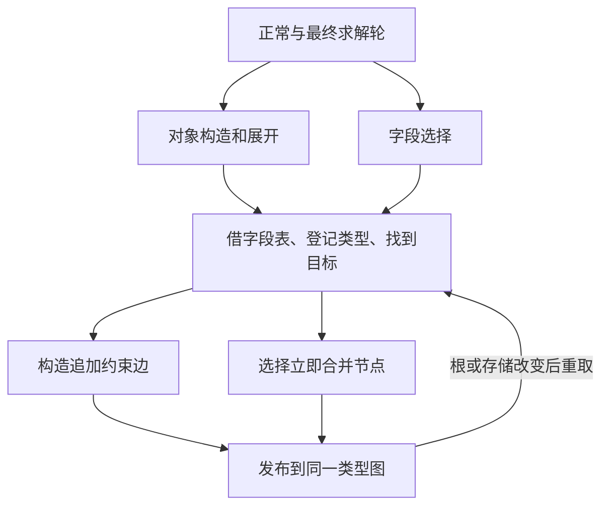

# 手写 Zig 净减少长执行计划

## Intent · 执行到什么位置

从 `master` 的 `4c11902b6` 起，以对象字段推导作为第一条完整调用链。先让正式编译器在对象构造、展开和字段选择时少依赖手写 Zig，再用同一口径判定主线是否进入净减少阶段。计划持续记录已退出的职责、实际数字和仍在执行的原生边界。

**本计划对“进入收敛”的执行定义**：至少两个相邻且可单独验收的迁移批次都让正式源码的手写 Zig 净减少；从固定起点到收口版本，全仓受跟踪的 Zig 和非 seed 包源码 Zig 也都净减少。每批要移除实际调用和对应的专用职责，行为、错误顺序及受影响性能有证据。文档提交、换名、移动文件、删 seed、删测试和压缩排版不计为一个迁移批次。上游若同时增加 Zig，分别公布本任务的差异和主线实际差异；主线未转负就继续。完整三阶段自举另按仓库完成标准验收。

## Data · 起点与已有证据

- 三个对象专用宿主文件合计 270 行。加上共有字段回放桥是 350 行；两个外层入口及两个投影交接文件另有 214 行。共同依赖是图节点、字段列、类型登记和写入后的视图刷新。三个文件对外提供 12 个专用回调，共有字段桥提供 5 个。[状态归属、源码与行数](2026-11-23/对象字段推导的宿主状态与迁移边界调查.md)
- 构造先取得目标字段，再登记来源，将带位置的赋值约束加入队列。选择先按顺序登记全部声明成员，再计算投影，立即合并目标与来源。普通轮能等待，最终轮要验证覆盖。共享视图可以复用，两种提交动作应分别保留。[构造应用](../packages/compiler/src/rx/analysis/inference/construction/application/advance.rx) · [字段选择入口](../packages/compiler/src/rx/analysis/inference/selection/apply.rx)
- 工具链以构建清单指定的 Zig 0.17.0 为准。初始 seed 生成引导器，再用固定 Source 引导器验收正式路径。性能沿用已有基线与实际受影响工作负载，同机比较时固定分区、优化模式和输入。[工具链清单](../packages/cli/build/toolchain/releases.json) · [前一阶段对照](2026-11-22/RX对象投影与字段写回自举.md)

## Edges · 范围与顺序

| 阶段                       | 应一起完成的工作                                                                                                                                                                       | 验收后怎样决定下一步                                                                                   |
| -------------------------- | -------------------------------------------------------------------------------------------------------------------------------------------------------------------------------------- | ------------------------------------------------------------------------------------------------------ |
| 0 固定基线                 | 记录远端起点、构建版本、现有入口和回归。准备可执行的初始引导器与正式 Source 对照工具。                                                                                                 | 先证明既有版本走通相同入口；基线自身的失败单独定位。                                                   |
| 1 字段读写和选择           | 沿字段查找、追加、声明类型登记、选择合并和最终诊断。将选择计划与应用接在同一 RX 流程，复用图的读写与原有物理存储。连同上层调用清理选择专用桥。                                         | 既有行为通过、同职责回调退出、记录本批净变化。若额外 Zig 抵消删除，在本链解决拥有者或适配问题再继续。  |
| 2 对象展开和构造字段       | 在同一对象的临时区中完成名字收集、展开就绪、候选选择和字段写回。复用第一批的字段视图、登记与共享求解状态，保留展开诊断位置和按需分配。清理两个构造专用桥及失去调用者的交接与生成登记。 | 从正式构造与选择入口重新追踪全部依赖，累计计算删除和新增。若两批已满足收敛定义，在这里停止。           |
| 3 仍不满足时沿写入端追     | 先处理本链留下的赋值登记、节点合并或就绪快照中的专用状态。优先选择上一批实际仍被调用、可让多个入口一起删桥的拥有者。将容量、长度、错误、刷新及调用方合并交付。                         | 每结束一个完整职责就重算相邻两批与累计指标。仍有增长时，写明增长的目录、函数和下一个能消除它的调用方。 |
| 4 本链已收口而主线仍净增时 | 从最新主线差异中取出增长最大的实际编译路径。按旧计划核对共享项目联结、缓存与 genz 生成，选一个仍在正式调用链的共同状态继续同样的整批迁移。                                             | 满足上述定义立即登记收敛版本。后续完整自举在已有总计划继续，避免为追求行数扩大到不相关产品工作。       |

保留共享图存储、名字寿命、并查集根、两个版本号以及对象就绪快照的原有契约。允许 Zig 提供通用分配、保留前缀及错误的最终交付。手写的字段选择、遍历、状态提交或诊断规则无论移进哪个目录都要列入待迁。仓库已有源码、回归和基线足够时直接复用。

## Answer · 每批怎么执行并交付

1. 固定批首提交、正常入口、要退出的具体函数、仍须保留的原生操作。先验证最可能阻塞本批的状态所有权或生成形态，再贯通同一职责的各调用方。
2. 在实际 Source 配置构建候选，运行已有的 RX 推导和受影响的对象回归；单独核对 seed。对运行路径或分配发生变化的部分复用既有固定输入，比较输出、诊断、运行时间与内存。失败时定位最早差异，修复并重跑有影响的检查。
3. 用 `git diff --no-renames --numstat "$base" "$tip" -- '*.zig'` 计算新增行减删除行。分别汇总全仓、`packages/*/src/` 下路径不含 `seed` 的文件和本批改到的共享实现。构建、测试、seed 与其他并行提交的变化列明归属。批内草稿可以增长，整批数字按已提交的两端快照核对。
4. 每一批把结果填入下表，连同代码、必要的总计划进度更新以英文规范提交推送。核对远端提交、净变化和正式调用关系后，按阶段表接续。只有真实验收、技术阻塞或用户改变执行范围才改变状态。

| 批次             | 起点与终点                | 实际退出的职责                                                                                     | 非 seed 包源码 / 全仓 Zig 净变化 | 验证与下一步                                                                                                                 |
| ---------------- | ------------------------- | -------------------------------------------------------------------------------------------------- | -------------------------------: | ---------------------------------------------------------------------------------------------------------------------------- |
| 基线             | `4c11902b6`               | 尚未开展代码迁移                                                                                   |                            0 / 0 | 固定本轮起点；先建立本机引导与回归对照。                                                                                     |
| 前置共用字段流程 | `98fadd8dd` → `081286a82` | 普通、开放与重放字段共用 Source，退出三个专用读写回调，合并字段索引与新增列由 Source 准备。        |                       −40 / +101 | 17,650 个生成文件一致，153 项 Zig、17 项 CLI 和 39 项 seed 通过。冷生成墙钟 +0.02 秒、CPU −0.02 秒。继续完成选择的整行切换。 |
| 1 字段选择       | `c4f7a907c` → `3b0f2d813` | 删除选择的 Zig 投影交接文件和应用宿主，Source 一次执行来源校验、成员登记、投影、合并与最终诊断。   |                        −51 / −52 | 17,651 个生成文件一致，153 项 Zig、17 项 CLI 与 39 项 seed 回归通过。冷生成墙钟 +0.04 秒、CPU −0.01 秒、进程树峰值 −1.9 MB。 |
| 2 对象构造       | `3b0f2d813` → `fa9b8d8d3` | 删除构造的 Zig 投影交接、展开宿主及应用宿主，Source 在同一对象暂存区校验、展开、选候选并写入约束。 |                      −104 / −106 | 17,640 个生成文件一致，153 项 Zig、17 项 CLI 与 39 项 seed 回归通过。冷生成墙钟持平、CPU −0.04 秒、进程树峰值 +1.1 MB。      |

截至远端 `081286a82`，固定起点 `4c11902b6` 的累计差异为非 seed 包源码 **−9**、全仓 Zig **+131**。其中 `0fa6c515d` 带来非 seed 包源码 +31、全仓 +30。同期选择整合与撤回的源码差异相抵。前置流程的非 seed 数字包含切出独立 seed 文件的影响，作为阶段 1 的输入，连续净减批次从阶段 1 开始计算。[前置验收](2026-11-22/RX字段访问与合并准备自举.md)

阶段 1 的非 seed 包源码新增 50 行、删除 101 行，全仓 Zig 新增 51 行、删除 103 行。固定起点 `4c11902b6` 到 `3b0f2d813` 累计为非 seed 包源码 **−60**、全仓 Zig **+79**。[字段选择验收](2026-11-22/RX字段选择整行自举.md)

阶段 2 的非 seed 包源码新增 164 行、删除 268 行，全仓 Zig 新增 165 行、删除 271 行。固定起点 `4c11902b6` 到远端收敛提交 `fa9b8d8d3` 累计为非 seed 包源码新增 641 行、删除 805 行，净减 **164** 行。全仓 Zig 新增 791 行、删除 818 行，净减 **27** 行。累计按两端仓库快照直接比较，计入同期提交。远端 `master` 已核对。两批为相邻实现提交，逐批和累计均达到本计划的收敛标准。[对象构造验收](2026-11-22/RX对象构造整行自举.md)
