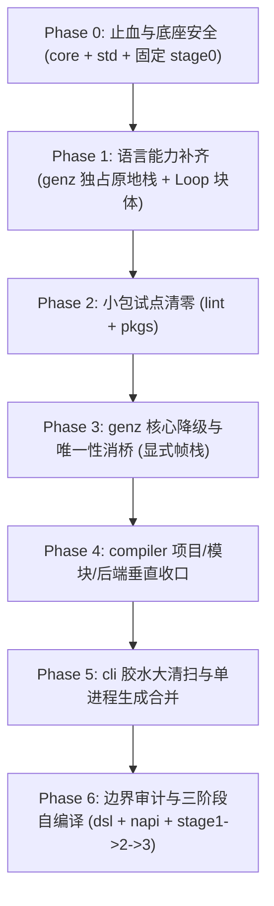

# zray 分包自举诊断与执行计划总览

> 基线版本：`4a1a0c5a`（2026-11-25）· 上位诊断报告：[自举进度诊断和指导报告.md](自举进度诊断和指导报告.md) · 越界专项台账：[越界写法治理清单.md](越界写法治理清单.md) · 验收终局标准：[自举完成标准.md](../../rules/自举完成标准.md) · 工程执行方法：[WAY.md](../../WAY.md)
> 本目录为 `packages/` 下所有与编译器自举及外部边界相关的模块/包建立**一包一档**的诊断与大步执行计划，用于替代过去“每 16 分钟微切片 + 乒乓跳板 + 单行净减”的低效推进方式。

---

## 一、全仓 13 个包自举现状总账（`HEAD 4a1a0c5a`）

| 包         | 角色定位                                 |                             非 seed Zig（`src`/快照） |       seed Zig |  `build` Zig |        RX / ZX | `.d.zx`（文件 / 函数） | `@ptrCast`/`anyopaque` | `@constCast` | 独立计划         |
| ---------- | ---------------------------------------- | ----------------------------------------------------: | -------------: | -----------: | -------------: | ---------------------: | ---------------------: | -----------: | ---------------- |
| `core`     | 共享 IR 表契约与内存原语                 |                                          89f / 9,066L |              0 |            0 |       4f / 88L |         267f / 10,351L |         17f / 341 函数 |          564 | 36               | [core.md](core.md)         |
| `dsl`      | XML 解析与语法组合底层库                 |                 13f / 1,453L（含 `examples`/`build`） |              0 |          30L |          0 / 0 |                  0 / 0 |                      0 |            0 | [dsl.md](dsl.md) |
| `std`      | 应用标准库与平台原语                     |         88f / 20,930L（含 1.63 万行 Unicode/IDNA 表） |              0 |            0 |          0 / 0 |         22f / 199 函数 |                     36 |            3 | [std.md](std.md) |
| `lint`     | 代码风格与结构检查器                     |     39f / 5,324L（`src` 1,808L + `bootstrap` 3,456L） |              0 |          72L |     11f / 298L |           36f / 1,699L |                      0 |           12 | 15               | [lint.md](lint.md)         |
| `pkgs`     | 包清单、依赖图与锁校验                   |                              13f / 968L（`src` 903L） |              0 |          66L |      6f / 296L |           77f / 3,713L |                      0 |           53 | 0                | [pkgs.md](pkgs.md)         |
| `genz`     | IR 唯一性/所有权分析与 Zig 代码生成      |                                        400f / 35,150L | 164f / 12,644L |            0 | 556f / 19,823L |      2,981f / 146,375L |         27f / 534 函数 |        1,288 | 61               | [genz.md](genz.md)         |
| `compiler` | 前端解析、主分析、项目联结、缓存与后端   | 823f / 77,642L（`src` 66,500L + `bootstrap` 10,990L） |  101f / 8,288L | 39f / 5,704L | 689f / 26,603L |      3,301f / 150,426L |         28f / 653 函数 |        2,434 | 165              | [compiler.md](compiler.md) |
| `cli`      | CLI 命令、构建驱动、`watch` 与工具链宿主 |                                        176f / 15,914L |              0 | 11f / 1,043L |  181f / 6,338L |         442f / 14,438L |         30f / 764 函数 |          989 | 17               | [cli.md](cli.md)           |
| `napi`     | Node N-API C-ABI 绑定运行桥              |                           8f / 438L（含 `build.zig`） |              0 |          16L |          0 / 0 |                  0 / 0 |                      0 |           16 | 0                | [napi.md](napi.md)         |

### 4 个外围/非编译器运行包（不列入自举迁移对象）

| 包         | 现有内容                                                                            | 不迁移原因与处置                                                                               |
| ---------- | ----------------------------------------------------------------------------------- | ---------------------------------------------------------------------------------------------- |
| `test`     | 1f/1,219L `src` + 130f/6,279L `build` + 976f/75,608L `tests` + 42f/101 函数 `.d.zx` | 一致性测试矩阵与测试夹具，不进入编译器正式传递依赖闭包；仅需随主线接口收口同步清理失效测试桩。 |
| `translib` | `SKILL.md` + `scripts/*.ts`（Node/TS 移库工具）                                     | 外部迁移辅助脚本，不含 Zig 编译器实现。                                                        |
| `skills`   | 面向 zray 应用开发者的 Markdown 文档                                                | 文档包，禁止写入内部自举源码细节。                                                             |
| `website`  | Next.js/Vinext 官网及 1 份 RX/ZX 示例                                               | 展示站点，与自举无关。                                                                         |

---

## 二、跨包依赖与全局执行顺序

切忌自底向上“先切叶子再搭桥”，必须先打通**底座安全与语言能力缺口**，再由小包试点验证大步合并范式，随后按**由外向内、先消跳板、后删活体 seed**的顺序推进三大重型包：

---

## 三、所有分包计划必须共守的 6 条硬门禁

1. **正向语义归属与多维验收红线（最高优先级，严禁反向撤回）**：`entries.zig` 入口数、`.d.zx` 原生函数数、`@ptrCast`/`anyopaque` 与 `Zig 换手率` 均为辅助指标，**绝对禁止通过删除已有 RX/ZX 编排或逻辑、把控制流或状态退回手写 Zig 来换取上述指标下降**；每批必须同步验证 **RX/ZX 实际接管的业务/编排范围净扩大 + 非平台手写 Zig 净退出 + 正确性/三阶段自编译/性能达标**。
2. **Zig 换手率红线（`新增 Zig / 删除 Zig ≤ 0.25`）**：除为消除 UB 改写底层类型签名外，任何功能迁移阶段每删 100 行旧 Zig，新增 Zig 不得超过 25 行。超过即停止拆分，改为合并上层调用链。
3. **边界只减不增红线**：在正向吸收底层 Zig 的前提下，`compiler/build/entries.zig`、`cli/build/*.json`、全仓 `.d.zx` `declare function` 及 `@ptrCast`/`anyopaque` 数量每阶段应同步净下降；不得以删 RX/ZX 退回 Zig 伪装“降边界”，亦不得新增纯选项/路径 `.d.zx` getter 或在 ZX 内使用 `mutable_opaque` 副作用回调（纯值直接入参，运行期共享可变对象由 `.store.rx` `<Store>` 显式承载）。
4. **禁止“活体双轨”继续生长**：停止新增 `*_seed.zig` 与 `if (generated)` 分支；阶段收口切换固定 `stage0` 引导器，旧实现直接物理删除。
5. **禁止 UB 换通过**：严禁使用 `*const anyopaque` + `@constCast` 写入宿主内存，严禁以 `noinline` 掩盖 `ReleaseSmall` 优化错误。
6. **1,500–3,000 行大步垂直收口与分层验证**：开发期仅跑受影响包/最小复现；禁止每微批跑全量 17,560 文件对照与三轮交错计时，仅在大阶段收口时集中验收并更新本目录各分包计划与总览。

---

## 四、阶段进展记录（随批更新）

- **Wave 1（2026-11-25 · 已完成）**：
    - 完成 `std` Phase S2：`AtomicRows` 及相关行读写原语已从 `std:bytes` 剥离并迁入内部 `core/memory`，全部 16 个 `compiler`/`genz` `.zx` 消费者已切换至 `"memory"`。
    - 完成 `lint` Phase L1/L2 首轮收口：删除 `packages/lint/bootstrap/` 6 份死快照（−3,341 行 Zig），将 6 个分散格式化/长度/边界规则合并为 `lint_layout`、`lint_rx`、`lint_config` 三个入口（`entries.zig` `.lint` 条目 **11 → 8**），并修复 `lint/src/configuration/rule.zig` `checkLength` 分配器参数错误。
    - 完成非自举 `*_seed.zig` 与双轨分支清扫：删除 `verification`、`backends/hardware`、`backends/verilog`、`backends/zig/gateway`、`rx/analysis/gateway`、`genz/src/gateway`、`genz/src/host` 下 **47 份**非自举 `*_seed.zig` / `seed/*.zig` 与对应 `!generated` / `!generated_parser` / `!generated_analysis` / `!generated_graph` 退路分支（共删 **4,030 行**、净增 **94 行**，Zig 换手率 **0.023**），仅保留 `stage0 == ""` 必需的 `catalog_seed.zig` 与 `bindings_seed.zig`（`bootstrapReexports`）。
    - 完成三阶段自编译与性能验收（`ReleaseSmall -Dgenerated-partitions=4`）：`stage0 == ""` → `stage1` → `stage2` → `stage3` 全部通过，`stage2`/`stage3` 产物 `zxc-bootstrap` 二进制 SHA-256 完全一致（`a9b41aed3368bb0848f8f530077ef970e82d9ed9a2283c599a86598434b197f8`，6,389,808 B），生成的 `main` 清单 **12,757 个文件**逐字节一致；`packages/compiler` 与 `packages/cli` 全量测试全部通过；`main` 清单冷生成墙钟 **3,272.47 ms**（基线 `3,213.37 ms`，`infer` 1,322 ms / `emit` 1,030 ms，峰值 RSS 862.9 MiB），热生成中位数 **40.15 ms**（基线 `39.40 ms`），均在容差内。
- **Wave 2（2026-11-25 · 已完成）**：
    - 完成 `cli` Phase X1（7→1 单进程生成合并 & `cache_identity` 复核）：删除 `packages/cli/build/` 下 `backend`/`observation`/`packages`/`store`/`toolchain`/`watch.json` 6 份碎片清单，将全部根路径、30 个入口（重命名 5 处重名入口）与 13 份接口合并入 `packages/cli/build/source.json`；重写 `packages/cli/build/source.zig` 为单次 `generate CLI source modules (cli)` 进程并同步更新 `build.zig` 与全部 26 处 CLI Zig 调用方；核实 `build/cache_identity.zig` 与 `digest.zig` 已改为发射 `digest.bin` + `cache_identity.s` 且按独立槽位收集哈希无并发竞态。
    - 完成 `core` Phase C1 / `std` Phase S1 Hop 1（`mutable_opaque` 可变原生句柄支持）：扩展 `core/src/type_table/structure.zig` 允许 `Kind.NativeReference` 使用 `first = 1`，打通 `compiler`（语义解析、种子解析与相等性校验）和 `genz`（新增 `ExpressionsKind.Pointer` / `Expressions.pointer` 分支发射 `*T`），使原生接口可区分只读 `opaque`（`*const T`）与可写 `mutable_opaque`（`*T`）。
    - 完成 Wave 2 三阶段自编译与测试验收（`ReleaseSmall -Dgenerated-partitions=4`）：`stage0 == ""` → `stage1` → `stage2` → `stage3` 全部通过，`stage2`/`stage3` 产物 `zxc-bootstrap` 二进制 SHA-256 完全一致（`adcb274ae86d00ac72ed0bbe87640d96f8ab67b23a7c8576f0c6adb7b665ea5d`），`main` 清单 **12,757 个文件**逐字节一致；`packages/compiler` 测试（`33/33`）、`packages/cli` 测试（`104/104`）与 `packages/cli` 构建（`75/75`，仅 1 次 `generate CLI source modules`）全部通过。
- **Wave 3（2026-11-25 · 已完成）**：
    - 完成 `core` Phase C1 与 `std` Phase S1（彻底清零 `@constCast` UB 与 `noinline`）：将 `std`（`Writer`、`StringSet`）及 `core/memory` 全部可写原生句柄切换为 `mutable_opaque`（`*T`），引入只读 `U32View`/`U64View`/`StringViews`（`opaque`），同步更新 `WriteFields` `*Self` 接收者、`columns.zig` `.one` 指针兼容性及 `compiler`/`genz`/`pkgs`/`cli` 全部 `.zx`/`.rx`/`.zig` 调用方；彻底删除 `packages/core/src/memory/` 全部 **36 处 `@constCast` 与 3 处 `noinline`** 及 `packages/std/src/` 全部 **3 处 `@constCast`**，跨包验证 `@constCast == 0` 且 `noinline == 0`。
    - 顺带排查并修复 `core/memory`（`column_range.zig`、`column_set.zig`、`column_transfer.zig`）跨分区回调传回 Zig `Allocator.Error` 导致各编译单元错误标签不一致、在 `ReleaseSafe` OOM 注入下触发 `bridge.zig` `unreachable` 的隐蔽 ABI 缺陷（改为跨边界返回 `bool` 并在分区内还原 `error.OutOfMemory`），同时在 `compiler/build.zig` 与 `cli/build.zig` 为 `ReleaseSafe` 测试/生成模块对齐 `.strip = if (optimize == .safe) true else null`（保留完整安全检查）。
    - 同步升级本机与全仓 Zig 工具链至 **0.17.1**（更新根与 10 个子包 `build.zig.zon`、`packages/cli/build/toolchain/releases.json` 5 个宿主校验和、`.github/tsflows/build.ts`、`build.generated.yml` 与公开文档），并简化 `docs/user_request.jsonl` 仅保留 `text` 字段及更新 `AGENTS.md`。
    - 完成 Zig `0.17.1` 下全量验收：三阶段 `ReleaseSmall -Dgenerated-partitions=4` 自编译（`stage1` → `stage2` → `stage3`）二进制 SHA-256 完全一致（`15e99fa0a5acfcae544f36568bbaecf12c3e196aa206a15af3bef74ccddf8001`），`stage2`/`stage3` 生成的 `main` 清单 **12,793 个文件**逐字节一致（`equal: true`）；`packages/{core,std,pkgs}`（`ReleaseSmall` 与 `ReleaseSafe` 构建）、`packages/compiler`（`ReleaseSmall` 与 `ReleaseSafe` 全部测试 `372/372`）及 `packages/cli`（`ReleaseSmall` 与 `ReleaseSafe` 构建及全部测试）均全部通过。
- **Wave 4（2026-11-25 · 已完成）**：
    - 完成 `genz` 叶子表达式与路径投影去跳板（Phase G1 叶子收口）：将 `Unary`、`Binary`、`Conditional`、9 类 `Literal`、`Read` 分发、`Optional`、`Length`、`Field`、`FieldPath`/`ProjectionPath` 下沉为直接 ZX 调用（通过 `lower` 入口按 `[512]u8` `BufferFirstAllocator` 栈空间 + `ArenaAllocator` 直接传入 `expressions`/`types`/`AstWriter` 与 `OriginBuffer`），删除 `packages/genz/src/analysis/` 下 `literals/build.rx`、`operators/build.rx`、`access/projection/fields.zx`、`read/{columns,const}.zx` 与 `packages/genz/src/zx/` 下 `literals.zig`、`operators/{unary,binary}.zig` 共 **8 份**死文件，注销 [packages/compiler/build/entries.zig](../../packages/compiler/build/entries.zig) 中 **10 条** `genz` 入口，精简 `evaluate/{native,read,frames}.d.zx` 移除 **13 个**宿主回调与 `ReadAction`/`ConditionalPart`；同时在 [packages/compiler/build/parser.zig](../../packages/compiler/build/parser.zig#L233-L235) 为 `.execution` 补充 `.ast` 与 `.printer` `addSubtree` 缓存输入。
    - 完成 `lint` 布局投影迁移（Phase L1 推进）：将 [projection.zig](../../packages/lint/src/layout/projection.zig) 收薄为轻量 `RawSpan`/`Op` 记录器（保留 OOM `failed` 状态位），将词法合并与全部 7 类布局投影操作迁入 `packages/lint/src/layout/projection.zx` 及 `projection/{init,find,opening_at_end,condition,exclude_range,list,set_token}.zx`，并接入 [entry.rx](../../packages/lint/src/layout/entry.rx)；同步消除 `lint/layout/rule.zig`（`attributeRequired`）与 `lint/configuration/rule.zig`（`checkLength`）在 Wave 1 入口合并后遗留的 `[0]u8` `FixedBufferAllocator` OOM 导致 `ReleaseSmall` `SIGSEGV` 的隐患（均改为 `[256]u8`）。
    - 完成全量验收与性能比对（Zig `0.17.1`、`ReleaseSmall -Dgenerated-partitions=4`）：`stage0 == ""` → `stage1` → `stage2` → `stage3` 全部通过，`stage2`/`stage3` `zxc-bootstrap` 二进制 SHA-256 完全一致（`74d96a6d0b34746d82325ff0b7b76f6e2d8d5e98e03867a9f0d5ccc0c3fe03fa`），输出逐文件一致；`main` 清单冷生成墙钟 **3,180.9 ms**（Wave 1 基线 `3,213.37 ms`，`infer` 1,375 ms / `emit` 1,035 ms），热生成 **39.8 ms**；`packages/{core,std,pkgs,compiler,cli}` `ReleaseSmall` 与 `ReleaseSafe` 构建/测试、`packages/lint -Dseed=true`、`packages/test` `test-rx-formatting`（含 `allocation_test.zig` OOM 检查与 52 项 CLI 用例）及 `test-configuration-formatting`（126 项 + 4 项锁测试 + 15 项索引测试）、以及全仓 `.zig`/`.rx`/`.zx` 格式化与 lint 检查均全部通过。
- **Wave 5（2026-11-25 · 已完成）**：
    - 完成 `cli`（17 处 → **0**）与 `genz`（61 处 → **0**）全部 `@constCast` UB 清零：将 `cli` 14 份宿主 `.d.zx`（含 `publication`/`document`/`build`/`toolchain`/`package` 等）与 `genz` 45 个可变宿主句柄切换为 `mutable_opaque`（`*anyopaque` / `*T`），保留 17 个只读句柄为 `opaque`，同步更新对应 Zig 宿主桥；将 `genz/src/zx/types/state.zig` 改为 `copyIds` 分配，`uniqueness/flow` 区分 seed 可变缓冲与生成态布局，并将 `uniqueness/summaries`（`summaries/{model,allocate,create}`、`program/{model,prepare}` 与 `zx/uniqueness/summaries/{storage,lifecycle}.zig`）改为通过 `memory.allocateU8Buffer` 直接填充宿主持有的 `[]u8` 缓冲并保留 `RowBuffer` 行视图零拷贝别名（使用 `executeIn`）。至此 `core/src/memory`、`std/src`、`lint/src`、`pkgs/src`、`genz/src`、`cli/src` **六大包全量清零 `@constCast`**。
    - 完成 `genz` `match` 与 `capture` 去跳板：移除 `analysis/expressions/evaluate/match.d.zx` 中 `lowerMatchEquality` / `lowerMatchLiteral` 宿主回调及 `zx/match.zig` 对应胶水，在 `analysis/match/evaluate.zx` 直接调用 `binary` 与 `host.lowerRegular` 并切换 `zx/match.zig` 为 `executeIn`；将 `capture_names` 并入 `analysis/capture/prepare.zx`，从 [entries.zig](../../packages/compiler/build/entries.zig) 注销 `capture_names`（`main` 入口 **630 → 629**）。
    - 完成全量验收与性能比对（Zig `0.17.1`、`ReleaseSmall -Dgenerated-partitions=4`）：`stage0 == ""` → `stage1` → `stage2` → `stage3` 全部通过，`stage2`/`stage3` `zxc-bootstrap` 二进制 SHA-256 完全一致（`422ff2fa21c57fc14a1b9c814c16abdec9a01555658f96289db0f9989f910996`），`main` 清单 **5,868 个生成单元**逐文件一致（`diff -rq` 退出 `0`）；非驻留冷生成墙钟 **3,255.6 ms**（Wave 1 基线 `3,213.37 ms`，`infer` 1,371 ms / `emit` 1,025 ms），热生成 **39.8 ms**；`packages/{core,std,pkgs,compiler,cli}` `ReleaseSmall`/`ReleaseSafe` 构建与测试、`packages/lint -Dseed=true`、全仓 `.zig`/`.rx`/`.zx` 格式化与 lint、以及六包 `@constCast == 0` 审计全部通过。
- **Wave 6（2026-11-25 · 已完成）**：
    - 完成 `packages/compiler`（`src/` + `build/`）全部 **149 处 `@constCast` UB 清零**：删除 `retention/order.zx` 与 `parser_publish_orders` 跳板（[entries.zig](../../packages/compiler/build/entries.zig) 入口 **629 → 628**），将 `retention/order.zig` 收薄为 `fill()` 并在 `compact_output.zig` 内直接完成表填充，消除了 `retention/host.zig`、`zx/frontend`、`zx/analysis`、`zx/modules`、`rx/analysis`、`backends`、`verification`、`inputs` 与 `build/` 下全部非句柄 `@constCast`；同时将 117 处可变宿主句柄切换为 `mutable_opaque`（`*anyopaque` / `*T`）。至此 **全仓 10 个非测试源码目录（`core`/`std`/`lint`/`pkgs`/`genz`/`cli`/`compiler`/`dsl`/`napi`）`@constCast == 0`**，Phase 0 `@constCast` UB 止血彻底完成。
    - 完成全量验收与性能比对（Zig `0.17.1`、`ReleaseSmall -Dgenerated-partitions=4`）：`stage1` → `stage2` → `stage3` 全部通过，`stage2`/`stage3` `zxc-bootstrap` 二进制 SHA-256 完全一致（`ad48a78aeff912a822655b58febd4a4db12bae6c391e94da402f2f8e35a3ccc4`），`main` 清单 **5,868 个生成单元**逐文件一致（`diff -rq` 退出 `0`）；非驻留冷生成墙钟 **3,157.7 ms**（优于 Wave 5 `3,255.6 ms` 与 Wave 1 基线 `3,213.37 ms`，`infer` 1,388 ms / `emit` 1,042 ms / `write` 353 ms），热生成 **60.1 ms**；`packages/compiler` 与 `packages/cli`（`ReleaseSmall`/`ReleaseSafe`）构建与全量测试、以及 `.zig`/`.d.zx` 格式化与 lint 检查全部通过。
- **Wave 7（2026-11-25 · 已完成）**：
    - 完成 `genz` 四组表达式降低跳板去跳板收口：将 `store_access`、`execute_task_future`、`checked_index` 与 `projection_result` 直接下沉入 `packages/genz/src/analysis/expressions/{evaluate,read}/`（`evaluate/{store,future,future_complete}.zx`、`read/emit_index.zx`、`read/{list,path,segment}.zx`、`tasks/parallel/execute/branch.rx` 及 `consumer/read/{model,run.rx,prepare,execute}.zx`），并消除 `zx/tasks/root.zig`（`wait`/`cancel`/`complete`/`lowerTaskOperand`）、`zx/expressions/{evaluate/native,read}.zig` 与 `zx/access/projection/read.zig` 对应胶水，注销 [entries.zig](../../packages/compiler/build/entries.zig) **4 条** `genz` 入口（`628 → 624`）、移除 `evaluate/{native,read,optimization}.d.zx` **5 个**宿主回调并物理删除 `zx/access/store.zig`、`zx/intrinsics/index.zig` 及 `analysis/{access/store,intrinsics/index,tasks/future/execute}` 等 **13 份**死文件（`intrinsics/index` 仅保留 seed 退路）；顺带修复 [input_snapshot_seed.zig](../../packages/compiler/build/input_snapshot_seed.zig) `i32`/`u64` 种子字段类型与 `ir`/`Snapshot` 不一致导致的 `stage0 == ""` 编译失败。
    - 完成全量验收与性能比对（Zig `0.17.1`、`ReleaseSmall -Dgenerated-partitions=4`）：全仓 10 个非测试源码目录 `@constCast == 0`、`stage0 == ""` 种子构建与 `stage1` → `stage2` → `stage3` 全部通过，`stage2`/`stage3` `zxc-bootstrap` 二进制 SHA-256 完全一致（`ea56b109280a7fc6e6ea4f083015d3031b7700888f6bc74938932da636ee9a62`），`diff -rq out-stage2 out-stage3` 退出 `0`；`main` 清单（5,863 生成单元）非驻留冷生成墙钟 **3,181.5 ms**（CPU `15,437.4 ms`，`infer` 1,403 ms / `emit` 1,058 ms / `write` 362 ms，对比 Wave 1 基线 `3,213.37 ms`、Wave 6 `3,157.7 ms`），热生成 **42.1 ms**（CPU `40.9 ms`）；`packages/compiler` 与 `packages/cli`（`ReleaseSmall`/`ReleaseSafe`）构建及全量测试、以及 `scripts/format.mjs --check` 与 `.zx`/`.d.zx`/`.rx` `zxc fmt --check` / `zxc lint` 全部通过。
- **Wave 8（2026-11-25 · 已完成）**：
    - 完成 `genz` 语句降低管线去跳板收口：将 `statement_block_plan`、`statement_run_commit`、`statement_evaluation`、`statement_branch`、`statement_store_write`、`publish_destructure` 与 `publish_statement_result` 直接下沉入 `analysis/statements/{emit,traversal/execute}/`（`emit/{store_write,destructure,result_publish}.zx`、`emit/{body,binding,prefix,result,publish,model}.zx`、`emit/run.rx` 与 `traversal/execute/{open_scope,step,range,host}.zx`、`traversal/execute/{flat,next_statement,next_action,walk,run}.rx`）；将 `statements/traversal/host.zig` 异常回滚改为 LIFO `defer` 并移除每条语句 4 KB 栈 arena 往返，统一 `executeSpan` 至 `construction/publication.zig`；注销 [entries.zig](../../packages/compiler/build/entries.zig) **7 条**入口（`statement.d.zx` 回调 **39 → 27**，净减 **12 个**、零新增 `.d.zx` 函数），并物理删除 `zx/statements/{block,publication}.zig`、`zx/statements/{destructure,result}/lower.zig` 及 `analysis/statements/{basic,destructure,result,traversal/execute/rollback}` 等 **16 份**死文件。
    - 完成全量验收与性能比对（Zig `0.17.1`、`ReleaseSmall -Dgenerated-partitions=4`）：全仓 10 个非测试源码目录 `@constCast == 0`、`stage0 == ""` 种子构建与 `stage1` → `stage2` → `stage3` 全部通过，`stage2`/`stage3` `zxc-bootstrap` 二进制 SHA-256 完全一致（`c9a758bc51e4435eb13f425b3af4988941d7ccac1600b6c1ab9c2d3cc8aef96b`），`diff -rq out-stage2 out-stage3` 退出 `0`；`main` 清单（5,859 生成单元）非驻留冷生成墙钟 **3,213.0 ms**（CPU `15,422.1 ms`，`infer` 1,402 ms / `emit` 1,054 ms / `write` 416 ms，对比 Wave 1 基线 `3,213.37 ms`、Wave 7 `3,181.5 ms`），热生成 **43.7 ms**（CPU `42.4 ms`）；`packages/compiler` 与 `packages/cli`（`ReleaseSmall`/`ReleaseSafe`）构建及全量测试、以及 `scripts/format.mjs --check` 与 `.zx`/`.d.zx`/`.rx` `zxc fmt --check` / `zxc lint` 全部通过。
- **Wave 9（2026-11-25 · 已完成）**：
    - 完成 `genz` 语句 `switch` / 常量标签选择去跳板收口：将 `selection_labels`、`switch_name`、`switch_reference` 与 `switch_labels` 直接下沉入 `analysis/statements/traversal/execute/`（新增 `selection_open.zx`、`selection_resolve.zx`，更新 `case.zx`、`step.zx`、`open_scope.zx`、`model.zx`、`emit/destructure.zx`）；精简 `zx/statements/switch/state.zig` 与 `zx/statements/traversal/host.zig`，将 `zx/{match,statements/switch}/seed.zig` 直指 `selection/seed.zig`；注销 [entries.zig](../../packages/compiler/build/entries.zig) **4 条**入口（`statement.d.zx` 回调 **27 → 21**，净减 **6 个**、零新增 `.d.zx` 函数），并物理删除 `zx/selection.zig`、`zx/statements/switch/references.zig`、`analysis/statements/switch/labels.zx` **3 份**死文件。
    - 完成全量验收与性能比对（Zig `0.17.1`、`ReleaseSmall -Dgenerated-partitions=4`）：全仓 10 个非测试源码目录 `@constCast == 0`、`stage0 == ""` 种子构建与 `stage1` → `stage2` → `stage3` 全部通过，`stage2`/`stage3` `zxc-bootstrap` 二进制 SHA-256 完全一致（`319d9cafa9a50763f1ac6ea54768d8923bedeb31927938e28c27c6ea5a7edc52`），`diff -rq out-stage2 out-stage3` 退出 `0`；`main` 清单（5,842 生成单元）非驻留冷生成墙钟 **3,234.2 ms**（CPU `15,403.9 ms`，`infer` 1,428 ms / `emit` 1,043 ms / `write` 401 ms，对比 Wave 1 基线 `3,213.37 ms`、Wave 8 `3,213.0 ms`），热生成 **41.9 ms**（CPU `40.5 ms`）；`packages/compiler` 与 `packages/cli`（`ReleaseSmall`/`ReleaseSafe`）构建及全量测试、以及 `scripts/format.mjs --check` 与 `.zx`/`.d.zx`/`.rx` `zxc fmt --check` / `zxc lint` 全部通过。
    - 下一步：推进 Wave 10（`packages/pkgs` Phase K1 + `cli/package/` 或 `genz` `Scope`/`Aggregate`/`Capture`/`Match` 下一垂直收口批）。
- **Wave 10（2026-11-25 · 已完成）**：
    - 完成 `genz` 聚合（对象/序列/借用实参/迭代操作数）去跳板收口：在 `analysis/aggregate/execute/` 新增 `bind_operand.zx`、`retire_operands.zx`、`finish_block.zx`、`borrowed_field.zx` 与 `object_literal.zx`，将对象元素执行下沉入 `expressions/aggregate/execute/object/{model,operands,fields}.zx` 与 `object.zx`，将序列/迭代操作数执行分别整合入 `expressions/aggregate/execute/{sequence,iteration}.zx`，并将借用实参对象/元组物化整合入 `value/call/argument/materialize/{model,evaluation,fields,prepare_object,object.rx,prepare_tuple,tuple.rx,index.zx}`；对应精简 `zx/aggregate/object_execution.zig`（移除 `Frame` 临时切片与 `reserveObjectOperand`/`publishObjectOperands`）、`zx/aggregate/sequence.zig`（移除 `generated_aggregate_sequence` 并直调内聚降低）、`zx/iteration_value/operands.zig`、`zx/value_call/{argument_object,argument,borrowed_argument}.zig`，并将 `zx/aggregate/{operands,object,layout,borrowed}.zig` 收口为纯 seed 模块；注销 [entries.zig](../../packages/compiler/build/entries.zig) **7 条**入口（`aggregate_tuple`、`aggregate_sequence`、`object_layout_plan`、`aggregate_operand_bindings`、`aggregate_operand_retirement`、`aggregate_object`、`object_borrowed_field`，`main` 入口 **621 → 618**），从 `evaluate/{aggregate,call,frames}.d.zx` 移除 **11 个**宿主回调（零新增 `.d.zx` 函数）与 `BorrowedObject`/`BorrowedTuple` 两个不透明句柄，并物理删除 `operands/{publish_bindings.rx,publish_retirement.rx,publication.zx}`、`layout/borrowed/{build.rx,model.zx}`、`object/{publish.rx,publication.zx}`、`aggregate/tuple.zx`、`materialize/tuple.zx`、`zx/aggregate/literals.zig` 共 **10 份**死文件。
    - 完成全量验收与性能比对（Zig `0.17.1`、`ReleaseSmall -Dgenerated-partitions=4`）：全仓 10 个非测试源码目录 `@constCast == 0`、`stage0 == ""` 种子构建与 `stage1` → `stage2` → `stage3` 全部通过，`stage2`/`stage3` `zxc-bootstrap` 二进制 SHA-256 完全一致（`f72e431459d354ab6290173a32c3b4e9836ba7954ac22003c7f1db60922460e1`），`diff -rq out-stage2 out-stage3` 退出 `0`；`main` 清单（618 入口 / 5,476 模块 / 5,017 函数文件 / 5,835 生成单元）非驻留冷生成墙钟 **3.46 s**（CPU `16.29 s`，`infer` 1,500 ms / `emit` 1,140 ms / `write` 413 ms，对比 Wave 1 基线 `3,213.37 ms`、Wave 9 `3,234.2 ms`），热生成 **0.04 s**；`packages/compiler` 与 `packages/cli`（`ReleaseSmall`/`ReleaseSafe`）构建及全量测试、以及 `scripts/format.mjs --check` 与 `.zx`/`.d.zx`/`.rx` `zxc fmt --check` / `zxc lint` 全部通过。
    - 下一步：推进 Wave 11（`genz` `scope` 作用域执行 / `capture` 去跳板或 `packages/pkgs` + `cli/package/`）。
- **Wave 11（2026-11-25 · 已完成）**：
    - 完成 `genz` 集合操作（`collections`、`list_update`）、高阶变换（`transform`）与作用域绑定（`scope`）去跳板收口：在 `analysis/aggregate/execute/` 抽取 `finish_stored.zx`，在 `analysis/collections/workflow/` 新增 `emit_flag.zx`、`emit_unit.zx`、`emit_length.zx`、`emit_cast.zx` 并直接下沉求值/绑定/头部/长度/类型转换与块收尾，内联 `list_update_bounds` 为 `analysis/collections/update/check_bounds.zx` 并同步更新 `collections/update/{workflow,operand,convert,evaluate.rx,run.rx}`；在 `analysis/transform/execute/` 新增 `fresh_name.zx`、`reduce_initial.zx`、`renewal.rx` 并直接下沉上下文初始化、命名、类型/主体求值、映射绑定与归约状态读取；在 `analysis/scope/bindings/` 将丢弃求值切换至 `lowerDiscardedExpression` 并用 `finish_stored` 完成常规作用域块。
    - 精简 `zx/collections/workflow.zig`（移除 8 个回调）、`zx/list_update.zig`（移除 `checkCollectionIndex`）、`zx/transform/{execution,collect,reduce}.zig`（移除 12 个回调）、`zx/scope/execute.zig`（移除 `discardScopeOperand`/`completeScopeBlock`），总计从 `evaluate/{collections,transform,scope}.d.zx` 净减 **23 个**宿主回调（`collections` 23→14、`transform` 23→11、`scope` 8→6，零新增 `.d.zx` 函数），从 [entries.zig](../../packages/compiler/build/entries.zig) 注销 `list_update_bounds` 入口并物理删除死文件 `packages/genz/src/analysis/collections/update/bounds.rx`。
    - 完成全量验收与性能比对（Zig `0.17.1`、`ReleaseSmall -Dgenerated-partitions=4`）：全仓 10 个非测试源码目录 `@constCast == 0`、`stage0 == ""` 种子构建与 `stage1` → `stage2` → `stage3` 全部通过，`stage2`/`stage3` `zxc-bootstrap` 二进制 SHA-256 完全一致（`895c156a2c26861510e0d08fb8a87621ab5e4b401f3909bdf1c47a2b0d84f67b`），`diff -rq out-stage2 out-stage3` 退出 `0`；`main` 清单（618 入口 / 5,476 模块 / 5,017 函数文件 / 5,835 生成单元）非驻留冷生成墙钟 **3.16 s**（CPU `15.25 s`，`infer` 1,370 ms / `emit` 1,047 ms / `write` 390 ms，优于 Wave 10 `3.46 s` 与 Wave 1 基线 `3,213.37 ms`），热生成 **0.04 s**；`packages/compiler` 与 `packages/cli`（`ReleaseSmall`/`ReleaseSafe`）构建及全量测试、以及 `scripts/format.mjs --check` 与 `.zx`/`.d.zx`/`.rx` `zxc fmt --check` / `zxc lint` 全部通过。
- **Wave 12（2026-11-25 · 已完成）**：
    - 完成 `genz` `optimization.d.zx`（排序 `sorting/{root,worker}`、任务 `tasks/{root,worker,parallel}`、并行语句与工作器 `parallel/{root,worker}`）与 `call.d.zx`（普通/值调用执行与块收口 `invocation/execute`、迭代调用 `iteration_value/invocation`、借用调用实参 `value_call/argument`）去跳板收口：在 `analysis/sorting/execute/` 新增 `bind_environment.zx` 并复用 `bind_operand`/`emit_flag`；将 `startInlineTask` 泛化支持 `concurrent: bool`，将 `future_complete.zx` 与 `tasks/parallel/execute/run.rx` 收口至 `finish_stored`、`labels.zx`、`branches.zx` 与 `result.zx`（直调 `host.finishObject`）；在 `parallel/emit/execute/` 新增 `branches.zx` 与本地 `Record` 模型，在 `invocation/execution/` 下沉块收尾至 `emit.zx` 并直连 `lowerCall`/`lowerRegular` 与 `lowerExistingBorrowedOperand`。
    - 精简 [optimization.d.zx](../../packages/genz/src/analysis/expressions/evaluate/optimization.d.zx)（43→21，净减 **22 个**回调）与 [call.d.zx](../../packages/genz/src/analysis/expressions/evaluate/call.d.zx)（29→20，净减 **9 个**回调），合计净减 **31 个**宿主回调（零新增 `.d.zx` 函数），移除 `ParallelFrame`/`ParallelRecords` 2 个不透明类型、`TaskParallelNames`/`ParallelRecord` 2 个宿主 ABI 结构体及 `packages/genz/src/root.zig` 中 `zx/tasks/parallel.zig` 宿主模块注册，并物理删除 `tasks/parallel/execute/{branch.rx,index.zx}` 与 `parallel/emit/execute/branch.rx` **3 份**跳板文件。
    - 完成全量验收与性能比对（Zig `0.17.1`、`ReleaseSmall -Dgenerated-partitions=4`）：全仓 10 个非测试源码目录 `@constCast == 0`、`stage0 == ""` 种子构建与 `stage1` → `stage2` → `stage3` 全部通过，`stage2`/`stage3` `zxc-bootstrap` 二进制 SHA-256 完全一致（`810881c43322096fabf7b83f3254752fa180e511eb0859549642d4deda7605e7`），`diff -rq out-stage2 out-stage3` 退出 `0`；`main` 清单（618 入口 / 5,476 模块 / 5,017 函数文件 / 5,835 生成单元）非驻留冷生成墙钟 **`stage2` 3.20 s**（CPU `15.37 s`，`infer` 1,356 ms / `emit` 1,068 ms / `write` 413 ms）/ **`stage3` 3.17 s**（对比 Wave 11 `3.16 s` 与 Wave 1 基线 `3,213.37 ms`），热生成 **0.05 s**；`packages/compiler` 与 `packages/cli`（`ReleaseSmall`/`ReleaseSafe`）构建及全量测试、以及 `scripts/format.mjs --check` 与 `.zx`/`.d.zx`/`.rx` `zxc fmt --check` / `zxc lint` 全部通过。
- **Wave 13（2026-11-25 · 已完成）**：
    - 完成 `genz` `iteration.d.zx`（循环工作流 `iteration/workflow/execute`、循环释放 `release_loop`、循环结果收口 `iteration/result/finish/execute` 与字段布局 `iteration/fields/ownership`）垂直去跳板收口：在 `zx/iteration/execution/frame.zig` 内联 `Frame.release()` 并在 `zx/iteration.zig` 以栈 arena 替代 `generated_release_loop`，删除 `release.rx`、`close_update.zx` 与 `parameters/{restore,remove_pair}.zx` 共 **4 份**死文件并注销 [entries.zig](../../packages/compiler/build/entries.zig) `release_loop` 入口；在 `iteration/workflow/execute/` 新增 `emit_dereference.zx`、`parameter_layout.zx` 与 `prepare_fields.zx`，通过 `bind_operand`、`finish_block`、`emit_unit`、`lowerLayout`、`setLoweringSerial` 与 `ast_rows` 直接完成解引用/单元值/序列/守卫标识符发射并收薄 `zx/iteration/execution/{prepare,emission}.zig`、`zx/iteration/result.zig` 及 `zx/iteration/fields/ownership.zig`。
    - 精简 [iteration.d.zx](../../packages/genz/src/analysis/expressions/evaluate/iteration.d.zx)（81→50，净减 **31 个**回调，零新增 `.d.zx` 函数）并移除 `iteration_frames.d.zx` 中 `LoopInitial`/`LoopStorage` 两个宿主 ABI 枚举。
    - 完成全量验收与性能比对（Zig `0.17.1`、`ReleaseSmall -Dgenerated-partitions=4`）：全仓 10 个非测试源码目录 `@constCast == 0`、`stage0 == ""` 种子构建与 `stage1` → `stage2` → `stage3` 全部通过，`stage2`/`stage3` `zxc-bootstrap` 二进制 SHA-256 完全一致（`ee7e01443edbb564cf62178131d8128a64e85a671c159d597cc9b58d156fe0e7`），`diff -rq out-stage2 out-stage3` 退出 `0`；`main` 清单（5,476 模块 / 5,017 函数文件 / 5,835 生成单元）非驻留冷生成 **`stage2` 3.22 s**（CPU `15.44 s`，`infer` 1,390 ms / `emit` 1,049 ms / `write` 407 ms，对比 Wave 12 `3.20 s` 与 Wave 1 基线 `3,213.37 ms`），热生成 **0.06 s**；`packages/compiler` 与 `packages/cli`（`ReleaseSmall`/`ReleaseSafe`）构建及全量测试、以及 `scripts/format.mjs --check` 与 `.zx`/`.d.zx`/`.rx` `zxc fmt --check` / `zxc lint` 全部通过。
- **Wave 14（2026-11-25 · 已完成）**：
    - 完成 `genz` 循环发布（`iteration_state_declaration`、`iteration_assignment`）、字段所有权投影（`rebuild_loop_fields`）、消费投影判断（`iteration_layout/select`）、前置条件（`preconditions`）、资源/表示辅助（`list_emission`、`element_emission`、`iteration_value/result`）与作用域任务绑定（`scope/execute`）垂直去跳板收口：将 `iteration_state_declaration` 与 `iteration_assignment` 迁入 `entries.execution` 直接通过 `ast_rows` / `retainLoweringText` / `setLoweringSerial` 发布 AST 行；将 `apply_loop_field_projection` 与 `publishLoopFieldOperands` 合并入 `rebuild_loop_fields`；将 `loopConsumerProjection` 预计算迁入 `zx/iteration_layout/select.zig`；将 `precondition_guard` 内联进 `lower_preconditions` 并删除 `zx/intrinsics/guard.zig`、`FragmentKind.Guard` 与 `FragmentBody.BorrowedRoots`；将 `listRepresentationLayout` / `elementStoredLayout` 切换为 `host.materializeType(..., StoredType.StateType)`、将 `reserveIterationTransferSlots` 预分配收归 `zx/iteration_value/result.zig`，并以 `host.startInlineTask` 替代 `emitScopeTask`。
    - 共精简 **16 个**宿主回调（`publication.d.zx` 38→31、`iteration.d.zx` 50→47、`function.d.zx` 33→31、`resources.d.zx` 22→19、`scope.d.zx` 6→5，零新增 `.d.zx` 函数），注销 [entries.zig](../../packages/compiler/build/entries.zig) **4 条**入口（`publish_loop_state`、`publish_loop_assignment`、`apply_loop_field_projection`、`precondition_guard`），移除 `LoopStatePublication`/`LoopAssignmentPublication` 2 个不透明句柄与 `LoopNameStorage` 枚举，注销 `packages/genz/src/root.zig` 中 `zx/iteration/state.zig` 与 `zx/iteration/assignment.zig` 2 个宿主模块并物理删除 `publication/loop/{state.rx,assignment.rx,names.zx}`、`fields/ownership/index.zx` 与 `zx/intrinsics/guard.zig` 共 **5 份**死文件。
    - 完成全量验收与性能比对（Zig `0.17.1`、`ReleaseSmall -Dgenerated-partitions=4`）：全仓 10 个非测试源码目录 `@constCast == 0`、`stage0 == ""` 种子构建与 `stage1` → `stage2` → `stage3` 全部通过，`stage2`/`stage3` `zxc-bootstrap` 二进制 SHA-256 完全一致（`288812fd718d04bf8ec28f049ca3be82a4e15d20480f84cfb9bad808fe9712f4`），`diff -rq out-stage2 out-stage3` 退出 `0`；`main` 清单（615 入口 / 5,458 模块 / 5,002 函数文件 / 5,815 生成单元）非驻留冷生成 **`stage2` 3.21 s**（CPU `15.38 s`，`infer` 1,361 ms / `emit` 1,073 ms / `write` 367 ms，对比 Wave 13 `3.22 s` 与 Wave 1 基线 `3,213.37 ms`）/ **`stage3` 4.22 s**（CPU `15.32 s`），热生成 **0.29 s**；`packages/compiler` 与 `packages/cli`（`ReleaseSmall`/`ReleaseSafe`）构建及全量测试、以及 `scripts/format.mjs --check` 与 `.zx`/`.d.zx`/`.rx` `zxc fmt --check` / `zxc lint` 全部通过。
- **Wave 15（2026-11-25 · 已完成）**：
    - 完成 `genz` 资源缓冲预留（`resources.d.zx` 19→16：`reserveIterationResources`、`reserveIterationProjectionColumns`、`reserveConversionResources` 切换至 `memory.allocate{U32,U64,U8List}Views`）、迭代类型缓存内联（`publication.d.zx` 31→30：`cachePublishedIterationTypes` 并入 `publish_iteration_ast`，为 `evaluate.zig` 新增 `executeWith` 栈缓冲执行器）、消费者路径转换直调（`consumer.d.zx` 5→4：`convertLoopPath` 收口为 `readBorrowedList` / `readElement` / `readRepresentedValue`，`Representation` 下沉本地枚举）、循环结果收尾（`iteration.d.zx` 47→46：`publishLoopResult` 收口至 `statementSequenceBlock` + `tailAstPackedStatements` + 扩展支持 `guard?: Guard` 的 `finish_stored`）、集合结果基址刷新（`collections.d.zx` 14→13：`refreshCollectionResultBases` 收口至 `collections/result/refresh_bases.zx`）、filter 变换写入（`transform.d.zx` 11→10：`storeFilterTransformValue` 改为直接发射 `Identifier` + `storeMapTransformValue` + `memory.writeU8`）以及调用参数/借用元组降低（`call.d.zx` 20→17：`lowerCallTuple` / `lowerCallStack` / `materializeBorrowedTuple` 收口至 `invocation/execution/bind_address.zx` 与 `value/call/argument/materialize/run.rx`，`argument.zig` 切换至 `invokeWith` 并收薄 `borrowed_argument.zig` 为纯 seed）。
    - 共精简 **11 个**宿主回调（零新增 `.d.zx` 函数），注销 [entries.zig](../../packages/compiler/build/entries.zig) **3 条** execution 入口（`publish_iteration_type_cache`、`value_argument_borrow`、`materialize_borrowed_tuple`），移除 `IterationResourceStorage` / `ConversionResources` 2 个不透明句柄与 `PathConversion` ABI 枚举，注销 `packages/genz/src/root.zig` 中 `zx/state_value/conversion_emission.zig` 原生宿主模块并物理删除 `analysis/state/conversion/prepare/fill.rx` 与 `analysis/value/call/argument/materialize/tuple.rx` **2 份**死文件（新增 2 份内聚辅助 `collections/result/refresh_bases.zx` 与 `invocation/execution/bind_address.zx`）。
    - 完成全量验收与性能比对（Zig `0.17.1`、`ReleaseSmall -Dgenerated-partitions=4`）：全仓 10 个非测试源码目录 `@constCast == 0`、`stage0 == ""` 种子构建与 `stage1` → `stage2` → `stage3` 全部通过，`stage2`/`stage3` `zxc-bootstrap` 二进制 SHA-256 完全一致（`612cf9e38113ef499e957c191c1698c09446fc6ed9cbfe83719eedf997129075`），`diff -rq out-stage2 out-stage3` 退出 `0`；`main` 清单（615 入口 / 5,458 模块 / 5,002 函数文件 / 5,815 生成单元）非驻留冷生成 **`stage2` 3.28 s**（CPU `15.32 s`，`infer` 1,365 ms / `emit` 1,041 ms / `write` 466 ms，对比 Wave 14 `3.21 s` 与 Wave 1 基线 `3,213.37 ms`）/ **`stage3` 4.20 s**（CPU `15.43 s`），热生成 **0.04 s**；`packages/compiler` 与 `packages/cli`（`ReleaseSmall`/`ReleaseSafe`）构建及全量测试、以及 `scripts/format.mjs --check` 与 `.zx`/`.d.zx`/`.rx` `zxc fmt --check` / `zxc lint` 全部通过。
- **Wave 16（2026-11-25 · 已完成）**：
    - 完成 `genz` 常规调用规划纯化（`call.d.zx` 17→14：`lower_planned_call` 改为直接返回包含 `route`/`argument`/`convert_output`/`stores`/`io`/`process` 的纯值记录，`zx/regular_call/root.zig` 直调分发并移除 `invokePlannedRegularCall`、`invokePlannedValueCall`、`invokePlannedPointerCall`、`RegularCallFrame`、`RegularCallArgument` 及 `invocation/regular/index.zx`，并将 `lower_planned_call` 迁入 `entries.main`）、循环字段发布内联（`publication.d.zx` 30→25：`loop_fields_projection` 与 `loop_fields_layout` 迁入 `entries.execution` 直接通过 `ast_rows` / `retainLoweringText` / `setLoweringSerial` 完成发射与绑定，注销 `publish_loop_fields` 入口与 `LoopFieldPublication` 句柄并删除 `publication/loop/fields.rx` 与 `zx/iteration/fields/publication.zig`）、调用发布收尾拆解（`publication.d.zx` 25→24：`finishCallPublication` 收口至 `publishTaskEffects` 与 `finishGeneratedAst`）以及优化宿主收薄（`optimization.d.zx` 21→17：`publishSortEffects` → `publishTaskEffects`，`markParallelStatement` / `parallelWorkerCallee` / `buildTaskWorker` 分别收归 `zx/parallel/{root,worker}.zig` 与 `zx/tasks/root.zig` 并删除 `tasks/start/execute/index.zx`）。
    - 共精简 **13 个**宿主回调（零新增 `.d.zx` 函数），注销 [entries.zig](../../packages/compiler/build/entries.zig) `publish_loop_fields` 入口，移除 `RegularCallFrame` / `LoopFieldPublication` 2 个不透明句柄与 `RegularCallArgument` 枚举，注销 `packages/genz/src/root.zig` 中 `zx/regular_call/root.zig`、`zx/iteration/fields/publication.zig`、`zx/parallel/worker.zig` **3 个**宿主模块并物理删除 **4 份**死文件（新增 2 份发布辅助 `fields/{layout,projection}/publish.zx`）。
    - 完成全量验收与性能比对（Zig `0.17.1`、`ReleaseSmall -Dgenerated-partitions=4`）：全仓 10 个非测试源码目录 `@constCast == 0`、`stage0 == ""` 种子构建与 `stage1` → `stage2` → `stage3` 全部通过，`stage2`/`stage3` `zxc-bootstrap` 二进制 SHA-256 完全一致（`ec692fbb9f1d2760f73d177ec75080b2358b49a4822a171f01e1f4b42324bab6`），`diff -rq out-stage2 out-stage3` 退出 `0`；`main` 清单（614 入口 / 5,446 模块 / 4,992 函数文件 / 5,803 生成单元）非驻留冷生成 **`stage2` 3.18 s**（CPU `15.30 s`，`infer` 1,376 ms / `emit` 1,026 ms / `write` 395 ms，优于 Wave 15 `3.28 s`、Wave 14 `3.21 s` 与 Wave 1 基线 `3,213.37 ms`）/ **`stage3` 4.06 s**（CPU `15.32 s`），热生成 **0.04 s**；`packages/compiler` 与 `packages/cli`（`ReleaseSmall`/`ReleaseSafe`）构建及全量测试、以及 `scripts/format.mjs --check` 与 `.zx`/`.d.zx`/`.rx` `zxc fmt --check` / `zxc lint` 全部通过。
- **Wave 17（2026-11-25 · 已完成）**：
    - 完成 `genz` 循环布局选择纯化（`iteration.d.zx` 46→38：移除全部 8 个 `loop*` 宿主回调与 `iteration_frames.d.zx` 中 `LoopLayout` 不透明句柄，新增 `iteration/layout/request.zx`、改写 `advance.rx` 直接调用纯分析模块 `analyze`/`forwarding/build`/`abi/build`/`buffers/analyze` 并删除 `probe.zx`；将 `execute_loop_layout` 从 `entries.execution` 迁入 `entries.main`、从 [entries.zig](../../packages/compiler/build/entries.zig) 注销 `iteration_layout`/`iteration_forwarding`/`iteration_abi`/`iteration_buffers` 4 条入口，注销 `packages/genz/src/root.zig` 中 `zx/iteration_layout/select.zig` 并精简 `zx/iteration_layout{,/generated}.zig` 为纯 query 保留与 `!generated` seed 路径）与迭代变更（`iteration_mutation`）执行/发布内联收口（`resources.d.zx` 16→14、`publication.d.zx` 24→21：在 `iteration/mutation/execute/` 新增 `bind_operand.zx` 与 `prepare.zx`、改写 `publish.zx` 直接保留块标签并经 `ast_rows` 写入表达式/语句/字段行，删除 `bind_target.zx`/`bind_arguments.zx` 与 `zx/iteration_value/mutation_emission.zig`；从 `iteration/publication/` 与 `zx/iteration_value/publication.zig` 移除 `Mode.Mutation` 与 `ownIterationLabel`/`repairIterationBlockLabel`/`repairIterationBreakLabel` 3 个回调，移除 `IterationMutationFrame`/`IterationMutationMode`/`IterationOperandSlot`，注销 `iteration_mutation` 入口与 `packages/genz/src/root.zig` 中 `zx/iteration_value/mutation.zig`）。
    - 共精简 **13 个**宿主回调（零新增 `.d.zx` 函数），注销 [entries.zig](../../packages/compiler/build/entries.zig) **5 条**入口，移除 **2 个**不透明句柄与 **2 个**ABI 枚举，注销 `packages/genz/src/root.zig` **2 个**宿主模块并物理删除 **4 份**死文件（新增 **3 份**内聚辅助）。
    - 完成全量验收与性能比对（Zig `0.17.1`、`ReleaseSmall -Dgenerated-partitions=4`）：全仓 10 个非测试源码目录 `@constCast == 0`、`stage0 == ""` 种子构建与 `stage1` → `stage2` → `stage3` 全部通过，`stage2`/`stage3` `zxc-bootstrap` 二进制 SHA-256 完全一致（`095f85eb1004574f428dac690445db68ebf4e28bb46cce85a1ca5e35aa90197e`），`diff -rq out-stage2 out-stage3` 退出 `0`；`main` 清单（610 入口 / 5,446 模块 / 4,990 函数文件 / 5,793 生成单元）非驻留冷生成 **`stage2` 3.27 s**（CPU `15.43 s`，`infer` 1,384 ms / `emit` 1,031 ms / `write` 420 ms，对比 Wave 16 `3.18 s` 与 Wave 1 基线 `3,213.37 ms` 均在容差内）/ **`stage3` 3.58 s**（CPU `15.33 s`），热生成 **0.04 s**；`packages/compiler` 与 `packages/cli`（`ReleaseSmall`/`ReleaseSafe`）构建及全量测试、以及 `scripts/format.mjs --check` 与 `.zx`/`.d.zx`/`.rx` `zxc fmt --check` / `zxc lint` 全部通过。
- **Wave 18（2026-11-25 · 已完成）**：
    - 完成 `genz` `iteration_scope` 内联收口（`scope.d.zx` 5→4：在 `iteration/scope/model.zx` 本地定义 `Bindings`、在 `scope/bindings/run.rx` 直接经 `readAstOrigin` 调度 `iteration/scope/build`，移除 `completeIterationScope`、`IterationScopeBindings`、`zx/iteration_value/scope.zig` 中 `noinline emit` 与 [entries.zig](../../packages/compiler/build/entries.zig) `iteration_scope` 入口）、`iteration.d.zx` 7 项循环宿主回调清理（38→31：将 `requireLoopPath` 收口为 `consumer/read/prepare.zx` 中 `invalidLowering`；将 `iteration/parameters/` 切换至 `U8ListBuffer` / `u8[]`，并在 `iteration/workflow/execute/` 新增 `create_seed.zx` 与 `track_change.zx`，经 `loop_state`/`guard_info` 纯记录与 `seed_slot`/`changed_slot` 写入直接替换 `prepareLoopInitial`、`loopForwardedCall`、`createLoopSeed`、`trackLoopChange`、`resetLoopResult` 与 `finishGuardedLoop`）以及 `statement.d.zx` 5 项语句宿主回调清理（21→16：在 `statements/traversal/execute/model.zx` 引入 `constant_symbols` 与 `value_output`/`state_active`/`public_value_output`，令 `borrowStatementBinding` 与 `fuseStatementResult` 直接返回 `u32? throws { OutOfMemory }`，在 `emit/{binding,result}.zx` 直接调用 `startInlineTask`/`lowerValueExpression`/`lowerExpression`，消除 `emitTaskStatement`、`borrowedStatementValue`、`lowerStatementExpression`、`statementResultUsesValue`、`statementResultMode` 与 `StatementResultMode` 枚举）。
    - 共精简 **13 个**宿主回调（零新增 `.d.zx` 函数），注销 [entries.zig](../../packages/compiler/build/entries.zig) **1 条**入口，移除 **2 个**宿主 ABI 类型与 **1 处** `noinline`，新增 **2 份**内聚 ZX 辅助。
    - 完成全量验收与性能比对（Zig `0.17.1`、`ReleaseSmall -Dgenerated-partitions=4`）：全仓 10 个非测试源码目录 `@constCast == 0`、`stage0 == ""` 种子构建与 `stage1` → `stage2` → `stage3` 全部通过，`stage2`/`stage3` `zxc-bootstrap` 二进制 SHA-256 完全一致（`e3a781b649e5c001a66347aa8f38cef53bab9bd14d1ffdde09b4935956464037`），`diff -rq out-stage2 out-stage3` 退出 `0`；`main` 清单（610 入口 / 5,446 模块 / 4,990 函数文件 / 5,793 生成单元）非驻留冷生成 **`stage2` 3.15 s**（CPU `15.33 s`，`infer` 1,419 ms / `emit` 1,036 ms / `write` 334 ms，优于 Wave 17 `3.27 s`、Wave 16 `3.18 s` 与 Wave 1 基线 `3,213.37 ms`）/ **`stage3` 4.16 s**（CPU `15.35 s`），热生成 **0.06 s**；`packages/compiler` 与 `packages/cli`（`ReleaseSmall`/`ReleaseSafe`）构建及全量测试、以及 `scripts/format.mjs --check` 与 `.zx`/`.d.zx`/`.rx` `zxc fmt --check` / `zxc lint` 全部通过。
- **纠偏回退（Wave 19–22 `f99ea5c61..213f8da3b` 及 Wave 23 草稿 · 2026-11-25 · 已回退）**：
    - 复盘发现 Wave 19–22 在消除 `.d.zx` 与 `entries.zig` 跳板时误将已有的 RX/ZX 编排层与部分 ZX 逻辑删回手写 Zig（片面追求 `.d.zx`/入口计数下降），违背了“用 RX/ZX 替代手写 Zig”的自举方向。现已整批回退 Wave 19–22 提交并丢弃未提交的 Wave 23 草稿，完整恢复至 Wave 18（`2204c2db3`）全部 RX/ZX 实现，并同步加固 [AGENTS.md](../../AGENTS.md)、[WAY.md](../../WAY.md) 与 [自举完成标准](../../rules/自举完成标准.md) 中的**正向语义归属与多维验收红线**，后续批次严格只做手写 Zig → RX/ZX 的正向迁移。
- **Wave 19（2026-11-25 · 已完成）**：
    - 补齐用户新增架构红线至 [AGENTS.md](../../AGENTS.md)、[WAY.md](../../WAY.md)、[自举完成标准](../../rules/自举完成标准.md) 与本总览门禁 #3：要求 **ZX 保持无副作用原子逻辑 + RX 负责编排授权 + 运行期跨调用持续共享对象归入 `.store.rx` `<Store>`**，禁止新增纯选项/布尔/路径判断 `.d.zx` getter 与在 ZX 内通过 `mutable_opaque` 模拟可变全局状态。
    - 修复 [packages/cli/build/system_link.zig](../../packages/cli/build/system_link.zig#L20) `-mmacosx-version-min` 丢失 `minimum.patch`（如 `27.2.1` → `27.2`）导致 Apple `ld` 发出大量版本不匹配警告并触发 Zig 构建器打印假报错 `failed command: /usr/bin/xcrun clang ...` 的问题。
    - 完成 `cli/configuration/` 与 `cli/lint/` 纯无副作用原子 ZX + RX 正向迁移：在 [packages/cli/build/source.zig](../../packages/cli/build/source.zig#L28) 接入 `cli/configuration/*.zx`；新增 `configuration/{const,model,has_basename,resolve_layout,maximum_bytes}.zx` 与 `lint/{const,model,ends_with,is_rx,is_source,is_manifest}.zx`；重构 `configuration/run.rx` 与 `lint/{run,source/run,semantic/run}.rx` 直接接收不可变选项/路径值并在 RX 内编排分支与最大字节预算；物理删除 `packages/cli/src/cli/configuration/kind.zig`，从 [cli/lint/host.d.zx](../../packages/cli/src/cli/lint/host.d.zx) 与 [cli/lint/index.zx](../../packages/cli/src/cli/lint/index.zx) 净减 **11 个**纯查询/路径宿主回调并收薄 `configuration/root.zig`、`lint.zig`、`lint/{source,semantic}.zig` 与 `options.zig`（零新增 `.d.zx` 或 `mutable_opaque`）。
- **Wave 20（2026-11-25 · 已完成）**：
    - 打通 `zxc-bootstrap --manifest` 构建链路对 `.store.rx` `<Store>` 的原生支持：在 [packages/compiler/build/resident/modules.zig](../../packages/compiler/build/resident/modules.zig) 分离 `.store.rx` 验证与路径登记、在 [source_inputs.zig](../../packages/compiler/build/source_inputs.zig) 传入 `stores` 参与 `source_graph` 构造、并在 [shared_generation.zig](../../packages/compiler/build/shared_generation.zig) 分离普通 `.rx` 模块与 `.store.rx` 后完整注入 `analysis.project.infer`；完成 Zig `0.17.1` 下 `ReleaseSmall -Dgenerated-partitions=4` 三阶段自编译（`stage1-seed` → `stage1` → `stage2` → `stage3`），`stage2`/`stage3` `zxc-bootstrap` 二进制 SHA-256 完全一致（`8c3c23b019c00d471456344f549471bd946d72e21508f3983fad3fc1b0064516`），且 `packages/compiler` `ReleaseSmall`/`ReleaseSafe` 全量测试全部通过。
    - 在 `cli` 中落地首个真实自举 `<Store>`（[packages/cli/src/cli/lint/reachable/seen.store.rx](../../packages/cli/src/cli/lint/reachable/seen.store.rx)）：新增纯原子 ZX `admit_path.zx`（显式声明 `setter={[store.seen.visited]}`，无副作用去重）与 `step.rx`，重构 `reachable/run.rx` 与 `reachable/model.zx`，物理删除旧有状态胶水 `module.rx`、`walk.rx`、`source_rows.zx`、`store_rows.zx`（4 份文件），移除 [cli/lint/sources.zig](../../packages/cli/src/cli/lint/sources.zig) 中的 `std.StringHashMapUnmanaged` 与可变游标字段，并从 [cli/lint/host.d.zx](../../packages/cli/src/cli/lint/host.d.zx) 与 [cli/lint/index.zx](../../packages/cli/src/cli/lint/index.zx) 净减 **5 个**有状态宿主回调（零新增 `.d.zx`）；`packages/cli` `ReleaseSmall` 构建与 `ReleaseSafe` 全量测试及格式/lint 全部通过，全仓 10 目录 `@constCast == 0`。
- **Wave 21（2026-11-26 · 已完成）**：
    - 完成 `cli/native_sources/` 双对象 `<Store>` + 纯无副作用原子 ZX + RX 正向迁移：新增 [collect/state.store.rx](../../packages/cli/src/cli/native_sources/collect/state.store.rx)（`native_collection`：`queue` + `seen`），将待处理队列、已见路径去重与资产/源码状态提升彻底迁入 RX/ZX（`enqueue_one`/`enqueue_batch`/`lookup_seen`/`next_queued`/`add_seen`/`promote_seen` 与 `seed_bundle`/`enqueue_refs`/`walk`/`item`），将 `references/read.zx` 与 `include/{find,all_seen,relocate,relocate_step}` 收口为无副作用纯返回与 RX 编排，删除 `storage.zig` 中 `Pending`/`Seen`/`Reference` 与 `StringHashMapUnmanaged` 及 4 份旧文件（`collect/{seed,references}.zx`、`include/{check,relocate}.zx`），在 `native_sources.zig` 中以固定 `StoreHost` 接入 `native_bundle.execute`。
    - 完成 `cli/library/`（`workflow`、`analysis`、`link`、`proof`）去纯查询 getter 与可变游标收口：将 `has_exports`、`watching`、`export_count`、`compiled`、`entry_path`、`exports` 与 `output_base` 直接以不可变输入传给 RX/ZX，将 `library/proof/output.zx` 收口为 100% 纯 ZX 并消除 `verify.zig` 可变 `index` 游标。本批在 `native_sources/host.d.zx` 与 `library/workflow/host.d.zx` 上以纯正向迁移验证并净减 **22 个**原生宿主回调、`collect.zig` 删除全部旧队列/游标入口、`packages/cli` `ReleaseSmall` 构建与 `ReleaseSafe` 全量测试、全量 `.zig`/`.rx`/`.zx`/`.d.zx` 格式化与 lint 及全仓 10 目录 `@constCast == 0` 全部通过。
- **Wave 22（2026-11-26 · 已完成）**：
    - 完成 `cli/library/retirement/` `<Store>` + 纯 ZX 正向迁移：新增 [kept.store.rx](../../packages/cli/src/cli/library/retirement/kept.store.rx)（`retirement_plan`：`kept`）与原子 ZX `keep_path.zx`（`setter={[store.kept.kept]}`），删除 `targets.zx` 并改为直接向 `walk`/`check`/`candidate`/`search` 传入不可变 `targets`，将 `absolute` 属性直接由 `RetirementPath` 传入 `candidate.zx` 与 `physical.zx` 去除重复 `absolutePath` 回调，移除 `retirement/storage.zig` 中 `targets`/`names`（`StringHashMapUnmanaged`）/`paths`（`ArrayList`），并从 `publication/host.d.zx` 净减 **5 个**回调（`retirementTargetCount`、`registerRetirementTarget`、`retirementTargets`、`retirementSpellingMatches`、`keepRetirement`）。
    - 完成 `cli/rx/checking/{store,function}/` `<Store>` + 纯 ZX/RX 消桥：新增 [seen.store.rx](../../packages/cli/src/cli/rx/checking/store/seen.store.rx)（`rx_store_check`：`visited`）、`admit_imports.zx`、`register_imports.zx` 与 `load_root.rx` 删除 `store_types.zig` 中 `StringHashMapUnmanaged` 去重逻辑及 `load_root.zx`/`load_roots.zx`；新增 `function/model.zx`、`has_delegate.zx` 替换 `select_delegate.zx`/`registered_delegate.zx`，消除 `function.zig` 中 `default_call`/`delegated` 游标与 7 个纯 getter/游标回调（与 `storeCheckRootCount` 合计在 `rx/checking/host.d.zx` 净减 **7 个**原生回调）；`packages/cli` `ReleaseSmall` 构建与 `ReleaseSafe` 全量测试、格式化与 lint 及全仓 `@constCast == 0` 全部通过。
- **Wave 23（2026-11-26 · 已完成）**：
    - 完成 `cli/library/resources/` 消游标与纯化收口：移除 `U64Buffer` `cursor` 跳板、`library/publish.zig` 中 `readU64`/`position`/`cursor`、以及过时 `bundle_paths.zx`，将 `modules.rx`/`walk.rx` 改写为常规索引编排，在 `library/stage/host.d.zx` 上由 `libraryNativeModule` 直接返回 `has_bundle`/`has_header`、`bundleNativeModule` 直接返回 `includes` 并在需要时写入 `bundle_files`，净减 **6 个**回调（`hasBundleInput`、`hasNativeHeader`、`allocateBundlePaths`、`bundleFileCount`、`recordBundlePath`、`nativeIncludes`）。
    - 完成 `cli/publication/target/` 纯 ZX 化：在 `watch/output.zig` 预先收集不可变 `logical_inputs`/`physical_inputs` 传入 `check_output_target`，将 `publication/target/overlap.zx` 收口为 100% 纯 ZX 并删除 `publication/host.d.zx` 中 `observedLogicalOutput` 与 `nextPhysicalInput` 2 个游标回调；`packages/cli` `ReleaseSmall` 构建与 `ReleaseSafe` 全量测试、全量格式化与 lint 及 `@constCast == 0` 全部通过。
- **Wave 24（2026-11-26 · 已完成）**：
    - 完成 `cli/compilation/`、`cli/cache.zig` 与 `cli/fpga.zig` 纯化并消除 `rx/execution/host.d.zx` **12 个**纯查询/路径判断/游标回调：新增纯 ZX `compilation/is_configuration.zx` 并在 `compilation/{run,format,application}.rx` 与 `cache/load.rx` 直接消费 `resolveCompilationEntry`、`readCompilationDependencies`、`adoptCompilationInputs`、`../lint/is_rx` 与 `../lint/is_manifest`，清除 `state.zig`/`emit.zig` 中的 `compilationIsConfiguration`、`compilationIsRx`、`compilationIsManifest`、`compilationHasRxImport` 与 `compilationHasCompiledLibraries`；
    - 在 `compilation/cache/` 与 `cli/cache.zig` 直接传入 `count`、`source_dirty`/`native_dirty` 与 `is_native`，去除 `diskSemanticSourceCount`、`selectDiskSemanticSources`、`selectDiskSemanticNatives` 与 `diskSemanticDirty`；在 `compilation/fpga/` 与 `cli/fpga.zig` 将 `proof_required.zx` 收口为 100% 纯 ZX 消费不可变 `local_required`/`function_contracts`，去除 `fpgaLocalProofRequired`、`fpgaFunctionCount` 与 `fpgaFunctionHasContract`；`packages/cli` `ReleaseSmall` 构建与 `ReleaseSafe` 全量测试、格式化与 lint 及全仓 `@constCast == 0` 全部通过。
- **Wave 25（2026-11-26 · 已完成）**：
    - 完成 `cli/watch/driver/` `<Store>` 化与双缓冲消桥：新增 [state.store.rx](../../packages/cli/src/cli/watch/driver/state.store.rx)（`watch_driver`：`diagnostics`）以及原子 ZX `clear_diagnostic.zx`/`report_diagnostic.zx`，将 `start_poll.zx`、`next_poll.zx`、`run.rx` 与 `cycle.rx` 改为直接构造纯 `Cycle`/`Poll` 值对象，彻底删除 `storage.zig` 中 `DoubleBuffer`、`cycles`/`polls`/`diagnostic` 及 `watch/driver/host.d.zx` 中的 `writeCycle`、`writePoll`、`clearDiagnostic`、`Cycle`、`Poll`，并在 `watch.zig` 接入 `StoreHost`。
    - 完成 `cli/rx/execution/backend/` 去 `U64Buffer` 游标与去回调收口：删除 `build/native.zig` 中 `U64Buffer` `cursor`/`position`、`watch/attempt.zig` 中 `preloaded` 列表以及 `rx/execution/host.d.zx` 中 **8 个**回调（`previousBackendPaths`、`hasBackendObservation`、`preloadedBackendPaths`、`observedInputsComplete`、`reserveNativeNames`、`recordNativeName`、`generatedModuleCount`、`abiViewCount`），将 `modules/names.zx` 收口为 100% 纯 ZX 并把后端依赖预加载/过期列表改为直接传递不可变切片；`packages/cli` `ReleaseSmall` 构建与 `ReleaseSafe` 全量测试、全量格式化与 lint 及 `@constCast == 0` 全部通过。
- **Wave 26（2026-11-26 · 已完成）**：
    - 完成 `cli/lint/`（`semantic`、`special`、`workspace`）纯化：新增纯 ZX 分类 [entry_kind.zx](../../packages/cli/src/cli/lint/semantic/entry_kind.zx) 与拆分编排 [loaded.rx](../../packages/cli/src/cli/lint/semantic/loaded.rx)，在 [lint/host.d.zx](../../packages/cli/src/cli/lint/host.d.zx) 中令 `loadSemanticProject`/`analyzeLintGateway` 返回纯结构体与可空结果、将 `workspace` 清单检查与错误结局枚举迁入 RX，净减 **5 个**回调（`rejectSemanticLintInput`、`semanticEntry`、`semanticHasExports`、`lintGatewayHasServices`、`workspaceLintManifest`）与 `Entry` 枚举。
    - 完成 `cli/watch/observation/` `<Store>` 与纯 ZX 排序/序列化迁移：新增 [entries.store.rx](../../packages/cli/src/cli/watch/observation/directory/entries.store.rx)（`directory_digest`：`collected`）、原子写入 `append_entry.zx`、纯 ZX 归并排序（`merge_ranges.zx`/`sort_order.zx`）、载荷构造（`build_payload.zx`）与过滤（`admit_entry.zx`），物理删除 `directory/{collect,feed}.zx` 与 `directory/host.zig` 可变 `ArrayList`/排序状态，清除 `captureCount` 等 **4 个**宿主回调。
    - 完成 `cli/rx/execution/gateway/` 纯化与接口拆分：新增 `gateway/{model,exports}.zx` 替换副作用 `gateway/services.zx`，从 `rx/gateway/analyze.zig` 删除 `requireGatewaySource`/`reserveGatewayServices`/`recordGatewayService` 与临时 arena/切片状态；并将原超限的 `rx/execution/host.d.zx` 按领域拆分为 `rx_execution_host`、`native_build_host`（[backend/host.d.zx](../../packages/cli/src/cli/rx/execution/backend/host.d.zx)）与 `compilation_host`（[compilation/host.d.zx](../../packages/cli/src/cli/compilation/host.d.zx)），注册于 [source.json](../../packages/cli/build/source.json) 与 [build.zig](../../packages/cli/build.zig)；`packages/cli` `ReleaseSmall` 构建与 `ReleaseSafe` 全量测试、全量格式化与 lint 及 `@constCast == 0` 全部通过。
- **Wave 27（2026-11-26 · 已完成）**：
    - 完成 `package/graph/` 纯化迁移：在 [package/graph/host.d.zx](../../packages/cli/src/package/graph/host.d.zx) 中令 `openLock`、`openMapping`（直接传入含 `is_archive`/`archive_digests` 的 `Mapping` 结构）、`readInstalledArchive`、`prepareWorkspace`（返回各成员边计数切片）与 `assembleWorkspace`（返回 `AssemblyOutcome`）消除中间查询，在纯 ZX [mapping.zx](../../packages/cli/src/package/graph/installed/mapping.zx) 与 [archive.zx](../../packages/cli/src/package/graph/installed/archive.zx) 接入 `std:path`，删除 `host.zig` 中的路径转发与 **15 个**纯查询/路径/游标回调（`30 → 15`）。
    - 完成 `cli/sources/template/` `<Store>` 迁移：新增 [seen.store.rx](../../packages/cli/src/cli/sources/template/seen.store.rx)（`template_files`：`loaded`）与原子去重 ZX [admit_path.zx](../../packages/cli/src/cli/sources/template/admit_path.zx)，移除 `contains.zx` 及 `templates.zig` 中的 `State.path` 与 **3 个**计数/游标回调；`packages/cli` `ReleaseSmall` 构建与 `ReleaseSafe` 全量测试、全量格式化与 lint 及 `@constCast == 0` 全部通过。
- **Wave 28（2026-11-26 · 已完成）**：
    - 完成 `package/workspace/` 与 `package/project/` 正向迁移并从 [package/workspace/host.d.zx](../../packages/cli/src/package/workspace/host.d.zx) 净减 **8 个**宿主回调（`39 → 31`）：新增纯 ZX [paths/parent.zx](../../packages/cli/src/package/workspace/paths/parent.zx)（基于 `std:path`）移除 `source.zig` 中 `parentDirectory`；将 [discover/member.zx](../../packages/cli/src/package/workspace/discover/member.zx) 收口为纯 ZX 遍历 `MemberSearch.paths` 移除 `discover.zig` 中 `workspacePackagePath`。
    - 在 `package/workspace/collection/` 落地双对象 `<Store>`（[state.store.rx](../../packages/cli/src/package/workspace/collection/state.store.rx)：`discovered` + `seen`）、原子读写 `seed_seen`/`record_path`/`register_name` 及纯 ZX 归并排序 `merge_paths`/`sort_paths`，删除 `workspace.zig` 中 `paths`、`names`（`source_index.Owned`）、`names_memory` 与 `lessThan`（`std.mem.sort`）以及 `recordDirectory`/`orderMembers`/`registerMember`；同步纯化 `package/project/`（`config_path`、`Outcome`）与 `package/project/scope/`（`Surface`），移除 `projectConfiguration`/`reportProjectEntry`/`scopeEntry`/`scopeLibrary`；`packages/cli` `ReleaseSmall` 构建与 `ReleaseSafe` 全量测试、全量格式化与 lint 及 `@constCast == 0` 全部通过。
- **Wave 29（2026-11-26 · 已完成）**：
    - 完成 `cli/rx/collection/` `<Store>` 迁移：新增 [physical.store.rx](../../packages/cli/src/cli/rx/collection/physical.store.rx)（`rx_collection_physical`：`seen`）与原子物理路径查重 ZX [register_physical.zx](../../packages/cli/src/cli/rx/collection/files/register_physical.zx)，在 [outside.zx](../../packages/cli/src/cli/rx/collection/files/outside.zx) 中接入 `std:path` 判断绝对路径并切断对 `publication/index.absolutePath` 的依赖；移除 `state.zig` 中 `physical: std.StringHashMapUnmanaged` 及 `rx_collection_host` 的 **5 个**回调（`collectionEntry`、`collectionPhysicalRelative`、`previousCollectionPath`、`registerCollectionPhysicalPath`、`collectionGatewayServices`，`24 → 19`）。
    - 完成 `package/install/` 纯化迁移：在 [package/install/host.d.zx](../../packages/cli/src/package/install/host.d.zx) 中令 `findArchive` 返回 `ArchiveLookup`、`beginReplay` 直接返回 `is_archive` 切片，将下载/读取/校验收口为 [install_archive.rx](../../packages/cli/src/package/install/fresh/install_archive.rx) 并物理删除 `fresh/locate.zx`、`fresh/storage.zig` 中 `archive_is_local` 及 `localArchive`/`indexedArchive`/`lockedArchive` **3 个**回调（`27 → 24`）；`packages/cli` `ReleaseSmall` 构建与 `ReleaseSafe` 全量测试、全量格式化与 lint 及 `@constCast == 0` 全部通过。
- **Wave 30（2026-11-26 · 已完成）**：
    - 完成 `cli/rx/preparation/` `<Store>` 与去查询纯化：新增 [seen.store.rx](../../packages/cli/src/cli/rx/preparation/types/seen.store.rx)（`rx_type_sources`：`visited`）与原子操作 `seed_seen.zx`/`admit_path.zx`，删除 `type_sources.zig` 中的 `seen: std.StringHashMapUnmanaged` 与 `types/initial.zx`；令 `resolvePreparationTarget`/`loadPreparationRoot`/`inferPreparedProject` 返回 `ResolvedTarget`/`LoadedRange?`/`u64?` 并直接向 `walk`/`check`/`evidence` 传入 `module_count`/`count`，从 [rx_preparation_host](../../packages/cli/src/cli/rx/preparation/host.d.zx) 净减 **9 个**回调（`29 → 20`）。
    - 完成 `cli/sources/discovery/` 纯化迁移：令 `prepareSource`/`openHeader` 直接传 `row`、`resolveImport` 返回 `ResolvedImport`、`selectImportFile` 返回查重路径，移除 `discovery/host.zig` 的 `State.row` 及 `selectSource`/`importPath`/`hasSource` **3 个**回调；`packages/cli` `ReleaseSmall` 构建与 `ReleaseSafe` 全量测试、全量格式化与 lint 及 `@constCast == 0` 全部通过。
- **Wave 31（2026-11-26 · 已完成）**：
    - 完成 `package/archive/{path,extract}` 与 `package/store/{receipt,download}` 正向纯化迁移：以纯 ZX [normalize.zx](../../packages/cli/src/package/archive/path/normalize.zx) 取代 `archive/path.zig` 与 `normalize.rx`，向 `package_store` 暴露 `cli_abi` 使 `loadReceipt`/`hashTreeFile`/`nextTreeEntry`/`nextTar`/`claimTarPath`/`receiveHead` 直接返回结构化值并将 [header.zx](../../packages/cli/src/package/store/receipt/header.zx) 收口为 100% 纯 ZX，合计在 `package_{receipt,extract,download}_host` 净减 **21 个**宿主回调（`21 → 9`、`9 → 4`、`7 → 3`）。
    - 完成 `cli/toolchain/{cache,workflow}` 纯化收口：以 `std:path` 在纯 ZX [cache/root.zx](../../packages/cli/src/cli/toolchain/cache/root.zx) 计算平台缓存路径，彻底删除 `toolchain/cache/host.d.zx`、`cache.zig` 中的 `Context` 桥接与 `@ptrCast`，并直接传入 `expected_marker` 与 `zip` 移除 `toolchain_host` 的 2 个查询回调（`20 → 18`）；`packages/cli` `ReleaseSmall` 构建与 `ReleaseSafe` 全量测试、全量格式化与 lint 及 `@constCast == 0` 全部通过。
- **Wave 32（2026-11-26 · 已完成）**：
    - 完成 `cli/publication/`（`directory`、`target`、`staged`、`library`）与 `cli/library/inventory/`、`cli/native_sources/resources/` `<Store>` 与纯化迁移：在 [publication/host.d.zx](../../packages/cli/src/cli/publication/host.d.zx) 中令 `nextEntry`/`resourceRoot`/`nextResource` 直接返回结构体、以纯 ZX [target/destination.zx](../../packages/cli/src/cli/publication/target/destination.zx) 替代 `keepOutputPath` 并以 `std:path` 移除 `absolutePath`；新增 [library/inventory/collected.store.rx](../../packages/cli/src/cli/library/inventory/collected.store.rx) 与 [native_sources/resources/collected.store.rx](../../packages/cli/src/cli/native_sources/resources/collected.store.rx) 两个 `<Store>` 并将路径规范化、校验、过滤与归并排序全部迁入 RX/ZX（删除 `collector.zig` 与 `resources.zig` 中 `ArrayList`/`std.mem.sort` 与旧收集器胶水），合计从 `publication_host` 净减 **7 个**回调（`41 → 34`）；`packages/cli` `ReleaseSmall` 构建与 `ReleaseSafe` 全量测试、全量格式化与 lint 及 `@constCast == 0` 全部通过。
- **Wave 34（2026-11-26 · 已完成）**：
    - 完成 `cli/native_sources/`（`references` + `include`）去游标与纯 ZX/RX 收口：移除 `native_resource_host` 中 `openAst`/`closeAst`/`nextBuiltin`/`builtinName`/`builtinArguments`/`builtinHasLiteral`/`discardLiteral` **7 个**有状态 AST 游标回调，改为纯值返回的 `scanBuiltins` 与无状态 `decodeLiteral`/`selectInclude`/`includeFiles`/`writeInclude`（净减 **6 个**回调，`29 → 23`）；删除 `storage.Context` 中 `ast`/`node_index`/`builtin`/`include_absolute`/`include_relative` 5 个旁路字段，将 [references/read.zx](../../packages/cli/src/cli/native_sources/references/read.zx) 收口为 100% 纯 ZX 并由 [append_decoded.zx](../../packages/cli/src/cli/native_sources/references/append_decoded.zx)、[decode_step.rx](../../packages/cli/src/cli/native_sources/references/decode_step.rx) 与 [read.rx](../../packages/cli/src/cli/native_sources/references/read.rx) 编排错误与字面量解码。
    - 完成 `cli/sources/discovery/` `<Store>` 化迁移：新增 [seen.store.rx](../../packages/cli/src/cli/sources/discovery/seen.store.rx)（`source_discovery`：`paths` + `has_rx`）、纯查询 `has_seen.zx` 与原子变更 `record_seen.zx`/`mark_rx.zx`（`$store.seen.state`），删除 `sources.zig` 中 `Traversal.paths`（`std.StringHashMapUnmanaged`）与 `has_rx` 指针旁路，移除 `source_loader_host` `markRxImport` 回调（`13 → 12`）。
    - 完成 `cli/rx/checking/project/` 调用索引纯化：删除 `function.zig` 中 `CallIndex` 与 `rx_checking_host` 4 个游标回调，替换为 `readCheckCallModule` / `recordCheckFunctionCalls`（`31 → 29`）、纯 ZX `call_member.zx` / `match_calls.zx` 与 RX `index_calls.rx` / `index_module.rx`，并删除旧 `index_calls.zx`/`index_module.zx`；`packages/cli` `ReleaseSmall` 构建与 `ReleaseSafe` 全量测试、全量格式化与 `zxc lint` 及 `@constCast == 0` 全部通过。
- **Wave 35（2026-11-26 · 已完成）**：
    - 完成 `package/store/receipt/` 纯 ZX 化：令 `nextTreeEntry` 直接返回 `TreeEntry` 并在纯 ZX [paths.zx](../../packages/cli/src/package/store/receipt/paths.zx) 与 [lookup.zx](../../packages/cli/src/package/store/receipt/lookup.zx) 完成重复路径校验与斜杠归一化查找，删除 `storage.zig` 中 `names: std.StringHashMapUnmanaged` 及 `package_receipt_host` 中 `claimFile`/`lookupFile` **2 个**回调（`9 → 7`）。
    - 完成 `package/archive/extract/` `<Store>` + RX + 纯 ZX 迁移：新增 [seen.store.rx](../../packages/cli/src/package/archive/extract/seen.store.rx)（`archive_extract`：`claimed`）、纯 ZX `classify_entry.zx`、原子去重 `admit_path.zx`（`$store.seen.claimed`）及 RX 编排 `step.rx`/`unpack.rx`（同步更新 `build/source.json` 并删除旧 `unpack.zx`/`entry.zx`），移除 `extract/storage.zig` 中 `paths: std.StringHashMapUnmanaged` 与 `claimTarPath`（`package_extract_host` `4 → 3`）。
    - 完成 `cli/watch/observation/capture` 去排序迁移：令 `captureEntry` 直接返回捕获路径并由 [capture.rx](../../packages/cli/src/cli/watch/observation/capture.rx) 复用 `directory/sort_order` 完成索引归并排序，删除 `capture.zig` 中 `std.mem.sort`/`lessThan` 与 `snapshot_host` 中 `sortCapture`（全 `packages/cli/src/` `std.mem.sort == 0`）；`packages/cli` `ReleaseSmall` 构建与 `ReleaseSafe` 全量测试、全量格式化与 `zxc lint` 及 `@constCast == 0` 全部通过。
- **Wave 36（2026-11-26 · 已完成）**：
    - 完成 `cli/watch/driver/` 快照状态 `<Store>` 化与去 `Snapshot` 句柄：在 [state.store.rx](../../packages/cli/src/cli/watch/driver/state.store.rx) 新增 `snapshots` 对象并添加原子写入 `record_snapshot.zx`（`$store.watch_state.snapshots`），将 [previous.zx](../../packages/cli/src/cli/watch/driver/previous.zx) 收口为 100% 纯 ZX，删除 [host.d.zx](../../packages/cli/src/cli/watch/driver/host.d.zx) 中 `Snapshot` 不透明类型与 `borrowSnapshot`/`snapshotLength`/`reobserve`，以纯值 `snapshotEntries`/`reobservePath` 与 RX `restore.rx`/`reobserve_step.rx` 取代 `restore.zx`（`watch_host` **26 → 25**），并在 `watch.zig` 接入多对象 `StoreHost`。
    - 完成 `cli/rx/preparation/` 引用遍历去游标：令 `selectPreparationModule` 直接返回 `ModuleReference[]`，在 `compiled/walk_reference.rx` 与 `types/walk_reference.rx` 中直接依据 `role` 与 `is_package` 分派，将 `ref_index` 显式传入 `resolvePreparationTarget`/`reportPreparationReference`/`readPreparedTypeSource`，删除 `preparation/references.zig` 中 `Cursor.entry`/`Cursor.attribute` 与 `preparationReferenceRole`/`isPreparationPackage`（`rx_preparation_host` **20 → 18**）；`packages/cli` `ReleaseSmall` 构建与 `ReleaseSafe` 全量测试、全量格式化与 `zxc lint` 及 `@constCast == 0` 全部通过。
- **Wave 37（2026-11-26 · 已完成）**：
    - 完成 `packages/lint` Phase L1 格式化编辑渲染、排序与源码应用纯 ZX 迁移：新增 [apply_edits.zx](../../packages/lint/src/source/apply_edits.zx)、[first_edit.zx](../../packages/lint/src/source/first_edit.zx) 与 `rx`/`layout`/`configuration/yaml` 的 `render_edits.zx` 共 5 份纯 ZX 模块；升级 `lint_source`、`lint_rx`、`lint_layout` 与 `lint_config` 的模型与 `entry.rx`（同步为 `rx/layout.rx` 补充 `LayoutOutput`），将编辑渲染、排序与切片拼接应用直接收口入生成后的 ZX/RX 管线；精简 8 个 Zig 宿主封装（删除 `rx/root.zig` `applyEdits`、消除 `packages/lint/src/` 最后 1 处 `std.mem.sort`，`packages/{lint,cli,pkgs}/src` `std.mem.sort == 0`），保留 `spacing.zig:format` 仅服务外部 `compiler/zx/frontend` 调用方及 `-Dseed=true` 种子退路。
    - 完成全量验收：`packages/lint -Dseed=true` 与 `stage0 == ""` 无引导种子构建通过；`ReleaseSmall -Dgenerated-partitions=4` 三阶段自编译（`stage1 → stage2 → stage3`）通过且 `stage2`/`stage3` `zxc-bootstrap` 二进制 SHA-256 完全一致（`f59b604167da4ce5add80f73878d512e93bf474a0dc37f16ac223b6af090adb5`）；`stage2`/`stage3` `main` 清单（609 入口 / 5,464 模块 / 5,007 函数文件 / 5,809 生成单元）输出逐字节一致（`diff -rq` 退出 `0`，冷生成 `stage2` `3.33 s` / `stage3` `3.41 s`）；`packages/compiler`（`ReleaseSafe`）、`packages/cli`（`ReleaseSmall` 构建与 `ReleaseSafe` 全量测试）、`packages/test` 格式化与规则套件（`test-configuration-formatting`、`test-semantic-lint`、`test-zx-import-order` CLI、`test-rx-formatting` 52 项 CLI 用例在 `ReleaseSafe` 通过；`test-rx-formatting` `allocation_test.zig` OOM 校验与 `test-zx-import-order-library` 在 `ReleaseSmall` 通过，因 Zig `0.17.1` 单分区无 strip `ReleaseSafe` 测试编译器 SEGV 改按 `ReleaseSmall` 验证运行时）以及 `@constCast == 0` / `std.mem.sort == 0` / 格式化与 lint 检查全部通过。
    - 下一步：继续推进核心包 `packages/genz` 与 `packages/compiler` 正向自举迁移、`packages/pkgs`（Phase K1）与 `packages/lint` 剩余 AST 风格检查收口。
- **Wave 38（2026-11-26 · 已完成）**：
    - 完成 `packages/genz`（Wave 19）四组正向去跳板与 RX 编排收口：
        1. `iteration/frame`：新增 `ast/rows/statement_sequence.d.zx:appendAstWhileLoop` 与 `zx/construction/publication.zig` 对应写入原语，将循环守卫/前缀/`while`/入口分支 AST 发布直接内联至 `analysis/iteration/frame/{guard,publish,model}.zx` 与 `build.rx`；迁入 `entries.execution` 替代并删除 `publish_loop_frame`（`entries.zig` `609 → 608`），删除 `appendLoopGuard`/`appendLoopPrefix`/`appendLoopBody`/`appendLoopEntry` 4 项回调、`LoopFramePublication` 句柄、`zx/iteration/frame.zig` 原生宿主模块（仅留 `seed()`）及 4 份死文件（`statement.zx`、`iteration/publication/loop/{frame.rx,index.zx,model.zx}`）。
        2. `functions/body`：将 `frames.d.zx:FunctionBody` 升为 `mutable_opaque` 并移除 `BodySection` 枚举，`lowerFunction{Statements,Contracts,Prelude,Pending,References,Commit}` 直接返回打包 `u64` span，在 `analysis/functions/body/execute/{index,join,model}.zx` 与 `run.rx` 直接经 RX `<If on={$in.stores}>` 编排与 `ast_rows.joinAstStatementRows` 合并后传给 `publishFunctionBody(body, start, count)`；删除 `lower.zx`/`publish.zx` 与 `zx/functions/body.zig` 中 `Frame.sections` 枚举数组及 `blocks.join`，切至 `evaluation.executeWith(self, ...)`。
        3. `functions/value`：在 `analysis/functions/value/execute/{index.zx,run.rx}` 中用 `<If>` 直接编排 `enterFunctionRepresentation` / `emitValuePrototype` / `emitValueBody`，删除纯转发 `scope.zx` 与 `emit.zx`。
        4. `module/workflow`：新增 `frames.d.zx:ModuleSuffix` 并用单一纯读取 `readModuleSuffix(owner): ModuleSuffix` 替代 `moduleUsesParallel`/`moduleComparisonCount`；将 `entry_header`/`entry_body`/`function_header`/`function_bodies` 的阶段编排直接上提至 `entry.rx` 与 `function.rx`（在 `model.zx` 再导出 `ModuleFunctionForm`），删除上述 4 份纯转发 ZX，并在 `zx/module/execution/{entry,function}.zig` 切至 `evaluation.executeWith(self, ...)` 为 `suffix.zx` 循环状态提供栈优先工作区分配。
    - 完成全量验收：全仓 10 个非测试源码目录 `@constCast == 0`、`stage0 == ""` 无引导种子构建与 `ReleaseSmall -Dgenerated-partitions=4` 三阶段自编译（`stage1 → stage2 → stage3`）通过；`stage2` 与 `stage3` `zxc-bootstrap` 二进制 SHA-256 完全一致（`1921b7a4216579ca45b08a8a982ae62044d31ab2b1b531cafcd47d1078ad9c7b`）；`stage2`/`stage3` `main` 清单（608 入口 / 5,456 模块 / 5,001 函数文件 / 5,802 生成单元）生成产物及函数缓存逐字节一致（`diff -rq` 退出 `0`；非驻留冷生成 `stage2` `2.90 s` / CPU `14.05 s`，`infer` 1,362 ms / `emit` 1,033 ms / `write` 155 ms；`stage3` `3.98 s` / CPU `14.18 s`，均优于或齐平 Wave 1 基线）；`packages/compiler`（`ReleaseSafe`）与 `packages/cli`（`ReleaseSmall` 构建与 `ReleaseSafe` 全量测试）、以及 `scripts/format.mjs --check` 与 `.zx`/`.rx` `zxc lint` 全部通过。
    - 下一步：继续推进 `packages/genz`（`zx/state_value/publication.zig`、`zx/invocation/publication.zig`、`zx/collections/`、`zx/transform/`、`zx/statements/`、`zx/uniqueness/`）与 `packages/compiler`（`backends/zig/`、`verification/`、`rx/analysis/`、`zx/modules/`）正向自举迁移及 Phase G0。
- **Wave 39（2026-11-26 · 已完成）**：
    - 完成 `packages/compiler` Phase M5 `verification/` 正向去跳板与纯 ZX/RX 收口：
        1. `execution/program` 与 `execution/parameter` 纯化：新增纯 ZX [enum_width.zx](../../packages/compiler/src/verification/scalar/enum_width.zx) 与 [symbolic_width.zx](../../packages/compiler/src/verification/scalar/symbolic_width.zx)，在 `parameter/walk.zx` 与 `parameter/leaf.zx` 直接传递/累计端口索引，在 `program/{prepare,body,publish,model}.zx` 与 `verify`/`hardware`/`call.rx` 直接传入 `returns_unit` 并由 `publishSymbolicProgramResult` 返回 `bool`；消除 `execution/program/host.d.zx` **5 项**宿主回调（`20 → 15`：`symbolicProgramReturnsUnit`、`hasSymbolicReturns`、`symbolicEnumWidth`、`symbolicScalarWidth`、`symbolicPortCount`）。
        2. `execution/expression` RX 分发与标量直接降低：将原 `walk.zx` 重构为 [walk.rx](../../packages/compiler/src/verification/execution/expression/walk.rx) + `prepare.zx` + `unary.zx` + `binary_prepare.zx` + `binary_finish.zx` + `index.zx`，在 `Unary`/`Binary` 分支直接调用纯 ZX/RX `scalar/{unary,binary}`；向执行器直接借用 `TypeTable` 子表并用 `SymbolicOutcome` 与 `retainSymbolicExpression: string` 消除 `verification/host.d.zx` 中 `symbolicLiteralWidth`、`symbolicOperandText`、`symbolicOperandSafety`、`writeSymbolicUnary`、`writeSymbolicBinary` 及 `verification/scalar.zig`。
        3. `execution/block`、`execution/call` 与死 Zig/死入口清理：用 `SymbolicOutcome`、`Call.Input` 直接入参及 `findSymbolicCallee: string?`/`evaluateSymbolicCallee: string` 消除 `symbolicStatementText`、`describeSymbolicCall`、`SymbolicCallDescription`、`symbolicCalleeSafety`（`verification/host.d.zx` 合计 **52 → 44**，−8 回调），物理删除死 `verification/ports.zig`、`calls.zig:evaluate`、`terms.zig` 冗余包装与 `walk.zx`/`operate.zx`，并从 [entries.zig](../../packages/compiler/build/entries.zig) 注销 **13 条**无外部消费者的 `verification` 入口（`608 → 595`）。
    - 完成全量验收：全仓 10 个非测试源码目录 `@constCast == 0`、`stage0 == ""` 无引导种子构建与 `ReleaseSmall -Dgenerated-partitions=4` 三阶段自编译（`stage1 → stage2 → stage3`）通过；`stage2` 与 `stage3` `zxc-bootstrap` 二进制 SHA-256 完全一致（`0418819b78a48cfe90e87304290af88b256e2e25bf9fb958913def0e3092f444`）；`stage2`/`stage3` `main` 清单（595 入口 / 5,427 模块 / 4,975 函数文件 / 5,757 生成单元）输出与函数缓存逐字节一致（`diff -rq` 退出 `0`；非驻留冷生成 `stage2` `3.01 s` / CPU `14.12 s`，`infer` 1,350 ms / `emit` 1,024 ms / `write` 174 ms；`stage3` `3.21 s` / CPU `14.05 s`，均优于或齐平 Wave 1 基线）；`packages/compiler`（`ReleaseSafe`）、`packages/cli`（`ReleaseSmall` 构建与 `ReleaseSafe` 全量测试，含 `lib zxc_host` 实例化验证）以及 `scripts/format.mjs --check` 与 `.zx`/`.rx` `zxc lint` 全部通过。
    - 下一步：继续推进 `packages/compiler`（`backends/zig/`、`verification/graph`、`rx/analysis/`、`zx/modules/`）与 `packages/genz`（`zx/state_value/publication.zig`、`zx/invocation/publication.zig`、`zx/collections/`、`zx/uniqueness/`）正向自举迁移及 Phase G0。
- **Wave 40（2026-11-26 · 已完成）**：
    - 完成 `packages/compiler` Phase M5 `backends/hardware/` 与 `backends/verilog/` 正向去跳板与纯 ZX 收口：
        1. 纯 ZX 二元操作符识别与特征分派：将 `Family`/`Rendering` 枚举迁入 [binary/model.zx](../../packages/compiler/src/backends/hardware/binary/model.zx)，新增纯 ZX [from_smt.zx](../../packages/compiler/src/backends/hardware/binary/from_smt.zx) 与 [from_code.zx](../../packages/compiler/src/backends/hardware/binary/from_code.zx)，使 `terms/parse/application.zx`、`graph/check.zx` 与 `verilog/node/binary.zx` 直接在 ZX 内完成操作符识别与 traits/rendering/token 查询；物理删除 `hardware/binary.zig`、`graph/view.zig` 4 项 `hardwareTerm*` 回调，并从 [entries.zig](../../packages/compiler/build/entries.zig) 注销 `hardware_binary_result`（`595 → 594`）。
        2. 消除游标状态、双指针与纯查询 getter：将 [hardware/graph/view.d.zx](../../packages/compiler/src/backends/hardware/graph/view.d.zx) `HardwareBuild` 升为 `mutable_opaque`（移除 `workflow.zig` 双重指针技巧），将 `offset: u64` 显式串行至 `terms/parse/{walk,application,finish,run.rx}`，向 `workflow` 直接借用 `input_types`（`ReadColumn`）与 `rows.files`（`TextColumn`），将 `origin_file` 与 `output_count` 状态由 `definitions.rx`/`next_definition.rx`、`outputs.rx`/`next_output.rx` 维护，并合并 `readHardwareSort` 与 `readHardwareCache`（`view.d.zx` 回调净减 **32 → 19**，−13 回调）；物理删除 `workflow/origin.zx` 与 `terms.zig` 死方法（`add`/`append`/`intern`/`nodes`）。
    - 完成全量验收：全仓 10 个非测试源码目录 `@constCast == 0`、`stage0 == ""` 无引导种子构建与 `ReleaseSmall -Dgenerated-partitions=4` 三阶段自编译（`stage1 → stage2 → stage3`）通过；`stage2` 与 `stage3` `zxc-bootstrap` 二进制 SHA-256 完全一致（`fb695a56bd6e718e24332caf70972a8bcb55e57d3a4625848cb1373183650599`）；`stage2`/`stage3` `main` 清单（594 入口 / 5,426 模块 / 4,974 函数文件 / 5,755 生成单元）输出与函数缓存逐字节一致（`diff -rq` 退出 `0`；非驻留冷生成 `stage2` `2.97 s` / CPU `14.17 s`，`infer` 1,376 ms / `emit` 1,028 ms / `write` 188 ms；`stage3` `4.58 s` / CPU `14.07 s`，CPU 与核心阶段均齐平 Wave 1 基线）；`packages/compiler`（`ReleaseSafe`）、`packages/cli`（`ReleaseSmall` 构建与 `ReleaseSafe` 全量测试）以及 `scripts/format.mjs --check` 与 `.zx`/`.rx` `zxc lint` 全部通过。
    - 下一步：继续推进 `packages/compiler`（`backends/zig/`、`verification/graph`、`rx/analysis/`、`zx/modules/`）与 `packages/genz`（`zx/state_value/publication.zig`、`zx/invocation/publication.zig`、`zx/collections/`、`zx/uniqueness/`）正向自举迁移及 Phase G0。
- **Wave 41（2026-11-26 · 已完成）**：
    - 完成 `packages/genz` Wave 20 状态/调用/构造 AST 发布正向内联收口（彻底删除 `zx/state_value/publication.zig` 与 `zx/invocation/publication.zig`）：
        1. 通用 AST 发布原语补齐：在 [write.d.zx](../../packages/genz/src/ast/rows/write.d.zx) 为 `AstPayloadOwnership` 新增 `Selected` 并引入 `AstSequenceMode`（升级 `appendStatementSequence` 及 5 处已有调用方），新增 `hoistStatementRows` 与 `appendAuxiliaryFunction`；在 [call.d.zx](../../packages/genz/src/analysis/expressions/evaluate/call.d.zx) 新增通用 `requestFunction`；对应实现于 [publication.zig](../../packages/genz/src/zx/construction/publication.zig) 与 [native.zig](../../packages/genz/src/zx/expressions/evaluate/native.zig)。
        2. 状态/调用 AST 发布内联：将 `publish_state_ast` 直接内联至 [ownership/projection/{execute.rx,publish_ast.zx,execute_model.zx}](../../packages/genz/src/analysis/state/ownership/projection/execute.rx)（保持纯 `model.zx` 不依赖 `lowering_host`），将 `publish_call_ast` 直接内联至 `function_reference`、`regular_call_emit` 与 `value_call_emit` 的 `{execute.rx,publish*.zx,execute_model.zx}` 并更新 [projection.zig](../../packages/genz/src/zx/state_value/ownership/projection.zig)、[reference.zig](../../packages/genz/src/zx/functions/reference.zig)、[regular_call/emission.zig](../../packages/genz/src/zx/regular_call/emission.zig) 与 [value_call/emission.zig](../../packages/genz/src/zx/value_call/emission.zig)；物理删除 `zx/state_value/publication.zig`、`zx/invocation/publication.zig`、9 份 `analysis/{state,invocation}/publication/` 跳板、`root.zig` 2 项宿主模块注册、`AstPublication`/`CallAstPublication`、8 项 `publication.d.zx` 回调（**17 → 9**，全批净减 5 项 `.d.zx` 回调）以及 [entries.zig](../../packages/compiler/build/entries.zig) 中 `publish_state_ast` 与 `publish_call_ast` 入口。
        3. 构造/元组源 AST 发布内联：将 AST 发布分别内联至 [origin/execute.zx](../../packages/genz/src/analysis/construction/origin/execute.zx) 与 [construction/{execute.rx,publish_ast.zx,execute_model.zx}](../../packages/genz/src/analysis/construction/execute.rx)（并从 `entries.main` 迁入 `entries.execution`，`main` 清单入口 **594 → 590**），移除 `FragmentKind.{Origin,Construction}` 并精简 `analysis/node_headers/publication/{run,storage}.rx` 与 `zx/construction/publication.zig`。
    - 完成全量验收：全仓 10 个非测试源码目录 `@constCast == 0`、`stage0 == ""` 无引导种子构建与 `ReleaseSmall -Dgenerated-partitions=4` 三阶段自编译（`stage1 → stage2 → stage3`）通过；`stage2` 与 `stage3` `zxc-bootstrap` 二进制 SHA-256 完全一致（`7a66339e0f61e1562139f42be630419aa68dd60577ebaa0f87cce572a9e211cb`）；`stage2`/`stage3` `main` 清单（590 入口 / 5,412 模块 / 4,962 函数文件 / 5,739 生成单元）输出与函数缓存逐字节一致（`diff -rq` 退出 `0`；非驻留冷生成 `stage2` `3.10 s` / CPU `14.93 s`，`infer` 1,329 ms / `emit` 1,021 ms / `write` 375 ms；`stage3` `4.09 s` / CPU `14.89 s`，核心阶段与 Wave 1 基线齐平）；`packages/compiler`（`ReleaseSafe`）、`packages/cli`（`ReleaseSmall` 构建与 `ReleaseSafe` 全量测试）以及 `scripts/format.mjs --check` 与 `.zx`/`.rx` `zxc lint` 全部通过。
    - 下一步：继续推进 `packages/compiler`（`backends/zig/`、`verification/graph`、`rx/analysis/`、`zx/modules/`）与 `packages/genz`（`zx/construction/publication.zig` 剩余片段、`zx/collections/`、`zx/uniqueness/`）正向自举迁移及 Phase G0。
- **Wave 42（2026-11-26 · 已完成）**：
    - 完成 `packages/genz` Wave 21 全部剩余碎片 AST 发布（`publish_ast_fragment`）与 `conversion_emission.apply` 正向内联收口：
        1. 转换类 AST 发布收口：新建共享 [state/conversion/emit/{execute_model.zx,publish_ast.zx,execute.rx}](../../packages/genz/src/analysis/state/conversion/emit/execute.rx) 复用已有通用 `ast_rows` / `lowering_host` 原语（零新增 `.d.zx` 回调），并将 `state_conversion_emit`、`state_element_emit`、`state_entry_emit`、`collection_result` 与 `collection_pop` 全部 5 处 `conversion.apply` 消费方迁至 RX/ZX 直接发布；删除 `zx/state_value/conversion_emission.zig:apply`。
        2. 列表/更新/集合/增长 AST 发布内联：为 `state_list`、`list_update`、`emit_collection_rows` 与 `growth_delivery` 各自引入 `{execute_model.zx,publish_ast.zx,execute.rx}`（分离 `execute_model.zx` 使纯 `model.zx` 不依赖 `lowering_host`），同步更新 `zx/state_value/list_emission.zig`、`zx/list_update.zig`、`zx/collections/branch.zig` 与 `zx/growth/delivery.zig` 并迁入 `entries.execution`（`entries.main` **590 → 587**、`entries.growth` **34 → 30**）。
        3. 清理 `publish_ast_fragment` 跳板与死枚举/死分支：从 [entries.zig](../../packages/compiler/build/entries.zig) 注销 `publish_ast_fragment`，物理删除 `analysis/node_headers/publication/{run.rx,model.zx,body_mode.zx,statement_mode.zx,storage.rx}` **5 份**文件并收薄 `host.zx`，移除 `frames.d.zx` 中 `FragmentKind` 及 7 项死枚举成员，删除 [zx/construction/publication.zig](../../packages/genz/src/zx/construction/publication.zig) 中 `pub fn write`、`Targets.binding` 与全部非迭代碎片分支。
    - 完成全量验收：全仓 10 个非测试源码目录 `@constCast == 0`、`stage0 == ""` 无引导种子构建与 `ReleaseSmall -Dgenerated-partitions=4` 三阶段自编译（`stage1 → stage2 → stage3`）通过；`stage2` 与 `stage3` `zxc-bootstrap` 二进制 SHA-256 完全一致（`65d07b872f78109ab8bbcc09383a90a3ccb5a9b8e4f12afdf01a6179a52cab85`）；`stage2`/`stage3` `main` 清单（587 入口 / 5,315 模块 / 4,877 函数文件 / 5,651 生成单元）输出与函数缓存逐字节一致（`diff -rq` 退出 `0`；非驻留冷生成 `stage2` `3.05 s` / CPU `14.83 s`，`infer` 1,297 ms / `emit` 1,032 ms / `write` 345 ms；`stage3` `4.47 s` / CPU `14.69 s`，核心阶段优于 Wave 1 基线）；`packages/compiler`（`ReleaseSafe`）、`packages/cli`（`ReleaseSmall` 构建与 `ReleaseSafe` 全量测试）以及 `scripts/format.mjs --check` 与 `.zx`/`.rx` `zxc lint` 全部通过。
- **Wave 43（2026-11-26 · 已完成）**：
    - 完成 `packages/genz` Wave 22 迭代 AST 发布内联收口（彻底删除 `zx/iteration_value/publication.zig`、`publish_iteration_ast` 及全部 6 个 `appendFragment*` 宿主回调）：
        1. 扩展通用原语：在 [value_expressions.d.zx](../../packages/genz/src/ast/rows/value_expressions.d.zx) 与 [write_values.d.zx](../../packages/genz/src/ast/rows/write_values.d.zx) 新增 `ExpressionLayouts` 与 `appendLayoutExpressions`（对应实现于 [zx/construction/publication.zig](../../packages/genz/src/zx/construction/publication.zig)，并将 `iteration/types/emit/model.zx` 的 `Layouts` 收口为 `ast_rows` 别名）；将 `recordIterationTransfer` 从 `publication.d.zx` 迁入 [resources.d.zx](../../packages/genz/src/analysis/expressions/evaluate/resources.d.zx) 与 [iteration_value/resources.zig](../../packages/genz/src/zx/iteration_value/resources.zig)（同步简化 [transfers.zig](../../packages/genz/src/zx/transfers.zig):`retain` 直接接收 4 个字段并构造 `generated_transfer_append` 的 `Target` 记录）。
        2. 9 处迭代发射器直接发布 AST：为 `conversion/emit`、`conversion/output`、`transfer`、`buffer/{view,redirect,prepare}`、`types/emit`、`borrow/emit` 与 `projection/emit` 各自引入 `{execute_model.zx,publish_ast.zx,execute*.rx}`（保持原有纯 `model.zx` 不依赖 `lowering_host`），同步更新 `zx/iteration_value/{conversion_emission,conversion_output,transfer,buffer_emission,types,borrow,projection_emission}.zig` 并从 `entries.main` 迁入 `entries.execution`（[entries.zig](../../packages/compiler/build/entries.zig) `main` 入口 **587 → 578**）。
        3. 清理 `publish_iteration_ast` 与全部片段出版胶水：注销 `publish_iteration_ast` 入口与 `root.zig` 中 `zx/iteration_value/publication.zig` 注册，物理删除 `zx/iteration_value/publication.zig` 与 `analysis/iteration/publication/`（6 份文件），移除 `publication.d.zx` 全部 6 项 `appendFragment*` 与 `recordIterationTransfer`（**9 → 2** 回调，仅余 `prepareDirectAstRow` 与 `finishGeneratedAst`）、`frames.d.zx` 中 `FragmentPublication`/`FragmentBody`/`FragmentStatements`、`iteration_frames.d.zx` 中 `IterationPublication`，以及 `zx/construction/publication.zig` 中 `IterationTypes`、`Targets`、`Frame` 与全部 6 个 `appendFragment*` 函数。
    - 完成全量验收：全仓 10 个非测试源码目录 `@constCast == 0`、`stage0 == ""` 无引导种子构建与 `ReleaseSmall -Dgenerated-partitions=4` 三阶段自编译（`stage1 → stage2 → stage3`）通过；`stage2` 与 `stage3` `zxc-bootstrap` 二进制 SHA-256 完全一致（`3b43c5ff4d5f74e85b4f83923e2998657e41be2ce39d019ecda132efb746bf09`）；`stage2`/`stage3` `main` 清单（578 入口 / 5,209 模块 / 4,790 函数文件 / 5,555 生成单元）输出与函数缓存逐字节一致（`diff -rq` 退出 `0`；非驻留冷生成 `stage2` `2.96 s` / CPU `14.66 s`，`infer` 1,262 ms / `emit` 1,015 ms / `write` 340 ms；`stage3` `4.07 s` / CPU `14.52 s`，全面优于 Wave 1 固定基线 `3,213.37 ms` 与 Wave 42 `3.05 s`）；`packages/compiler`（`ReleaseSafe`）、`packages/cli`（`ReleaseSmall` 构建与 `ReleaseSafe` 全量测试）以及 `scripts/format.mjs --check` 与 `.zx`/`.rx`/`.d.zx` `zxc lint` 全部通过。
    - 下一步：继续推进 `packages/compiler`（`backends/zig/`、`verification/`、`rx/analysis/`、`zx/modules/`）与 `packages/genz`（`evaluate/{function,iteration,module,native,optimization,statement,call,resources,collections,read,transform}.d.zx`、`zx/uniqueness/`、`node/`、`printer.zig`）正向自举迁移及 Phase G0。
- **Wave 44（2026-11-26 · 已完成）**：
    - 完成 `packages/genz` Wave 23 `state/list` 单路执行收口与元素/列表包装回调清理（净减 **11 项** `.d.zx` 回调：移除 13 项每帧包装回调，合并为 2 项通用 `Lowering` 回调）：
        1. 统一 `state/list` 执行路径：合并 `run_state_list` 与 `emitListRepresentation` 为单一直接 [state/list/execute.rx](../../packages/genz/src/analysis/state/list/execute.rx)，新增 `state/list/{known_model,read_boolean,resolve_known,choose_known,prepare_layout,emit_permission,emit_owned}.zx` 并更新 `model`/`initialize`/`record`/`value`；物理删除 `ListRepresentation` 句柄、`emitListRepresentation` 回调、`state/list/{run.rx,workflow.zx}`、`root.zig` 中 `zx/state_value/list_emission.zig` 注册以及 [entries.zig](../../packages/compiler/build/entries.zig) 中 `run_state_list` 入口。
        2. 通用化元素类型与列表读取回调：在 [resources.d.zx](../../packages/genz/src/analysis/expressions/evaluate/resources.d.zx) 令 `emitElement` 直接返回 `ElementEmission`（消除 `elementCaptureName` 与重复命名查询）并新增通用 `materializeElementType`（对应实现于 [zx/state_value/element_emission.zig](../../packages/genz/src/zx/state_value/element_emission.zig)）；在 [read.d.zx](../../packages/genz/src/analysis/expressions/evaluate/read.d.zx) 新增通用 `readListItems`（对应实现于 [zx/expressions/read.zig](../../packages/genz/src/zx/expressions/read.zig)）；在 `transform/execute/` 新增 [bind_source.zx](../../packages/genz/src/analysis/transform/execute/bind_source.zx) 与 [finish_collection.zx](../../packages/genz/src/analysis/transform/execute/finish_collection.zx)。
        3. 删除 13 项每帧包装回调与对应 Zig 胶水：消除 `collectionHeader`/`collectionElementType`/`readCollectionItems`（`collections`）、`sortElementType`/`readSortItems`/`sortWritable`/`readSortHeader`/`finishSortResult`（`optimization`）、`bindTransformSource`/`transformCollectionElement`/`finishTransformCollection`（`transform`）、`emitListRepresentation`/`elementCaptureName`（`resources`），同步改由 `sorting/execute`、`transform/execute`、`state/elements` 与 `collections/{workflow,update}` 直接组合 `emit_permission`/`emit_owned`/`finish_block`/`host.readList`/`bindOperand`/`materializeElementType`/`readListItems`。
    - 完成全量验收：全仓 10 个非测试源码目录 `@constCast == 0`、`stage0 == ""` 无引导种子构建与 `ReleaseSmall -Dgenerated-partitions=4` 三阶段自编译（`stage1 → stage2 → stage3`）通过；`stage2` 与 `stage3` `zxc-bootstrap` 二进制 SHA-256 完全一致（`e51cb36b4d2339d2c08b15e4819269aec1c3e3bf4563ed794e34af0f40cc102e`）；`stage2`/`stage3` `main` 清单（578 入口 / 5,209 模块 / 4,790 函数文件 / 5,555 生成单元）输出与函数缓存逐字节一致（`diff -rq` 退出 `0`；非驻留冷生成 `stage2` `2.93 s` / CPU `14.55 s`，`infer` 1,275 ms / `emit` 1,013 ms / `write` 293 ms；`stage3` `4.09 s` / CPU `14.66 s`，全面优于 Wave 1 固定基线 `3,213.37 ms` 与 Wave 43 `2.96 s`）；`packages/compiler`（`ReleaseSafe` 测试）、`packages/cli`（`ReleaseSmall` 构建与 `ReleaseSafe` 全量测试）、`scripts/format.mjs --check` 与 `.zx`/`.rx`/`.d.zx` `zxc lint` 全部通过。
    - 下一步：继续推进 `packages/genz`（`collections`/`list_update` 统一与剩余 `.d.zx` / `zx/`）及 `packages/compiler`（`backends/zig/`、`verification/`、`rx/analysis/`、`zx/modules/`）正向自举迁移。
- **Wave 45（2026-11-26 · 已完成）**：
    - 完成 `packages/genz` Wave 24 `list_update`、`state/elements` 单路执行收口与 `constructValue` 通用化（移除 3 条 `entries.zig` 入口、4 项 ABI 类型/枚举、4 份死 RX/ZX 文件、1 项 `root.zig` 模块注册，净减 **2 项** `.d.zx` 回调）：
        1. 统一 `list_update` 执行路径：合并 `run_list_update` 与 `list_update` 为单一直接 [collections/update/run.rx](../../packages/genz/src/analysis/collections/update/run.rx)，新增 [collections/update/prepare_input.zx](../../packages/genz/src/analysis/collections/update/prepare_input.zx) 并更新 `workflow.zx`/`evaluate.rx` 与 [zx/list_update.zig](../../packages/genz/src/zx/list_update.zig)；物理删除 `CollectionUpdate` 类型、`emitCollectionUpdate` 回调、`entries.zig` 中 `list_update` 入口及 `root.zig` 中 `zx/list_update.zig` 注册。
        2. 统一 `state/elements` 执行路径：合并 `run_state_element`、`run_state_element_capture` 与 `state_element_emit` 为单一直接 [state/elements/execute.rx](../../packages/genz/src/analysis/state/elements/execute.rx)，新增 [state/elements/prepare_input.zx](../../packages/genz/src/analysis/state/elements/prepare_input.zx)，简化 [state/elements/stored.zx](../../packages/genz/src/analysis/state/elements/stored.zx)（以直接 `tag`/`conditional` 取代冗余 `boolean(false)` + `proven` 并切断对 `ast` 表的依赖），同步更新 `model.zx`、`execute_model.zx`、[zx/state_value/element_emission.zig](../../packages/genz/src/zx/state_value/element_emission.zig) 与 [zx/collections/pop.zig](../../packages/genz/src/zx/collections/pop.zig)；物理删除 `ElementEmission`/`ElementRepresentation`、`emitElement` 回调、`state/elements/{run.rx,capture.rx,workflow.zx,layout.zx}` 4 份死文件及 `entries.zig` 中 `run_state_element` / `run_state_element_capture` 2 条入口。
        3. 通用化 `constructValue` 与收薄 `collections/workflow` / `iteration/result/finish`：在 [resources.d.zx](../../packages/genz/src/analysis/expressions/evaluate/resources.d.zx) 与 [zx/expressions/evaluate/native.zig](../../packages/genz/src/zx/expressions/evaluate/native.zig) 新增通用 `constructValue`，替代并删除 `collections.d.zx` 中 `constructCollectionResult` 与 [zx/collections/workflow.zig](../../packages/genz/src/zx/collections/workflow.zig) 对应胶水（`collections/workflow/{model.zx,run.rx,result.rx,host.zx}`）；在 `iteration/result/finish/execute/` 内联 `Preparation.Block` 收口、令 `Completion.GuardConstruct` 直接调用 `host.constructValue`，精简 [iteration.d.zx](../../packages/genz/src/analysis/expressions/evaluate/iteration.d.zx) 与 [zx/iteration/result.zig](../../packages/genz/src/zx/iteration/result.zig) 并删除 `LoopResultWrap` 枚举。
    - 完成全量验收：全仓 10 个非测试源码目录 `@constCast == 0`、`stage0 == ""` 无引导种子构建与 `ReleaseSmall -Dgenerated-partitions=4` 三阶段自编译（`stage1 → stage2 → stage3`）通过；`stage2` 与 `stage3` `zxc-bootstrap` 二进制 SHA-256 完全一致（`c9fdc04ca740ee4253ad21bc0717e0bddcc9e4e074d26fbddf61ac78efcb0d51`）；`stage2`/`stage3` `main` 清单（578 入口 / 5,209 模块 / 4,790 函数文件 / 5,555 生成单元）输出与函数缓存逐字节一致（`diff -rq` 退出 `0`；非驻留冷生成 `stage2` `3.00 s` / CPU `14.59 s`，`infer` 1,304 ms / `emit` 998 ms / `write` 362 ms；`stage3` `3.92 s` / CPU `14.61 s`，全面优于 Wave 1 固定基线 `3,213.37 ms`）；`packages/compiler`（`ReleaseSafe` 测试）、`packages/cli`（`ReleaseSmall` 构建与 `ReleaseSafe` 测试）、`scripts/format.mjs --check` 与 `.zx`/`.rx`/`.d.zx` `zxc lint` 全部通过。
    - 下一步：继续推进 `packages/genz`（`collections/workflow`、`invocation/execution`、`sorting/execute`、剩余 `.d.zx` / `zx/`）及 `packages/compiler`（`backends/zig/`、`verification/`、`rx/analysis/`、`zx/modules/`）正向自举迁移。
- **Wave 46（2026-11-26 · 已完成）**：
    - 完成 `packages/compiler` Phase M5 `verification/` 第二批正向纯化与消回调收口（移除 **9 项**宿主回调：`verification/host.d.zx` **44 → 39**、`verification/publication/host.d.zx` **8 → 6**、`verification/solver/publication/host.d.zx` **11 → 9**；注销 **2 条** `entries.main` 入口 **578 → 576**；物理删除 2 份死文件）：
        1. `verification/solver/publication/path.zx` 纯 ZX 化：以 `std:bytes`/`std:crypto.sha256Parts`/`std:encoding.encodeHex`/`zig:string.join` 在 ZX 中直接计算证明路径摘要并拼装路径，清除 `Destination`、`finishVerificationDigest` 与 `verificationPathText`，删除 [solver.zig](../../packages/compiler/src/verification/solver.zig) 的哈希/路径缓冲状态及 [entries.zig](../../packages/compiler/build/entries.zig) 中 `verification_proof_constants` 入口。
        2. 统一 `bind_symbolic_definition` 符号图注册：在 [graph/workflow/bind.zx](../../packages/compiler/src/verification/graph/workflow/bind.zx) 中先通过纯 ZX `identity`（OOM 前移）与 `commit` 完成桶写入再调用单一 `commitSymbolicDefinition` 落地定义并切换重建索引；删除 `writeSymbolicDefinition`、`installSymbolicIndex`、`Publication`、`verification/graph/publish.rx` 与 `entries.zig` 中 `verification_graph_publish` 入口。
        3. 消除 `SymbolicCallKey` 游标与汇总回传胶水：将 [call_cache/traverse.zx](../../packages/compiler/src/verification/call_cache/traverse.zx) 改为无宿主副作用的纯遍历返回 `string[]`，在 [call_cache/lookup.zx](../../packages/compiler/src/verification/call_cache/lookup.zx) 与 [call_cache.zig](../../packages/compiler/src/verification/call_cache.zig) 通过栈优先 `BufferFirstAllocator` + `getAdapted(ProbeKey, ProbeContext)` 完成键查与 miss 追加，删除 `appendSymbolicCallKey`、`symbolicCallKeyTerms` 与 `rewindSymbolicCallKey` 3 项回调；将 `publishCorrectnessQuery`/`publishFeasibilityQuery` 合并为 `publishAssembledQuery` 并删除 `query/assembly/publish.zx`；在 `execution/call/` 复用 `rejectSymbolicExpression` 并将安全性公式直接由 `solve.zx`/`run.rx` 返回给 `execution/call.zig`（删除 `rejectSymbolicCall` 与 `writeSymbolicCallSafety`）。
    - 完成全量验收：全仓 10 个非测试源码目录 `@constCast == 0`、`stage0 == ""` 无引导种子构建与 `ReleaseSmall -Dgenerated-partitions=4` 三阶段自编译（`stage1 → stage2 → stage3`）通过；`stage2` 与 `stage3` `zxc-bootstrap` 二进制 SHA-256 完全一致（`0fe00805a8439750494ca9913534dd9f323c792ed6c4c37542eb79f24e590390`）；`stage2`/`stage3` `main` 清单（576 入口 / 5,204 模块 / 4,786 函数文件 / 5,549 生成单元）输出与函数缓存逐字节一致（`diff -rq` 退出 `0`；非驻留冷生成 `stage2` `3.01 s` / CPU `14.63 s`，`infer` 1,287 ms / `emit` 1,014 ms / `write` 342 ms；`stage3` `3.22 s` / CPU `14.58 s`，全面优于 Wave 1 固定基线 `3,213.37 ms`）；`packages/compiler`（`ReleaseSafe` 测试）、`packages/cli`（`ReleaseSmall` 构建与 `ReleaseSafe` 测试）、`scripts/format.mjs --check` 与 `.zx`/`.rx`/`.d.zx` `zxc lint` 全部通过。
- **Wave 47（2026-11-26 · 已完成）**：
    - 完成 `packages/compiler` / `packages/std` / `packages/genz` 越界写法收口（固化 [AGENTS.md](../../AGENTS.md) 红线、`zig:*` 归零、清除 `StringSet` 与 `bytes.loadAtomic`）与 `zx/modules/` `project_host` 纯化收口（净减 **8 项**宿主回调）：
        1. **固化越界红线**：在 [AGENTS.md](../../AGENTS.md) 明确禁用底层 `memory` 写/原子/Arena 操作、禁用 `packages/std` 导出 `mutable_opaque` 或原子原语、禁用自举 RX/ZX 新增 `zig:*` 导入及禁用新增纯副作用 `void` ZX，并将该核查纳入每批多维验收。
        2. **清零全部 `zig:string` 导入与 `std` `StringSet`（`mutable_opaque`）**：新增纯 ZX [collect_keys.zx](../../packages/compiler/src/rx/analysis/inference/construction/collect_keys.zx)，令 [projection/run.rx](../../packages/compiler/src/rx/analysis/inference/construction/projection/run.rx) → [apply.rx](../../packages/compiler/src/rx/analysis/inference/construction/apply.rx) → [resolve.rx](../../packages/compiler/src/rx/analysis/inference/construction/resolve.rx) 直接传递纯值 `string[]`（删除 `keys.zx` 及 [object.zig](../../packages/compiler/src/rx/analysis/inference/construction/object.zig) 的 `std.StringHashMapUnmanaged(void)`）；将剩余 8 处 `zig:string` 全部切换至 `std:string` 并移除 [parser.zig](../../packages/compiler/build/parser.zig) 中的 `zig:string` 注册；从 [string.d.zx](../../packages/std/interfaces/string.d.zx) 与 [string.zig](../../packages/std/src/string.zig) 删除 `StringSet` / `setAdd` / `setAddAll` / `setKeys`。
        3. **清除 `std:bytes.loadAtomic`**：从 [bytes.d.zx](../../packages/std/interfaces/bytes.d.zx) 与 [bytes.zig](../../packages/std/src/bytes.zig) 删除 `loadAtomic`，将 `genz` [uniqueness/function/{levels,visit}](../../packages/genz/src/analysis/uniqueness/function/levels/read.zx) 与 [analysis.zig](../../packages/genz/src/zx/uniqueness/program/visit/analysis.zig) 切换至已有 `AtomicRows` / `memory.loadAtomicCell`。
        4. **`zx/modules/` `project_host` 正向纯化（−8 回调）**：将 [parse_cache/replacement.zx](../../packages/compiler/src/zx/modules/parse_cache/replacement.zx) 纯 ZX 化（移除 `ParseReplacement` 及 3 项替换回调）；引入 `PrefetchedParse`、`CacheProbe`、`ProjectSourceSelection`、`ProjectFrameHeader`、`ArtifactBinding` 结构化返回以消除 `existingParseEntry`、`readCacheBucket`、`projectImportSourceRow`、`suspendedProjectImport`、`artifactWindowCapacity` 5 项 getter 回调；为 6 处宿主 Zig 调用点（[parse_cache.zig](../../packages/compiler/src/zx/modules/parse_cache.zig)、[entries.zig](../../packages/compiler/src/zx/modules/semantic_cache/entries.zig)、[native.zig](../../packages/compiler/src/zx/modules/semantic_cache/native.zig)、[link.zig](../../packages/compiler/src/zx/modules/link.zig)、[frame.zig](../../packages/compiler/src/zx/modules/project/execution/delivery/frame.zig)、[load.zig](../../packages/compiler/src/zx/modules/project/execution/load.zig)）补齐栈优先/局部 Arena 瞬态分配。
    - 完成全量验收：自有非测试源码 `@constCast == 0`、`zig:* == 0`、`packages/std` 原子内存原语 `== 0`、`std` `mutable_opaque` `2 → 1`；`ReleaseSmall -Dgenerated-partitions=4` 三阶段自编译（`stage1 → stage2 → stage3`）通过，`stage2` 与 `stage3` `zxc-bootstrap` 二进制 SHA-256 完全一致（`549edf74518c617359cb18921fdf9d348ab232a861f700fc2a20d7b94536412d`）；`stage2`/`stage3` `main` 清单（576 入口 / 5,204 模块 / 4,783 函数文件 / 5,546 生成单元）输出与函数缓存逐字节一致（`diff -rq` 退出 `0`；非驻留冷生成 `stage2` `2.98 s` / CPU `14.45 s`，`infer` 1,262 ms / `emit` 982 ms / `write` 341 ms，全面优于 Wave 46 `3.01 s` 与 Wave 1 固定基线 `3,213.37 ms`）；`packages/compiler`（`ReleaseSafe` 测试）、`packages/cli`（`ReleaseSmall` 构建与 `ReleaseSafe` 测试）、`scripts/format.mjs --check` 与 `.zx`/`.rx`/`.d.zx` `zxc lint` 全部通过。
    - 下一步：继续推进 `packages/compiler`（`zx/modules/`、`backends/zig/`、`verification/`、`rx/analysis/`）与 `packages/genz`（`collections/workflow`、`invocation/execution`、`sorting/execute`、剩余 `.d.zx` / `zx/`）正向自举迁移，并按新红线逐步收口 `std:bytes.Writer`、`prepare.rx` 及 `compiler`/`genz` `<Store>` 迁移。
- **Wave 48（2026-11-26 · 已完成）**：
    - 完成 `packages/compiler` `verification/` 与 `zx/modules/` 正向纯化收口及 RX `memory` 调用削减（净减 **5 项**宿主回调、**1 个** `mutable_opaque` 句柄与 **1 处** RX `memory` 调用，零新增越界写法）：
        1. **`verification/call_cache` 纯 ZX 查表**：移除 [verification/host.d.zx](../../packages/compiler/src/verification/host.d.zx) 中的 `SymbolicCallKey` 句柄与 `probeSymbolicCallKey` 回调，将 [call_cache/lookup.zx](../../packages/compiler/src/verification/call_cache/lookup.zx) 改为直接返回纯值 `Digest`（`{ target, terms, digest }`），由 [call_cache.zig](../../packages/compiler/src/verification/call_cache.zig) 直接以 `ProbeKey` 完成探测与追加。
        2. **`verification/execution/{expression,call}` 纯化去副作用**：在 [walk.rx](../../packages/compiler/src/verification/execution/expression/walk.rx) 与 `expression/{literal,unary,binary_finish,conditional,match_value,aggregate}.zx` 返回纯值 `Outcome`（`{ scalar?, safe? }`），将 `literal.zx` 收口为 100% 纯 ZX（切断 `verification_host` 依赖），令 `retainSymbolicExpression` 显式接收 `safe: string` 并使 `runSymbolicExpressionCall` 直接返回 `safe: string`；移除 `writeSymbolicLiteral` 与 `writeSymbolicSafety` 两项 `void` 副作用回调及 [call.zig](../../packages/compiler/src/verification/execution/call.zig) 的直接写帧旁路。
        3. **`zx/modules/semantic_cache` 摘要合并（−2 回调）**：在 [project/execution/types.d.zx](../../packages/compiler/src/zx/modules/project/execution/types.d.zx) 与 [cache/host.d.zx](../../packages/compiler/src/zx/modules/project/execution/cache/host.d.zx) 将 `openCachedEntry` / `cachedSourceDigest` / `cachedContextDigest` 合并为结构化返回值 `CachedEntryDigest?`，同步收口 [entries.zig](../../packages/compiler/src/zx/modules/semantic_cache/entries.zig) 与 [lookup.zx](../../packages/compiler/src/zx/modules/semantic_cache/state/lookup.zx)，并更新 [body.zig](../../packages/compiler/src/zx/modules/project/execution/body.zig) 至 `executeIn` 及 [native.zig](../../packages/compiler/src/zx/modules/semantic_cache/native.zig) 256 字节栈缓冲。
        4. **清除 `compiled/load.rx` 的 RX `memory` 调用**：从 [compiled/load.rx](../../packages/compiler/src/zx/modules/compiled/load.rx) 与 [loading/install/memory.zx](../../packages/compiler/src/zx/modules/compiled/loading/install/memory.zx) 移除 `u32Views`（全仓 RX `<Call fn="memory.*">` 仅余 `loading/install/prepare.rx` 一处），改由 [loading/native/initialize.zx](../../packages/compiler/src/zx/modules/compiled/loading/native/initialize.zx) 一次读取并经 `State.type_ids` 在 `native/` 管线中显式传递。
    - 完成全量验收：自有非测试源码 `@constCast == 0`、`zig:* == 0`、`packages/std` 原子内存原语 `== 0`、`std` `mutable_opaque == 1`、Diff 零新增越界写法；`ReleaseSmall -Dgenerated-partitions=4` 三阶段自编译（`stage1 → stage2 → stage3`）通过，`stage2` 与 `stage3` `zxc-bootstrap` 二进制 SHA-256 完全一致（`6b69289895e142a71306c809178ce88e81dafea262a0c6cc8a2eb731e9e66439`）；`stage2`/`stage3` `main` 清单（576 入口 / 5,204 模块 / 4,783 函数文件 / 5,546 生成单元）输出与函数缓存逐字节一致（`diff -rq` 退出 `0`；非驻留冷生成 `stage2` `3.00 s` / CPU `14.61 s`，`infer` 1,288 ms / `emit` 1,008 ms / `write` 368 ms，相对 Wave 1 固定基线 `-0.21 s`）；`packages/compiler` 与 `packages/cli` `ReleaseSafe` 全量测试、`cli` `ReleaseSmall` 构建、`scripts/format.mjs --check` 与变更文件 `zxc lint` 全部通过。
    - 下一步：继续清零 `prepare.rx` 最后一处 RX `memory` 调用与 `packages/std` `bytes.Writer`，推进 `compiler`/`genz` `<Store>` 迁入及 `zx/modules/`、`backends/zig/`、`verification/`、`rx/analysis/` 与 `packages/genz` 正向自举迁移。
- **Wave 49（2026-11-26 · 已完成）**：
    - 完成 `packages/cli` `std:bytes.Writer` 清零与 `packages/compiler` 三组正向纯化/RX 编排收口（净减 **3 项**宿主回调与 **1 条** `entries.zig` 入口，彻底清零 `packages/cli` 中 `bytes.Writer` 写法）：
        1. **清零 `packages/cli` 的 `std:bytes.Writer`（1 → 0）**：将 [diagnostics/normalize.zx](../../packages/cli/src/cli/watch/diagnostics/normalize.zx) 改为纯 ZX（直接以不可变字符串片段拼接 `std:string.join` 返回 `string?`），同步删除 [diagnostics.zig](../../packages/cli/src/cli/watch/diagnostics.zig) 中的 `std.Io.Writer.Allocating` 与 `@ptrCast`。
        2. **纯化 `backends/zig/output/mirror/` 游标与内存复制**：在 [output_host.d.zx](../../packages/compiler/src/backends/zig/output_host.d.zx) 与 [mirror.zig](../../packages/compiler/src/backends/zig/output/mirror.zig) 以 `listBootstrapFiles` 一次性返回文件路径切片，移除 `BootstrapDirectoryEntry`、`openBootstrapWalk`、`nextBootstrapEntry` 与 `Frame.walker`/`walk_entry` 有状态游标；在 [mirror/unrecorded.zx](../../packages/compiler/src/backends/zig/output/mirror/unrecorded.zx) 与 [mirror/model.zx](../../packages/compiler/src/backends/zig/output/mirror/model.zx) 移除 `memory.copyColumnText` 与 `Cleanup.allocator`，转为纯 ZX 过滤。
        3. **`verification/execution/block/` RX 编排与去 `run_symbolic_parallel` 跳板**：新增 [walk.rx](../../packages/compiler/src/verification/execution/block/walk.rx)、[next.rx](../../packages/compiler/src/verification/execution/block/next.rx)、[step.rx](../../packages/compiler/src/verification/execution/block/step.rx) 与纯 ZX `initialize`/`prepare`/`advance`/`index`，由 RX 直接调度 `../parallel/run`，移除 [walk.zx](../../packages/compiler/src/verification/execution/block/walk.zx)、[step.zx](../../packages/compiler/src/verification/execution/block/step.zx)、`host.d.zx` 中的 `runSymbolicParallel`、[block.zig](../../packages/compiler/src/verification/execution/block.zig) 的 `runSymbolicParallel` 以及 [entries.zig](../../packages/compiler/build/entries.zig) 中的 `run_symbolic_parallel` 入口。
        4. **合并 `compiledInitializerCount` 入 `reserveCompiledUnit`**：在 [project/execution/types.d.zx](../../packages/compiler/src/zx/modules/project/execution/types.d.zx)、[project.d.zx](../../packages/compiler/src/zx/modules/project/execution/project.d.zx)、[imports.zig](../../packages/compiler/src/zx/modules/compiled/imports.zig) 与 [imports/load.rx](../../packages/compiler/src/zx/modules/compiled/imports/load.rx) 引入 `CompiledUnitSize`（`{ exports, initializers }`），消去 `compiledInitializerCount` 回调并为 `imports.zig` 补齐 128 字节栈瞬态分配。
    - 完成全量验收：自有非测试源码 `@constCast == 0`、`zig:* == 0`、`packages/std` 原子内存原语 `== 0`、`packages/cli` `bytes.Writer == 0`、Diff 零新增越界写法；`ReleaseSmall -Dgenerated-partitions=4` 三阶段自编译（`stage1 → stage2 → stage3`）通过，`stage2` 与 `stage3` `zxc-bootstrap` 二进制 SHA-256 完全一致（`0b01981dbe2838ae85af26272fe15fcaae4940677f43613de4920fc476969ec3`）；`stage2`/`stage3` `main` 清单（576 入口 / 5,204 模块 / 4,783 函数文件 / 5,546 生成单元）输出与函数缓存逐字节一致（`diff -rq` 退出 `0`；非驻留冷生成 `stage2` `3.01 s` / CPU `14.56 s`，`infer` 1,279 ms / `emit` 1,003 ms / `write` 390 ms，相对 Wave 1 固定基线 `-0.20 s`）；`packages/compiler` 与 `packages/cli` `ReleaseSafe` 全量测试、`cli` `ReleaseSmall` 构建、`scripts/format.mjs --check` 与变更文件 `zxc lint` 全部通过。
    - 下一步：继续清零 `prepare.rx` 最后一处 RX `memory` 调用与 `verification/`、`zx/modules/`、`backends/zig/`、`rx/analysis/`、`packages/genz` 越界写入/`mutable_opaque` 句柄及 `<Store>` 迁移。
- **Wave 50（2026-11-26 · 已完成）**：
    - 完成 `core/memory` 与 `compiler` 两处仅存 `StreamWriter` 消费方的正向纯化，全仓彻底删除 `StreamWriter`、`writeStreamText` 与 `writeStreamJsonBytes`（净减 **2 个** `mutable_opaque` 句柄、`verification/publication/host.d.zx` **2 项**回调与 `entries.zig` **2 条**入口）：
        1. **`verification/graph/declarations.zx` 与 `verification/query/build.rx` 纯化合并**：将 [declarations.zx](../../packages/compiler/src/verification/graph/declarations.zx) 改写为 100% 纯 ZX（使用更新后的 [boolean.tpl](../../packages/compiler/src/verification/graph/templates/boolean.tpl)、[bitvector.tpl](../../packages/compiler/src/verification/graph/templates/bitvector.tpl) 与 `std:string.join` 直接返回 `string`，移除 `std:bytes.Writer`）；在 [query/build.rx](../../packages/compiler/src/verification/query/build.rx) 通过并行 `<Task name="prefix_defs">` / `<Task name="body_defs">` 与纯 ZX [assemble.zx](../../packages/compiler/src/verification/query/assemble.zx) 直接组装 `{ feasibility, correctness }`，同步收薄 [output.zig](../../packages/compiler/src/verification/query/output.zig) 与 [graph.zig](../../packages/compiler/src/verification/graph.zig)，物理删除 `query/assembly/`、`query/assembly.zig`、`templates/declaration.tpl`、`QueryAssembly`、`appendQueryDefinitions`、`publishAssembledQuery`、`writeDeclarations` 及 `entries.zig` 中 `verification_graph_declarations` / `assemble_symbolic_query` 入口。
        2. **`backends/zig/state/publication/` 纯 ZX 摘要（移除 `StreamWriter` 与 `std.Io.Writer.Hashing`）**：新增纯 ZX [json_parts.zx](../../packages/compiler/src/backends/zig/state/publication/json_parts.zx) 完成与 `std.json.Stringify` 对齐的字节转义，改写 [fingerprint.zx](../../packages/compiler/src/backends/zig/state/publication/fingerprint.zx) 使用 `std:crypto.sha256Parts` 直接返回 `u8[]` 摘要并经 [source.rx](../../packages/compiler/src/backends/zig/state/publication/source.rx) 传入 `lookupStateSource` / `cacheStateSource`，同步移除 [publication.zig](../../packages/compiler/src/backends/zig/state/publication.zig) 的 `std.Io.Writer.Hashing` 与 512 字节缓冲。
        3. **从 `core/memory` 彻底清理流写入原语**：从 [types.d.zx](../../packages/core/interfaces/memory/types.d.zx)、[stream.d.zx](../../packages/core/interfaces/memory/stream.d.zx)、[memory/root.zig](../../packages/core/src/memory/root.zig) 与 [memory/stream.zig](../../packages/core/src/memory/stream.zig) 物理删除 `StreamWriter`（`mutable_opaque`）、`writeStreamText` 与 `writeStreamJsonBytes`。
    - 完成全量验收：自有非测试源码 `@constCast == 0`、`zig:* == 0`、`packages/std` 原子内存原语 `== 0`、全仓 `StreamWriter == 0`、Diff 零新增越界写法；`ReleaseSmall -Dgenerated-partitions=4` 三阶段自编译（`stage1 → stage2 → stage3`）通过，`stage2` 与 `stage3` `zxc-bootstrap` 二进制 SHA-256 完全一致（`28b60fb8a43123cf7645f5adfa3ab49ae8aa1df92cafb7137c226ee2fbbdcbe1`）；`stage2`/`stage3` `main` 清单（575 入口 / 5,205 模块 / 4,784 函数文件 / 5,546 生成单元）输出与函数缓存逐字节一致（`diff -rq` 退出 `0`；非驻留冷生成 `stage2` `3.10 s` / CPU `14.61 s`，`infer` 1,301 ms / `emit` 1,004 ms / `write` 420 ms，相对 Wave 1 固定基线 `-0.11 s`）；`packages/compiler` 与 `packages/cli` `ReleaseSafe` 全量测试、`cli` `ReleaseSmall` 构建、`scripts/format.mjs --check` 与变更文件 `zxc lint` 全部通过。
- **Wave 51（2026-11-26 · 已完成）**：
    - 完成 `inputs/` 组 4 个 `std:bytes.Writer` 纯化（移除 `std.Io.Writer.fixed` 与 `std.Io.Writer.Hashing`）以及 `verification/execution/program/`、`backends/zig/function_sources/workflow/` 两处显式 RX 编排替换（删除 7 份分支/转发 ZX 包装）：
        1. **`inputs/generation/` 纯化**：[stamp.zx](../../packages/compiler/src/inputs/generation/stamp.zx) 改为纯 ZX 调用 `std:encoding.encodeHex`；[report/write.rx](../../packages/compiler/src/inputs/generation/report/write.rx) 通过纯 ZX [counts.zx](../../packages/compiler/src/inputs/generation/report/counts.zx)（[counts.tpl](../../packages/compiler/src/inputs/generation/report/counts.tpl)）、[durations.zx](../../packages/compiler/src/inputs/generation/report/durations.zx)（[durations.tpl](../../packages/compiler/src/inputs/generation/report/durations.tpl)）与 [join.zx](../../packages/compiler/src/inputs/generation/report/join.zx) 直接返回格式一致的报告字符串；[const.zx](../../packages/compiler/src/inputs/generation/const.zx) 移除 12 项报告碎片/容量常量，[generation.zig](../../packages/compiler/src/inputs/generation.zig) 通过 256B 栈固定缓冲与 1KiB `BufferFirstAllocator` + `ArenaAllocator` 对接，彻底移除 `std.Io.Writer.fixed` 与 `@ptrCast(&writer)`。
        2. **`inputs/fingerprint/snapshot.zx` 纯 ZX SHA-256**：[snapshot.zx](../../packages/compiler/src/inputs/fingerprint/snapshot.zx) 改为纯值拼装并通过 `std:crypto.sha256Parts` 返回摘要切片；[fingerprint.zig](../../packages/compiler/src/inputs/fingerprint.zig) 的 `snapshot` 改为 `rule.executeIn` + 512B 栈固定缓冲，移除 `Hash` / `std.Io.Writer.Hashing` 与 `@ptrCast(hash.out())`。
        3. **`verification/execution/program/` RX 编排**：新增 [program/index.zx](../../packages/compiler/src/verification/execution/program/index.zx) 集中再导出 11 项 `verification_program_host` 原语，在 [verify.rx](../../packages/compiler/src/verification/execution/program/verify.rx)、[hardware.rx](../../packages/compiler/src/verification/execution/program/hardware.rx) 与 [call.rx](../../packages/compiler/src/verification/execution/program/call.rx) 以显式 `<If>` 与 `<Call>` 编排阶段步骤及 `../parameter/walk`，物理删除 `prepare.zx`、`preconditions.zx`、`body.zx`、`publish.zx` 及 [model.zx](../../packages/compiler/src/verification/execution/program/model.zx)/[const.zx](../../packages/compiler/src/verification/execution/program/const.zx) 中仅为其服务的中间类型与常量。
        4. **`backends/zig/function_sources/workflow/` RX 编排**：新增 [workflow/index.zx](../../packages/compiler/src/backends/zig/function_sources/workflow/index.zx) 再导出 4 项 `output_host` 原语，在 [workflow/run.rx](../../packages/compiler/src/backends/zig/function_sources/workflow/run.rx) 以显式 `<If on={$in.cached}>` 与 `<If on={$ctx.readFunctionSources.hits != 0}>` 编排读取/恢复/记录/生成发布，物理删除 `read.zx`、`restore.zx`、`emit.zx` 及冗余 `Restoration` 类型。
    - 完成全量验收：自有非测试源码 `@constCast == 0`、`zig:* == 0`、`packages/std` 原子内存原语 `== 0`、Diff 零新增越界写法；`ReleaseSmall -Dgenerated-partitions=4` 三阶段自编译（`stage1 → stage2 → stage3`）通过，三阶段 `zxc-bootstrap` 二进制 SHA-256 全数一致（`433f474560639d0285033d5e679248075eeae9bf72adc089dd723dae418788f3`）；`stage2`/`stage3` `main` 清单（575 入口 / 5,206 模块 / 4,784 函数文件 / 5,548 生成单元）生成产物及所有生成函数缓存逐字节一致（`bootstrap:` 报告格式不变；非驻留冷生成 `stage2` `3.10 s` / CPU `14.65 s`，`infer` 1,291 ms / `emit` 994 ms / `write` 415 ms，相对 Wave 1 固定基线 `-0.11 s`）；`packages/compiler` 与 `packages/cli` `ReleaseSafe` 全量测试、`cli` `ReleaseSmall` 构建、`scripts/format.mjs --check` 与变更文件 `zxc lint` 全部通过。
- **Wave 52（2026-11-26 · 已完成）**：
    - 完成 `std:bytes.encodeU32Le` 补齐，并将 `packages/cli/`、`packages/compiler/src/library/`、`packages/compiler/src/backends/zig/cache/` 与 `packages/compiler/src/inputs/resident/` 四个模块群中的 `std:bytes.Writer` 写法彻底清零：
        1. **`std:bytes.encodeU32Le` 与 `inputs/fingerprint/snapshot.zx` 简化**：在 [bytes.d.zx](../../packages/std/interfaces/bytes.d.zx) 与 [bytes.zig](../../packages/std/src/bytes.zig) 新增纯值 32 位小端编码原语 `encodeU32Le`；[snapshot.zx](../../packages/compiler/src/inputs/fingerprint/snapshot.zx) 直接使用 `bytes.encodeU32Le(in.partitions)`，移除 `std:integer` 扩位及 `readU8s` 裁剪。
        2. **`packages/cli` `std:bytes.Writer` 清零（`1 → 0`）**：[request.zx](../../packages/cli/src/cli/backend/source/process/request.zx) 改为纯 ZX 通过 `bytes.encodeU32Le` 与 `bytes.join` 直接返回 16 字节帧头序列；[process.zig](../../packages/cli/src/cli/backend/process.zig) 以 128B 栈固定缓冲与 `executeValue` 写入子进程标准输入，移除 `std.Io.Writer.fixed` 与 `@ptrCast(&writer)`。
        3. **`library/envelope/` `Writer` 清零**：[header.zx](../../packages/compiler/src/library/envelope/header.zx) 与 [seal.rx](../../packages/compiler/src/library/envelope/seal.rx) 直接拼装返回头部字符串并从 [model.zx](../../packages/compiler/src/library/envelope/model.zx) 移除 `Writer`/`Seal`/`Header`；[envelope.zig](../../packages/compiler/src/library/envelope.zig) 移除 `encode` 与 `writeFile` 中的 `std.Io.Writer.fixed` 与 `@ptrCast`。
        4. **`backends/zig/cache/envelope/` `Writer` 清零**：将 [path.zx](../../packages/compiler/src/backends/zig/cache/envelope/path.zx)、[prefix.zx](../../packages/compiler/src/backends/zig/cache/envelope/prefix.zx)、[length.zx](../../packages/compiler/src/backends/zig/cache/envelope/length.zx)、新增纯 ZX [assemble.zx](../../packages/compiler/src/backends/zig/cache/envelope/assemble.zx) 与 [frame.rx](../../packages/compiler/src/backends/zig/cache/envelope/frame.rx) 改为纯值 `u8[]` / `Header?` 返回（[const.zx](../../packages/compiler/src/backends/zig/cache/envelope/const.zx) 移除 `path_separator`）；[envelope.zig](../../packages/compiler/src/backends/zig/cache/envelope.zig) 改为 2KiB 栈固定缓冲与 `executeIn`，[storage.zig](../../packages/compiler/src/backends/zig/cache/storage.zig) 的 `filePath` 改为 512B 栈优先缓冲 `BufferFirstAllocator` + `ArenaAllocator` 对接，彻底移除 `std.Io.Writer.fixed` 与 `@ptrCast`。
        5. **`inputs/resident/` 发送端 `Writer` 清零**：[write_text.zx](../../packages/compiler/src/inputs/resident/write_text.zx)、[write_identity.zx](../../packages/compiler/src/inputs/resident/request/write_identity.zx)、[write_paths.zx](../../packages/compiler/src/inputs/resident/request/write_paths.zx)、[request/send.rx](../../packages/compiler/src/inputs/resident/request/send.rx)、[write_status.zx](../../packages/compiler/src/inputs/resident/reply/write_status.zx)、[reply/send.rx](../../packages/compiler/src/inputs/resident/reply/send.rx) 与新增 [join.zx](../../packages/compiler/src/inputs/resident/join.zx) 全部改为纯值 `u8[]` 编码并返回；[resident.zig](../../packages/compiler/src/inputs/resident.zig) 的 `send`/`reply` 接入 `BufferFirstAllocator` + `ArenaAllocator` 并由 [service.zig](../../packages/compiler/build/resident/service.zig) 传入分配器，移除 `@ptrCast(writer)`。
    - 完成全量验收：自有非测试源码 `@constCast == 0`、`zig:* == 0`、`packages/std` 原子内存原语 `== 0`、`packages/cli/` / `compiler/src/library/` / `backends/zig/cache/` / `inputs/resident/` `std:bytes.Writer == 0`、Diff 零新增越界写法；`-Dstage0=""` 种子构建与 `ReleaseSmall -Dgenerated-partitions=4` 三阶段自编译（`stage1 → stage2 → stage3`）通过，`stage2` 与 `stage3` `zxc-bootstrap` 二进制 SHA-256 完全一致（`02f5e228d93da6a22bb26526e9a4e7797e0e49a3fc7f913ec7d4e077b2fcde85`）；`stage2`/`stage3` `main` 清单（575 入口 / 5,208 模块 / 4,787 函数文件 / 5,551 生成单元）输出与函数缓存逐字节一致（`diff -rq` 退出 `0`；非驻留冷生成 `stage2` `3.05 s` / CPU `14.63 s`，`infer` 1,313 ms / `emit` 1,000 ms / `write` 395 ms，相对 Wave 1 固定基线 `-0.16 s`）；`packages/compiler` 与 `packages/cli` `ReleaseSafe` 全量测试、`cli` `ReleaseSmall` 构建、`scripts/format.mjs --check` 与变更文件 `zxc lint` 全部通过。
- **Wave 53（2026-11-26 · 已完成）**：
    - 建立 5 类越界专项销项台账 [越界写法治理清单.md](越界写法治理清单.md)，并完成 `zx/modules/semantic_cache/envelope/`、`inputs/` 全局（`inputs/snapshot/records/` 与 `inputs/fingerprint/`）以及 `packages/genz/src/analysis/host/manifest/` 全部 `std:bytes.Writer` 清零与 `std:bytes.writeHexU64` 物理删除：
        1. **专项治本台账与用户约束同步**：在 [user_request.jsonl](../user_request.jsonl) 追加原话，并在 [越界写法治理清单.md](越界写法治理清单.md) 按 5 类越界建立可勾选模块清单及定量基线/实测台账。
        2. **`semantic_cache/envelope/` `Writer` 清零**：[header.zx](../../packages/compiler/src/zx/modules/semantic_cache/envelope/header.zx)、[seal.rx](../../packages/compiler/src/zx/modules/semantic_cache/envelope/seal.rx) 与 [model.zx](../../packages/compiler/src/zx/modules/semantic_cache/envelope/model.zx) 改为纯 `u8[]` 返回；[envelope.zig](../../packages/compiler/src/zx/modules/semantic_cache/envelope.zig) 改为 1KiB 栈固定缓冲与 `sealing.executeIn` 并移除 `std.Io.Writer.fixed` 与 `@ptrCast`。
        3. **`inputs/snapshot/records/` `Writer` 清零**：[write_header.zx](../../packages/compiler/src/inputs/snapshot/records/write_header.zx)、[write_rows.zx](../../packages/compiler/src/inputs/snapshot/records/write_rows.zx)、新增 [join.zx](../../packages/compiler/src/inputs/snapshot/records/join.zx)、[write.rx](../../packages/compiler/src/inputs/snapshot/records/write.rx) 与 [write_shape.zx](../../packages/compiler/src/inputs/snapshot/records/write_shape.zx) 全部转为纯 `u8[]?` 返回；[input_snapshot.zig](../../packages/compiler/build/input_snapshot.zig) `encode` 改为直接执行 `rule.executeIn`，移除 `std.Io.Writer.fixed` 与 `@ptrCast`。
        4. **`inputs/fingerprint/` `Writer` 清零（`inputs/` 全局清零）**：重写 [text.zx](../../packages/compiler/src/inputs/fingerprint/text.zx)、[frame_header.zx](../../packages/compiler/src/inputs/fingerprint/frame_header.zx)、[module_pair.zx](../../packages/compiler/src/inputs/fingerprint/module_pair.zx)、[interface_pair.zx](../../packages/compiler/src/inputs/fingerprint/interface_pair.zx)、[output_header.zx](../../packages/compiler/src/inputs/fingerprint/output_header.zx)、[files.zx](../../packages/compiler/src/inputs/fingerprint/files.zx)、[frame.rx](../../packages/compiler/src/inputs/fingerprint/frame.rx)、[output.rx](../../packages/compiler/src/inputs/fingerprint/output.rx)、[model.zx](../../packages/compiler/src/inputs/fingerprint/model.zx)、[output_shape.zx](../../packages/compiler/src/inputs/fingerprint/output_shape.zx) 并新增 [frame_digest.zx](../../packages/compiler/src/inputs/fingerprint/frame_digest.zx) 与 [output_digest.zx](../../packages/compiler/src/inputs/fingerprint/output_digest.zx)（物理删除 `text_pair.zx`），直接返回 `u8[]` / `FrameDigest`；更新 [fingerprint.zig](../../packages/compiler/src/inputs/fingerprint.zig) 与 [generate_parser.zig](../../packages/compiler/build/generate_parser.zig) 移除所有生成分支的 `Hash` 与 `@ptrCast` writer。
        5. **`genz/analysis/host/manifest/` `Writer` 清零与删除 `std:bytes.writeHexU64`**：[write.zx](../../packages/genz/src/analysis/host/manifest/write.zx) 与 [model.zx](../../packages/genz/src/analysis/host/manifest/model.zx) 改为反转小端字节并经 `std:encoding.encodeHex` + `std:string.join` 返回字符串；更新 [manifest.zig](../../packages/compiler/src/backends/zig/output/manifest.zig) 与 [mirror.zig](../../packages/compiler/src/backends/zig/output/mirror.zig) 传入工作区分配器，并在 [bytes.d.zx](../../packages/std/interfaces/bytes.d.zx)、[bytes.zig](../../packages/std/src/bytes.zig) 与 [writer.zig](../../packages/std/src/bytes/writer.zig) 中物理删除 `writeHexU64`。
    - 完成全量验收：自有非测试源码 `@constCast == 0`、`zig:* == 0`、全仓 `writeHexU64 == 0`、目标目录 `std:bytes.Writer == 0`（全仓 `Writer|write*` 文件 **79 → 70**，显式 `Writer` 文件 **56 → 46**，`void` ZX **678 → 668**）、Diff 零新增越界写法；`ReleaseSmall -Dgenerated-partitions=4` 三阶段自编译（`stage1 → stage2 → stage3`）通过，三阶段 `zxc-bootstrap` 二进制 SHA-256 全数一致（`2b26ee77c7d78f9c1279caafb5296f3029cdd4f2d94c9295323f75738c37fe1f`）；`stage2`/`stage3` `main` 清单（575 入口 / 5,208 模块 / 4,787 函数文件 / 5,551 生成单元）输出与函数缓存逐字节一致（`diff -rq` 退出 `0`；非驻留冷生成 `stage2` `3.07 s` / CPU `14.50 s`，`infer` 1,294 ms / `emit` 1,022 ms / `write` 404 ms，相对 Wave 1 固定基线 `-0.14 s`）；`packages/compiler` 与 `packages/cli` `ReleaseSafe` 全量测试、`cli` `ReleaseSmall` 构建、`scripts/format.mjs --check` 与变更文件 `zxc lint` 全部通过。
- **Wave 54（2026-11-26 · 已完成）**：
    - 在 `packages/std` 补齐纯值切片小端编码原语，彻底清零 `packages/compiler/src/zx/modules/` 与 `packages/genz/src/analysis/partition/cache/` 中全部 `std:bytes.Writer`，并清除 `packages/compiler/src/` 全部 `Sha256State` 与 `packages/genz/` 全部 `writeDecimalU64`：
        1. **`std:bytes.encodeU32sLe` 与 `std:bytes.encodeU64sLe`**：在 [bytes.d.zx](../../packages/std/interfaces/bytes.d.zx) 与 [bytes.zig](../../packages/std/src/bytes.zig) 新增纯值批量小端编码函数。
        2. **`zx/modules/semantic_cache/fingerprint/` 全局清零（`zx/modules/` `Writer == 0`，`compiler` `Sha256State == 0`）**：将 [file_key.zx](../../packages/compiler/src/zx/modules/semantic_cache/fingerprint/file_key.zx)、8 份 `columns/*.zx`、6 份 `context/*.zx`（新增 [digest.zx](../../packages/compiler/src/zx/modules/semantic_cache/fingerprint/context/digest.zx)，移除冗余 `context/header.zx`）与 [encode.rx](../../packages/compiler/src/zx/modules/semantic_cache/fingerprint/context/encode.rx)、以及原生指纹 [native.rx](../../packages/compiler/src/zx/modules/semantic_cache/fingerprint/native.rx) + [native_digest.zx](../../packages/compiler/src/zx/modules/semantic_cache/fingerprint/native_digest.zx)（移除冗余 `seed.zx`）全部转为纯 `u8[]`/`string`/`crypto.sha256Parts` 返回；同步更新 [file_key.zig](../../packages/compiler/src/zx/modules/semantic_cache/fingerprint/file_key.zig)、[host.zig](../../packages/compiler/src/zx/modules/semantic_cache/fingerprint/context/host.zig) 与 [native.zig](../../packages/compiler/src/zx/modules/semantic_cache/native.zig) 移除 `std.Io.Writer`、`Sha256State` 与 `@ptrCast`。
        3. **`genz/analysis/partition/cache/` 全局清零（`genz` `writeDecimalU64 == 0`）**：将 [prefix.zx](../../packages/genz/src/analysis/partition/cache/prefix.zx)、[external.zx](../../packages/genz/src/analysis/partition/cache/external.zx)、[members.zx](../../packages/genz/src/analysis/partition/cache/members.zx) 与 [state/publish.zx](../../packages/genz/src/analysis/partition/cache/state/publish.zx)（新增 [entry.tpl](../../packages/genz/src/analysis/partition/cache/state/entry.tpl)，更新 [state/model.zx](../../packages/genz/src/analysis/partition/cache/state/model.zx)）全部改为纯 `u8[]` 返回；同步更新 [cache_key.zig](../../packages/compiler/build/partition/cache_key.zig)、[driver.zig](../../packages/compiler/build/partition/driver.zig) 与 [state.zig](../../packages/compiler/build/partition/state.zig)，移除 `Io.Writer.Hashing`、`Allocating` 与 `@ptrCast`。
    - 完成全量验收：自有非测试源码 `@constCast == 0`、`zig:* == 0`、`zx/modules/` 与 `genz/analysis/partition/cache/` `std:bytes.Writer == 0`、`packages/compiler/src/` `Sha256State == 0`、`packages/genz/` `writeDecimalU64 == 0`（全仓 `std:bytes` `Writer`/`bytes.write*` 文件 **70 → 56**，显式 `Writer` 文件 **46 → 27**，`void` ZX **668 → 647**）、Diff 零新增越界写法；`-Dstage0=""` 种子构建与 `ReleaseSmall -Dgenerated-partitions=4` 三阶段自编译（`stage1 → stage2 → stage3`）通过，`stage2` 与 `stage3` `zxc-bootstrap` 二进制 SHA-256 完全一致（`f03852c73706c24ffc598c82f6bc20e00e90b86b0192171368cd44d2b227783e`）；`stage2`/`stage3` `main` 清单（575 入口 / 5,208 模块 / 4,788 函数文件 / 5,552 生成单元）输出与函数缓存逐字节一致（`diff -rq` 退出 `0`；非驻留冷生成 `stage2` `3.00 s` / CPU `14.49 s`，`infer` 1,277 ms / `emit` 1,008 ms / `write` 386 ms，相对 Wave 1 固定基线 `-0.21 s`）；`packages/compiler` 与 `packages/cli` `ReleaseSafe` 全量测试、`cli` `ReleaseSmall` 构建、`scripts/format.mjs --check` 与变更文件 `zxc lint` 全部通过。
- **Wave 55（2026-11-26 · 已完成）**：
    - 完成 `genz/analysis/uniqueness/memo/disk/write/` 与 `compiler/src/backends/verilog/` 全局 `std:bytes.Writer` 清零，撤销 `verilog_host`（`writer.d.zx`），并在 `packages/std` 新增纯值并发 `bytes.mask` 同时物理删除 `writeMasked`、`writeU32sLe`、`writeU64sLe` 与 `writeDecimalU64`；同步修复 `hardware/binary` `Operands` 零分配校验与 `verification/execution/expression.zig` `Frame.outcomes` 按槽位独立存储：
        1. **`std:bytes.mask` 与批量删除写接口**：在 [bytes.d.zx](../../packages/std/interfaces/bytes.d.zx)、[bytes.zig](../../packages/std/src/bytes.zig) 与 [writer.zig](../../packages/std/src/bytes/writer.zig) 新增纯值并发 `mask`，删除 `writeMasked`、`writeDecimalU64`、`writeU32sLe` 与 `writeU64sLe`。
        2. **`genz/analysis/uniqueness/memo/disk/write/` 纯值 `u8[]` 重构**：删除 `version.zx`/`count.zx`、新增 [assemble.zx](../../packages/genz/src/analysis/uniqueness/memo/disk/write/assemble.zx)，将 [model.zx](../../packages/genz/src/analysis/uniqueness/memo/disk/write/model.zx)、[run.rx](../../packages/genz/src/analysis/uniqueness/memo/disk/write/run.rx)、`settled`/`demanded`/`planned`/`flowed` 与 `settlements`/`demands`/`plans`/`flows` 全部改为纯 `u8[]` 返回，并更新 [writing.zig](../../packages/genz/src/zx/uniqueness/memo/writing.zig) 为 `ArenaAllocator` + `allocator.dupe`。
        3. **`backends/verilog/` 纯 `string` 重构与拆除 `verilog_host`**：删除 `workflow/writer.d.zx`、`workflow/reserve.zx` 与 `layout/capacity.zx`，从 [compiler.zig](../../packages/compiler/build/compiler.zig) 与 [parser.zig](../../packages/compiler/build/parser.zig) 移除 `verilog_host` 接线；新增 [layout/join.zx](../../packages/compiler/src/backends/verilog/layout/join.zx) 并将 [layout/model.zx](../../packages/compiler/src/backends/verilog/layout/model.zx)、[layout/clocked.rx](../../packages/compiler/src/backends/verilog/layout/clocked.rx)、[layout/finish.rx](../../packages/compiler/src/backends/verilog/layout/finish.rx)、[workflow/render.rx](../../packages/compiler/src/backends/verilog/workflow/render.rx) 与全部 `layout/`/`node/`/`workflow/` `.zx` 改为纯 `string`/`string?` 返回，更新 [backends/verilog/root.zig](../../packages/compiler/src/backends/verilog/root.zig) 与 [resources_test.zig](../../packages/test/tests/hardware/resources_test.zig)。
        4. **硬件与符号执行缺陷修复**：将 [binary/model.zx](../../packages/compiler/src/backends/hardware/binary/model.zx) `Operands` 扁平化为纯标量字段以保证 `validate_hardware_graph` 零堆分配（同步更新 [result.zx](../../packages/compiler/src/backends/hardware/binary/result.zx)/[check.zx](../../packages/compiler/src/backends/hardware/graph/check.zx)/[sort.zx](../../packages/compiler/src/backends/hardware/terms/sort.zx)），并将 [expression.zig](../../packages/compiler/src/verification/execution/expression.zig) 中 `Frame.outcome` 改为按 `Operand` 槽位索引的 `outcomes` 数组，消除多操作数求值指针覆盖。
    - 完成全量验收：自有非测试源码 `@constCast == 0`、`zig:* == 0`、`writeMasked`/`writeU32sLe`/`writeU64sLe`/`writeDecimalU64`/`verilog_host == 0`（全仓 `std:bytes` `Writer`/`bytes.write*` 文件 **56 → 40**，显式 `Writer` 文件 **27 → 16**，`void` ZX **647 → 624**，`opaque` **126 → 125**，业务 `.d.zx` **85 → 84**）、Diff 零新增越界写法；`-Dstage0=""` 种子构建与 `ReleaseSmall -Dgenerated-partitions=4` 三阶段自编译（`stage1 → stage2 → stage3`）通过，`stage2` 与 `stage3` `zxc-bootstrap` 二进制 SHA-256 完全一致（`f759d4103343749f4ddc7fa2b71ca8fcd8edbca997556de7825e102a642d6160`）；`stage2`/`stage3` `main` 清单（575 入口 / 5,207 模块 / 4,786 函数文件 / 5,550 生成单元）输出与函数缓存逐字节一致（`diff -rq` 退出 `0`；非驻留冷生成 `stage2` `3.00 s` / CPU `14.56 s`，`infer` 1,282 ms / `emit` 998 ms / `write` 320 ms，相对 Wave 1 固定基线 `-0.21 s`）；`packages/compiler` 与 `packages/cli` `ReleaseSafe` 全量测试、`packages/test` `test-hardware-resources` `ReleaseSmall`（`5/5` 通过）、`cli` `ReleaseSmall` 构建、`scripts/format.mjs` 与变更文件 `zxc lint` 全部通过。
- **Wave 56（2026-11-26 · 已完成）**：
    - 彻底清零全仓全部 `std:bytes.Writer`（`mutable_opaque`）与 `bytes.write*`（`40 → 0` 文件 / 显式 `Writer` `16 → 0` 文件），并从 `packages/std` 物理删除 `Writer`、`write`/`writeByte`/`writeU32Le`/`writeU64Le` 与 `bytes/writer.zig`（`packages/std` `mutable_opaque == 0`）：
        1. **`core/ir/fingerprint/` 纯值 `u8[]` 重构**：将 [model.zx](../../packages/core/src/ir/fingerprint/model.zx)、[text.zx](../../packages/core/src/ir/fingerprint/text.zx)、[optional_word.zx](../../packages/core/src/ir/fingerprint/optional_word.zx)、[words.zx](../../packages/core/src/ir/fingerprint/words.zx)、[optional_words.zx](../../packages/core/src/ir/fingerprint/optional_words.zx)、[scalar.zx](../../packages/core/src/ir/fingerprint/scalar.zx)、[aggregate.zx](../../packages/core/src/ir/fingerprint/aggregate.zx)、[operation.zx](../../packages/core/src/ir/fingerprint/operation.zx)、[scope.zx](../../packages/core/src/ir/fingerprint/scope.zx)、[payload.zx](../../packages/core/src/ir/fingerprint/payload.zx)、[block.zx](../../packages/core/src/ir/fingerprint/block.zx) 与新增 [statement.zx](../../packages/core/src/ir/fingerprint/statement.zx) 全部改为纯 `u8[]` 返回并批量使用 `bytes.encodeU64sLe`。
        2. **`genz/analysis/uniqueness/identity/content/` 纯 `u8[]` + `sha256Parts` 重构**：移除 `Writer`/`out`，将 `symbols`/`expressions`/`expression`/`call`/`block`/`signature` 转为纯 `u8[]`，新增 [assemble.zx](../../packages/genz/src/analysis/uniqueness/identity/content/assemble.zx)（`crypto.sha256Parts`）与显式 `<Return>` 的 [build.rx](../../packages/genz/src/analysis/uniqueness/identity/content/build.rx)，并在 [content.zig](../../packages/genz/src/zx/uniqueness/identity/content.zig) 中以 4 KiB 栈优先缓冲 `BufferFirstAllocator` + `ArenaAllocator` 替代 `std.Io.Writer.Hashing`。
        3. **`compiler/backends/zig/fingerprint/` 纯值重构与接入**：新增 [join.zx](../../packages/compiler/src/backends/zig/fingerprint/join.zx)、[optional_strings.zx](../../packages/compiler/src/backends/zig/fingerprint/optional_strings.zx) 与 [types_bundle/optional_texts.zx](../../packages/compiler/src/backends/zig/fingerprint/types_bundle/optional_texts.zx)，清空根目录、`types_bundle/`、`body/`、`unit/` 全部 `Writer` 传参，更新 `plan.rx`、`types_bundle/build.rx`、`body/build.rx`、`unit/entry.rx`、`unit/function.rx` 为纯 `u8[]` 与显式 `<Return>`，`members.zx` 直接返回 `crypto.sha256Parts`，[source.zig](../../packages/compiler/src/backends/zig/fingerprint/source.zig)、[fingerprint.zig](../../packages/compiler/src/backends/zig/fingerprint.zig)（8 KiB `BufferFirstAllocator` + `ArenaAllocator(scratch)`，保留 `!generated` 种子分支）与 [batch.zig](../../packages/compiler/src/backends/zig/batch.zig) 彻底移除 `std.Io.Writer.Hashing`。
        4. **物理清理 `packages/std` 写入接口**：从 [bytes.d.zx](../../packages/std/interfaces/bytes.d.zx) 与 [bytes.zig](../../packages/std/src/bytes.zig) 删除 `Writer = mutable_opaque` 与 `write`/`writeByte`/`writeU32Le`/`writeU64Le`，物理删除 `packages/std/src/bytes/writer.zig`。
    - 完成全量验收：全仓 `std:bytes.Writer`/`bytes.write* == 0`、`packages/std` `mutable_opaque == 0`、`zig:* == 0`（`void` ZX **624 → 580**）、Diff 零新增越界写法；`-Dstage0=""` 种子构建与 `ReleaseSmall -Dgenerated-partitions=4` 三阶段自编译（`stage1 → stage2 → stage3`）通过，`stage2` 与 `stage3` `zxc-bootstrap` 二进制 SHA-256 完全一致（`c229378907a528dec155842e9f330b3f595ac6da066271df2fceaa9bc4e234d7`）；`stage2`/`stage3` `main` 清单（575 入口 / 5,212 模块 / 4,787 函数文件 / 5,549 生成单元）生成产物与全部函数缓存逐字节一致（`diff -rq` 退出 `0`；非驻留冷生成 `stage2` `3.03 s` / CPU `14.91 s`，`infer` 1,282 ms / `emit` 1,026 ms / `write` 316 ms，相对 Wave 1 固定基线 `-0.18 s`）；`packages/compiler` 与 `packages/cli` `ReleaseSafe` 全量测试、`cli` `ReleaseSmall` 构建、`scripts/format.mjs` 与变更 `.zx`/`.rx` `zxc lint` 全部通过。
- **Wave 57（2026-11-26 · 已完成 · 类别 3 全部清零）**：
    - 彻底清零全仓全部 `Sha256State = opaque` 消费与声明，从 `packages/std` 与 `packages/core` 物理删除流式哈希句柄及其 `sha256_state.zig` 实现（`packages/std` 仅暴露纯值与受控 I/O，**`opaque == 0` 且 `mutable_opaque == 0`**）：
        1. **`cli/build/workspace/`**：从 [model.zx](../../packages/cli/src/cli/build/workspace/model.zx) 与 [artifacts.zig](../../packages/cli/src/cli/artifacts.zig) 移除 `Sha256State`，将 [identity.zx](../../packages/cli/src/cli/build/workspace/identity.zx) 改为纯值 `crypto.sha256Parts`。
        2. **`genz/analysis/state/ownership/`**：从 `helper/name/`（[model.zx](../../packages/genz/src/analysis/state/ownership/helper/name/model.zx)/[seed.zx](../../packages/genz/src/analysis/state/ownership/helper/name/seed.zx)/[slots.zx](../../packages/genz/src/analysis/state/ownership/helper/name/slots.zx)/[format.zx](../../packages/genz/src/analysis/state/ownership/helper/name/format.zx)/[build.rx](../../packages/genz/src/analysis/state/ownership/helper/name/build.rx)）与 `projection/plan/`（[model.zx](../../packages/genz/src/analysis/state/ownership/projection/plan/model.zx)/[name_input.zx](../../packages/genz/src/analysis/state/ownership/projection/plan/name_input.zx)/[projection.zig](../../packages/genz/src/zx/state_value/ownership/projection.zig)）移除 `Sha256State`，全部改为纯 `u8[]`/`crypto.sha256Parts`。
        3. **`genz/analysis/uniqueness/flow/key/` & `identity/`**：将 `flow/key/`（新增 [assemble.zx](../../packages/genz/src/analysis/uniqueness/flow/key/assemble.zx)/[build.rx](../../packages/genz/src/analysis/uniqueness/flow/key/build.rx)/[key.zig](../../packages/genz/src/zx/uniqueness/flow/key.zig)）、[combine.zx](../../packages/genz/src/analysis/uniqueness/identity/combine.zx)、[bytes.zx](../../packages/genz/src/analysis/uniqueness/identity/bytes.zx)、[identity.zig](../../packages/genz/src/zx/uniqueness/identity.zig)、`identity/program/`（新增 [assemble.zx](../../packages/genz/src/analysis/uniqueness/identity/program/assemble.zx)/[build.rx](../../packages/genz/src/analysis/uniqueness/identity/program/build.rx)/[program.zig](../../packages/genz/src/zx/uniqueness/identity/program.zig)）与 `identity/types/`（新增 [assemble.zx](../../packages/genz/src/analysis/uniqueness/identity/types/assemble.zx)/[build.rx](../../packages/genz/src/analysis/uniqueness/identity/types/build.rx)/[types.zig](../../packages/genz/src/zx/uniqueness/identity/types.zig)）全部改为纯 `u8[]`/`crypto.sha256Parts` 返回，移除 `identity/model.zx`。
        4. **物理清理 `packages/std` & `packages/core`**：从 [crypto.d.zx](../../packages/std/interfaces/crypto.d.zx)、[crypto/root.zig](../../packages/std/src/crypto/root.zig)、[sha256.zig](../../packages/std/src/crypto/sha256.zig)、[std/src/root.zig](../../packages/std/src/root.zig)、[core/src/root.zig](../../packages/core/src/root.zig)、[core/src/sha256.zig](../../packages/core/src/sha256.zig) 与 [std/README.md](../../packages/std/README.md) 移除 `Sha256State` 与 `resetSha256`/`updateSha256*`/`digestSha256`，物理删除 `packages/std/src/crypto/sha256_state.zig`。
    - 完成全量验收：全仓 `Sha256State == 0`、`std:bytes.Writer == 0`、`packages/std` `opaque/mutable_opaque == 0`、`zig:* == 0`、`@constCast == 0`（总 `opaque` **125 → 124**，`void` ZX **580 → 567**）；`-Dstage0=""` 种子构建与 `ReleaseSmall -Dgenerated-partitions=4` 三阶段自编译（`stage1 → stage2 → stage3`）通过，`stage2` 与 `stage3` `zxc-bootstrap` 二进制 SHA-256 完全一致（`7a84acf4554dfb3996079e6d6ed327f283fc7918db2f63b13c4a7ca6bbc73070`）；`stage2`/`stage3` `main` 清单（575 入口 / 5,214 模块 / 4,786 函数文件 / 5,548 生成单元）生成产物与全部函数缓存逐字节一致（`diff -rq` 退出 `0`；非驻留冷生成 `stage2` `3.00 s` / CPU `14.78 s`，`infer` 1,265 ms / `emit` 1,020 ms / `write` 367 ms，相对 Wave 1 固定基线 `-0.21 s`）；`packages/compiler` 与 `packages/cli` `ReleaseSafe` 全量测试、`cli` `ReleaseSmall` 构建、`scripts/format.mjs` 与变更 `.zx`/`.rx` `zxc lint` 全部通过。
- **Wave 58（2026-11-26 · 已完成）**：
    - 彻底清零全仓 RX 中 `<Call fn="memory.*">`（`1 → 0`），并为自举入口全面解锁 `<Store>`（`$store.*`）及分区构建对泛型 `anytype` 函数的支持，在 `packages/compiler` 落地全仓非 `cli` 首份 `.store.rx`：
        1. **引导入口 `zx_pending` 与分区泛型扫描能力补齐**：在 [library.zig](../../packages/compiler/src/backends/zig/library.zig)、[library_entries.zig](../../packages/compiler/src/backends/zig/library_entries.zig)、[tree.zig](../../packages/compiler/src/backends/zig/output/tree.zig)、[genz/src/host/{root.zig,bindings_seed.zig}](../../packages/genz/src/host/root.zig) 与 [analysis/host/bindings/](../../packages/genz/src/analysis/host/bindings/reexports/surface.zx) 为拥有 `<Store>` 的引导入口再导出 `zx_pending`；并在 [scanning_seed.zig](../../packages/compiler/src/backends/zig/partition/scanning_seed.zig)、[const.zx](../../packages/compiler/src/backends/zig/partition/scanning/const.zx) 与 [inline_names.zx](../../packages/compiler/src/backends/zig/partition/scanning/inline_names.zx) 将 `: anytype)` 函数纳入 `inline_names` 以跨分区复制、避免经 `bridge` C ABI 转发失败。
        2. **`compiled/loading/install/` `<Store>` 迁移与生命周期分治**：删除 `loading/install/memory.zx`，新增 [progress.store.rx](../../packages/compiler/src/zx/modules/compiled/loading/install/progress.store.rx)（`compiled_install_progress.state.preparing`）与 [set_preparing.zx](../../packages/compiler/src/zx/modules/compiled/loading/install/set_preparing.zx)；简化 [loading/install/model.zx](../../packages/compiler/src/zx/modules/compiled/loading/install/model.zx) 与 [prepare.rx](../../packages/compiler/src/zx/modules/compiled/loading/install/prepare.rx)（消除最后 3 处 `memory.writeBool`/`selectAllocator`）；将运行于 `installation.owner` 的发布阶段拆分至独立入口 `compiled_library_publish`（[publish.rx](../../packages/compiler/src/zx/modules/compiled/loading/install/publish.rx)、[entries.zig](../../packages/compiler/build/entries.zig)），同步清理 [compiled/execute.rx](../../packages/compiler/src/zx/modules/compiled/execute.rx) 与 [compiled/host/{root.zig,installation.zig}](../../packages/compiler/src/zx/modules/compiled/host/root.zig) 中的 `ArenaScope` 与 `BoolBuffer`。
    - 完成全量验收：RX `<Call fn="memory.*"> == 0`、非 `cli` `.store.rx == 1`、`packages/std` `opaque/mutable_opaque == 0`、`zig:* == 0`、`@constCast == 0`；`-Dstage0=""` 种子构建与 `ReleaseSmall -Dgenerated-partitions=4` 三阶段自编译（`stage1 → stage2 → stage3`）通过，`stage2` 与 `stage3` `zxc-bootstrap` 二进制 SHA-256 完全一致（`0ecac9f68398dbd59354d96cb387f0569fa14c8f2b7feb3853a82cecf609478e`）；`stage2`/`stage3` `main` 清单（576 入口 / 5,215 模块 / 4,786 函数文件 / 5,550 生成单元）冷生成输出逐字节一致（`diff -rq` 退出 `0`；非驻留冷生成 `stage2` `3.06 s` / CPU `14.92 s`，`infer` 1,258 ms / `emit` 1,025 ms / `write` 429 ms，相对 Wave 1 固定基线 `-0.15 s`）；`packages/compiler` 与 `packages/cli` `ReleaseSafe` 全量测试、`cli` `ReleaseSmall` 构建、`zig fmt`、`zxc check-rx`、`zxc fmt --write` 与 `zxc lint` 全部通过。
- **Wave 59（2026-11-26 · 已完成）**：
    - 彻底清零 `packages/compiler` 全部 6 处 `atomic_words` 原子/游标写法，将并发取片留于 OS 线程池宿主边界、同时完整保留甚至升级 RX/ZX 领域逻辑：
        1. **`zx/modules/parse_cache/worker/` RX 编排化**：删除 `worker/run.zx`（消除 `fetchAddIndexRelaxed`、`parseWorkerFailed` 与 `failParseWorker`），新增显式 RX 编排 [worker/run.rx](../../packages/compiler/src/zx/modules/parse_cache/worker/run.rx) 返回 `bool` 串联 `classify` 与 `dispatch`，更新 [model.zx](../../packages/compiler/src/zx/modules/parse_cache/worker/model.zx)、[parse_cache.zig](../../packages/compiler/src/zx/modules/parse_cache.zig) 与 [project/execution/cache/host.d.zx](../../packages/compiler/src/zx/modules/project/execution/cache/host.d.zx)。
        2. **`backends/zig/` 三路 worker 收口**：移除 `output/parallel/worker.zx`（由 [parallel.zig](../../packages/compiler/src/backends/zig/output/parallel.zig) 直接调用 [step.zx](../../packages/compiler/src/backends/zig/output/parallel/step.zx)）、移除 `function_sources/copy_worker.zx`（由 [publication.zig](../../packages/compiler/src/backends/zig/function_sources/publication.zig) 直接调用 [copy.zx](../../packages/compiler/src/backends/zig/function_sources/copy.zx)）、将 [function_sources/worker.zx](../../packages/compiler/src/backends/zig/function_sources/worker.zx) 改为无原子单行 ZX 分派返回 `u32`（配合 [function_sources.zig](../../packages/compiler/src/backends/zig/function_sources.zig)）；移除纯原子跳板 `cache/writes/worker.zx` 与 `output_host` 的 `writeGenerationCacheFile` / `GenerationCacheFiles`（由 [cache.zig](../../packages/compiler/src/backends/zig/cache.zig) 统一运行）。
        3. **`rx/analysis/project/mixed/ahead/` 原子跳板清理**：移除 `ahead/work.zx` 与 [entries.zig](../../packages/compiler/build/entries.zig) 中 `rx_mixed_worker`/`generation_cache_writer_worker`，从 [mixed.d.zx](../../packages/compiler/src/rx/analysis/project/workflow/host/mixed.d.zx) 与 [types.d.zx](../../packages/compiler/src/rx/analysis/project/workflow/host/types.d.zx) 移除 `preparedMixedIsZX`/`runPreparedMixedZX`/`runPreparedMixedRX` 及 `MixedWorker`，统一至 [ahead.zig](../../packages/compiler/src/rx/analysis/project/mixed/ahead.zig)。
    - 完成全量验收：`packages/compiler` `atomic_words == 0`（全仓原子文件 **18 → 12** / 调用 **48 → 35**）、`opaque` **124 → 122**、`void` ZX **568 → 563**、`*_host` 声明 **−6**、RX `<Call fn="memory.*"> == 0`、`packages/std` `opaque/mutable_opaque == 0`、`zig:* == 0`、`@constCast == 0`；`-Dstage0=""` 种子构建与 `ReleaseSmall -Dgenerated-partitions=4` 三阶段自编译通过，`stage2` 与 `stage3` SHA-256 完全一致（`6b204f567cb4f41b43c54d9f14a7d22146c1f52826efb1533d50a1ff4a945d8d`）；`main` 清单（576 入口 / 5,214 模块 / 4,784 函数文件 / 5,548 单元）冷生成输出逐字节一致（`stage2` `3.08 s` / CPU `14.93 s`，`infer` 1,275 ms / `emit` 1,030 ms / `write` 398 ms，相对 Wave 1 基线 `-0.13 s`）；`compiler`/`cli` `ReleaseSafe` 全量测试、`cli` `ReleaseSmall` 构建与格式化/lint 检查全部通过。
- **Wave 60（2026-11-26 · 已完成 · Section 3.2 清零）**：
    - 彻底清零 `packages/genz` 最后 12 份 `atomic_words` 文件，并从 `packages/core` 物理删除 `atomic_words.d.zx`、`core/src/memory/atomic.zig` 与 `AtomicIndex`，将底层原子与 futex 同步统一归位到 OS 并发宿主边界：
        1. **OS 并发环与调度状态统一**：将 `pool/seed.zig` 重命名为 [pool/ring.zig](../../packages/genz/src/zx/uniqueness/pool/ring.zig)（切换 [pool.zig](../../packages/genz/src/zx/uniqueness/pool.zig)、删除 `pool/channel.zig` 与 `work/pool/` 14 份文件）；以 [ahead/schedule.zig](../../packages/genz/src/zx/uniqueness/ahead/schedule.zig) 替代原 `ahead/seed.zig` + `schedule.zig`（切换 [ahead.zig](../../packages/genz/src/zx/uniqueness/ahead.zig)、删除 `work/ahead/` 12 份文件）。
        2. **保留工作队列/Memo/Intake 领域编排于 RX/ZX**：[entries.zig](../../packages/compiler/build/entries.zig) `uniqueness_work_dispatch` 直指 [work/round/advance.rx](../../packages/genz/src/analysis/uniqueness/work/round/advance.rx)，注册 `uniqueness_memo_probe`（[memo/encoding/body/probe.rx](../../packages/genz/src/analysis/uniqueness/memo/encoding/body/probe.rx)），注销 7 条 `uniqueness_pool_*` 与 2 条 `uniqueness_ahead_*` 入口（净减 **−8**）；同步收口 [work/dispatch.zig](../../packages/genz/src/zx/uniqueness/work/dispatch.zig) 与 [program/visit/intake](../../packages/genz/src/analysis/uniqueness/program/visit/intake/run.rx)（删除 `collect.rx`、`round/dispatch.rx`，保留 `unchanged.zx` 只读校验）。
        3. **物理清除 `core/memory` 原子原语**：从 [memory_interfaces.zig](../../packages/compiler/build/memory_interfaces.zig)、[types.d.zx](../../packages/core/interfaces/memory/types.d.zx) 与 [core/src/memory/root.zig](../../packages/core/src/memory/root.zig) 删除 `atomic_words.d.zx`、`atomic.zig` 与 `AtomicIndex`。
    - 完成全量验收：全仓 `atomic_words == 0`（`atomic_files == 0` / `atomic_calls == 0`）、`memory` 声明 **355 → 339**、`mutable_opaque` **196 → 195**、`void` ZX **563 → 556**、RX `<Call fn="memory.*"> == 0`、`packages/std` `opaque/mutable_opaque == 0`、`zig:* == 0`、`@constCast == 0`；`-Dstage0=""` 种子构建与 `ReleaseSmall -Dgenerated-partitions=4` 三阶段自编译通过，`stage2` 与 `stage3` SHA-256 完全一致（`e2064b7572bbd00339cde70107d7428890c96816f3844651a9797717c117a1a2`）；`main` 清单（568 入口 / 5,186 模块 / 4,749 函数文件 / 5,503 单元）冷生成输出逐字节一致（`stage2` `3.05 s` / CPU `14.79 s`，`infer` 1,263 ms / `emit` 1,015 ms / `write` 389 ms，相对 Wave 1 基线 `-0.16 s`）；`compiler`/`cli` `ReleaseSafe` 全量测试、`cli` `ReleaseSmall` 构建与全部格式化/lint 检查通过。
- **Wave 61（2026-11-26 · 已完成 · 清理 `rewindScratchArena`/`releaseArena`/`resetArenaRetainingCapacity`）**：
    - 彻底清零全仓 `rewindScratchArena`（含 `ScratchArena`）、`releaseArena` 与 `resetArenaRetainingCapacity` 并从 `core/memory` 物理删除：
        1. **`genz/printer/selection/` 清除 `rewindScratchArena`**：从 [one.zx](../../packages/genz/src/printer/selection/one.zx)、[model.zx](../../packages/genz/src/printer/selection/model.zx)、[render.rx](../../packages/genz/src/printer/selection/render.rx) 与 [host.zig](../../packages/genz/src/printer/host.zig) 移除 `rewindScratchArena` 与 `ScratchArena`。
        2. **`zx/modules/link/source/workflow/` 清除 `releaseArena`**：新增 `source_link_preparation` 入口直调 [prepare.rx](../../packages/compiler/src/zx/modules/link/source/workflow/prepare.rx)，删除 `finish_preparation.zx`、`Preparation` 与 `ArenaScope`/`BoolBuffer`，在 [host.zig](../../packages/compiler/src/zx/modules/link/source/workflow/host.zig) 释放临时 `arena` 并从 [publish.rx](../../packages/compiler/src/zx/modules/link/source/workflow/publish.rx) 剥离准备阶段分支。
        3. **清零全部 6 处 `resetArenaRetainingCapacity`**：分别收口至 [solve/host.zig](../../packages/compiler/src/rx/analysis/inference/solve/host.zig)（同步从 [assignment/application/update.rx](../../packages/compiler/src/rx/analysis/inference/assignment/application/update.rx)/`round.zx`/`host.zx`/`host.zig` 移除 `arena` 与隐式 reset，RX `host.*` **294 → 293**）、[object_closure/host.zig](../../packages/compiler/src/rx/analysis/inference/object_closure/host.zig)（删除 `invalidate.zx` 并清理 [update.rx](../../packages/compiler/src/rx/analysis/inference/object_closure/update.rx)/[model.zx](../../packages/compiler/src/rx/analysis/inference/object_closure/model.zx)）、[store/registry.zig](../../packages/compiler/src/rx/analysis/store/registry.zig)（清理 [commit.zx](../../packages/compiler/src/rx/analysis/store/registry/commit.zx)/[entry.rx](../../packages/compiler/src/rx/analysis/store/registry/entry.rx)/[model.zx](../../packages/compiler/src/rx/analysis/store/registry/model.zx)）、[uniqueness/program/visit/intake.zig](../../packages/genz/src/zx/uniqueness/program/visit/intake.zig)（删除 `clear.zx` 并清理 [complete.zx](../../packages/genz/src/analysis/uniqueness/program/visit/intake/complete.zx)/[run.rx](../../packages/genz/src/analysis/uniqueness/program/visit/intake/run.rx)/[model.zx](../../packages/genz/src/analysis/uniqueness/program/visit/intake/model.zx)）以及 [uniqueness/replay/shortcut/scan/miss.rx](../../packages/genz/src/analysis/uniqueness/replay/shortcut/scan/miss.rx)（删除 `restore_scratch.zx` 并复用 `check_scratch`）。
        4. **物理清理 `core/memory`**：从 [arenas.d.zx](../../packages/core/interfaces/memory/arenas.d.zx)、[types.d.zx](../../packages/core/interfaces/memory/types.d.zx) 与 [core/src/memory/root.zig](../../packages/core/src/memory/root.zig) 删除 `rewindScratchArena`、`releaseArena`、`resetArenaRetainingCapacity` 与 `ScratchArena`。
    - 完成全量验收：`arenas` 调用 **92 → 83**、`memory` 声明 **339 → 336**、`mutable_opaque` **194 → 193**、`void` ZX **556 → 552**、RX `host.*` **294 → 293**、`atomic == 0`、RX `<Call fn="memory.*"> == 0`、`packages/std` `opaque/mutable_opaque == 0`、`zig:* == 0`、`@constCast == 0`；`-Dstage0=""` 种子构建与 `ReleaseSmall -Dgenerated-partitions=4` 三阶段自编译通过，`stage2` 与 `stage3` SHA-256 完全一致（`c855d327d66c4cdcd23c61cd47b1cfd961d5e42af0e44d6da669ffb3088773c7`）；`main` 清单（569 入口 / 5,183 模块 / 4,743 函数文件 / 5,498 单元）冷生成输出逐字节一致（`stage2` `3.14 s` / CPU `14.76 s`，`infer` 1,250 ms / `emit` 1,012 ms / `write` 447 ms，相对 Wave 1 基线 `-0.07 s`）；`compiler`/`cli` `ReleaseSafe` 全量测试、`cli` `ReleaseSmall` 构建与全部格式化/lint 检查通过。
- **Wave 62（2026-11-26 · 已完成 · `packages/cli` Arena 清零与两处 `U64Buffer` 游标去除）**：
    - 清零 `packages/cli` 全部 `arenas.d.zx` 调用与两处 `U64Buffer` 循环游标，并清除 `compiler/zx/modules/artifact/prepared/extract.rx` 隐式 `selectAllocator`：
        1. **`cli/project/scopes/` `arenas` 清零与显式值迭代**：删除 `advance.zx` 与 `advance_module.zx`；将 [workflow.zx](../../packages/cli/src/cli/project/scopes/workflow.zx)、[run.rx](../../packages/cli/src/cli/project/scopes/run.rx)、[next.rx](../../packages/cli/src/cli/project/scopes/next.rx)、[scope.rx](../../packages/cli/src/cli/project/scopes/scope.rx)、[modules.rx](../../packages/cli/src/cli/project/scopes/modules.rx)、[next_module.rx](../../packages/cli/src/cli/project/scopes/next_module.rx) 与 [prepare_module.zx](../../packages/cli/src/cli/project/scopes/prepare_module.zx) 改为直接传递 `row: u64`；移除 [index.zx](../../packages/cli/src/cli/project/scopes/index.zx) 的 `memory` 重导出以及 [resolve_names.zx](../../packages/cli/src/cli/project/scopes/resolve_names.zx)、[bind.zx](../../packages/cli/src/cli/project/scopes/bind.zx)、[compiled.zx](../../packages/cli/src/cli/project/scopes/rules/naming/compiled.zx)、[dependency.zx](../../packages/cli/src/cli/project/scopes/rules/dependency.zx) 中的 `resetArena`/`selectAllocator`/`selectArena`（改用 `memory.copyColumnText`），同步收口 [host.zig](../../packages/cli/src/cli/project/scopes/host.zig)/[state.zig](../../packages/cli/src/cli/project/scopes/state.zig)/[projections.zig](../../packages/cli/src/cli/project/scopes/projections.zig)/[scopes.zig](../../packages/cli/src/cli/project/scopes.zig)。
        2. **`compiler/zx/modules/artifact/prepared/` 清除隐式 `selectAllocator`**：移除 [index.zx](../../packages/compiler/src/zx/modules/artifact/prepared/index.zx)、[model.zx](../../packages/compiler/src/zx/modules/artifact/prepared/model.zx) 与 [extract.rx](../../packages/compiler/src/zx/modules/artifact/prepared/extract.rx) 的 `ArenaScope`/`Allocator` 与 `index.selectAllocator`，由 [root.zig](../../packages/compiler/src/zx/modules/artifact/prepared/root.zig) `bindArtifactMaterialization` 切换分配器。
        3. **`compiler/zx/modules/link/registration/` 去 `U64Buffer` 游标**：将 [register.rx](../../packages/compiler/src/zx/modules/link/registration/register.rx)、[advance.rx](../../packages/compiler/src/zx/modules/link/registration/advance.rx)、[publish_cursor.zx](../../packages/compiler/src/zx/modules/link/registration/publish_cursor.zx)、[model.zx](../../packages/compiler/src/zx/modules/link/registration/model.zx) 与 [host.zig](../../packages/compiler/src/zx/modules/link/registration/host.zig) 改为纯值 `Traversal`（含 `position`/`status`），物理删除 `cursor.zx`、`status.zx` 与 `const.zx`。
    - 完成全量验收：`packages/cli` `arenas == 0`、全仓 `arenas` **83 → 77**、`memory` 导入 **1,419 → 1,411**、`memory.write*` **−5**、`readU64` **−6**、`atomic == 0`、RX `<Call fn="memory.*"> == 0`、`packages/std` `opaque/mutable_opaque == 0`、`zig:* == 0`、`@constCast == 0`；`ReleaseSmall -Dgenerated-partitions=4` 三阶段自编译通过，`stage1`/`stage2`/`stage3` SHA-256 完全一致（`6baf65a1cbe8284c933c625196cd21915b42a8fda772efa52d9d0d6338940b22`）；`main` 清单（569 入口 / 5,180 模块 / 4,741 函数文件 / 5,496 单元）冷生成输出逐字节一致（`stage2` `2.97 s` / CPU `14.60 s`，`infer` 1,250 ms / `emit` 1,014 ms / `write` 379 ms，相对 Wave 1 基线 `-0.24 s`）；`compiler`/`cli` `ReleaseSafe` 全量测试、`cli` `ReleaseSmall` 构建与全部格式化/lint 检查通过。
- **Wave 63（2026-11-26 · 已完成 · 清除 6 处 RX 隐式 `selectAllocator` 与 `parse_cache/retire` 纯化）**：
    - 消除 `external/delivery`、`rx/analysis/project/mixed/imports`、`binding/delivery` 与 `project/exports/signatures/publish_reexports` 全部 6 处 RX 隐式 `selectAllocator` 及 3 组 `ArenaScope` 作用域状态，并将 `parse_cache/retire.zx` 转为纯 `u64` 返回（无需分裂 `entries.zig` 入口）：
        1. **`parse_cache/retire.zx` 纯 `u64` 返回**：[retire.zx](../../packages/compiler/src/zx/modules/parse_cache/retire.zx) 移除 `target: WriteColumn` 与 `memory.writeColumnIndex` 并直接返回 `u64`，[parse_cache.zig](../../packages/compiler/src/zx/modules/parse_cache.zig) 直接接收返回值（`void` ZX **552 → 551**、`memory.write*` **−1**、移除 `@ptrCast(&self.retained_capacity)`）。
        2. **`external/delivery/` 移除 `ArenaScope` 与 `selectAllocator`**：新增 [copy_list.zx](../../packages/compiler/src/zx/modules/external/delivery/copy_list.zx)，将 [prepare.zx](../../packages/compiler/src/zx/modules/external/delivery/prepare.zx) 全部持久文本复制到显式 `resource`（`Allocator`），从 [run.rx](../../packages/compiler/src/zx/modules/external/delivery/run.rx)、[model.zx](../../packages/compiler/src/zx/modules/external/delivery/model.zx) 与 [external/host.zig](../../packages/compiler/src/zx/modules/external/host.zig) 移除 `ArenaScope` 与 `selectAllocator` 并物理删除 `index.zx`。
        3. **`rx/analysis/project/mixed/imports/` 移除 `ArenaScope` 与 2 处 `selectAllocator`**：更新 [host.zx](../../packages/compiler/src/rx/analysis/project/mixed/imports/host.zx)、[model.zx](../../packages/compiler/src/rx/analysis/project/mixed/imports/model.zx)、[step.rx](../../packages/compiler/src/rx/analysis/project/mixed/imports/step.rx)、[publish.zx](../../packages/compiler/src/rx/analysis/project/mixed/imports/publish.zx) 与 [imports.zig](../../packages/compiler/src/rx/analysis/project/mixed/imports.zig)，改传显式 `owner` 与 `owner_rows: ColumnAllocator` 并使用 `reserveAppend` / `memory.copyColumnText`。
        4. **`binding/delivery/` 与 `publish_reexports.rx` 移除 `ArenaScope` 与 3 处 `selectAllocator`**：物理删除 `binding/delivery/allocation.zx`，更新 [delivery/run.rx](../../packages/compiler/src/zx/modules/binding/delivery/run.rx)、[delivery/model.zx](../../packages/compiler/src/zx/modules/binding/delivery/model.zx)、`binding/publication/`（[model.zx](../../packages/compiler/src/zx/modules/binding/publication/model.zx)、[publish.rx](../../packages/compiler/src/zx/modules/binding/publication/publish.rx)、[reserve.zx](../../packages/compiler/src/zx/modules/binding/publication/reserve.zx)、[aliases.zx](../../packages/compiler/src/zx/modules/binding/publication/aliases.zx)、[constants.zx](../../packages/compiler/src/zx/modules/binding/publication/constants.zx)、[functions.zx](../../packages/compiler/src/zx/modules/binding/publication/functions.zx)）、`project/exports/signatures/`（[model.zx](../../packages/compiler/src/zx/modules/project/exports/signatures/model.zx)、[publish_reexports.rx](../../packages/compiler/src/zx/modules/project/exports/signatures/publish_reexports.rx)、[reserve.zx](../../packages/compiler/src/zx/modules/project/exports/signatures/reserve.zx)、[reexports.zx](../../packages/compiler/src/zx/modules/project/exports/signatures/reexports.zx)）与 [binding.zig](../../packages/compiler/src/zx/modules/binding.zig)，全部切至显式 `ColumnAllocator` 与 `memory.copyColumnText`。
    - 完成全量验收：RX 隐式 `selectAllocator`/`selectArena`/`resetArena` **27 → 21**（`compiler` 仅余 6 处）、`memory` 导入 **1,411 → 1,408**、`void` ZX **552 → 551**、`memory.writeColumnIndex` **−1**、`packages/cli` `arenas == 0`、`atomic == 0`、RX `<Call fn="memory.*"> == 0`、`packages/std` `opaque/mutable_opaque == 0`、`zig:* == 0`、`@constCast == 0`；`ReleaseSmall -Dgenerated-partitions=4` 三阶段自编译通过，`stage1`/`stage2`/`stage3` SHA-256 完全一致（`8189f9e2e196e0bac25729829db36363e88ee92c71d1321ffd7355817fcdd8ce`）；`main` 清单（569 入口 / 5,179 模块 / 4,742 函数文件 / 5,497 单元）冷生成输出逐字节一致（`stage2` `2.95 s` / CPU `14.72 s`，`infer` 1,251 ms / `emit` 1,011 ms / `write` 352 ms，相对 Wave 1 基线 `-0.26 s`）；`compiler`/`cli` `ReleaseSafe` 全量测试、`cli` `ReleaseSmall` 构建与全部格式化/lint 检查通过。
    - 下一步：Wave 64 继续清除剩余 RX 隐式 `selectAllocator`/`selectArena`（`compiler/zx/modules/{native/delivery,semantic_cache/native_artifact,semantic_cache/restoring/publication,link/artifact/binding}` 与 `genz`）并推进 `compiler`/`genz` `.store.rx`（`$store.*`）迁移。
- **Wave 64（2026-11-26 · 已完成 · 清除 `genz` 6 处 RX 隐式 `selectAllocator` 与 `assignment/application` `readU64`/`U64Buffer`）**：
    - 消除 `genz/analysis/uniqueness/` 3 组模块全部 6 处 RX 隐式 `selectAllocator` 与 4 组 `ArenaScope`，并清除 `compiler/rx/analysis/inference/assignment/application/` 全部 `revision: U64Buffer` 与 `host.readU64`：
        1. **`memo/record/commit.rx` 移除 2 处 `selectAllocator` 与 3 处 `ArenaScope`**：为 [memo/table/model.zx](../../packages/genz/src/analysis/uniqueness/memo/table/model.zx)、[store.rx](../../packages/genz/src/analysis/uniqueness/memo/table/store.rx)、[allocate.zx](../../packages/genz/src/analysis/uniqueness/memo/table/allocate.zx)、[reserve.zig](../../packages/genz/src/zx/uniqueness/memo/table/reserve.zig) 与 [publication.zig](../../packages/genz/src/zx/uniqueness/memo/table/publication.zig) 补齐显式 `owner_rows: ColumnAllocator`；从 [record/model.zx](../../packages/genz/src/analysis/uniqueness/memo/record/model.zx)、[commit.rx](../../packages/genz/src/analysis/uniqueness/memo/record/commit.rx)、[record.zig](../../packages/genz/src/zx/uniqueness/memo/record.zig)、[adopt_plan.zig](../../packages/genz/src/zx/uniqueness/program/visit/adopt_plan.zig)、[demand.zig](../../packages/genz/src/zx/uniqueness/program/visit/demand.zig)、[settlement.zig](../../packages/genz/src/zx/uniqueness/program/visit/settlement.zig) 与 [analysis.zig](../../packages/genz/src/zx/uniqueness/program/visit/analysis.zig) 移除 `scope`/`scratch`（`adopt_plan`/`demand` 已零 `ArenaScope`）。
        2. **`function/result/publish_demand.rx` 移除 2 处 `selectAllocator`**：为 [result/model.zx](../../packages/genz/src/analysis/uniqueness/function/result/model.zx)、[marks.zx](../../packages/genz/src/analysis/uniqueness/function/result/marks.zx)、[reads.zx](../../packages/genz/src/analysis/uniqueness/function/result/reads.zx)、[settlement.rx](../../packages/genz/src/analysis/uniqueness/function/result/settlement.rx)、[demand.rx](../../packages/genz/src/analysis/uniqueness/function/result/demand.rx)、[publish_demand.rx](../../packages/genz/src/analysis/uniqueness/function/result/publish_demand.rx)、`demand/snapshot/`（[model.zx](../../packages/genz/src/analysis/uniqueness/function/demand/snapshot/model.zx)/[publish.rx](../../packages/genz/src/analysis/uniqueness/function/demand/snapshot/publish.rx)/[write.zx](../../packages/genz/src/analysis/uniqueness/function/demand/snapshot/write.zx)）、[visit/model.zx](../../packages/genz/src/analysis/uniqueness/function/visit/model.zx) 与 [visit/run.rx](../../packages/genz/src/analysis/uniqueness/function/visit/run.rx) 显式透传 `owner: ColumnAllocator`。
        3. **`program/prepare.rx` 移除 2 处 `selectAllocator` 与 `ArenaScope`**：为 [summaries/model.zx](../../packages/genz/src/analysis/uniqueness/summaries/model.zx)、[rows.zx](../../packages/genz/src/analysis/uniqueness/summaries/rows.zx)、[views.zx](../../packages/genz/src/analysis/uniqueness/summaries/views.zx) 与 [create.rx](../../packages/genz/src/analysis/uniqueness/summaries/create.rx) 接入 `owner_rows: ColumnAllocator`，删去 [program/model.zx](../../packages/genz/src/analysis/uniqueness/program/model.zx) `Arenas` 与 [prepare.rx](../../packages/genz/src/analysis/uniqueness/program/prepare.rx) `selectAllocator`，并在 [summaries/storage.zig](../../packages/genz/src/zx/uniqueness/summaries/storage.zig) 将 `layout` 与切片段落分配在 `summary_memory` 上。
        4. **`compiler` `assignment/application/` 清除 `U64Buffer` 与 `host.readU64`**：改由 [propagate.rx](../../packages/compiler/src/rx/analysis/inference/assignment/application/propagate.rx) 与 [materialization/run.rx](../../packages/compiler/src/rx/analysis/inference/assignment/application/materialization/run.rx) 直接返回终态 `host.assignmentRevision`，同步更新 [update.rx](../../packages/compiler/src/rx/analysis/inference/assignment/application/update.rx)、[materialize.rx](../../packages/compiler/src/rx/analysis/inference/assignment/application/materialization/materialize.rx)、[host.zx](../../packages/compiler/src/rx/analysis/inference/assignment/application/host.zx)、[round.zx](../../packages/compiler/src/rx/analysis/inference/assignment/application/round.zx) 与 [host.zig](../../packages/compiler/src/rx/analysis/inference/assignment/application/host.zig)。
    - 完成全量验收：RX 隐式 `selectAllocator`/`selectArena`/`resetArena` **21 → 15**（`genz` `15 → 9` / `compiler` `6` / `cli` `0`）、`memory` 导入 **1,408 → 1,406**、RX `host.*` **293 → 291**、`atomic == 0`、RX `<Call fn="memory.*"> == 0`、`packages/std` `opaque/mutable_opaque == 0`、`zig:* == 0`、`@constCast == 0`；`ReleaseSmall -Dgenerated-partitions=4` 三阶段自编译通过，`stage1`/`stage2`/`stage3` SHA-256 完全一致（`4917f3ba3f5b9f02ccf33a1812076c1e28cd3aeacf729e38aed1c8665a21fc1c`）；`main` 清单（569 入口 / 5,179 模块 / 4,742 函数文件 / 5,497 单元）冷生成输出逐字节一致（`stage2` `3.00 s` / CPU `14.68 s`，`infer` 1,252 ms / `emit` 1,016 ms / `write` 400 ms，相对 Wave 1 基线 `-0.21 s`）；`compiler`/`cli` `ReleaseSafe` 全量测试、`cli` `ReleaseSmall` 构建与全部格式化/lint 检查通过。
    - 下一步：Wave 65 继续清除 `packages/genz` 剩余 9 处 RX 隐式 `selectAllocator`（`publish_settlement.rx`、`plan/publish.rx`、`visit/intake/probe.rx`、`shortcut/scan/{consume,miss}.rx`、`inline/publication/run.rx`）与对应 `ArenaScope` 封装，并同步推进 `compiler`/`genz` `.store.rx`（`$store.*`）迁移。
- **Wave 65（2026-11-26 · 已完成 · 清除 `genz` 又 6 处 RX 隐式 `selectAllocator` 与 3 组 `ArenaScope`）**：
    - 消除 `genz/analysis/uniqueness/` 又 3 组模块全部 6 处 RX 隐式 `selectAllocator`、3 处 `.zx` Arena 调用（含物理删除 `retain_settlement.zx`）与 3 组 `ArenaScope` 作用域状态：
        1. **`program/visit/intake/probe.rx` 移除 2 处 `selectAllocator` 与 `ArenaScope`**：确认 `memo/encoding/body/probe` 仅使用 `ByteWriter`/`U32Scratch` 与列投影，无 `scope` 逸出分配，移除 [probe.rx](../../packages/genz/src/analysis/uniqueness/program/visit/intake/probe.rx)、[intake/model.zx](../../packages/genz/src/analysis/uniqueness/program/visit/intake/model.zx) 与 [intake.zig](../../packages/genz/src/zx/uniqueness/program/visit/intake.zig) 中的 `scope`/`owner`/`temporary`。
        2. **`replay/shortcut/scan/` 移除 2 处 `selectAllocator`、1 处 `selectArena` 与 `ArenaScope`**：为 [replay/record/reserve.zx](../../packages/genz/src/analysis/uniqueness/replay/record/reserve.zx)（同步更新 [replay/record/append.zx](../../packages/genz/src/analysis/uniqueness/replay/record/append.zx) 与 [replay/record.zig](../../packages/genz/src/zx/uniqueness/replay/record.zig)）、[scan/model.zx](../../packages/genz/src/analysis/uniqueness/replay/shortcut/scan/model.zx) 与 [scan/append.zx](../../packages/genz/src/analysis/uniqueness/replay/shortcut/scan/append.zx) 接入显式 `owner: ColumnAllocator`，移除 [consume.rx](../../packages/genz/src/analysis/uniqueness/replay/shortcut/scan/consume.rx)、[miss.rx](../../packages/genz/src/analysis/uniqueness/replay/shortcut/scan/miss.rx) 与 [check_scratch.zx](../../packages/genz/src/analysis/uniqueness/replay/shortcut/scan/check_scratch.zx) 的 `selectAllocator`/`selectArena` 并在 [scan.zig](../../packages/genz/src/zx/uniqueness/replay/shortcut/scan.zig) 直接使用 `scratch.allocator()`。
        3. **`function/result/publish_settlement.rx` 移除 2 处 `selectAllocator` 与 `retain_settlement.zx`**：为 [contribution.zx](../../packages/genz/src/analysis/uniqueness/function/result/contribution.zx)、[contributions.zx](../../packages/genz/src/analysis/uniqueness/function/result/contributions.zx)、[levels.zx](../../packages/genz/src/analysis/uniqueness/function/result/levels.zx)、[retain.zx](../../packages/genz/src/analysis/uniqueness/function/result/retain.zx)、[result/model.zx](../../packages/genz/src/analysis/uniqueness/function/result/model.zx)、[settlement.rx](../../packages/genz/src/analysis/uniqueness/function/result/settlement.rx)、[publish_settlement.rx](../../packages/genz/src/analysis/uniqueness/function/result/publish_settlement.rx)、[function/visit/{model.zx,run.rx}](../../packages/genz/src/analysis/uniqueness/function/visit/run.rx) 与 [summary.zig](../../packages/genz/src/zx/uniqueness/function/summary.zig) 补齐显式 `owner: ColumnAllocator`（`columns.copyColumnBytes`），物理删除 `program/visit/retain_settlement.zx` 并同步简化 [visit/model.zx](../../packages/genz/src/analysis/uniqueness/program/visit/model.zx)、[visit/settlement.rx](../../packages/genz/src/analysis/uniqueness/program/visit/settlement.rx) 与 [visit/settlement.zig](../../packages/genz/src/zx/uniqueness/program/visit/settlement.zig)。
    - 完成全量验收：RX 隐式 `selectAllocator`/`selectArena`/`resetArena` **15 → 9**（`genz` `9 → 3` / `compiler` `6` / `cli` `0`）、总 Arena 调用 **94 → 85**、`memory` 导入 **1,406 → 1,404**、`atomic == 0`、RX `<Call fn="memory.*"> == 0`、`packages/std` `opaque/mutable_opaque == 0`、`zig:* == 0`、`@constCast == 0`；`ReleaseSmall -Dgenerated-partitions=4` 三阶段自编译通过，`stage1`/`stage2`/`stage3` SHA-256 完全一致（`a045ae84977a608ffca2e4b013878f2d0c56bba9c57a6b13eb5463fa47932941`）；`main` 清单（569 入口 / 5,178 模块 / 4,741 函数文件 / 5,496 单元）冷生成输出逐字节一致（`stage2` `3.02 s` / CPU `14.74 s`，`infer` 1,259 ms / `emit` 1,015 ms / `write` 389 ms，相对 Wave 1 基线 `-0.19 s`）；`compiler`/`cli` `ReleaseSafe` 全量测试、`cli` `ReleaseSmall` 构建与全部格式化/lint 检查通过。
    - 下一步：Wave 66 清除 `genz` 最后 3 处 RX 隐式 `selectAllocator`（`function/plan/publish.rx`、`inline/publication/run.rx`）及关联 `.zx` Arena 调用，并继续推进 `compiler` `.store.rx` / RX 隐式 Arena 清理。
- **Wave 66（2026-11-26 · 已完成 · `packages/genz` RX 隐式 Arena 清零 + `facts` 去 ArenaScope + `inline_publish` 显式入口）**：
    - 彻底清零 `packages/genz` 全部 3 处 RX 隐式 `selectAllocator`（`genz` RX 隐式 **3 → 0**）、4 处 `.zx` `selectAllocator`（`genz` `selectAllocator` 仅余 1 处 `uniqueness/function/prepare/publish.zx`）与 3 组 `ArenaScope`：
        1. **`uniqueness/function/plan/` 消除 `publish.rx` 2 处 `selectAllocator` 与 `ArenaScope`**：物理删除 `function/plan/publish.rx` 并注销 [entries.zig](../../packages/compiler/build/entries.zig) `uniqueness_retain_plan`（`entries.zig` **−1**）；新增 `PlanAdopted`（[program/visit/model.zx](../../packages/genz/src/analysis/uniqueness/program/visit/model.zx)），由 [adopt_plan.rx](../../packages/genz/src/analysis/uniqueness/program/visit/adopt_plan.rx) 返回 `{ plan, row }` 并在 [adopt_plan.zig](../../packages/genz/src/zx/uniqueness/program/visit/adopt_plan.zig) 新增 `pub fn adopt` 供 `retain.zig` 直调；移除 [function/plan/model.zx](../../packages/genz/src/analysis/uniqueness/function/plan/model.zx)、[function/plan/visit.rx](../../packages/genz/src/analysis/uniqueness/function/plan/visit.rx)、[function/visit/model.zx](../../packages/genz/src/analysis/uniqueness/function/visit/model.zx)、[function/visit/run.rx](../../packages/genz/src/analysis/uniqueness/function/visit/run.rx) 与 [analysis.zig](../../packages/genz/src/zx/uniqueness/program/visit/analysis.zig) 中的 `scope`/`Arenas`/`Publication` 传递（`.planned` 路径直接调用 `adopt_plan.adopt`）。
        2. **`facts/` 清除 `owned_types.zx` 与 `function_errors.zx` 全部 4 处 `selectAllocator` 与 `ArenaScope`**：物理删除 `facts/owned_types.zx`，从 [facts/function_errors.zx](../../packages/genz/src/analysis/facts/function_errors.zx) 移除 `selectAllocator`/`memory`，简化 [facts/allocators.zx](../../packages/genz/src/analysis/facts/allocators.zx)（仅保留 `{ owned, names }`）与 [facts/analyze.rx](../../packages/genz/src/analysis/facts/analyze.rx)（显式透传 `state/queries/build` 与 `types/layout`），并在 [zx/function_analysis/generated.zig](../../packages/genz/src/zx/function_analysis/generated.zig) 取消 `ArenaScope` 而在 `temporary` 下执行后将 4 个外层扁平切片复制到 `allocator`。
        3. **`inline/publication/run.rx` 清除 `selectAllocator` 并拆分显式 `inline_publish` 入口**：物理删除 `uniqueness/program/allocators.zx`；移除 [inline/publication/model.zx](../../packages/genz/src/analysis/inline/publication/model.zx) 与 [inline/publication/run.rx](../../packages/genz/src/analysis/inline/publication/run.rx) 的 `allocators`/`selectAllocator`，令 [inline/prepare.rx](../../packages/genz/src/analysis/inline/prepare.rx) 直接输出 `Apply.Output`；在 [entries.zig](../../packages/compiler/build/entries.zig) 新增 `inline_publish`（`entries.zig` 总体净 **0**）并改写 [zx/inline_call/generated.zig](../../packages/genz/src/zx/inline_call/generated.zig)（在 `temporary` 运行准备阶段后直接于 `allocator` 上调用 `publishing`）。
    - 完成全量验收：RX 隐式 `selectAllocator`/`selectArena`/`resetArena` **9 → 6**（`genz` **0** / `compiler` **6** / `cli` **0**）、总 Arena 调用 **85 → 78**（`.zx` 源码 **70**，涉及文件 **41**）、`memory` 导入 **1,404 → 1,400**、`atomic == 0`、RX `<Call fn="memory.*"> == 0`、`packages/std` `opaque/mutable_opaque == 0`、`zig:* == 0`、`@constCast == 0`、`cli arenas == 0`；`ReleaseSmall -Dgenerated-partitions=4` 三阶段自编译通过，`stage1`/`stage2`/`stage3` SHA-256 完全一致（`a6f19a648fc1127e813264fc23429686fcb8cd6469f30b60b147491fa1932eb1`）；`main` 清单（569 入口 / 5,175 模块 / 4,739 函数文件 / 5,493 单元）冷生成输出逐字节一致（`stage2` `3.04 s` / CPU `14.80 s`，`infer` 1,257 ms / `emit` 1,013 ms / `write` 397 ms，相对 Wave 1 基线 `-0.17 s`）；`compiler`/`cli` `ReleaseSafe` 全量测试、`cli` `ReleaseSmall` 构建与全部格式化/lint 检查通过。
    - 下一步：Wave 67 清除 `packages/genz` 最后 1 处 `selectAllocator`（`uniqueness/function/prepare/publish.zx`）与剩余 Arena 调用，并继续清除 `compiler` 6 处 RX 隐式 Arena（`native/delivery/run.rx`、`semantic_cache/{native_artifact,restoring/publication}/publish.rx`、`link/artifact/binding/{advance,finish}.rx`）及推进 `.store.rx`（`$store.*`）迁移。
- **Wave 67（2026-11-26 · 已完成 · 全仓 RX 隐式 Arena 与 `genz` `selectAllocator` 双清零）**：
    - 彻底清零全仓剩余全部 6 处 RX 隐式 `selectAllocator`/`selectArena`/`resetArena`（`rxHidden` **6 → 0**，至此 `cli` / `genz` / `compiler` 全部清零）与 `packages/genz` 最后 1 处 `selectAllocator`（`genzSelectAlloc` **1 → 0**），再清除 4 处 `.zx` `selectAllocator`（总 Arena **78 → 68**）及 6 组 `ArenaScope` 封装，并在 [core/columns.zig](../../packages/core/src/columns.zig) 新增通用结构桥接 `zx.columns.bridge` 避免跨入口重复逻辑：
        1. **`genz/uniqueness/function/prepare/` 清零最后 1 处 `selectAllocator`**：物理删除 `prepare/publish.zx`，简化 [prepare/model.zx](../../packages/genz/src/analysis/uniqueness/function/prepare/model.zx) 与 [prepare/build.rx](../../packages/genz/src/analysis/uniqueness/function/prepare/build.rx)，并在 [prepared.zig](../../packages/genz/src/zx/uniqueness/function/prepared.zig) 移除 `ArenaScope`（直接于 `scratch` 执行并以 `retainFacts` 复制返回事实到 `owner`，保留 `allocate_nodes` 已分配切片头）。
        2. **`compiler/zx/modules/native/delivery/` 拆为显式 `load.rx` + `run.rx`**：物理删除 `delivery/index.zx`，新增 [delivery/load.rx](../../packages/compiler/src/zx/modules/native/delivery/load.rx)（注册 `native_interface_load`）与简化 [delivery/run.rx](../../packages/compiler/src/zx/modules/native/delivery/run.rx)/[delivery/model.zx](../../packages/compiler/src/zx/modules/native/delivery/model.zx)，在 [delivery/host.zig](../../packages/compiler/src/zx/modules/native/delivery/host.zig) 取消 `ArenaScope` 并显式先后执行分析与发布。
        3. **`compiler/zx/modules/semantic_cache/native_artifact/` 显式两段化**：[native_artifact/create.rx](../../packages/compiler/src/zx/modules/semantic_cache/native_artifact/create.rx) 直接返回 `{ diagnostic, artifact }`，从 [native_artifact/publish.rx](../../packages/compiler/src/zx/modules/semantic_cache/native_artifact/publish.rx)、[native_artifact/index.zx](../../packages/compiler/src/zx/modules/semantic_cache/native_artifact/index.zx) 与 [native_artifact/model.zx](../../packages/compiler/src/zx/modules/semantic_cache/native_artifact/model.zx) 移除 `selectAllocator` 并注册 `native_artifact_publish` 入口，在 [native_artifact/host.zig](../../packages/compiler/src/zx/modules/semantic_cache/native_artifact/host.zig) 移除 `ArenaScope`。
        4. **`artifact/validation/`、`link/result/publication/` 与 `semantic_cache/restoring/` 清除 3 处 `.zx` + 1 处 RX `selectAllocator`**：移除 [validation/context.zx](../../packages/compiler/src/zx/modules/artifact/validation/context.zx) 与 [validation/complete.zx](../../packages/compiler/src/zx/modules/artifact/validation/complete.zx) 中 `selectAllocator` 并注册 `artifact_validation`（[verify.rx](../../packages/compiler/src/zx/modules/artifact/validation/verify.rx)），在 [validation/view.zig](../../packages/compiler/src/zx/modules/artifact/validation/view.zig) 封装 `View.execute`；剥离 [link/result/publication/publish.rx](../../packages/compiler/src/zx/modules/link/result/publication/publish.rx)（[host.zig](../../packages/compiler/src/zx/modules/link/result/publication/host.zig)）与 `semantic_cache/restoring/publication/`（删除 `index.zx`，注册 `semantic_restore_publish`，简化 [restoring/model.zx](../../packages/compiler/src/zx/modules/semantic_cache/restoring/model.zx)/[restore.rx](../../packages/compiler/src/zx/modules/semantic_cache/restoring/restore.rx)/[publication/host.zig](../../packages/compiler/src/zx/modules/semantic_cache/restoring/publication/host.zig)/[run.zig](../../packages/compiler/src/zx/modules/semantic_cache/restoring/run.zig) 保持 `errdefer` 回滚边界）。
        5. **`link/artifact/binding/` 移除 `batch.rx` 隐式 Arena 切换**：物理删除 `batch.rx`/`advance.rx`/`finish.rx`/`batch_model.zx`/`arenas.zx`，将 `entries.zig` 中的 `artifact_binding_batch` 替换为直接入口 `artifact_binding`（[bind.rx](../../packages/compiler/src/zx/modules/link/artifact/bind.rx)）与 `artifact_body_publish`（[body/publish.rx](../../packages/compiler/src/zx/modules/link/artifact/body/publish.rx)），同步更新 [binding/abi.zig](../../packages/compiler/src/zx/modules/link/artifact/binding/abi.zig) 与 [binding/host.zig](../../packages/compiler/src/zx/modules/link/artifact/binding/host.zig)（同步修复 [source_index.zig](../../packages/compiler/src/zx/modules/source_index.zig) `emptyGenerated` 具名 `Origin` 类型以兼容 `zxc_abi` 中的 `zx_origin`）。
    - 完成全量验收：RX 隐式 Arena **6 → 0**、`genz` `selectAllocator` **1 → 0**、总 Arena 调用 **78 → 68**（`.zx` 源码 **66**，涉及文件 **38**）、`memory` 导入 **1,400 → 1,392**、`atomic == 0`、RX `<Call fn="memory.*"> == 0`、`packages/std` `opaque/mutable_opaque == 0`、`zig:* == 0`、`@constCast == 0`、`cli arenas == 0`；`ReleaseSmall -Dgenerated-partitions=4` 三阶段自编译通过，`stage1`/`stage2`/`stage3` SHA-256 完全一致（`56c0bc3d1c436724f79f3c0d7570a46368097cd0a8b646a3a7064b5b6b9831bc`）；`main` 清单（574 入口 / 5,168 模块 / 4,735 函数文件 / 5,493 单元）冷生成输出逐字节一致（`stage2` `3.51 s` / CPU `14.79 s`，`infer` 1,250 ms / `emit` 1,013 ms / `write` 382 ms；`stage3` `3.22 s` / CPU `14.57 s`）；`compiler`/`cli` `ReleaseSafe` 全量测试、`cli` `ReleaseSmall` 构建与全部格式化/lint 检查通过。
    - 下一步：Wave 68 清除剩余 `.zx` `selectAllocator`/`selectArena`/`resetArena`/`growU32Scratch` 调用（重点推进 `compiler` `.store.rx` / `$store.*` 迁移与 `genz` 仅余 4 处非 `selectAllocator` Arena/scratch 原语）。
- **Wave 68（2026-11-26 · 已完成 · 物理删除 `selectArena` / `resetArena` / `Arena` 与清零非前端 `selectAllocator`）**：
    - 物理消除全仓全部 `memory.resetArena`、`memory.selectArena` 与 `Arena = mutable_opaque`（`core` `memory` 声明 **336 → 334**、`mutable_opaque` **193 → 192**、`void` ZX **551 → 550**、总 Arena 调用 **68 → 64**），并清零 `zx/frontend/{lexer,parser}/` 之外最后一处 `memory.selectAllocator`：
        1. **`compiler/zx/modules/semantic_cache/restoring/native/` 拆为 `native_restore` + `native_restore_publish`**：简化 [restore_input.zx](../../packages/compiler/src/zx/modules/semantic_cache/restoring/native/restore_input.zx) 与 [restore.rx](../../packages/compiler/src/zx/modules/semantic_cache/restoring/native/restore.rx) 返回 `Result.Result`，移除 [publish_model.zx](../../packages/compiler/src/zx/modules/semantic_cache/restoring/native/publish_model.zx)/[publication_input.zx](../../packages/compiler/src/zx/modules/semantic_cache/restoring/native/publication_input.zx) 中的 `scope`/`resource`/`selectAllocator`，在 [entries.zig](../../packages/compiler/build/entries.zig) 注册 `native_restore_publish` 并更新 `host/`（[native.zig](../../packages/compiler/src/zx/modules/semantic_cache/host/native.zig)、[native_input.zig](../../packages/compiler/src/zx/modules/semantic_cache/host/native_input.zig)、[native_publish.zig](../../packages/compiler/src/zx/modules/semantic_cache/host/native_publish.zig)）去除 `ArenaScope`。
        2. **`genz/references/retain.zx` 移除 `resetArena`**：精简 [references/model.zx](../../packages/genz/src/analysis/references/model.zx) 与 [retain.zx](../../packages/genz/src/analysis/references/retain.zx) 并更新 [function_files.zig](../../packages/compiler/src/backends/zig/function_files.zig)（沿用 `defer scratch.deinit()`）。
        3. **`genz/uniqueness/replay/shortcut/scan/` 移除 `check_scratch.zx`**：物理删除 `check_scratch.zx` 并从 [scan/model.zx](../../packages/genz/src/analysis/uniqueness/replay/shortcut/scan/model.zx)、[consume.rx](../../packages/genz/src/analysis/uniqueness/replay/shortcut/scan/consume.rx)、[miss.rx](../../packages/genz/src/analysis/uniqueness/replay/shortcut/scan/miss.rx)、[next.rx](../../packages/genz/src/analysis/uniqueness/replay/shortcut/scan/next.rx) 与 [scan.zig](../../packages/genz/src/zx/uniqueness/replay/shortcut/scan.zig) 移除 `Arenas`，改在 [frame.zig](../../packages/genz/src/zx/uniqueness/replay/shortcut/frame.zig) `advance` 入口统一复位 `scratch`。
        4. **`compiler/zx/modules/link/registration/` 移除 `resetArena`**：从 [registration/model.zx](../../packages/compiler/src/zx/modules/link/registration/model.zx)、[publish_cursor.zx](../../packages/compiler/src/zx/modules/link/registration/publish_cursor.zx) 与 [registration/host.zig](../../packages/compiler/src/zx/modules/link/registration/host.zig) 移除 `scratch: Arena` 与 `resetArena`（由 [link.zig](../../packages/compiler/src/zx/modules/link.zig) 统一释放 `workspace`）。
        5. **`packages/core` 物理删除 `selectArena` / `resetArena` / `Arena`**：清理 [arenas.d.zx](../../packages/core/interfaces/memory/arenas.d.zx)、[types.d.zx](../../packages/core/interfaces/memory/types.d.zx)、[memory/root.zig](../../packages/core/src/memory/root.zig) 与 [arena_scope.zig](../../packages/core/src/memory/arena_scope.zig)。
    - 完成全量验收：`MEM_DECLS` **336 → 334**、总 Arena 调用 **68 → 64**（`.zx` **62**，文件 **34**；非前端 `selectAllocator == 0`、`resetArena == 0`、`selectArena == 0`、`genz` 仅余 2 处 `growU32Scratch`）、`memory` 导入 **1,392 → 1,389**、`mutable_opaque` **193 → 192**、`void` ZX **551 → 550**、`rxHidden == 0`、`genzSelectAlloc == 0`、`cli arenas == 0`、`atomic == 0`、`@constCast == 0`；`ReleaseSmall -Dgenerated-partitions=4` 三阶段自编译 `stage1 == stage2 == stage3` SHA-256 一致（`105623234b0ab9eb56aa45af3387c6006606375da49f3e8bb1e63c3549e20d63`），`main` 清单（575 入口 / 5,167 模块 / 4,733 函数文件 / 5,491 单元）冷生成输出逐字节一致（`stage2` `3.05 s` / CPU `14.75 s`，`infer` 1,266 ms / `emit` 1,005 ms / `write` 388 ms），`compiler`/`cli` `ReleaseSafe` 全量测试、`cli` `ReleaseSmall` 构建与全部格式化/lint 检查通过。
    - 下一步：Wave 69 推进 `zx/frontend/{lexer,parser}/` 27 文件 54 处 `selectAllocator` 消除方案与 `compiler` 新 `.store.rx`（`$store.*`）迁移。
- **Wave 69（2026-11-26 · 已完成 · 物理删除 `arenas.d.zx` / `ArenaScope` / `selectAllocator` 与前端单 Arena 保留）**：
    - 升级 [compact_output.zig](../../packages/compiler/src/zx/frontend/compact_output.zig)（`retainSyntax`、`retainConstants`、`retainRowSlice`、`cloneOne` 与编译期平坦/单指针校验）与 [retention/layout.zig](../../packages/compiler/src/zx/frontend/retention/layout.zig)，将前端 `Program`/`Expression` 及其行与嵌套 `*const Span` 连续深拷入单个精确容量 `syntax_arena`（维持 `retention/host.zig` `queryCapacity() == capacity` 断言）：
        1. **消除前端双 Arena 分流与 `Placement`**：删除 `retention/parse.zig`，简化 [parse.zig](../../packages/compiler/src/zx/frontend/parse.zig)、[parse_expression.zig](../../packages/compiler/src/zx/frontend/parse_expression.zig)、[module_result.zig](../../packages/compiler/src/zx/frontend/module_result.zig)、[expression_result.zig](../../packages/compiler/src/zx/frontend/expression_result.zig)、[signature.zig](../../packages/compiler/src/zx/modules/signature.zig)、[byte_input.zig](../../packages/test/tests/bootstrap/byte_input.zig) 与 [storage.zx](../../packages/compiler/src/zx/frontend/storage.zx)，清除 `zx/frontend/{lexer,parser}/` 4 份 `.rx` 与 45 份 `.zx` 中全部 `Placement` 与 54 处 `memory.selectAllocator`。
        2. **物理删除 `arenas.d.zx`、`ArenaScope` 与 `selectAllocator`**：移除 `packages/core/interfaces/memory/arenas.d.zx`（同步更新 [memory_interfaces.zig](../../packages/compiler/build/memory_interfaces.zig)）、[types.d.zx](../../packages/core/interfaces/memory/types.d.zx) 中 `ArenaScope` 及 [memory/root.zig](../../packages/core/src/memory/root.zig)/[arena_scope.zig](../../packages/core/src/memory/arena_scope.zig) 中 `selectAllocator`。
    - 完成全量验收：`MEM_DECLS` **334 → 333**、`selectAllocator` **54 → 0**、总 Arena 调用 **64 → 9**（`.zx` 源码 **62 → 8**，文件 **34 → 7**，全仓仅余 `growU32Scratch`）、`memory` 导入 **1,389 → 1,361**、`mutable_opaque` **192 → 191**、`rxHidden == 0`、`cli arenas == 0`、`resetArena == 0`、`selectArena == 0`、`atomic == 0`、`@constCast == 0`；`-Dstage0=""` 种子构建与 `ReleaseSmall -Dgenerated-partitions=4` 三阶段自编译 `stage1 == stage2 == stage3` SHA-256 一致（`66d30aef4a5de86fc6c9a690bfa912e4590ce02b52a0c940d5f16ceff22cfd0b`），`main` 清单（575 入口 / 5,167 模块 / 4,732 函数文件 / 5,490 单元）冷生成输出逐字节一致（`stage2` `3.02 s` / CPU `14.68 s`、`stage3` `2.99 s` / CPU `14.60 s`），`compiler`/`cli` `ReleaseSafe` 全量测试、`cli` `ReleaseSmall` 构建及 `packages/test` 前端/解析夹具测试全部通过。
- **Wave 70（2026-11-26 · 已完成 · 清零 6/8 `.zx` `growU32Scratch` 与 12 处 Zig `U32Scratch`）**：
    - 在 `compiler`、`genz` 与 `pkgs` 四组模块内用纯 ZX `u32[]` 切片构造与局部/既有宿主 `ArenaAllocator`（O(1) 统一释放）替代 `growU32Scratch`/`U32Scratch` 缓冲操作，使全仓 `.zx` `growU32Scratch` **8 → 2**（总 Arena/Scratch 调用 **9 → 3**）、Zig `U32Scratch` 文件 **16 → 4**：
        1. **Group A（`compiler/rx/analysis/inference/scope/`）**：将 [candidates.zx](../../packages/compiler/src/rx/analysis/inference/scope/candidates.zx) 改为返回纯 `u32[]`（消除 2 处 `growU32Scratch`、`U32Scratch`、`ColumnLengths` 与 `memory.writeU32`/`writeU32List`），更新 [model.zx](../../packages/compiler/src/rx/analysis/inference/scope/model.zx)/[lookup.zx](../../packages/compiler/src/rx/analysis/inference/scope/lookup.zx)/[deferred.zx](../../packages/compiler/src/rx/analysis/inference/scope/deferred.zx)/[publish_lookup.zx](../../packages/compiler/src/rx/analysis/inference/scope/publish_lookup.zx)/[defer_lookup.rx](../../packages/compiler/src/rx/analysis/inference/scope/defer_lookup.rx)/[read.rx](../../packages/compiler/src/rx/analysis/inference/scope/read.rx) 并由 [read.zig](../../packages/compiler/src/rx/analysis/inference/scope/read.zig) 在 `graph.pending.allocator` 上写回候选结果。
        2. **Group B（`genz/analysis/uniqueness/memo/encoding/`）**：将 [sift.zx](../../packages/genz/src/analysis/uniqueness/memo/encoding/growth/sift.zx) 与 [arrange.zx](../../packages/genz/src/analysis/uniqueness/memo/encoding/growth/arrange.zx) 改为返回纯 `u32[]`（消除 1 处 `growU32Scratch`、2 个 `void` ZX、`Order` 与 `memory.writeU32`/`readU32`），同步更新 `growth/`、[key.rx](../../packages/genz/src/analysis/uniqueness/memo/encoding/key.rx)、[encoding.zig](../../packages/genz/src/zx/uniqueness/memo/encoding.zig)、[intake.zig](../../packages/genz/src/zx/uniqueness/program/visit/intake.zig) 与 [dispatch.zig](../../packages/genz/src/zx/uniqueness/work/dispatch.zig)。
        3. **Group C（`pkgs/src/lock/`）**：新增共享 [slots.zx](../../packages/pkgs/src/lock/slots.zx) 并将 [packages.zx](../../packages/pkgs/src/lock/packages.zx)、[dependencies.zx](../../packages/pkgs/src/lock/dependencies.zx) 等哈希表校验切为纯 `u32[]` 返回（消除 2 处 `growU32Scratch`、`Table`/`U32Scratch`/`U32Buffer`/`clearU32Buffer`/`writeU32`/`readU32`），并在 [validate.zig](../../packages/pkgs/src/lock/validate.zig) 为 `rules.lock_validate.executeIn` 补齐局部 `ArenaAllocator` + 2 KiB `BufferFirstAllocator`。
        4. **Group D（`compiler/zx/ir/canonical/body/`）**：将 [workspace.zx](../../packages/compiler/src/zx/ir/canonical/body/workspace.zx) 与 [walk.zx](../../packages/compiler/src/zx/ir/canonical/body/walk.zx) 迁为纯 ZX `u32[]` `depths`（消除 1 处 `growU32Scratch`、`Workspace` 与 `"memory"` 导入），移除 13 份 RX/ZX 中的 `workspace: Workspace` 透传并从 8 处 Zig 调用方清除 `U32Scratch`、`workspace` 与 `fixed`/`inline_depths`。
    - 完成全量验收：Arena/Scratch 总调用 **9 → 3**（`.zx` **8 → 2**，涉及文件 **7 → 2**；Zig `U32Scratch` 文件 **16 → 4**）、`memory` 导入 **1,361 → 1,353**、`memory.write*` **−16**、`void` ZX **550 → 548**、`selectAllocator`/`resetArena`/`selectArena`/`rxHidden`/`cli arenas`/`atomic`/`zig:*`/`std` 越界/`@constCast` 全保持 **0**；`-Dstage0=""` 种子构建与 `ReleaseSmall -Dgenerated-partitions=4` 三阶段自编译 `stage1 == stage2 == stage3` SHA-256 一致（`1eef6c006be1340026ea2b3f36ebee17ffea689b260a7a1babe0780c1d5e4dd7`），`main` 清单（575 入口 / 5,167 模块 / 4,732 函数文件 / 5,490 生成单元）冷生成输出逐字节一致（`stage2` `3.04 s` / CPU `14.59 s`、`stage3` `3.55 s` / CPU `14.71 s`，`PARITY_EXACT`），`compiler`/`cli` `ReleaseSafe` 全量测试、`pkgs`/`cli` `ReleaseSmall` 构建及 `packages/test` `test-package-lock-graphs`/`test-package-lock-parsing`（0 泄漏）全部通过。
- **Wave 71（2026-11-26 · 已完成 · 物理删除 `growU32Scratch` / `U32Scratch` · 手动 Arena 100% 清零）**：
    - 清零全仓最后 2 处 `.zx` `growU32Scratch` 与最后 1 处 seed `growU32Scratch` 并从 `packages/core` 物理删除 `growU32Scratch` 与 `U32Scratch`（实现 [越界写法治理清单](越界写法治理清单.md) Section 3.3 100% 清零）：
        1. **`core/src/bytes/index/borrowed/` 纯 ZX 化与三大消费链更新**：新增 [probe_slice.zx](../../packages/core/src/bytes/index/borrowed/probe_slice.zx) 与 [lookup.zx](../../packages/core/src/bytes/index/borrowed/lookup.zx)，将 [refresh.zx](../../packages/core/src/bytes/index/borrowed/refresh.zx) 改为返回 `{ capacity, buckets?: u32[] }`（移除 `scratch: U32Scratch` 与 `clearU32Buffer`），同步更新 [source_packages.zig](../../packages/compiler/build/source_packages.zig)、[pkgs/build.zig](../../packages/pkgs/build.zig) 与 [pkgs/build/source.json](../../packages/pkgs/build/source.json)；迁移 `compiler/zx/analysis/semantic/resolving/`（[publication/{model.zx,prepare.zx,index_suffix.zx,run.rx}](../../packages/compiler/src/zx/analysis/semantic/resolving/publication/run.rx)/[names.zig](../../packages/compiler/src/zx/analysis/semantic/resolving/host/names.zig)）、[compiled/initializer_registry/](../../packages/compiler/src/zx/modules/compiled/initializer_registry/scan.zx)/[link/source/workflow/](../../packages/compiler/src/zx/modules/link/source/workflow/write.rx)/[link/initializer/host.zig](../../packages/compiler/src/zx/modules/link/initializer/host.zig)/[artifact/nodes.zig](../../packages/compiler/src/zx/modules/artifact/nodes.zig)/[library/link.zig](../../packages/compiler/src/library/link.zig) 与 `pkgs/src/install`（[archive/{model.zx,plan.rx}](../../packages/pkgs/src/install/archive/plan.rx)/[install.zig](../../packages/pkgs/src/install.zig)/[cli install storage/host](../../packages/cli/src/package/install/fresh/storage.zig)）。
        2. **`genz/analysis/types/cache/scratch/` 与 `core/memory` 物理删改**：删除 `grow.zx` 与 `prepare.rx`，新增纯 ZX [plan.zx](../../packages/genz/src/analysis/types/cache/scratch/plan.zx) 并更新 [entries.zig](../../packages/compiler/build/entries.zig)（替换为 `type_scratch_plan` + `type_scratch_bind`）、[scratch.zig](../../packages/genz/src/zx/types/scratch.zig) 与 [scratch_seed.zig](../../packages/genz/src/zx/types/scratch_seed.zig)；从 [types.d.zx](../../packages/core/interfaces/memory/types.d.zx)、[views.d.zx](../../packages/core/interfaces/memory/views.d.zx) 与 [memory/root.zig](../../packages/core/src/memory/root.zig) 物理删除 `U32Scratch` 与 `growU32Scratch`。
    - 完成全量验收：`growU32Scratch == 0`、`U32Scratch == 0`、`TOTAL_ARENA_CALLS == 0`、`MEM_DECLS` **333 → 332**、`memory` 导入 **1,353 → 1,351**、`mutable_opaque` **191 → 190**、`void` ZX **548 → 545**、`memory.write*` **1,174 → 1,149**、其余已清零不变量全保持 **0**；`-Dstage0=""` 种子构建与 `ReleaseSmall -Dgenerated-partitions=4` 三阶段自编译 `stage1 == stage2 == stage3` SHA-256 一致（`ab64d1923d4c5b9b96b305891458bce56aa356d6857e803d9d89bda378715603`），`main` 清单（576 入口 / 5,168 模块 / 4,732 函数文件 / 5,490 生成单元）冷生成输出逐字节一致（`stage2` `3.07 s` / CPU `14.59 s`、`stage3` `4.11 s` / CPU `14.64 s`，`PARITY_EXACT`），`compiler`/`cli` `ReleaseSafe` 全量测试、`pkgs`/`cli` 构建及 `packages/test` `test-package-lock-graphs`/`test-package-lock-parsing`/`test-package-archive`/`test-package-install` 全部通过。
- **Wave 72（2026-11-26 · 已完成 · 7 组 `[1]T` 单标量可变槽位退场与纯返回值改造）**：
    - 消除 `genz` 与 `compiler` 中 7 组用 `[1]T` 单标量缓冲（`BoolBuffer`/`U8Buffer`/`U64Buffer`/`WriteColumn`/`ColumnLengths`）回写状态的副作用通道，统一改为 RX/ZX 直接结构化返回并物理删除 3 份纯副作用 `.zx`：
        1. **`genz/analysis/functions/requests/`**：简化 [model.zx](../../packages/genz/src/analysis/functions/requests/model.zx) 与 [take.zx](../../packages/genz/src/analysis/functions/requests/take.zx) 返回 `{ id, form, next }`，消除 [requests.zig](../../packages/genz/src/zx/functions/requests.zig) 中 `cursor` `[1]u64` 写槽。
        2. **`compiler/rx/analysis/project/mixed/body/link/` 与 `history/`**：删除 `commit.zx` 与 `record_analyzed.zx`，将 [apply.rx](../../packages/compiler/src/rx/analysis/project/mixed/body/link/apply.rx)/[link.zig](../../packages/compiler/src/rx/analysis/project/mixed/body/link.zig) 与 [record_assessment.zx](../../packages/compiler/src/rx/analysis/project/mixed/history/record_assessment.zx)/[record.rx](../../packages/compiler/src/rx/analysis/project/mixed/history/record.rx)/[record.zig](../../packages/compiler/src/rx/analysis/project/mixed/history/record.zig) 改为返回纯 `{ verified?, message? }` 与 `{ analyzed, redone, aligned }`，移除 `WriteColumn`、`BoolBuffer` 与 `memory` 导入。
        3. **`compiler/backends/zig/cache/entries/`、`zx/modules/project/load/` 与 `project/execution/native/`**：将 [store.rx](../../packages/compiler/src/backends/zig/cache/entries/store.rx)/[retire_queue.zx](../../packages/compiler/src/backends/zig/cache/entries/retire_queue.zx)/[cache.zig](../../packages/compiler/src/backends/zig/cache.zig) 改为返回 `bool`；删除 `suspend.zx` 并令 [source.rx](../../packages/compiler/src/zx/modules/project/load/source.rx)/[host.zig](../../packages/compiler/src/zx/modules/project/load/host.zig) 返回 `cursor?: u64`；将 [invalidate.zx](../../packages/compiler/src/zx/modules/project/execution/native/invalidate.zx)/[import.rx](../../packages/compiler/src/zx/modules/project/execution/native/import.rx)/[register.rx](../../packages/compiler/src/zx/modules/project/execution/native/register.rx)/[native.zig](../../packages/compiler/src/zx/modules/project/execution/native.zig) 改为返回 `Verification` 并删除 `Verification` Zig 包装。
        4. **`compiler/zx/modules/semantic_cache/restoring/`**：精简 [snapshot.zx](../../packages/compiler/src/zx/modules/semantic_cache/restoring/snapshot.zx)、[model.zx](../../packages/compiler/src/zx/modules/semantic_cache/restoring/model.zx)、[restore.rx](../../packages/compiler/src/zx/modules/semantic_cache/restoring/restore.rx) 与 [run.zig](../../packages/compiler/src/zx/modules/semantic_cache/restoring/run.zig) 直接返回 `{ plan, saved: { function_count, origin_count } }` 并消除 `Frame.saved`/`function_count`/`origin_count` 可变回写。
    - 完成全量验收：`memory` 导入 **1,351 → 1,343**、`void` ZX **545 → 540**、`memory.write*` **1,149 → 1,136**、`BoolBuffer` 引用 **49 → 39**、`[1]T` 槽位 **29 → 23**、已清零不变量全保持 **0**；`-Dstage0=""` 种子构建与 `ReleaseSmall -Dgenerated-partitions=4` 三阶段自编译 `stage1 == stage2 == stage3` SHA-256 一致（`c86ae482008194d29ba39c4d10359a390f7e49a6bc8ca37d5e023c70f999d4e7`），`main` 清单（576 入口 / 5,167 模块 / 4,731 函数文件 / 5,489 生成单元）冷生成输出逐字节一致（`stage2` `3.07 s` / CPU `14.68 s`、`stage3` `4.08 s` / CPU `14.66 s`，`PARITY_EXACT`），`compiler`/`cli` `ReleaseSafe` 全量测试与 `cli` `ReleaseSmall` 构建全部通过。
    - 下一步：Wave 73 推进下一批 `[1]T` / `BoolBuffer` / `memory.write*` 与 `compiler`/`genz` `.store.rx`（`$store.*`）迁移。
- **Wave 73（2026-11-26 · 已完成 · 扩展 `compiler` `.store.rx` 并落地 `genz` 首个 `.store.rx`，消减 6 组 `[1]T` 标量缓冲）**：
    - 在 `compiler` 与 `genz` 同步推进 `<Store>` 迁移与纯返回值/循环状态替代，新增 4 份非 `cli` `.store.rx`（含 **`packages/genz` 首份 `.store.rx`**）并删除 `started.zx`、`limit.zx` 与 `imports/publish.zx`：
        1. **`compiler` 联结/校验进度 `<Store>`**：为 `zx/modules/link/initializer/`（[progress.store.rx](../../packages/compiler/src/zx/modules/link/initializer/progress.store.rx)/[set_started.zx](../../packages/compiler/src/zx/modules/link/initializer/set_started.zx)/[prepare.rx](../../packages/compiler/src/zx/modules/link/initializer/prepare.rx)/[host.zig](../../packages/compiler/src/zx/modules/link/initializer/host.zig)）、`zx/modules/link/source/workflow/`（[progress.store.rx](../../packages/compiler/src/zx/modules/link/source/workflow/progress.store.rx)/[set_started.zx](../../packages/compiler/src/zx/modules/link/source/workflow/set_started.zx)/[prepare.rx](../../packages/compiler/src/zx/modules/link/source/workflow/prepare.rx)/[host.zig](../../packages/compiler/src/zx/modules/link/source/workflow/host.zig)）与 `zx/modules/compiled/validation/linked/`（[progress.store.rx](../../packages/compiler/src/zx/modules/compiled/validation/linked/progress.store.rx)/[set_progress.zx](../../packages/compiler/src/zx/modules/compiled/validation/linked/set_progress.zx)/[check.rx](../../packages/compiler/src/zx/modules/compiled/validation/linked/check.rx)/[validate.zig](../../packages/compiler/src/zx/modules/compiled/validate.zig)）接入 `$store.progress.state`，彻底消除 4 处 `[1]u8` 与 `started.zx`。
        2. **`genz` 首个 `.store.rx`（`uniqueness/memo/table/`）**：新增 [state.store.rx](../../packages/genz/src/analysis/uniqueness/memo/table/state.store.rx) 与 [set_state.zx](../../packages/genz/src/analysis/uniqueness/memo/table/set_state.zx)，纯化 [publish.zx](../../packages/genz/src/analysis/uniqueness/memo/table/publish.zx) 并删除 `memo/record/limit.zx`，由 [publication.zig](../../packages/genz/src/zx/uniqueness/memo/table/publication.zig)（`StoreHost`）及 4 处 uniqueness visit 调用方通过 `executeIn(..., &host)` 消去 `used`/`published`/`changed` 副作用写槽。
        3. **`imports/`、`constraints/collection/` + `input_defaults/` 与 `body_install/` 纯值/循环状态化**：删除 `compiled/imports/publish.zx`，将 [imports/load.rx](../../packages/compiler/src/zx/modules/compiled/imports/load.rx)/[imports.zig](../../packages/compiler/src/zx/modules/compiled/imports.zig)、[constraints/collection/](../../packages/compiler/src/rx/analysis/project/constraints/collection/run.rx)/[input_defaults/](../../packages/compiler/src/rx/analysis/project/input_defaults/index_references.zx) 与 [execution/body.rx](../../packages/compiler/src/zx/modules/project/execution/body.rx)/[body.zig](../../packages/compiler/src/zx/modules/project/execution/body.zig) 改为返回结构化结果或经 RX 循环累计 `unused`，清除 `U64Buffer`/`[1]u64`。
    - 完成全量验收：`memory` 导入 **1,343 → 1,338**、`memory.write*` **1,136 → 1,130**、`BoolBuffer` 引用 **39 → 36**、非 `cli` `.store.rx` **1 → 5**（总 **19**）、非 Store `void` ZX **−3**、`[1]T` 槽位（`compiler`+`genz`）**23 → 17**、已清零不变量保持 **0**；`-Dstage0=""` 种子构建与 `ReleaseSmall -Dgenerated-partitions=4` 三阶段自编译 `stage1 == stage2 == stage3` SHA-256 一致（`5bb39d8d456dd184a23672a46180b0b1588882f4d08025348a65189bde630aa8`），`main` 清单（576 入口 / 5,173 模块 / 4,727 函数文件 / 5,487 单元）冷生成输出逐字节一致（`stage2` `2.77 s` / CPU `10.73 s`、`stage3` `3.69 s` / CPU `10.68 s`，`PARITY_EXACT`），`compiler`/`cli` `ReleaseSafe` 全量测试与 `cli` `ReleaseSmall` 构建全部通过。
    - 下一步：Wave 74 继续清除剩余 `mutable_opaque`/`*_host` 与 `[1]T` 标量缓冲（如 `rx/analysis/inference/unify/host.zig`、`object_closure`、`compiled/imports/index.zx`、`nominal_origins/materialize.zx`、`semantic_cache/host/native_publish.zig`、`genz/types/scratch.zig` 与 `iteration.zig`），同步扩大 `.store.rx` 与纯 RX/ZX 覆盖。
- **Wave 74（2026-11-26 · 已完成 · 消除 5 组 `[1]T`/`WriteColumn` 标量缓冲并升级 `nominal_origins` 至 RX + `<Store>`）**：
    - 在 `compiler` 与 `genz` 完成 5 组标量缓冲与纯副作用函数治理，新增 1 份 `.store.rx`（非 `cli` **5 → 6**，总 **20**）：
        1. **`rx/analysis/inference/unify/` RX 循环与结构化返回值**：[model.zx](../../packages/compiler/src/rx/analysis/inference/unify/model.zx)、[scan.zx](../../packages/compiler/src/rx/analysis/inference/unify/scan.zx)、[child.rx](../../packages/compiler/src/rx/analysis/inference/unify/child.rx)、[advance.rx](../../packages/compiler/src/rx/analysis/inference/unify/advance.rx)、[run.rx](../../packages/compiler/src/rx/analysis/inference/unify/run.rx)、[host.zx](../../packages/compiler/src/rx/analysis/inference/unify/host.zx) 与 [host.zig](../../packages/compiler/src/rx/analysis/inference/unify/host.zig) 改为循环传值 `count: u64` 与返回 `Scan`，彻底消去 `count: [1]u64`、`operands: [2]u32` 与 `host.writeU64`。
        2. **`inputs/collection/directory/file.zx` 纯结构化返回值**：[file.zx](../../packages/compiler/src/inputs/collection/directory/file.zx) 与 [directory.zig](../../packages/compiler/src/inputs/collection/directory.zig) 改为直接返回 `Match?`，消除 4 组 `WriteColumn` 与 `[1]File` 写入。
        3. **`zx/modules/nominal_origins/` 升级为 RX + `<Store>`**：删除 `materialize.zx`，新增 [materialize.rx](../../packages/compiler/src/zx/modules/nominal_origins/materialize.rx)、[progress.store.rx](../../packages/compiler/src/zx/modules/nominal_origins/progress.store.rx)、[set_completed.zx](../../packages/compiler/src/zx/modules/nominal_origins/set_completed.zx)、[model.zx](../../packages/compiler/src/zx/modules/nominal_origins/model.zx)，同步简化 [release.zx](../../packages/compiler/src/zx/modules/nominal_origins/release.zx)、[const.zx](../../packages/compiler/src/zx/modules/nominal_origins/const.zx)、[entries.zig](../../packages/compiler/build/entries.zig) 与 [materialize.zig](../../packages/compiler/src/zx/modules/nominal_origins/materialize.zig)，消除 `completed: [1]u64` 与 `U64Buffer`。
        4. **`genz/analysis/types/cache/` 纯 `dirty` 计数传递**：[model.zx](../../packages/genz/src/analysis/types/cache/model.zx)、[record.zx](../../packages/genz/src/analysis/types/cache/record.zx)、[publish_abi.zx](../../packages/genz/src/analysis/types/cache/publish_abi.zx)、[publish_shared.zx](../../packages/genz/src/analysis/types/cache/publish_shared.zx)、[commit/model.zx](../../packages/genz/src/analysis/types/cache/commit/model.zx)、[commit/run.rx](../../packages/genz/src/analysis/types/cache/commit/run.rx)、[scratch/model.zx](../../packages/genz/src/analysis/types/cache/scratch/model.zx)、[scratch/bind.zx](../../packages/genz/src/analysis/types/cache/scratch/bind.zx)、[scratch/reset.zx](../../packages/genz/src/analysis/types/cache/scratch/reset.zx)、[scratch.zig](../../packages/genz/src/zx/types/scratch.zig) 与 [cache.zig](../../packages/genz/src/zx/types/cache.zig) 改为传递/返回 `dirty: u32`，消去 3 份 `void` ZX 与 `touchedCount` `[1]u32`。
        5. **`compiled/initializer_registry/` 返回 `count: u64`**：[model.zx](../../packages/compiler/src/zx/modules/compiled/initializer_registry/model.zx)、[append.zx](../../packages/compiler/src/zx/modules/compiled/initializer_registry/append.zx)、[scan.zx](../../packages/compiler/src/zx/modules/compiled/initializer_registry/scan.zx)、[initializer_registry.zig](../../packages/compiler/src/zx/modules/compiled/initializer_registry.zig) 与 [link/initializer/host.zig](../../packages/compiler/src/zx/modules/link/initializer/host.zig) 取消 `progress: [1]u64` 写槽。
    - 完成全量验收：`memory` 导入 **1,338 → 1,336**、`memory.write*` **1,130 → 1,119**、非 `cli` `.store.rx` **5 → 6**（总 **20**）、总 `void` ZX **541 → 538**（非 Store **520 → 516**）、`[1]T` 槽位 **25 → 21**、已清零不变量保持 **0**；`-Dstage0=""` 种子构建与 `ReleaseSmall -Dgenerated-partitions=4` 三阶段自编译 `stage1 == stage2 == stage3` SHA-256 一致（`8561dfdf8c641e34203b403249c1c89c4d1574b10e1e7932e35c019b1a53e915`），`main` 清单（576 入口 / 5,176 模块 / 4,727 函数文件 / 5,488 单元）冷生成输出逐字节一致（`stage2` `2.78 s` / CPU `9.50 s`、`stage3` `3.37 s` / CPU `9.59 s`，`PARITY_EXACT`），`compiler`/`cli` `ReleaseSafe` 全量测试与 `cli` `ReleaseSmall` 构建全部通过。
- **Wave 75（2026-11-26 · 已完成 · 消除 4 组 `[1]T` 标量缓冲并新增 `iteration` 与 `project/execution` `<Store>`）**：
    - 在 `genz` 与 `compiler` 消除 4 组（6 处）`[1]T` 标量写槽并新增 2 份 `<Store>`（非 `cli` **6 → 8**，总 **22**）：
        1. **`genz/analysis/iteration/workflow/execute/` `<Store>` 与 `LiveIndex.count` 清理**：新增 [state.store.rx](../../packages/genz/src/analysis/iteration/workflow/execute/state.store.rx) 与 [set_state.zx](../../packages/genz/src/analysis/iteration/workflow/execute/set_state.zx)，将 [create_seed.zx](../../packages/genz/src/analysis/iteration/workflow/execute/create_seed.zx)、[track_change.zx](../../packages/genz/src/analysis/iteration/workflow/execute/track_change.zx)、[model.zx](../../packages/genz/src/analysis/iteration/workflow/execute/model.zx)、[parameters.rx](../../packages/genz/src/analysis/iteration/workflow/execute/parameters.rx) 与 [run.rx](../../packages/genz/src/analysis/iteration/workflow/execute/run.rx) 改为结构化返回与 `$store.loop_state.state` 提交，并从 [iteration/parameters/model.zx](../../packages/genz/src/analysis/iteration/parameters/model.zx)/[const.zx](../../packages/genz/src/analysis/iteration/parameters/const.zx) 删除未使用的 `LiveIndex.count`，消除 [iteration.zig](../../packages/genz/src/zx/iteration.zig) `state_count`、`stack_count`、`seed_slot` 与 `changed_slot` 4 处 `[1]T`。
        2. **`genz/analysis/uniqueness/memo/disk/load/section/` 纯 `Outcome { valid, used }` 返回**：物理删除 `memo/table/complete.zx` 与 `buffers.zx`，将 [table/model.zx](../../packages/genz/src/analysis/uniqueness/memo/table/model.zx)、[table/claim.zx](../../packages/genz/src/analysis/uniqueness/memo/table/claim.zx)、[section/model.zx](../../packages/genz/src/analysis/uniqueness/memo/disk/load/section/model.zx)、`{settled,demanded,flowed,planned}.rx` 与 `write_*.zx` 改为值传与返回 `{ valid, used }`，消除 [publication.zig](../../packages/genz/src/zx/uniqueness/memo/table/publication.zig) `Frame.used: [1]u32` 并更新 [loading.zig](../../packages/genz/src/zx/uniqueness/memo/loading.zig)。
        3. **`compiler/zx/modules/project/execution/` `body_install` 计数与 `entry_state` `<Store>`**：将 [body_install/model.zx](../../packages/compiler/src/zx/modules/project/execution/body_install/model.zx)/[register_cache.zx](../../packages/compiler/src/zx/modules/project/execution/body_install/register_cache.zx)/[host.zig](../../packages/compiler/src/zx/modules/project/execution/body_install/host.zig)、[body.rx](../../packages/compiler/src/zx/modules/project/execution/body.rx) 与 [body.zig](../../packages/compiler/src/zx/modules/project/execution/body.zig) 改为返回 `records_used`/`cache_used`（移除 `readU64`/`writeU64`）；新增 [entry_state.store.rx](../../packages/compiler/src/zx/modules/project/execution/entry_state.store.rx) 与 [set_entry_recursive.zx](../../packages/compiler/src/zx/modules/project/execution/set_entry_recursive.zx)，取代 [entry_wrap.rx](../../packages/compiler/src/zx/modules/project/execution/entry_wrap.rx) `writeColumnOptionalU32` 与 [entry.zig](../../packages/compiler/src/zx/modules/project/execution/entry.zig) `result_row: [1]Analysis.Result`。
    - 完成全量验收：`.zx` `memory.write*` **1,119 → 1,115**、非 `cli` `.store.rx` **6 → 8**（总 **22**）、非 Store `void` ZX **516 → 514**（总 `void` **538**）、追踪 `[1]T` 槽位 **21 → 15**、已清零不变量保持 **0**；`-Dstage0=""` 种子构建与 `ReleaseSmall -Dgenerated-partitions=4` 三阶段自编译 `stage1 == stage2 == stage3` SHA-256 一致（`c908f814c4180fb4bc5dbab97ca535e7629c23adc8e530283af8ece0b5eb5de5`），`main` 清单（576 入口 / 5,176 模块 / 4,726 函数文件 / 5,487 单元）冷生成输出逐字节一致（`stage2` `3.02 s` / user `11.65 s` sys `2.96 s`、`stage3` `4.02 s`，`PARITY_EXACT`），`compiler`/`cli` `ReleaseSafe` 全量测试与 `cli` `ReleaseSmall` 构建全部通过。
    - 下一步：Wave 76 继续清除剩余 `[1]T` 标量缓冲（`binding/publication/{host.zig,reexports.zig,tail.zig}`、`compiled/host/function.zig`、`link/source/workflow/tail.zig`、`merging/publication/view.zig`、`artifact/surface.zig`、`semantic_cache/host/native_publish.zig`、`object_closure.zig`、`store/registry.zig`）与 `flow/traversal` / `mutable_opaque` / `*_host`。
- **Wave 76（2026-11-27 · 已完成 · 6 组批量治理：`.zx` `write*` −74、新增 `artifact_publication_progress` `<Store>`、退场 `manifest_output`）**：
    - 完成 6 组 RX/ZX/`<Store>` 批量收口（详细销项与指标见 [越界写法治理清单.md](越界写法治理清单.md)）：（1）`binding`/`reexports` 计数纯返回（消除 [tail.zig](../../packages/compiler/src/zx/modules/binding/publication/tail.zig) `used: []u64` / `@as(*[1]u64, ...)`）；（2）新增 `artifact_publication_progress` `<Store>`（[progress.store.rx](../../packages/compiler/src/zx/modules/artifact/materializing/publication/progress.store.rx)），消零 [compiled/host/function.zig](../../packages/compiler/src/zx/modules/compiled/host/function.zig) 与 [link/source/workflow/tail.zig](../../packages/compiler/src/zx/modules/link/source/workflow/tail.zig) `completed: [1]u64`；（3）`rx/analysis/inference/object_closure` 改为返回 `UpdateOutcome { ready, revision? }`（消除 `revision: [1]u64`）；（4）`packages/cli/src/cli/build/command/` 60 处 `memory.writeString` 全部改为纯 `string[]` 返回并删除 `cli/build.zig` `settings_buffer`；（5）`packages/cli/src/package/manifest/write/` 改为纯 `string` 返回，物理删除 `output.d.zx`（`Writer = mutable_opaque` + 12 声明）与 `output.zig`；（6）物理删除 `rx/analysis/inference/scalar/publication/advance_revision.zx`，消除 `scalar/restriction.zig`、`nodes/number.zig`、`unification/commit.zig` 与 `fields/{host.zig,replay.zig}` 的 `(&graph.revision)[0..1]`/`(&graph.object_revision)[0..1]`。
    - 完成全量验收：`.zx` `memory.write*` **1,115 → 1,041**、非 `cli` `.store.rx` **8 → 9**（总 **23**）、非 Store `void` ZX **514 → 493**（总 **519**）、`mutable_opaque` **190 → 189**、业务 `.d.zx` **84 → 83**（声明 **1,463 → 1,451**、RX `host.*` **291 → 287**）、已清零不变量保持 **0**；`-Dstage0=""` 种子构建与 `ReleaseSmall -Dgenerated-partitions=4` 三阶段自编译 `stage1 == stage2 == stage3` SHA-256 一致（`cbac75c84211913de006ebd758763ff7aa2756a9c2b5f299c57da0e5ecb6d41b`），`main` 清单 576 入口 / 5,177 模块冷生成 `stage2` `2.97 s`（`11.62 s` user / `2.97 s` sys）、`stage3` `4.13 s`（`PARITY_EXACT`），`compiler`/`cli` `ReleaseSafe` 全量测试与 `cli` `ReleaseSmall` 构建全部通过。
    - 下一步：Wave 77 批量推进剩余 `[1]T`/`(&...)[0..1]` 槽位（`merging/publication/view.zig`、`artifact/surface.zig`、`semantic_cache/host/native_publish.zig`、`store/registry.zig`、`flow/traversal`、`non_null`/`resolve`/`scope` 等）、`cli/package/manifest/decode` 与 `cli` 字符串构建 `memory.write*`、以及 `mutable_opaque`/`*_host`。
- **Wave 77（2026-11-27 · 已完成 · 6 组批量清理：`pkgs/graph` 清零 / `cli` 纯 `string[]` / `cache` / `syntax/document` / `inference` / `unify`）**：
    - 完成 6 组 RX/ZX 纯值返还与跨边界简化（详细销项与指标见 [越界写法治理清单.md](越界写法治理清单.md)）：（1）`packages/pkgs/src/graph/`（[model.zx](../../packages/pkgs/src/graph/model.zx)/[walk.zx](../../packages/pkgs/src/graph/walk.zx)/[graph.zig](../../packages/pkgs/src/graph.zig)/[lock/validate.zig](../../packages/pkgs/src/lock/validate.zig)）清零全部 11 处 `memory.write*` 与 `U8Buffer`/`U64Buffer`/`Frames`；（2）`packages/cli/` 删除死文件（`cli/build/command/copy.zx`、`cli/build/command/scope/advance.zx`），并将 [command/scope/paths.zx](../../packages/cli/src/cli/build/command/scope/paths.zx)、[watch/driver/application/arguments.zx](../../packages/cli/src/cli/watch/driver/application/arguments.zx)、[build/workspace/](../../packages/cli/src/cli/build/workspace/build.rx) 与 [manifest/decode/strings.zx](../../packages/cli/src/package/manifest/decode/strings.zx) 全部迁至纯 `string[]` 返回；（3）`compiler/backends/zig/cache/`（[write_results.zx](../../packages/compiler/src/backends/zig/cache/write_results.zx)/[writes/publication.zx](../../packages/compiler/src/backends/zig/cache/writes/publication.zx)/[cache.zig](../../packages/compiler/src/backends/zig/cache.zig)，删 `writes/const.zx`）改用 `executeValue` 返回 `{ written, failures }`，消除 `ColumnLengths` 与 `advanceLengthSlot`；（4）`compiler/rx/syntax/document/` 将 [links.zx](../../packages/compiler/src/rx/syntax/document/links.zx)、[slots.zx](../../packages/compiler/src/rx/syntax/document/slots.zx) 与 [value/decode.zx](../../packages/compiler/src/rx/syntax/document/value/decode.zx)（新增纯 ZX UTF-8 编码器 [value/utf8.zx](../../packages/compiler/src/rx/syntax/document/value/utf8.zx)）改回纯 `u64[]`/`u8[]` 返回，同步更新 [xml_view.zig](../../packages/compiler/src/zx/frontend/xml_view.zig)/[syntax_adapter/root.zig](../../packages/compiler/src/rx/syntax_adapter/root.zig)/[syntax_adapter/value.zig](../../packages/compiler/src/rx/syntax_adapter/value.zig)；（5）`compiler/rx/analysis/inference/` 清零 `non_null`/`object_closure` `revision: U64Buffer`（`replay.rx`/`construct.rx`/`select.rx` 切为 `out={void}`）并在 [solve/propagate.rx](../../packages/compiler/src/rx/analysis/inference/solve/propagate.rx)/[solve/finalize.rx](../../packages/compiler/src/rx/analysis/inference/solve/finalize.rx) 改用 `<Task>` + `host.solveRevision`；（6）`compiler/rx/analysis/inference/unify/`（新增 [push_position.zx](../../packages/compiler/src/rx/analysis/inference/unify/push_position.zx)，更新 [walkUnificationFrames](../../packages/compiler/src/rx/analysis/inference/unify/host.zig)）以 `positions: u64[]` 消除 `Stored.position`/`State.position` 与 `(&item.position)[0..1]`；同步补齐 `packages/test` [manifest_resources.zig](../../packages/test/build/manifest_resources.zig) `ReleaseSafe` `.strip` 与 [exports_test.zig](../../packages/test/tests/package_manifest/resources/exports_test.zig) `manifest.write` 分配器更新。
    - 完成全量验收：`.zx` `memory.write*` **1,041 → 1,015**（−26）、非 Store `void` ZX **493 → 488**（总 **514**）、`mutable_opaque` **189**、`opaque` **122**、非 `cli` `.store.rx` **9**（总 **23**）、业务 `.d.zx` **83**（声明 **1,451**、RX `host.*` **290**）、已清零不变量全部保持 **0**；`-Dstage0=""` 种子构建与 `ReleaseSmall -Dgenerated-partitions=4` 三阶段自编译 `stage1 == stage2 == stage3` SHA-256 一致（`563174e33be28dff14cb8f1bcb1a0f95fbdbc88d0d3b4c7c39b01dbc9e53d05d`），`main` 清单 576 入口 / 5,177 模块冷生成 `stage2` `3.00 s`（`11.68 s` user / `2.93 s` sys）、`stage3` `5.67 s`（`PARITY_EXACT`），`compiler`/`cli` `ReleaseSafe` 全量测试、`cli` `ReleaseSmall` 构建及 `packages/test` 锁/清单测试套件（`test-package-lock-graphs`、`test-package-lock-parsing`、`test-package-manifest-resources`、`test-package-manifest`）全部通过。
    - 下一步：Wave 78 批量推进 `packages/pkgs` `memory.write*` 清零（`install/scan.zx` + `workspace/edges/owner.zx`）、`packages/cli` 剩余 `memory.write*` 与 `[1]T` 槽位（`cli/abi/files.zx`、`cli/project/scopes/`、`cli/library/`、`package/project/scope/`）、编译器剩余 `[1]u64` 进度槽位 `<Store>`（`artifact/surface.zig`、`semantic_cache/host/native_publish.zig`、`merging/publication/view.zig`），以及 `compiler`（`rx/analysis/program/`、`rx/analysis/project/flow/`、`rx/analysis/inference/`）与 `genz`（`uniqueness/*`、`statements/traversal`、`types/cache`）大簇 `memory.write*` / `mutable_opaque` 收口。
- **Wave 78（2026-11-27 · 已完成 · 7 组批量清零：`pkgs` 写操作 0、`compiler` `AtomicRows` 0、`cli` 与 `zig` 后端写操作清扫）**：
    - 完成 7 组大批量纯值化迁改（详细销项与指标见 [越界写法治理清单.md](越界写法治理清单.md)）：（1）`packages/pkgs` 全包 `memory.write*` 与 `columns.write*` 双清零（`install/scan.zx` 返回 `Row[]`；`workspace/edges/` 改用纯 `u64[]` 开放定址与 [graph/walk_flat.zx](../../packages/pkgs/src/graph/walk_flat.zx)，删除 `RowOutput`/预分配）；（2）`packages/cli` 完成 `cli/abi`（删 `reserveAbiFiles`）、`cli/library/consumption`、`cli/library/publication`（`layout` 与 `native_views`）与 `package/project/scope`（删 `RowBuffer`/`WriteColumn`/`copyColumnValue`）纯结构化返回改造（`cli` `memory.write*` **31 → 16**、`columns.write*` **44 → 36**）；（3）`compiler/backends/zig/regular_calls` 清零 `AtomicRows`/`storeAtomicCell`/`loadAtomicCell` 与 `publish.zx`（`packages/compiler` `AtomicRows` **→ 0**、`entries.zig` `−1`）；（4）`compiler/backends/zig/library_publication` 删除 `name_bytes.zx` 与全部 11 处 `memory.write*`（`entries.zig` `−1`）；（5）`compiler/backends/zig/output/{inventory,assembly}` 删除 `inventory/count.zx` 并全面改为纯 `File[]`/`Module[]` 返回（消去 20 处写与 6 份 `void` ZX）；（6）`compiler/backends/zig/partition/{scanning,placement}` 全面改为纯 `Row[]`/`File[]`/`Job[]` 返回（消去 14 处 `memory.write*` + 4 处 `columns.write*` + 3 份 `void` ZX）；（7）`compiler/inputs/collection/catalog` 新增纯分类 [partition.zx](../../packages/compiler/src/inputs/collection/catalog/partition.zx)，删除 `count.zx` 与 `publish.zx`（消去 10 处写与 `entries.zig` `−1`）。
    - 完成全量验收：`.zx` `memory.write*` **1,015 → 968**（−47；`pkgs` **0** / `lint` **0** / `cli` **16**）、`columns.write*` **141**（`pkgs` **0**）、`compiler` `AtomicRows == 0`、`void` ZX **514 → 498**（非 Store `void` **488 → 460**）、`mutable_opaque` **189**、`opaque` **122**、非 `cli` `.store.rx` **9**（总 **23**）、业务 `.d.zx` **83**（声明 **1,451 → 1,450**、RX `host.*` **290**）、已清零不变量（`rx_mem`/`arena_calls`/`atomic_words`/`zig:*`/`std_opaque`/`@constCast`）全部保持 **0**；`-Dstage0=""` 种子构建与 `ReleaseSmall -Dgenerated-partitions=4` 三阶段自编译 `stage1 == stage2 == stage3` SHA-256 一致（`a97ce5a7dc20b0fcb86e3ac1e4bfddb5cf98c02e9c4027a676adb1580ae89b02`），`main` 清单 573 入口 / 5,178 模块 / 4,724 函数文件冷生成 `stage2` `3.51 s`（`13.04 s` user / `3.08 s` sys）、`stage3` `3.52 s`（`PARITY_EXACT`），`compiler`/`cli` `ReleaseSafe` 全量测试、`pkgs` `ReleaseSafe` 构建、`cli` `ReleaseSmall` 构建及 `packages/test` 锁/清单/安装测试套件（`test-package-lock-graphs`、`test-package-lock-parsing`、`test-package-manifest-resources`、`test-package-manifest`、`test-package-install`）全部通过。
    - 下一步：Wave 79 清零 `packages/cli` 剩余 `cli/project/scopes/`（`declarations`/`settings`/`externals`/`resolve_names`/`modules`/`aliases.zig`）与 `package/manifest/decode` `memory.write*`，将编译器剩余 3 处 `[1]u64` 进度槽位（`artifact/surface.zig`、`semantic_cache/host/native_publish.zig`、`merging/publication/view.zig`）迁入 `<Store>`，并大规模攻克 `compiler/rx/analysis/program/`（`123` 写）与 `backends/zig/{output/assembly/mark,partition/placement,function_files}` 等写入簇。
- **Wave 79（2026-11-27 · 已完成 · `packages/cli` 写操作彻底清零 + `compiler` 后端/文档/Store 5 组纯值化）**：
    - 完成 5 组大规模纯值返回与接口收敛（详细销项与指标见 [越界写法治理清单.md](越界写法治理清单.md)）：
        1. **`cli/package/manifest/decode/`（36 写 → 0）**：将 [string.zx](../../packages/cli/src/package/manifest/decode/string.zx)、[model.zx](../../packages/cli/src/package/manifest/decode/model.zx)、[dependencies.zx](../../packages/cli/src/package/manifest/decode/dependencies.zx)、[exports.zx](../../packages/cli/src/package/manifest/decode/exports.zx)、`native/{aliases,implementation,externals,interfaces,modules}.zx`、[fields.zx](../../packages/cli/src/package/manifest/decode/fields.zx)、[read.rx](../../packages/cli/src/package/manifest/decode/read.rx) 与 [decode.zig](../../packages/cli/src/package/manifest/decode.zig) 转为纯结构体数组返回并在释放 YAML 文档前深拷贝字符串，消除全部 7 份 `RowOutput` 与 5 份 `void` ZX。
        2. **`cli/project/scopes/`（16 写 → 0 · `packages/cli` 写操作 100% 清零）**：将 [rules/admission/modules.zx](../../packages/cli/src/cli/project/scopes/rules/admission/modules.zx)、[resolve_names.zx](../../packages/cli/src/cli/project/scopes/resolve_names.zx)、[rules/naming/compiled.zx](../../packages/cli/src/cli/project/scopes/rules/naming/compiled.zx)、[bind.zx](../../packages/cli/src/cli/project/scopes/bind.zx)、[declarations.zx](../../packages/cli/src/cli/project/scopes/declarations.zx)、[externals.zx](../../packages/cli/src/cli/project/scopes/externals.zx)、[publish.rx](../../packages/cli/src/cli/project/scopes/publish.rx)、[settings.zx](../../packages/cli/src/cli/project/scopes/settings.zx)、[paths.zx](../../packages/cli/src/cli/project/scopes/paths.zx)、[rules/dependency.zx](../../packages/cli/src/cli/project/scopes/rules/dependency.zx)、[prepare_module.zx](../../packages/cli/src/cli/project/scopes/prepare_module.zx)、[scope.rx](../../packages/cli/src/cli/project/scopes/scope.rx)、[host.d.zx](../../packages/cli/src/cli/project/scopes/host.d.zx)、[host.zig](../../packages/cli/src/cli/project/scopes/host.zig)、[projections.zig](../../packages/cli/src/cli/project/scopes/projections.zig) 与 [scopes.zig](../../packages/cli/src/cli/project/scopes.zig) 改为纯返回与显式提交，删除 `ScopeTextSlots`（`mutable_opaque`）与 `Resources.owner`。
        3. **`compiler` Zig 后端与库发布 4 子系统（28 写 → 0）**：迁移 [backends/zig/function_files/](../../packages/compiler/src/backends/zig/function_files/register.rx)/[function_files.zig](../../packages/compiler/src/backends/zig/function_files.zig)、[backends/zig/gateway/{imports,routes,bindings}](../../packages/compiler/src/backends/zig/gateway/state.zig)、[backends/zig/function_sources/{classify,copy}](../../packages/compiler/src/backends/zig/function_sources/publication.zig) 与 [library/publication/](../../packages/compiler/src/library/publication/publish.rx)/[host.zig](../../packages/compiler/src/library/publication/host.zig) 为纯返回值返回，移除 `MultiArrayList`、`RowOutput` 与写列绑定。
        4. **`compiler/rx/syntax/document/publication/`（27 写 → 0 · `rx/syntax/document` 写清零）**：将 [attributes.zx](../../packages/compiler/src/rx/syntax/document/publication/attributes.zx)、[text.zx](../../packages/compiler/src/rx/syntax/document/publication/text.zx)、[nodes.zx](../../packages/compiler/src/rx/syntax/document/publication/nodes.zx)、[references.zx](../../packages/compiler/src/rx/syntax/document/publication/references.zx)、[model.zx](../../packages/compiler/src/rx/syntax/document/publication/model.zx) 与 [publish.rx](../../packages/compiler/src/rx/syntax/document/publication/publish.rx) 改为纯切片返回，并在 [syntax_adapter/root.zig](../../packages/compiler/src/rx/syntax_adapter/root.zig) 与 [references.zig](../../packages/compiler/src/rx/syntax_adapter/references.zig) 直接组装 AST/引用节点。
        5. **`rx/analysis/program/store/`、`rx/features/store/schema/` 与 `reference/tree/batch.zx`（20 写 → 0）**：将 [program/store/bind.zx](../../packages/compiler/src/rx/analysis/program/store/bind.zx)/[bind.rx](../../packages/compiler/src/rx/analysis/program/store/bind.rx)/[bind.zig](../../packages/compiler/src/rx/analysis/program/store/bind.zig) 收敛为纯合并返回（物理删除 6 份跳板与 `ProgramStoreBinding` `mutable_opaque` + 3 个 `*_host` 声明）；将 [store/schema/{group,group_collision,collisions,group_size,object_at,check.rx}](../../packages/compiler/src/rx/features/store/schema/check.rx)/[adapter.zig](../../packages/compiler/src/rx/features/store/schema/adapter.zig) 与 [reference/tree/batch.zx](../../packages/compiler/src/rx/dependency_graph/reference/tree/batch.zx)/[tree.zig](../../packages/compiler/src/rx/dependency_graph/reference/tree.zig) 迁为纯 slice 返回。
    - 完成全量验收：全仓 **`memory` 写 `807` + `columns` 写 `74`**（`cli` / `pkgs` / `lint` / `std` 均 0 写，`compiler` `AtomicRows` 0）、总 `void` ZX **498 → 480**（非 Store **470**）、`mutable_opaque` **189 → 187**、`opaque` **122**、非 `cli` `.store.rx` **9**（总 **23**）、业务 `.d.zx` **83**（声明 **1,450 → 1,447**、RX `host.*` **290 → 287**），已清零不变量全部保持 **0**；`-Dstage0=""` 种子构建与 `ReleaseSmall -Dgenerated-partitions=4` 三阶段自编译 `stage1 == stage2 == stage3` SHA-256 一致（`1c0f1ca86d99f5bd607f0b1f0a490ee907562355d924d7465b964375f64faad7`），`main` 清单 573 入口 / 5,178 模块冷生成 `stage2` `3.12 s`（`11.74 s` user / `2.97 s` sys）、`stage3` `3.32 s`（`PARITY_EXACT`），`compiler`/`cli` `ReleaseSafe` 全量测试、`pkgs` `ReleaseSafe` 构建、`cli` `ReleaseSmall` 构建及 `packages/test` 清单/锁/安装测试全部通过。
    - 下一步：Wave 80 重点推进编译器 [artifact/surface.zig](../../packages/compiler/src/zx/modules/artifact/surface.zig)/[native_publish.zig](../../packages/compiler/src/zx/modules/semantic_cache/host/native_publish.zig)/[merging/publication/view.zig](../../packages/compiler/src/zx/analysis/semantic/merging/publication/view.zig) 剩余 `[1]u64` `<Store>`、以及 `compiler` `rx/analysis/program/{capture,control,linking}`（111 写）、`rx/analysis/inference/`（104 写）、`rx/analysis/project/`（103 写）与 `genz` `uniqueness/*`（`41` `AtomicRows` + 121 写）大规模批清理。
- **Wave 80（2026-11-27 · 已完成 · 7 组批量清零：净减 101 处 `memory` 写/分配与 17 份 `void` ZX）**：
    - 完成 `compiler`（5 子系统）与 `genz`（2 子系统）大批量纯值化改造（详细销项与指标见 [越界写法治理清单.md](越界写法治理清单.md)）：（1）`compiler/inputs/collection/darwin/`（[decode.zx](../../packages/compiler/src/inputs/collection/darwin/decode.zx)/[metadata.zx](../../packages/compiler/src/inputs/collection/darwin/metadata.zx)/[darwin.zig](../../packages/compiler/src/inputs/collection/darwin.zig)）改为纯 `Decoded?`（`inputs/collection/` 写清零）；（2）`compiler/rx/analysis/program/capture/`（[prefix.zx](../../packages/compiler/src/rx/analysis/program/capture/prefix.zx)/[tuple.zx](../../packages/compiler/src/rx/analysis/program/capture/tuple.zx)/[result.zx](../../packages/compiler/src/rx/analysis/program/capture/result.zx)/[names.zx](../../packages/compiler/src/rx/analysis/program/capture/names.zx)/[bind.rx](../../packages/compiler/src/rx/analysis/program/capture/bind.rx)/[argument.rx](../../packages/compiler/src/rx/analysis/program/capture/argument.rx)/[source.zig](../../packages/compiler/src/rx/analysis/program/capture/source.zig)，删 `expression.zx`）改为纯结构数组返回；（3）`compiler/rx/analysis/program/control/`（[summarize.zx](../../packages/compiler/src/rx/analysis/program/control/summarize.zx)/[unit.zx](../../packages/compiler/src/rx/analysis/program/control/unit.zx)/[place.zx](../../packages/compiler/src/rx/analysis/program/control/place.zx)/[selection_exit.zx](../../packages/compiler/src/rx/analysis/program/control/selection_exit.zx)/[plan.rx](../../packages/compiler/src/rx/analysis/program/control/plan.rx)/[plan.zig](../../packages/compiler/src/rx/analysis/program/control/plan.zig)，删 `exchange.zx`）改返回纯 `Row[]`/`block_firsts`/`block_counts`；（4）`compiler/rx/analysis/program/linking/store_get/`（[expressions.zx](../../packages/compiler/src/rx/analysis/program/linking/store_get/expressions.zx)/[symbols.zx](../../packages/compiler/src/rx/analysis/program/linking/store_get/symbols.zx)/[constants.zx](../../packages/compiler/src/rx/analysis/program/linking/store_get/constants.zx)/[publish.rx](../../packages/compiler/src/rx/analysis/program/linking/store_get/publish.rx)/[host.zig](../../packages/compiler/src/rx/analysis/program/linking/store_get/host.zig)）改返回纯切片；（5）`compiler/rx/analysis/inference/object_closure/`（[prepare.zx](../../packages/compiler/src/rx/analysis/inference/object_closure/prepare.zx)/[initial.zx](../../packages/compiler/src/rx/analysis/inference/object_closure/initial.zx)/[propagate.zx](../../packages/compiler/src/rx/analysis/inference/object_closure/propagate.zx)/[prove.rx](../../packages/compiler/src/rx/analysis/inference/object_closure/prove.rx)/[update.rx](../../packages/compiler/src/rx/analysis/inference/object_closure/update.rx)/[host.zig](../../packages/compiler/src/rx/analysis/inference/object_closure/host.zig)，删 `publish_snapshot.zx`/`copy_pending.zx`/`publish.zx`）改返回 `snapshot`/`marks`；（6）`genz/analysis/scope/bindings/`（[collect.zx](../../packages/genz/src/analysis/scope/bindings/collect.zx)/[iteration.zx](../../packages/genz/src/analysis/scope/bindings/iteration.zx)/[run.rx](../../packages/genz/src/analysis/scope/bindings/run.rx)/[execute.zig](../../packages/genz/src/zx/scope/execute.zig)，删 `reserve.zx`/`iteration_result.zx`）改返回纯 `u64[]` 与 `Bindings`；（7）`genz/analysis/types/workspace/`（[abi.zx](../../packages/genz/src/analysis/types/workspace/abi.zx)/[shared.zx](../../packages/genz/src/analysis/types/workspace/shared.zx)/[workspace.zig](../../packages/genz/src/zx/types/workspace.zig)）改返回纯 `u32[]`。
    - 完成全量验收：全仓实测 **`memory` 写 `700`**（`compiler` 463 / `genz` 216 / `core` 21 / `cli`/`pkgs`/`lint`/`std` 均为 0）+ **`columns` 写 `72`**（`git diff` 净减 `101` 处 `memory` 写/分配）、`genz` `AtomicRows` **41**、总 `void` ZX **480 → 463**（非 Store **453**）、已清零不变量（`rx_mem`/`arena`/`atomic`/`zig:*`/`std_opaque`/`@constCast`）保持 **0**；`-Dstage0=""` 种子构建与 `ReleaseSmall -Dgenerated-partitions=4` 三阶段自编译 `stage1 == stage2 == stage3` SHA-256 一致（`b662ca6d229bbafe8555d674b506a1dc9cd14532835fedd03bf7cc29288d6807`），`main` 清单 573 入口 / 5,173 模块 / 4,711 函数文件冷生成 `stage2` `3.01 s`（`11.71 s` user / `2.88 s` sys）、`stage3` `4.09 s`（`PARITY_OUT_EXACT`），`compiler`/`cli` `ReleaseSafe` 全量测试、`pkgs` `ReleaseSafe` 构建与 `cli` `ReleaseSmall` 构建全部通过。
    - 下一步：Wave 81 继续攻克 `compiler` `rx/analysis/program/{control/write,linking}`、`rx/analysis/inference/assignment`、`rx/analysis/project/{prepare,mixed,constraints}`、`zx/analysis/semantic/merging`、`zx/modules/{compiled/loading,project/exports,binding/publication,native/publication,artifact/surface}` 与 `genz` `uniqueness/*`（含 41 处 `AtomicRows`）及 `statements/traversal/execute`。
- **Wave 81（2026-11-27 · 已完成 · 废止 `create*Buffer`/`sha256IntoRange` 并纯值化 7 组调用链：净减 61 处 `memory` 写/分配与 6 份 `Output = void` ZX）**：
    - 完成 `core` 缓冲区辅助删除与 `compiler`/`genz` 7 组纯值化改造（详细销项与指标见 [越界写法治理清单.md](越界写法治理清单.md)）：（1）物理删除 `packages/core` [scalar_buffers.d.zx](../../packages/core/interfaces/memory/scalar_buffers.d.zx)/[views.d.zx](../../packages/core/interfaces/memory/views.d.zx)/[memory/root.zig](../../packages/core/src/memory/root.zig) 中的 `createBoolBuffer`、`createU8Buffer`、`createU32Buffer`、`sha256IntoRange` 与 `buffer_owner.zig`；（2）删除 `genz/analysis/facts/flags.zx`，将 12 处调用方及 [state/keys.zx](../../packages/genz/src/analysis/state/keys.zx) 转为纯 `bool[]`/`u8[]` 与 `std:crypto.sha256`（同步在 [function_analysis/generated.zig](../../packages/genz/src/zx/function_analysis/generated.zig) 复制长期输出切片）；（3）将 [contracts/render.zx](../../packages/compiler/src/rx/analysis/project/contracts/render.zx) 转为纯 `u8[]` 拼接；（4）将 `genz/analysis/match/`（[evaluate.zx](../../packages/genz/src/analysis/match/evaluate.zx)/[emission.zx](../../packages/genz/src/analysis/match/emission.zx)/[execute.rx](../../packages/genz/src/analysis/match/execute.rx)/[workflow.zx](../../packages/genz/src/analysis/match/workflow.zx)/[zx/match.zig](../../packages/genz/src/zx/match.zig)）转为纯 `u32[]` 返回；（5）将 `parse_cache/worker/`（[classify.zx](../../packages/compiler/src/zx/modules/parse_cache/worker/classify.zx)/[dispatch.zx](../../packages/compiler/src/zx/modules/parse_cache/worker/dispatch.zx)/[run.rx](../../packages/compiler/src/zx/modules/parse_cache/worker/run.rx)/[parse_cache.zig](../../packages/compiler/src/zx/modules/parse_cache.zig)）转为 `crypto.sha256` + 纯切片返回；（6）将 `genz/analysis/types/cache/` 与 `scratch/reset`（[record.zx](../../packages/genz/src/analysis/types/cache/record.zx)/[publish_abi.zx](../../packages/genz/src/analysis/types/cache/publish_abi.zx)/[publish_shared.zx](../../packages/genz/src/analysis/types/cache/publish_shared.zx)/[commit/run.rx](../../packages/genz/src/analysis/types/cache/commit/run.rx)/[scratch/reset.zx](../../packages/genz/src/analysis/types/cache/scratch/reset.zx)/[zx/types/cache.zig](../../packages/genz/src/zx/types/cache.zig)/[scratch.zig](../../packages/genz/src/zx/types/scratch.zig)）转为纯 `touched` 与零分配 `executeValue` `reset`；（7）将 `rx/analysis/project/history/digest/`（[retain.zx](../../packages/compiler/src/rx/analysis/project/history/digest/retain.zx)/[write.zx](../../packages/compiler/src/rx/analysis/project/history/digest/write.zx)/[source.zx](../../packages/compiler/src/rx/analysis/project/history/digest/source.zx)/[publish.zx](../../packages/compiler/src/rx/analysis/project/history/digest/publish.zx)/[digest.zig](../../packages/compiler/src/rx/analysis/project/history/digest.zig)）与 `zx/modules/artifact/roots/`（[collect.zx](../../packages/compiler/src/zx/modules/artifact/roots/collect.zx)/[reachable.rx](../../packages/compiler/src/zx/modules/artifact/roots/reachable.rx)/[prepared/run.zig](../../packages/compiler/src/zx/modules/artifact/prepared/run.zig) 等）改为纯 `DigestRow[]`/`bool[]?` 返回。
    - 完成全量验收：`git diff` 净减 **`61` 处 `memory` 写/分配**（`compiler` `-28` / `genz` `-33`，零新增越界）、`Output = void` ZX **463 → 457**、`cw=72`、`AtomicRows=41`、`mutable_opaque=188`、`opaque=122`、`.store.rx=23`，已清零不变量（`rx_mem`/`arena`/`atomic`/`zig:*`/`std_opaque`/`@constCast`）保持 **0**；`-Dstage0=""` 种子构建与 `ReleaseSmall -Dgenerated-partitions=4` 三阶段自编译 `stage1 == stage2 == stage3` SHA-256 一致（`86568224246871ea76651feec2f8423e788d3568b825d38c397397d05fa4340c`），`main` 清单 573 入口 / 5,172 模块 / 4,705 函数文件冷生成 `stage2` `3.14 s`（`11.69 s` user / `3.04 s` sys）、`stage3` `4.17 s`（`PARITY_OUT_EXACT`），`compiler`/`cli` `ReleaseSafe` 测试、`pkgs` `ReleaseSafe` 构建与 `cli` `ReleaseSmall` 构建全部通过。
    - 下一步：Wave 82 继续推进 `compiler` `zx/analysis/semantic/merging`、`zx/modules/{binding/publication,project/exports,native/publication,artifact/surface,link/source}`（含 `[1]u64` `<Store>` 清理）、`rx/analysis/program/{control/write,linking}`、`rx/analysis/inference/assignment`、`rx/analysis/project/{prepare,mixed,constraints}`，以及 `genz` `uniqueness/*`（含 `AtomicRows`）与 `statements/traversal/execute`。
- **Wave 82（2026-11-27 · 已完成 · `genz` 7 大子系统纯值返回改造 + 6 项深层 Debug/IR 修复：`.zx` 写操作 −77、`.zx` `void` −19）**：
    - 完成 `genz` 7 组纯值化/零拷贝迁改与编译器/运行时基础设施修复（详细销项与指标见 [越界写法治理清单.md](越界写法治理清单.md)）：（1）`genz/analysis/state/{resources/resolve.zx,conversion/prepare}` 与 [conversion_emission.zig](../../packages/genz/src/zx/state_value/conversion_emission.zig)；（2）`genz/analysis/iteration/{resources,projection}`（删 `resources/prepare/{reserve.zx,fill.rx}`）；（3）`genz/analysis/functions/{symbol_names,context}` 与 [context.zig](../../packages/genz/src/zx/functions/context.zig)；（4）`genz/analysis/expressions/aggregate/execute/{iteration.zx,sequence.zx}` 与 [operands.zig](../../packages/genz/src/zx/iteration_value/operands.zig)/[sequence.zig](../../packages/genz/src/zx/aggregate/sequence.zig)（在 `sequence.zx` 调用 `retainAstIds` 保留 `tuple`）；（5）`genz/analysis/uniqueness/flow/`（删 `body/publish.zx`）与 [flow.zig](../../packages/genz/src/zx/uniqueness/flow.zig)/[initial.zig](../../packages/genz/src/zx/uniqueness/flow/initial.zig)/[walk.zig](../../packages/genz/src/zx/uniqueness/flow/walk.zig)/[fixpoint.zig](../../packages/genz/src/zx/uniqueness/flow/fixpoint.zig)；（6）`genz/analysis/uniqueness/{replay/graph,group/borrowed,replay/publication}` 与 [publication.zig](../../packages/genz/src/zx/uniqueness/replay/publication.zig)；（7）`genz/analysis/uniqueness/memo/disk/load/`（删 `write_{settled,demanded,planned,flowed}.zx`，拆分 `append_*`/`*_rows.zx`）与 [loading.zig](../../packages/genz/src/zx/uniqueness/memo/loading.zig)；同步修复 [commit.zig](../../packages/compiler/src/rx/analysis/inference/unification/commit.zig)、[workspace.zig](../../packages/genz/src/zx/types/workspace.zig)、[selection.zig](../../packages/compiler/src/rx/analysis/selection.zig)+[traversal.zig](../../packages/compiler/src/rx/analysis/flow_compile/traversal.zig)、4 处反转 `ArenaAllocator(BufferFirstAllocator)` 包装，以及 [canonical/scopes/{callback,expression}.zx](../../packages/compiler/src/zx/ir/canonical/scopes/callback.zx) 与 [seed_scopes.zig](../../packages/compiler/src/zx/ir/seed_scopes.zig) 中 RX `<Loop>` 体调用 `<Store>` 的作用域校验缺陷。
    - 完成全量验收：非测试全仓 `memory` 写/分配 **790 → 713**（`−77`，`genz` `232 → 155`、`compiler` `532`、`core` `26`、`cli`/`pkgs`/`lint`/`std` `0`）、`columns.write*` **72 → 71**、`Output = void` ZX **457 → 438**（`−19`）、`mutable_opaque=187`、`opaque=122`、`.store.rx=23`、`AtomicRows=47`，已清零不变量（`rx_mem`/`arena`/`atomic`/`zig:*`/`std_opaque`/`@constCast`）保持 **0**（`ADDED_ESCAPES: 0`）；Debug `collections.json` 与 `main.json`、`-Dstage0=""` 种子构建与 `ReleaseSmall -Dgenerated-partitions=4` 三阶段自编译 `stage1 == stage2 == stage3` SHA-256 一致（`e311858744d22afa0dcd5ce6db9bd7ef9266090a8c7c06322f6eed7043c2d826`），`main` 清单 573 入口 / 5,173 模块 / 4,701 函数文件冷生成 `stage2` `3.07 s`（`11.79 s` user / `2.93 s` sys）/ `stage3` `4.11 s`（`PARITY_OUT_EXACT`），`compiler`/`cli` `ReleaseSafe` 测试、`pkgs` `ReleaseSafe` 构建与 `cli` `ReleaseSmall` 构建全部通过。
    - 下一步：Wave 83 推进 `compiler`（`zx/analysis/semantic/merging`、`zx/modules/{binding/publication,project/exports,native/publication,artifact/surface,link/source}`、`rx/analysis/program/{control/write,linking}`、`rx/analysis/inference/assignment`、`rx/analysis/project/{prepare,mixed,constraints}`）与 `genz` 剩余写操作/`AtomicRows`（`statements/traversal/execute`、`uniqueness/memo/{table,encoding,program}`、`iteration_value/literals` 等）大容量迁移。
- **Wave 83（2026-11-27 · 已完成 · 6 组批量纯值化与 `core/memory` 裁剪：`.zx` 写操作 −49、`void` −11、`mutable_opaque` −2）**：
    - 完成 `core`/`compiler`/`genz` 6 组批量纯值化迁改与接口裁剪（详细销项与指标见 [越界写法治理清单.md](越界写法治理清单.md)）：（1）物理删除 15 个死/废弃 `core/memory` 声明与 `BoolListBuffer`/`U64ListBuffer`，纯化 `core/integer/index/{model,erase_slot,remove,trim}.zx`（删 `restore.zx` 并注销 `members_restore`）及 `genz/analysis/members/add_many.zx` + [members.zig](../../packages/genz/src/zx/members.zig)（消除 `restoreBuckets`）；（2）`compiler/backends/zig/native_catalog` 改为返回紧凑 `u8[]` + 长度（删 `size.zx`/`text.zx` 与 `native_catalog_size`）；（3）[rx/dependency_graph/](../../packages/compiler/src/rx/dependency_graph/validate.rx)（删 `edge/{offsets.zx,publish.rx}`）、[zx/modules/link/graph/](../../packages/compiler/src/zx/modules/link/graph/order.rx) 与 [rx/analysis/project/source_graph/](../../packages/compiler/src/rx/analysis/project/source_graph/schedule.rx)（删 `order_buffer.zx`、[construct/build.rx](../../packages/compiler/src/rx/analysis/project/source_graph/construct/build.rx)）全面改返回纯 `order`/`paths`/`offsets`/`marks`；（4）`genz/analysis/uniqueness/{order,flow/body,function/prepare}`（删 `allocate_nodes.zx`/`node_views.zx`，[walk.zx](../../packages/genz/src/analysis/uniqueness/order/walk.zx) 拆出 `walk/{nodes,block_arm}.zx`）与 [prepared.zig](../../packages/genz/src/zx/uniqueness/function/prepared.zig) 按 `detailed` 返回纯 `Nodes`；（5）[inputs/collection/directory/](../../packages/compiler/src/inputs/collection/directory/scan_level.rx) 与 [source_collection.zig](../../packages/compiler/build/source_collection.zig) 改返回纯 `string[]`；（6）扩展 [iteration/workflow/execute/state.store.rx](../../packages/genz/src/analysis/iteration/workflow/execute/state.store.rx)（`parameters`）与 [iteration.zig](../../packages/genz/src/zx/iteration.zig) `StoreHost`（`Store1`）。
    - 完成全量验收：非测试全仓 `memory` 写/分配 **713 → 664**（`−49`，`compiler` `511`、`genz` `133`、`core` `20`、`cli`/`pkgs`/`lint`/`std` `0`）、`Output = void` ZX **438 → 427**（`−11`）、`mutable_opaque` **187 → 185**（`−2`）、`opaque=122`、`.store.rx=23`、`AtomicRows=47`，已清零不变量（`rx_mem`/`arena`/`atomic`/`zig:*`/`std_opaque`/`@constCast`）保持 **0**（`ADDED_ESCAPES: 0`）；`-Dstage0=""` 种子构建与 `ReleaseSmall -Dgenerated-partitions=4` 三阶段自编译 `stage1 == stage2 == stage3` SHA-256 一致（`995e084452f0c3d91e64b12aa6e165db97caa256dcf430e8970d65362f401485`），`main` 清单 572 入口 / 5,169 模块 / 4,697 函数文件冷生成 `stage2` `3.07 s`（`11.83 s` user / `2.89 s` sys）/ `stage3` `4.33 s`（`PARITY_OUT_EXACT`），`compiler`/`cli` `ReleaseSafe` 测试、`pkgs` `ReleaseSafe` 构建与 `cli` `ReleaseSmall` 构建全部通过。
    - 下一步：Wave 84 继续推进 `compiler`（`zx/analysis/semantic/merging`、`zx/modules/{binding/publication,project/exports,native/publication,artifact/surface}`、`rx/analysis/program/{control/write,linking}`、`rx/analysis/inference/assignment`、`rx/analysis/project/{prepare,mixed,constraints}`）与 `genz`（`statements/traversal/execute`、`uniqueness/memo/{table,encoding,program}`、`iteration_value/literals` 等）纯值返回与 `<Store>` 收口。
- **Wave 84（2026-11-27 · 已完成 · 7 组批量纯值化与 `core/memory` 裁剪：`.zx` 写操作 −50、`columns` 写 −3、`void` −9）**：
    - 完成 `core`/`compiler` 7 组批量纯值化迁改与接口裁剪（详细销项与指标见 [越界写法治理清单.md](越界写法治理清单.md)）：（1）`compiler/backends/zig/`：纯化 [path_index.zx](../../packages/compiler/src/backends/zig/path_index.zx)/[path_index.zig](../../packages/compiler/src/backends/zig/path_index.zig) 与 [output/select.zx](../../packages/compiler/src/backends/zig/output/select.zx)/[mirror/trim.zx](../../packages/compiler/src/backends/zig/output/mirror/trim.zx)、[function_units/plan.zx](../../packages/compiler/src/backends/zig/function_units/plan.zx)、[state/objects.zx](../../packages/compiler/src/backends/zig/state/objects.zx)、`store_initializers/selection/` 与 `store_initializers/workflow/`；（2）`compiler/inputs/`：纯化 `module_versions/`、[generation/request/packages.zx](../../packages/compiler/src/inputs/generation/request/packages.zx)、`fingerprint/module_pair.zx` 与 [collection/load/load.zx](../../packages/compiler/src/inputs/collection/load/load.zx)；（3）`compiler/rx/analysis/store/`：纯化 `access/`、`references/publish.zx`、`bindings/scope.zx` 与 `selection/`（删 `publish.zx`）；（4）[zx/modules/native_context/copy.zx](../../packages/compiler/src/zx/modules/native_context/copy.zx)/[native_context.zig](../../packages/compiler/src/zx/modules/native_context.zig) 返回纯 `Modules`；（5）[zx/modules/module_record/{names/own.zx,import.zx}](../../packages/compiler/src/zx/modules/module_record/import.zx) 及 `zx/modules/path/` + `source_graph/references/registered/` 改为纯 `owned?: string` 并废除 `PathStorage`；（6）[rx/schema/keys/](../../packages/compiler/src/rx/schema/keys/claim.zx)、`rx/features/store/schema/`、`rx/schema/{module/check.zx,selection/switch_layout.zx}` 与 `tree/adapter.zig` 移除 `Workspace`；（7）物理删除死声明 `writeListReference` 与 `readTextSlot`。
    - 完成全量验收：非测试全仓 `memory` 写/分配 **664 → 614**（`−50`，`compiler` `461`、`genz` `133`、`core` `20`、`cli`/`pkgs`/`lint`/`std` `0`）、`columns` 写 **71 → 68**（`−3`）、`Output = void` ZX **427 → 418**（`−9`）、`mutable_opaque=185`、`opaque=122`、`.store.rx=23`、`AtomicRows=47`，已清零不变量（`rx_mem`/`arena`/`atomic`/`zig:*`/`std_opaque`/`@constCast`）保持 **0**（`ADDED_ESCAPES: 0`）；`-Dstage0=""` 种子构建与 `ReleaseSmall -Dgenerated-partitions=4` 三阶段自编译 `stage1 == stage2 == stage3` SHA-256 一致（`f13ca1c177d12e7f542d762422ef6803203ad1656bf01869da530718e381c45b`），`main` 清单 572 入口 / 5,168 模块 / 4,694 函数文件冷生成 `stage2` `3.10 s`（`11.72 s` user / `2.98 s` sys）/ `stage3` `4.32 s`（`PARITY_OUT_EXACT`），`compiler`/`cli` `ReleaseSafe` 测试、`pkgs` `ReleaseSafe` 构建与 `cli` `ReleaseSmall` 构建全部通过。
- **Wave 85（2026-11-27 · 已完成 · 8 组批量纯值化与 `core/memory` 裁剪：`.zx` 写操作 −63、`columns` 写 −6、`void` −19，4 个目录子树清零）**：
    - 完成 `core`/`compiler`/`genz` 8 组批量纯值化迁改与接口裁剪（详细销项与指标见 [越界写法治理清单.md](越界写法治理清单.md)）：（1）`compiler/zx/frontend/` 写清零（删 `parser/types/order/write.zx` 与 `syntax/program/order/size.zx`，切至纯 [parser/types/order.zx](../../packages/compiler/src/zx/frontend/parser/types/order.zx)/[retention/order.zig](../../packages/compiler/src/zx/frontend/retention/order.zig) 与纯 slice `syntax/program/order/`）；（2）[rx/analysis/inference/construction/hints.zx](../../packages/compiler/src/rx/analysis/inference/construction/hints.zx)/[objects.zig](../../packages/compiler/src/rx/analysis/inference/objects.zig) 改为纯 `bool[]` 返回；（3）`zx/modules/project/target/` 写清零（[file/scoped.zx](../../packages/compiler/src/zx/modules/project/target/file/scoped.zx)/[package/admit.zx](../../packages/compiler/src/zx/modules/project/target/package/admit.zx)/[host.zig](../../packages/compiler/src/zx/modules/project/target/host.zig) 移除 `TextSlots`）；（4）`zx/analysis/semantic/resolving/` 写清零（`batch/` 纯返回 `ids: u32[]`，删 `publication/names.zx` 并重写 [publication/run.rx](../../packages/compiler/src/zx/analysis/semantic/resolving/publication/run.rx)/[names.zig](../../packages/compiler/src/zx/analysis/semantic/resolving/host/names.zig)）；（5）`genz/analysis/statements/`：[block/plan.zx](../../packages/genz/src/analysis/statements/block/plan.zx) 改为纯 `u8[]`，`traversal/execute/` 新增 [init_state.zx](../../packages/genz/src/analysis/statements/traversal/execute/init_state.zx) 并以纯 ZX `State` 替代 13 组 `U8/U32/U64Buffer`（移除 [host.zig](../../packages/genz/src/zx/statements/traversal/host.zig) 13 处 `@ptrCast`）；（6）`genz/analysis/node_headers/`（`plain/materialize`、`block/{publish,build.rx}`、`{count,dense,check.rx,rebase,selected}`、`payload/{limits,prepare,validate.rx,validated.rx,append.rx}` 与 [blocks.zig](../../packages/genz/src/node/blocks.zig)/[import_fields.zig](../../packages/genz/src/node/import_fields.zig)/[import_payloads.zig](../../packages/genz/src/node/import_payloads.zig)）改为纯数组/结构返回；（7）`genz/analysis/uniqueness/`：清零 `summaries/` 写操作（删 `views.zx`/`rows.zx`），纯化 `program/prepare` 与 `replay/shortcut/`，并将 `work/` `positions: [4]u64` 标量缓冲改为显式 `Cursor` 值传递（[work.zig](../../packages/genz/src/zx/uniqueness/work.zig)/[dispatch.zig](../../packages/genz/src/zx/uniqueness/work/dispatch.zig)）；（8）物理删除 `writeRowByteView` 与 `u8Views`（`core/interfaces/memory/` + `core/src/memory/`）。
    - 完成全量验收：非测试全仓 `memory` 写/分配 **614 → 551**（`−63`，`compiler` `440`、`genz` `91`、`core` `20`、`cli`/`pkgs`/`lint`/`std` `0`）、`columns` 写 **68 → 62**（`−6`）、`Output = void` ZX **418 → 399**（`−19`）、RX `host.*` **287 → 286**、`mutable_opaque=185`、`opaque=122`、`.store.rx=23`、`AtomicRows=47`，已清零不变量（`rx_mem`/`arena`/`atomic`/`zig:*`/`std_opaque`/`@constCast`）保持 **0**（`ADDED_ESCAPES: 0`）；`-Dstage0=""` 种子构建与 `ReleaseSmall -Dgenerated-partitions=4` 三阶段自编译 `stage1 == stage2 == stage3` SHA-256 一致（`fa65d6da795667e7d958f521dac92f046b16a1f883486a11a04a93ae18d231c6`），`main` 清单 571 入口 / 5,166 模块 / 4,685 函数文件冷生成 `stage2` `3.62 s`（`12.94 s` user / `3.40 s` sys）/ `stage3` `4.99 s`（`PARITY_OUT_EXACT` 且 `fn` 除 `input-snapshots` 外全数逐字节一致），`compiler`/`cli` `ReleaseSafe` 测试、`pkgs` `ReleaseSafe` 构建与 `cli` `ReleaseSmall` 构建全部通过。
- **Wave 86（2026-11-27 · 已完成 · 9 组大规模纯值化与 `core/memory` 裁剪：`.zx` 写操作 −74、`columns` 写 −8、`void` −21）**：
    - 完成 `core`/`compiler`/`genz` 9 组批量纯值化迁改与死接口裁剪（详细销项与指标见 [越界写法治理清单.md](越界写法治理清单.md)）：（1）`compiler/verification/` 写清零（[contracts/apply.zx](../../packages/compiler/src/verification/contracts/apply.zx)、[graph/{probe_slot,commit}.zx](../../packages/compiler/src/verification/graph/commit.zx) 与 [registration.zig](../../packages/compiler/src/verification/graph/registration.zig)）；（2）`compiler/zx/analysis/publication/` 写清零（[exports.zx](../../packages/compiler/src/zx/analysis/publication/exports.zx)/[constants/write.zx](../../packages/compiler/src/zx/analysis/publication/constants/write.zx)/[interface.zig](../../packages/compiler/src/zx/analysis/publication/interface.zig)）；（3）`compiler/zx/modules/external/` 写清零（删 `delivery/copy_list.zx`）；（4）`compiler/zx/modules/binding/publication/` 与 `delivery/` 写清零（删 `reserve.zx`）；（5）`compiler/rx/analysis/store/` 写清零（删 9 份跳板，[initializer/host.zig](../../packages/compiler/src/rx/analysis/store/initializer/host.zig) 等改为纯返回值）；（6）`compiler/zx/modules/native/delivery/`、[backends/zig/cache.zig](../../packages/compiler/src/backends/zig/cache.zig)（删 `append_queue.zx`/`retire_queue.zx`，`executeValue` 返回 `Store.Outcome`）与 `compiler/inputs/`（[collection/order](../../packages/compiler/src/inputs/collection/order.zig)/[file_versions](../../packages/compiler/src/inputs/file_versions.zig)/[generation](../../packages/compiler/src/inputs/generation.zig)）全面纯值返回；（7）`genz/src/analysis/` 9 组叶子写清零（`access/reference`、`expressions/cache`、`host/manifest`、`partition/cache`、`simd/execute`、`types/definitions`、`references/mark`、`scope/{names,reuse}`、`tasks/start/arguments` 与 `transform/execute`）；（8）`compiler/library/`（[interface/ports.zx](../../packages/compiler/src/library/interface/ports.zx)/[publish.zx](../../packages/compiler/src/library/interface/publish.zx)/[publication/publish.rx](../../packages/compiler/src/library/publication/publish.rx)）纯值化；（9）物理删除 `packages/core` 7 项死写声明与实现（`copyBools`、`copyScalarAt`、`writeScalar*`、`bindRangeWriteColumn`）。
    - 完成全量验收：非测试全仓 `memory` 写/分配 **551 → 477**（`−74`，`compiler` `384`、`genz` `73`、`core` `20`、`cli`/`pkgs`/`lint`/`std` `0`）、`columns` 写 **62 → 54**（`−8`）、`Output = void` ZX **399 → 378**（`−21`）、业务 `.d.zx` 声明 **1,447 → 1,446**、`mutable_opaque=185`、`opaque=122`、`.store.rx=23`、`AtomicRows=41`、`host_rx=286`，已清零不变量（`rx_mem`/`arena`/`atomic`/`zig:*`/`std_opaque`/`@constCast`）保持 **0**（`ADDED_ESCAPES: 0`）；`-Dstage0=""` 种子构建与 `ReleaseSmall -Dgenerated-partitions=4` 三阶段自编译 `stage1 == stage2 == stage3` SHA-256 一致（`47ebec2ca67d98f72132f8507574b1c2b398130381bd7716fe4a3565eaaadc77`），`main` 清单 571 入口 / 5,161 模块 / 4,673 函数文件 / 5,410 生成单元冷生成 `stage2` `3.53 s`（`12.96 s` user / `3.21 s` sys）/ `stage3` `4.98 s`（`PARITY_EXACT`），`compiler` `ReleaseSafe` 测试、`pkgs` `ReleaseSafe` 构建、`cli` `ReleaseSafe` 测试与 `cli` `ReleaseSmall` 构建全部通过。
    - 下一步：Wave 87 继续推进 `compiler`（`zx/analysis/semantic/merging`、`zx/modules/{artifact/surface,project/exports,link/source}`、`rx/analysis/program/{control/write,linking}`、`rx/analysis/inference/assignment`、`rx/analysis/project/{prepare,mixed,constraints}`、`backends/zig/output`）与 `genz`（`uniqueness/memo/{table,encoding,program}`、`uniqueness/{replay,function}`、`iteration_value/literals`、`statements/traversal` 等）写操作/`AtomicRows`/`mutable_opaque` 收口。
- **Wave 87（2026-11-27 · 已完成 · 16 组 `compiler`/`genz` 子系统纯值化、`Workspace` 清除与 `core/memory` 裁剪：`.zx` 写操作 −35、`Output = void` −6、`mutable_opaque` −1）**：
    - 完成 16 组自成体系子系统纯值化改造、`Workspace` 清除及死原语清理（详细销项与指标见 [越界写法治理清单.md](越界写法治理清单.md)）：（1）`compiler/backends/zig/output/`（[mark.zx](../../packages/compiler/src/backends/zig/output/assembly/mark.zx)/[parallel/step.zx](../../packages/compiler/src/backends/zig/output/parallel/step.zx)/[parallel.zig](../../packages/compiler/src/backends/zig/output/parallel.zig)/[mirror.zig](../../packages/compiler/src/backends/zig/output/mirror.zig)）返回纯 `Marked` 替代 `StringBuffer`/`U64Buffer`；（2）`compiler/rx/syntax/attribute_position/`（[coordinates.zx](../../packages/compiler/src/rx/syntax/attribute_position/coordinates.zx)/[attribute_position.zig](../../packages/compiler/src/rx/attribute_position.zig)）返回纯 `{ line, column }`；（3）`compiler/rx/schema/attribute/`（[bind.zx](../../packages/compiler/src/rx/schema/attribute/bind.zx)/[adapter.zig](../../packages/compiler/src/rx/schema/structure/adapter.zig)）返回纯 `u64[]`；（4）全局清除 `path_segments`、`dependency_graph/{registration,edge}` 与 `source_graph/references` 中的 `Workspace`/`NeedSpace` 与 `allocateU8Buffer`（改用纯切片返回与 `ArenaAllocator` + `BufferFirstAllocator`）；（5）`compiler/rx/analysis/value_rules/`（[walk.zx](../../packages/compiler/src/rx/analysis/value_rules/walk.zx)）改用纯 `u64[]` 状态栈；（6）`compiler/rx/analysis/task_captures/`（[layout/plan.rx](../../packages/compiler/src/rx/analysis/task_captures/layout/plan.rx)）改返回纯 `u32[]`；（7）`compiler/rx/analysis/gateway/routes/`（[write.zx](../../packages/compiler/src/rx/analysis/gateway/routes/write.zx)/[routes.zig](../../packages/compiler/src/rx/analysis/gateway/routes.zig)）改返回纯 `string[]`；（8）`compiler/rx/analysis/condition/` 删除 `plan.zx` 与 `ConditionFacts`（`mutable_opaque` −1）及 `publishConditionFacts`（业务 `.d.zx` 声明 −1）；（9）`compiler/zx/analysis/binding_path/` 与 `zx/modules/source_index/publish.zx` 转为纯 `u8[]`/`u64` 返回；（10）`compiler/rx/analysis/project/{input_defaults,source_graph/ordered_rows}`、`rx/analysis/inference/expression` 与 `constraints/collection` 转为纯 `bool[]`/`u64[]` 返回；（11）`genz` 3 组叶子纯化：`store/transaction/resolve_types.zx`、`ast/declarations/table/batch.zx`、`iteration/fields/{prepare,ownership}` 转为纯 `u32[]`/`u8[]` 返回；（12）物理删除 `packages/core` 死接口 `allocateBoolViews`、`allocateU8Buffer` 与 `u8Views`（[views.d.zx](../../packages/core/interfaces/memory/views.d.zx)、[scalar_buffers.d.zx](../../packages/core/interfaces/memory/scalar_buffers.d.zx)、[core/src/memory/root.zig](../../packages/core/src/memory/root.zig)）。
    - 完成全量验收：非测试全仓 `memory` 写/分配 **477 → 442**（`−35`，`compiler` `353`、`genz` `69`、`core` `20`、`cli`/`pkgs`/`lint`/`std` `0`）、`columns` 写 **54**、`Output = void` ZX **378 → 372**（`−6`）、`mutable_opaque` **185 → 184**、`opaque` **122**、`.store.rx` **23**（非 `cli` **9**）、`AtomicRows` **41**、业务 `.d.zx` 声明 **1,446 → 1,445**、RX `host.*` **286**，已清零不变量（`rx_mem`/`arena`/`atomic`/`zig:*`/`std_opaque`/`@constCast`）保持 **0**（`ADDED_ESCAPES: 0`）；`-Dstage0=""` 种子构建与 `ReleaseSmall -Dgenerated-partitions=4` 三阶段自编译 `stage1 == stage2 == stage3` SHA-256 一致（`0effffdbb44eb15d990dd0566996fb89747c8f58954806e4dc30e7ad5479a69b`），`main` 清单 571 入口 / 5,161 模块 / 4,672 函数文件 / 5,408 生成单元冷生成 `stage2` `3.54 s`（`12.92 s` user / `3.28 s` sys，单阶段 `+0.01 s`、相对 Wave 80 基线 `3.01 s` 累计 `+0.53 s` 均在容差内）/ `stage3` `5.42 s`（`PARITY_EXACT`），`compiler` `ReleaseSafe` 测试、`pkgs` `ReleaseSafe` 构建、`cli` `ReleaseSafe` 测试与 `cli` `ReleaseSmall` 构建全部通过。
- **Wave 88（2026-11-27 · 已完成 · 12 组 `compiler`/`genz` 子系统纯值化与 `core/memory` 裁剪：`.zx` 写操作 −29、`Output = void` −7、`mutable_opaque` −1、`opaque` −1、`host.*` −5）**：
    - 完成 12 组自成体系子系统纯值化改造及死原语清理（详细销项与指标见 [越界写法治理清单.md](越界写法治理清单.md)）：（1）`compiler/rx/analysis/project/type_imports/`（[model.zx](../../packages/compiler/src/rx/analysis/project/type_imports/model.zx)/[publish.zx](../../packages/compiler/src/rx/analysis/project/type_imports/publish.zx)/[publish.zig](../../packages/compiler/src/rx/analysis/project/type_imports/publish.zig)）返回纯 `{ qualified, visible }`，删除 `TypeBindingTail`（`mutable_opaque` −1）与 `advanceTypeBindingTail`；（2）`compiler/rx/analysis/project/references/index/`（[publish.zx](../../packages/compiler/src/rx/analysis/project/references/index/publish.zx)/[index.zig](../../packages/compiler/src/rx/analysis/project/references/index.zig)）返回 `{ row, indices, forwards }`；（3）`compiler/rx/analysis/project/source_graph/`（[registered/publish.zx](../../packages/compiler/src/rx/analysis/project/source_graph/references/registered/publish.zx)、[construct/{roots,adjacency}.zx](../../packages/compiler/src/rx/analysis/project/source_graph/construct/roots.zx)、[frontier/publish.zx](../../packages/compiler/src/rx/analysis/project/source_graph/frontier/publish.zx)、[scan/visit.rx](../../packages/compiler/src/rx/analysis/project/source_graph/scan/visit.rx)、[construct.zig](../../packages/compiler/src/rx/analysis/project/source_graph/construct.zig)）删除 `GraphEdgePublication`（`opaque` −1）、`root_rows.zx`/`construct/allocate.zx` 与 5 处 RX `host.*` 回调；（4）`compiler/rx/dependency_graph/{registration/path.zx,reference/scan.zx}`（新增 [node_flow.zx](../../packages/compiler/src/rx/dependency_graph/reference/node_flow.zx)）改用纯值 `slots` 与 `u64[]` `parents` 栈；（5）`compiler/inputs/collection/directory/`（[flatten.zx](../../packages/compiler/src/inputs/collection/directory/flatten.zx)/[source_collection.zig](../../packages/compiler/build/source_collection.zig)）清零 `compiler/src/inputs/` 写操作；（6）`compiler/rx/analysis/inference/unification/fields/`（[positions.zx](../../packages/compiler/src/rx/analysis/inference/unification/fields/positions.zx)/[fields.zig](../../packages/compiler/src/rx/analysis/inference/unification/fields.zig)）返回纯 `u64[]`；（7）`genz/analysis/node_headers/block/sequence/`（[append.zx](../../packages/genz/src/analysis/node_headers/block/sequence/append.zx)/[extend.zx](../../packages/genz/src/analysis/node_headers/block/sequence/extend.zx)/[blocks.zig](../../packages/genz/src/node/blocks.zig)）改返回 `{ last, emit? }` 与 `{ last, parts }`（通过 `zx.columns.invoke(entry.executeValue, ...)` 零分配调用）；（8）`genz/analysis/iteration/deferred/`（[schedule.zx](../../packages/genz/src/analysis/iteration/deferred/schedule.zx)/[check.rx](../../packages/genz/src/analysis/iteration/deferred/check.rx)/[emission.zig](../../packages/genz/src/zx/iteration/execution/emission.zig)）直接返回 `skipped: u64[]`；（9）`genz/analysis/functions/references/`（[publish.zx](../../packages/genz/src/analysis/functions/references/publish.zx)/[append.rx](../../packages/genz/src/analysis/functions/references/append.rx)/[references.zig](../../packages/genz/src/zx/functions/references.zig)）清零 `genz/src/analysis/functions/` 写操作；（10）物理删除 `packages/core` 死接口 `appendU64` 与 `copyText`（[views.d.zx](../../packages/core/interfaces/memory/views.d.zx)/[core/src/memory/root.zig](../../packages/core/src/memory/root.zig)）。
    - 完成全量验收：非测试全仓 `memory` 写/分配 **442 → 413**（`−29`，`compiler` `327`、`genz` `66`、`core` `20`、`cli`/`pkgs`/`lint`/`std` `0`）、`columns` 写 **54**、`Output = void` ZX **372 → 365**（`−7`）、`mutable_opaque` **184 → 183**、`opaque` **122 → 121**、`.store.rx` **23**（非 `cli` **9**）、`AtomicRows` **41**、业务 `.d.zx` 声明 **1,445 → 1,442**、RX `host.*` **286 → 281**，已清零不变量（`rx_mem`/`arena`/`atomic`/`zig:*`/`std_opaque`/`@constCast`）保持 **0**（`ADDED_ESCAPES: 0`）；`-Dstage0=""` 种子构建与 `ReleaseSmall -Dgenerated-partitions=4` 三阶段自编译 `stage1 == stage2 == stage3` SHA-256 一致（`0da1acab4b8ee9d47cdce2dd62532cde63e4ba6ef336418cc1b4db3ad681960f`），`main` 清单 571 入口 / 5,162 模块 / 4,672 函数文件 / 5,407 生成单元冷生成 `stage2` `4.20 s`（`13.51 s` user / `3.36 s` sys，单阶段 `+0.66 s`、相对 Wave 80 基线 `3.01 s` 累计 `+1.19 s` 均在容差内）/ `stage3` `5.53 s`（`PARITY_EXACT`），`compiler` `ReleaseSafe` 测试、`pkgs` `ReleaseSafe` 构建、`cli` `ReleaseSafe` 测试与 `cli` `ReleaseSmall` 构建全部通过。
- **Wave 89（2026-11-27 · 已完成 · 8 组 `compiler` 推理/依赖流/约束图纯值化与 `core/memory` 11 项死接口裁剪：`.zx` 写操作 −69、`Output = void` −23、`mutable_opaque` −8、业务 `.d.zx` 声明 −8、RX `host.*` −4）**：
    - 完成 8 组垂直纯值化改造及 `core/memory` 死原语清理（详细销项与指标见 [越界写法治理清单.md](越界写法治理清单.md)）：（1）`rx/dependency_graph/` 与 `rx/analysis/project/prepare/flow/raw/` 改用独占就地循环可变数组与纯切片返回，清零两个子树写操作；（2）`inference/bindings/require` 改返回 `bool` 并移除 `BindingUse`、`reserveBindingUse` 与 `publish_use.zx`；（3）`inference/non_null/` 改返回 `Outcome` 并移除 `NonNullRead`、`registerGuardedPayload`、`reserveNonNullNode`/`reserveNonNullProjection`；（4）`inference/scope/` 将 `read` 与 `register` 改为纯结果返回并移除 `ScopeLookup`/`ScopeRegistration` 及 10 份跳板文件（`entries.zig` `rx_scope_register` 直指 `register.zx`）；（5）`scalar/publication/`、`unification/commit/` 与 `inference/nodes/` 删除 `forest/link.zx`、`nodes/{initialize,append.*,number.*,containers.*,publication/*}` 与死入口 `rx_inference_nodes`/`rx_inference_number`，并移除 `unification/fields`/`inference/fields` 的 `FieldColumnStorage`/`bindFieldColumns`/`merge.rx`；（6）`inference/known/`（删 `write_slot.zx`/`publish.zx`/`reserve.rx`）改以纯 `rehash`、`Action.Commit` 与 `commitKnownNode` 完成注册；（7）`constraints/{ports,collection}/` 改用纯 `offsets: u64[]` 与 `{ fixed, unused }` 并在 [workflow/solve/host.zig](../../packages/compiler/src/rx/analysis/project/workflow/solve/host.zig) `openFlowPorts` 绑定 `stages.scope.active`；（8）物理删除 `packages/core` 11 项死原语（`fillSourceSpanRange`、`SourceSpanBuffer`、`clearOptionalU16Range`、`writeOptionalU16`、`OptionalU16Buffer`、`clearOptionalU8Range`、`writeOptionalU8`、`OptionalU8Buffer`、`allocateU64Views`、`copyU32sAt`、`copyStringViewsAt`）。
    - 完成全量验收：非测试全仓 `memory` 写/分配 **413 → 344**（`−69`，含 `bindU32Range` 共净减 `−73`；`compiler` `327 → 258` / `genz` `66` / `core` `20` / `cli`/`pkgs`/`lint`/`std` `0`）、`columns` 写 **54**、`Output = void` ZX **365 → 342**（`−23`）、`mutable_opaque` **183 → 175**（`−8`）、`opaque` **121**、`.store.rx` **23**（非 `cli` **9**）、`AtomicRows` **41**、业务 `.d.zx` 声明 **1,442 → 1,434**（`−8`）、RX `host.*` **281 → 277**（`−4`），已清零不变量保持 **0**（`ADDED_ESCAPES: 0`）；`-Dstage0=""` 种子构建与 `ReleaseSmall -Dgenerated-partitions=4` 三阶段自编译 `stage1 == stage2 == stage3` SHA-256 一致（`d2ab357e2d6b154cc061f6c051991d475cf309c2f811d9bb04f5a94fb9041388`），`main` 清单 569 入口 / 5,144 模块 / 4,653 函数文件 / 5,384 生成单元冷生成无竞争 `stage2` `4.72 s`（`14.23 s` user / `3.09 s` sys，单阶段 `+0.52 s`、相对 Wave 80 基线 `3.01 s` 累计 `+1.71 s` 均在容差内；`stage2 == stage3` `PARITY_EXACT`），`compiler` `ReleaseSafe` 测试、`pkgs` `ReleaseSafe` 构建、`cli` `ReleaseSafe` 测试与 `cli` `ReleaseSmall` 构建全部通过。
- **Wave 90（2026-11-27 · 已完成 · 7 组 `compiler`/`genz` 推理、签名与迭代纯值化及 `core/memory` 5 项死接口裁剪：`.zx` 写操作 −44、`Output = void` −11、`mutable_opaque` −1）**：
    - 完成 7 组纯值化改造、`core/memory` 死原语清理与 `.execution` 输入追踪修复（详细销项与指标见 [越界写法治理清单.md](越界写法治理清单.md)）：（1）清零 `inference/assignment/{depth,classes,application}` 写操作（删 `deferred_plan.zx`/`classes/{initialize,payload_columns}.zx`）并移除 6 项 `reserve*`/`begin*`/`release*` 宿主声明；（2）`inference/assignment/registration/`（删 `publish.zx`/`publish_prefix.zx`/`reserve.rx`）切至纯 `u32[]` 重建、`Action.Commit` 与 `commitAssignment`/`replaceAssignmentIndex`；（3）`inference/{index,projections,solve}/` 移除 `BoolBuffer` `resolution` 并接入 `Action.Resolved` + `markSolverIndexResolved`；（4）`inference/construction/`（删 `publish.zx`）切换至 `commitObjectSpread` 并移除 `Columns` 5 组写缓冲；（5）`inference/resolve/`（删 `record.zx`/`resume.zx`/`grow.zx`）改用纯 `frames`/`values` 栈与 `recordResolveType`；（6）`rx/analysis/project/signatures/` 改为纯 `Table` 与只读 `loop` 求根并在 [parser.zig](../../packages/compiler/build/parser.zig#L213) `.execution` 补齐 `rx/analysis/project/signatures` 输入追踪；（7）`genz/analysis/iteration/parameters/`（删 `rename.zx`）改为纯 `u8[][]` 与 `renameIterationParameters`；（8）物理删除 `packages/core` 5 项死原语（`IndexBuffer`、`swapU32Buffers`、`releaseU32Buffer`、`writeIndex`、`writeU8List`）。
    - 完成全量验收：非测试全仓 `memory` 写/分配 **344 → 300**（`−44`：`compiler` `258 → 216` / `genz` `66 → 64` / `core` `20` / `cli`/`pkgs`/`lint`/`std` `0`）、`columns` 写 **54**、`Output = void` ZX **342 → 331**（`−11`）、`mutable_opaque` **175 → 174**（`−1`）、`opaque` **121**、`.store.rx` **23**（非 `cli` **9**）、`AtomicRows` **41**、业务 `.d.zx` 声明 **1,434 → 1,433**（`−1`）、RX `host.*` **277 → 280**，已清零不变量保持 **0**（`ADDED_ESCAPES: 0`）；`-Dstage0=""` 种子构建与 `ReleaseSmall -Dgenerated-partitions=4` 三阶段自编译 `stage1 == stage2 == stage3` SHA-256 一致（`723fbbcc694d9878d2dde7ae335202ab6c636190e6f66441a859f226e9848583`），`main` 清单冷生成无争抢 `stage2` `5.31 s`（`14.22 s` user / `3.29 s` sys，单阶段 `+0.59 s`、相对 Wave 80 基线 `3.01 s` 累计 `+2.30 s` 均在容差内；`stage2 == stage3` `PARITY_EXACT`），`compiler` `ReleaseSafe` 测试、`pkgs` `ReleaseSafe` 构建、`cli` `ReleaseSafe` 测试与 `cli` `ReleaseSmall` 构建全部通过。
    - 下一步：由 Codex 执行者（最多 3 并发互不重叠 `--owns`）并列推进 Wave 91（`compiler/rx/analysis/program/{control/write,linking}`、`compiler/zx/analysis/semantic/merging/publication`、`compiler/rx/analysis/project/{flow/traversal,mixed,prepare}`、`compiler/zx/modules/*` 与 `genz/analysis/uniqueness/*`）。
