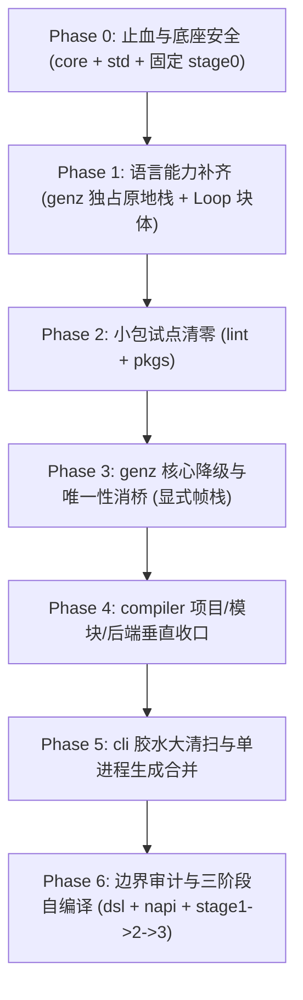

# zray 分包自举诊断与执行计划总览

> 基线版本：`4a1a0c5a`（2026-11-25）· 上位诊断报告：[自举进度诊断和指导报告.md](自举进度诊断和指导报告.md) · 验收终局标准：[自举完成标准.md](../../rules/自举完成标准.md) · 工程执行方法：[WAY.md](../../WAY.md)

本目录为 `packages/` 下所有与编译器自举及外部边界相关的模块/包建立**一包一档**的诊断与大步执行计划，用于替代过去“每 16 分钟微切片 + 乒乓跳板 + 单行净减”的低效推进方式。

---

## 一、全仓 13 个包自举现状总账（`HEAD 4a1a0c5a`）

| 包         | 角色定位                                 |                             非 seed Zig（`src`/快照） |       seed Zig |  `build` Zig |        RX / ZX | `.d.zx`（文件 / 函数） | `@ptrCast`/`anyopaque` | `@constCast` | 独立计划         |
| ---------- | ---------------------------------------- | ----------------------------------------------------: | -------------: | -----------: | -------------: | ---------------------: | ---------------------: | -----------: | ---------------- |
| `core`     | 共享 IR 表契约与内存原语                 |                                          89f / 9,066L |              0 |            0 |       4f / 88L |         267f / 10,351L |         17f / 341 函数 |          564 | 36               | [core.md](core.md)         |
| `dsl`      | XML 解析与语法组合底层库                 |                 13f / 1,453L（含 `examples`/`build`） |              0 |          30L |          0 / 0 |                  0 / 0 |                      0 |            0 | [dsl.md](dsl.md) |
| `std`      | 应用标准库与平台原语                     |         88f / 20,930L（含 1.63 万行 Unicode/IDNA 表） |              0 |            0 |          0 / 0 |         22f / 199 函数 |                     36 |            3 | [std.md](std.md) |
| `lint`     | 代码风格与结构检查器                     |     39f / 5,324L（`src` 1,808L + `bootstrap` 3,456L） |              0 |          72L |     11f / 298L |           36f / 1,699L |                      0 |           12 | 15               | [lint.md](lint.md)         |
| `pkgs`     | 包清单、依赖图与锁校验                   |                              13f / 968L（`src` 903L） |              0 |          66L |      6f / 296L |           77f / 3,713L |                      0 |           53 | 0                | [pkgs.md](pkgs.md)         |
| `genz`     | IR 唯一性/所有权分析与 Zig 代码生成      |                                        400f / 35,150L | 164f / 12,644L |            0 | 556f / 19,823L |      2,981f / 146,375L |         27f / 534 函数 |        1,288 | 61               | [genz.md](genz.md)         |
| `compiler` | 前端解析、主分析、项目联结、缓存与后端   | 823f / 77,642L（`src` 66,500L + `bootstrap` 10,990L） |  101f / 8,288L | 39f / 5,704L | 689f / 26,603L |      3,301f / 150,426L |         28f / 653 函数 |        2,434 | 165              | [compiler.md](compiler.md) |
| `cli`      | CLI 命令、构建驱动、`watch` 与工具链宿主 |                                        176f / 15,914L |              0 | 11f / 1,043L |  181f / 6,338L |         442f / 14,438L |         30f / 764 函数 |          989 | 17               | [cli.md](cli.md)           |
| `napi`     | Node N-API C-ABI 绑定运行桥              |                           8f / 438L（含 `build.zig`） |              0 |          16L |          0 / 0 |                  0 / 0 |                      0 |           16 | 0                | [napi.md](napi.md)         |

### 4 个外围/非编译器运行包（不列入自举迁移对象）

| 包         | 现有内容                                                                            | 不迁移原因与处置                                                                               |
| ---------- | ----------------------------------------------------------------------------------- | ---------------------------------------------------------------------------------------------- |
| `test`     | 1f/1,219L `src` + 130f/6,279L `build` + 976f/75,608L `tests` + 42f/101 函数 `.d.zx` | 一致性测试矩阵与测试夹具，不进入编译器正式传递依赖闭包；仅需随主线接口收口同步清理失效测试桩。 |
| `translib` | `SKILL.md` + `scripts/*.ts`（Node/TS 移库工具）                                     | 外部迁移辅助脚本，不含 Zig 编译器实现。                                                        |
| `skills`   | 面向 zray 应用开发者的 Markdown 文档                                                | 文档包，禁止写入内部自举源码细节。                                                             |
| `website`  | Next.js/Vinext 官网及 1 份 RX/ZX 示例                                               | 展示站点，与自举无关。                                                                         |

---

## 二、跨包依赖与全局执行顺序

切忌自底向上“先切叶子再搭桥”，必须先打通**底座安全与语言能力缺口**，再由小包试点验证大步合并范式，随后按**由外向内、先消跳板、后删活体 seed**的顺序推进三大重型包：

---

## 三、所有分包计划必须共守的 5 条硬门禁

1. **Zig 换手率红线（`新增 Zig / 删除 Zig ≤ 0.25`）**：除为消除 UB 改写底层类型签名外，任何功能迁移阶段每删 100 行旧 Zig，新增 Zig 不得超过 25 行。超过即停止拆分，改为合并上层调用链。
2. **边界只减不增红线**：`compiler/build/entries.zig`（当前 **954** 入口）、`cli/build/*.json`（**127** 入口）、全仓 `.d.zx` `declare function`（非测试区 **2,480** 个）及 `@ptrCast`/`anyopaque`（**5,356+** 处）每阶段必须**净下降**。
3. **禁止“活体双轨”继续生长**：停止新增 `*_seed.zig` 与 `if (generated)` 分支；阶段收口切换固定 `stage0` 引导器，旧实现直接物理删除。
4. **禁止 UB 换通过**：严禁使用 `*const anyopaque` + `@constCast` 写入宿主内存，严禁以 `noinline` 掩盖 `ReleaseSmall` 优化错误。
5. **1,500–3,000 行大步垂直收口与分层验证**：开发期仅跑受影响包/最小复现；禁止每微批跑全量 17,560 文件对照与三轮交错计时，仅在大阶段收口时集中验收并更新本目录各分包计划与总览。

---

## 四、阶段进展记录（随批更新）

- **Wave 1（2026-11-25 · 已完成）**：
    - 完成 `std` Phase S2：`AtomicRows` 及相关行读写原语已从 `std:bytes` 剥离并迁入内部 `core/memory`，全部 16 个 `compiler`/`genz` `.zx` 消费者已切换至 `"memory"`。
    - 完成 `lint` Phase L1/L2 首轮收口：删除 `packages/lint/bootstrap/` 6 份死快照（−3,341 行 Zig），将 6 个分散格式化/长度/边界规则合并为 `lint_layout`、`lint_rx`、`lint_config` 三个入口（`entries.zig` `.lint` 条目 **11 → 8**），并修复 `lint/src/configuration/rule.zig` `checkLength` 分配器参数错误。
    - 完成非自举 `*_seed.zig` 与双轨分支清扫：删除 `verification`、`backends/hardware`、`backends/verilog`、`backends/zig/gateway`、`rx/analysis/gateway`、`genz/src/gateway`、`genz/src/host` 下 **47 份**非自举 `*_seed.zig` / `seed/*.zig` 与对应 `!generated` / `!generated_parser` / `!generated_analysis` / `!generated_graph` 退路分支（共删 **4,030 行**、净增 **94 行**，Zig 换手率 **0.023**），仅保留 `stage0 == ""` 必需的 `catalog_seed.zig` 与 `bindings_seed.zig`（`bootstrapReexports`）。
    - 完成三阶段自编译与性能验收（`ReleaseSmall -Dgenerated-partitions=4`）：`stage0 == ""` → `stage1` → `stage2` → `stage3` 全部通过，`stage2`/`stage3` 产物 `zxc-bootstrap` 二进制 SHA-256 完全一致（`a9b41aed3368bb0848f8f530077ef970e82d9ed9a2283c599a86598434b197f8`，6,389,808 B），生成的 `main` 清单 **12,757 个文件**逐字节一致；`packages/compiler` 与 `packages/cli` 全量测试全部通过；`main` 清单冷生成墙钟 **3,272.47 ms**（基线 `3,213.37 ms`，`infer` 1,322 ms / `emit` 1,030 ms，峰值 RSS 862.9 MiB），热生成中位数 **40.15 ms**（基线 `39.40 ms`），均在容差内。
- **Wave 2（2026-11-25 · 已完成）**：
    - 完成 `cli` Phase X1（7→1 单进程生成合并 & `cache_identity` 复核）：删除 `packages/cli/build/` 下 `backend`/`observation`/`packages`/`store`/`toolchain`/`watch.json` 6 份碎片清单，将全部根路径、30 个入口（重命名 5 处重名入口）与 13 份接口合并入 `packages/cli/build/source.json`；重写 `packages/cli/build/source.zig` 为单次 `generate CLI source modules (cli)` 进程并同步更新 `build.zig` 与全部 26 处 CLI Zig 调用方；核实 `build/cache_identity.zig` 与 `digest.zig` 已改为发射 `digest.bin` + `cache_identity.s` 且按独立槽位收集哈希无并发竞态。
    - 完成 `core` Phase C1 / `std` Phase S1 Hop 1（`mutable_opaque` 可变原生句柄支持）：扩展 `core/src/type_table/structure.zig` 允许 `Kind.NativeReference` 使用 `first = 1`，打通 `compiler`（语义解析、种子解析与相等性校验）和 `genz`（新增 `ExpressionsKind.Pointer` / `Expressions.pointer` 分支发射 `*T`），使原生接口可区分只读 `opaque`（`*const T`）与可写 `mutable_opaque`（`*T`）。
    - 完成 Wave 2 三阶段自编译与测试验收（`ReleaseSmall -Dgenerated-partitions=4`）：`stage0 == ""` → `stage1` → `stage2` → `stage3` 全部通过，`stage2`/`stage3` 产物 `zxc-bootstrap` 二进制 SHA-256 完全一致（`adcb274ae86d00ac72ed0bbe87640d96f8ab67b23a7c8576f0c6adb7b665ea5d`），`main` 清单 **12,757 个文件**逐字节一致；`packages/compiler` 测试（`33/33`）、`packages/cli` 测试（`104/104`）与 `packages/cli` 构建（`75/75`，仅 1 次 `generate CLI source modules`）全部通过。
- **Wave 3（2026-11-25 · 已完成）**：
    - 完成 `core` Phase C1 与 `std` Phase S1（彻底清零 `@constCast` UB 与 `noinline`）：将 `std`（`Writer`、`StringSet`）及 `core/memory` 全部可写原生句柄切换为 `mutable_opaque`（`*T`），引入只读 `U32View`/`U64View`/`StringViews`（`opaque`），同步更新 `WriteFields` `*Self` 接收者、`columns.zig` `.one` 指针兼容性及 `compiler`/`genz`/`pkgs`/`cli` 全部 `.zx`/`.rx`/`.zig` 调用方；彻底删除 `packages/core/src/memory/` 全部 **36 处 `@constCast` 与 3 处 `noinline`** 及 `packages/std/src/` 全部 **3 处 `@constCast`**，跨包验证 `@constCast == 0` 且 `noinline == 0`。
    - 顺带排查并修复 `core/memory`（`column_range.zig`、`column_set.zig`、`column_transfer.zig`）跨分区回调传回 Zig `Allocator.Error` 导致各编译单元错误标签不一致、在 `ReleaseSafe` OOM 注入下触发 `bridge.zig` `unreachable` 的隐蔽 ABI 缺陷（改为跨边界返回 `bool` 并在分区内还原 `error.OutOfMemory`），同时在 `compiler/build.zig` 与 `cli/build.zig` 为 `ReleaseSafe` 测试/生成模块对齐 `.strip = if (optimize == .safe) true else null`（保留完整安全检查）。
    - 同步升级本机与全仓 Zig 工具链至 **0.17.1**（更新根与 10 个子包 `build.zig.zon`、`packages/cli/build/toolchain/releases.json` 5 个宿主校验和、`.github/tsflows/build.ts`、`build.generated.yml` 与公开文档），并简化 `docs/user_request.jsonl` 仅保留 `text` 字段及更新 `AGENTS.md`。
    - 完成 Zig `0.17.1` 下全量验收：三阶段 `ReleaseSmall -Dgenerated-partitions=4` 自编译（`stage1` → `stage2` → `stage3`）二进制 SHA-256 完全一致（`15e99fa0a5acfcae544f36568bbaecf12c3e196aa206a15af3bef74ccddf8001`），`stage2`/`stage3` 生成的 `main` 清单 **12,793 个文件**逐字节一致（`equal: true`）；`packages/{core,std,pkgs}`（`ReleaseSmall` 与 `ReleaseSafe` 构建）、`packages/compiler`（`ReleaseSmall` 与 `ReleaseSafe` 全部测试 `372/372`）及 `packages/cli`（`ReleaseSmall` 与 `ReleaseSafe` 构建及全部测试）均全部通过。
- **Wave 4（2026-11-25 · 已完成）**：
    - 完成 `genz` 叶子表达式与路径投影去跳板（Phase G1 叶子收口）：将 `Unary`、`Binary`、`Conditional`、9 类 `Literal`、`Read` 分发、`Optional`、`Length`、`Field`、`FieldPath`/`ProjectionPath` 下沉为直接 ZX 调用（通过 `lower` 入口按 `[512]u8` `BufferFirstAllocator` 栈空间 + `ArenaAllocator` 直接传入 `expressions`/`types`/`AstWriter` 与 `OriginBuffer`），删除 `packages/genz/src/analysis/` 下 `literals/build.rx`、`operators/build.rx`、`access/projection/fields.zx`、`read/{columns,const}.zx` 与 `packages/genz/src/zx/` 下 `literals.zig`、`operators/{unary,binary}.zig` 共 **8 份**死文件，注销 [packages/compiler/build/entries.zig](../../packages/compiler/build/entries.zig) 中 **10 条** `genz` 入口，精简 `evaluate/{native,read,frames}.d.zx` 移除 **13 个**宿主回调与 `ReadAction`/`ConditionalPart`；同时在 [packages/compiler/build/parser.zig](../../packages/compiler/build/parser.zig#L233-L235) 为 `.execution` 补充 `.ast` 与 `.printer` `addSubtree` 缓存输入。
    - 完成 `lint` 布局投影迁移（Phase L1 推进）：将 [projection.zig](../../packages/lint/src/layout/projection.zig) 收薄为轻量 `RawSpan`/`Op` 记录器（保留 OOM `failed` 状态位），将词法合并与全部 7 类布局投影操作迁入 `packages/lint/src/layout/projection.zx` 及 `projection/{init,find,opening_at_end,condition,exclude_range,list,set_token}.zx`，并接入 [entry.rx](../../packages/lint/src/layout/entry.rx)；同步消除 `lint/layout/rule.zig`（`attributeRequired`）与 `lint/configuration/rule.zig`（`checkLength`）在 Wave 1 入口合并后遗留的 `[0]u8` `FixedBufferAllocator` OOM 导致 `ReleaseSmall` `SIGSEGV` 的隐患（均改为 `[256]u8`）。
    - 完成全量验收与性能比对（Zig `0.17.1`、`ReleaseSmall -Dgenerated-partitions=4`）：`stage0 == ""` → `stage1` → `stage2` → `stage3` 全部通过，`stage2`/`stage3` `zxc-bootstrap` 二进制 SHA-256 完全一致（`74d96a6d0b34746d82325ff0b7b76f6e2d8d5e98e03867a9f0d5ccc0c3fe03fa`），输出逐文件一致；`main` 清单冷生成墙钟 **3,180.9 ms**（Wave 1 基线 `3,213.37 ms`，`infer` 1,375 ms / `emit` 1,035 ms），热生成 **39.8 ms**；`packages/{core,std,pkgs,compiler,cli}` `ReleaseSmall` 与 `ReleaseSafe` 构建/测试、`packages/lint -Dseed=true`、`packages/test` `test-rx-formatting`（含 `allocation_test.zig` OOM 检查与 52 项 CLI 用例）及 `test-configuration-formatting`（126 项 + 4 项锁测试 + 15 项索引测试）、以及全仓 `.zig`/`.rx`/`.zx` 格式化与 lint 检查均全部通过。
- **Wave 5（2026-11-25 · 已完成）**：
    - 完成 `cli`（17 处 → **0**）与 `genz`（61 处 → **0**）全部 `@constCast` UB 清零：将 `cli` 14 份宿主 `.d.zx`（含 `publication`/`document`/`build`/`toolchain`/`package` 等）与 `genz` 45 个可变宿主句柄切换为 `mutable_opaque`（`*anyopaque` / `*T`），保留 17 个只读句柄为 `opaque`，同步更新对应 Zig 宿主桥；将 `genz/src/zx/types/state.zig` 改为 `copyIds` 分配，`uniqueness/flow` 区分 seed 可变缓冲与生成态布局，并将 `uniqueness/summaries`（`summaries/{model,allocate,create}`、`program/{model,prepare}` 与 `zx/uniqueness/summaries/{storage,lifecycle}.zig`）改为通过 `memory.allocateU8Buffer` 直接填充宿主持有的 `[]u8` 缓冲并保留 `RowBuffer` 行视图零拷贝别名（使用 `executeIn`）。至此 `core/src/memory`、`std/src`、`lint/src`、`pkgs/src`、`genz/src`、`cli/src` **六大包全量清零 `@constCast`**。
    - 完成 `genz` `match` 与 `capture` 去跳板：移除 `analysis/expressions/evaluate/match.d.zx` 中 `lowerMatchEquality` / `lowerMatchLiteral` 宿主回调及 `zx/match.zig` 对应胶水，在 `analysis/match/evaluate.zx` 直接调用 `binary` 与 `host.lowerRegular` 并切换 `zx/match.zig` 为 `executeIn`；将 `capture_names` 并入 `analysis/capture/prepare.zx`，从 [entries.zig](../../packages/compiler/build/entries.zig) 注销 `capture_names`（`main` 入口 **630 → 629**）。
    - 完成全量验收与性能比对（Zig `0.17.1`、`ReleaseSmall -Dgenerated-partitions=4`）：`stage0 == ""` → `stage1` → `stage2` → `stage3` 全部通过，`stage2`/`stage3` `zxc-bootstrap` 二进制 SHA-256 完全一致（`422ff2fa21c57fc14a1b9c814c16abdec9a01555658f96289db0f9989f910996`），`main` 清单 **5,868 个生成单元**逐文件一致（`diff -rq` 退出 `0`）；非驻留冷生成墙钟 **3,255.6 ms**（Wave 1 基线 `3,213.37 ms`，`infer` 1,371 ms / `emit` 1,025 ms），热生成 **39.8 ms**；`packages/{core,std,pkgs,compiler,cli}` `ReleaseSmall`/`ReleaseSafe` 构建与测试、`packages/lint -Dseed=true`、全仓 `.zig`/`.rx`/`.zx` 格式化与 lint、以及六包 `@constCast == 0` 审计全部通过。
    - 下一步：推进 Wave 6（`packages/compiler` `@constCast` 清零 + `genz`/`compiler` 下一垂直收口批）。
