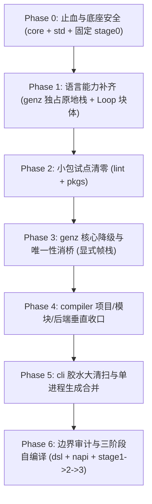

# zray 分包自举诊断与执行计划总览

> 基线版本：`4a1a0c5a`（2026-11-25）· 上位诊断报告：[自举进度诊断和指导报告.md](自举进度诊断和指导报告.md) · 验收终局标准：[自举完成标准.md](../../rules/自举完成标准.md) · 工程执行方法：[WAY.md](../../WAY.md)

本目录为 `packages/` 下所有与编译器自举及外部边界相关的模块/包建立**一包一档**的诊断与大步执行计划，用于替代过去“每 16 分钟微切片 + 乒乓跳板 + 单行净减”的低效推进方式。

---

## 一、全仓 13 个包自举现状总账（`HEAD 4a1a0c5a`）

| 包         | 角色定位                                 |                             非 seed Zig（`src`/快照） |       seed Zig |  `build` Zig |        RX / ZX | `.d.zx`（文件 / 函数） | `@ptrCast`/`anyopaque` | `@constCast` | 独立计划         |
| ---------- | ---------------------------------------- | ----------------------------------------------------: | -------------: | -----------: | -------------: | ---------------------: | ---------------------: | -----------: | ---------------- |
| `core`     | 共享 IR 表契约与内存原语                 |                                          89f / 9,066L |              0 |            0 |       4f / 88L |         267f / 10,351L |         17f / 341 函数 |          564 | 36               | [core.md](core.md)         |
| `dsl`      | XML 解析与语法组合底层库                 |                 13f / 1,453L（含 `examples`/`build`） |              0 |          30L |          0 / 0 |                  0 / 0 |                      0 |            0 | [dsl.md](dsl.md) |
| `std`      | 应用标准库与平台原语                     |         88f / 20,930L（含 1.63 万行 Unicode/IDNA 表） |              0 |            0 |          0 / 0 |         22f / 199 函数 |                     36 |            3 | [std.md](std.md) |
| `lint`     | 代码风格与结构检查器                     |     39f / 5,324L（`src` 1,808L + `bootstrap` 3,456L） |              0 |          72L |     11f / 298L |           36f / 1,699L |                      0 |           12 | 15               | [lint.md](lint.md)         |
| `pkgs`     | 包清单、依赖图与锁校验                   |                              13f / 968L（`src` 903L） |              0 |          66L |      6f / 296L |           77f / 3,713L |                      0 |           53 | 0                | [pkgs.md](pkgs.md)         |
| `genz`     | IR 唯一性/所有权分析与 Zig 代码生成      |                                        400f / 35,150L | 164f / 12,644L |            0 | 556f / 19,823L |      2,981f / 146,375L |         27f / 534 函数 |        1,288 | 61               | [genz.md](genz.md)         |
| `compiler` | 前端解析、主分析、项目联结、缓存与后端   | 823f / 77,642L（`src` 66,500L + `bootstrap` 10,990L） |  101f / 8,288L | 39f / 5,704L | 689f / 26,603L |      3,301f / 150,426L |         28f / 653 函数 |        2,434 | 165              | [compiler.md](compiler.md) |
| `cli`      | CLI 命令、构建驱动、`watch` 与工具链宿主 |                                        176f / 15,914L |              0 | 11f / 1,043L |  181f / 6,338L |         442f / 14,438L |         30f / 764 函数 |          989 | 17               | [cli.md](cli.md)           |
| `napi`     | Node N-API C-ABI 绑定运行桥              |                           8f / 438L（含 `build.zig`） |              0 |          16L |          0 / 0 |                  0 / 0 |                      0 |           16 | 0                | [napi.md](napi.md)         |

### 4 个外围/非编译器运行包（不列入自举迁移对象）

| 包         | 现有内容                                                                            | 不迁移原因与处置                                                                               |
| ---------- | ----------------------------------------------------------------------------------- | ---------------------------------------------------------------------------------------------- |
| `test`     | 1f/1,219L `src` + 130f/6,279L `build` + 976f/75,608L `tests` + 42f/101 函数 `.d.zx` | 一致性测试矩阵与测试夹具，不进入编译器正式传递依赖闭包；仅需随主线接口收口同步清理失效测试桩。 |
| `translib` | `SKILL.md` + `scripts/*.ts`（Node/TS 移库工具）                                     | 外部迁移辅助脚本，不含 Zig 编译器实现。                                                        |
| `skills`   | 面向 zray 应用开发者的 Markdown 文档                                                | 文档包，禁止写入内部自举源码细节。                                                             |
| `website`  | Next.js/Vinext 官网及 1 份 RX/ZX 示例                                               | 展示站点，与自举无关。                                                                         |

---

## 二、跨包依赖与全局执行顺序

切忌自底向上“先切叶子再搭桥”，必须先打通**底座安全与语言能力缺口**，再由小包试点验证大步合并范式，随后按**由外向内、先消跳板、后删活体 seed**的顺序推进三大重型包：

---

## 三、所有分包计划必须共守的 5 条硬门禁

1. **Zig 换手率红线（`新增 Zig / 删除 Zig ≤ 0.25`）**：除为消除 UB 改写底层类型签名外，任何功能迁移阶段每删 100 行旧 Zig，新增 Zig 不得超过 25 行。超过即停止拆分，改为合并上层调用链。
2. **边界只减不增红线**：`compiler/build/entries.zig`（当前 **954** 入口）、`cli/build/*.json`（**127** 入口）、全仓 `.d.zx` `declare function`（非测试区 **2,480** 个）及 `@ptrCast`/`anyopaque`（**5,356+** 处）每阶段必须**净下降**。
3. **禁止“活体双轨”继续生长**：停止新增 `*_seed.zig` 与 `if (generated)` 分支；阶段收口切换固定 `stage0` 引导器，旧实现直接物理删除。
4. **禁止 UB 换通过**：严禁使用 `*const anyopaque` + `@constCast` 写入宿主内存，严禁以 `noinline` 掩盖 `ReleaseSmall` 优化错误。
5. **1,500–3,000 行大步垂直收口与分层验证**：开发期仅跑受影响包/最小复现；禁止每微批跑全量 17,560 文件对照与三轮交错计时，仅在大阶段收口时集中验收并更新本目录各分包计划与总览。

---

## 四、阶段进展记录（随批更新）

- **Wave 1（2026-11-25 · 已完成）**：
    - 完成 `std` Phase S2：`AtomicRows` 及相关行读写原语已从 `std:bytes` 剥离并迁入内部 `core/memory`，全部 16 个 `compiler`/`genz` `.zx` 消费者已切换至 `"memory"`。
    - 完成 `lint` Phase L1/L2 首轮收口：删除 `packages/lint/bootstrap/` 6 份死快照（−3,341 行 Zig），将 6 个分散格式化/长度/边界规则合并为 `lint_layout`、`lint_rx`、`lint_config` 三个入口（`entries.zig` `.lint` 条目 **11 → 8**），并修复 `lint/src/configuration/rule.zig` `checkLength` 分配器参数错误。
    - 完成非自举 `*_seed.zig` 与双轨分支清扫：删除 `verification`、`backends/hardware`、`backends/verilog`、`backends/zig/gateway`、`rx/analysis/gateway`、`genz/src/gateway`、`genz/src/host` 下 **47 份**非自举 `*_seed.zig` / `seed/*.zig` 与对应 `!generated` / `!generated_parser` / `!generated_analysis` / `!generated_graph` 退路分支（共删 **4,030 行**、净增 **94 行**，Zig 换手率 **0.023**），仅保留 `stage0 == ""` 必需的 `catalog_seed.zig` 与 `bindings_seed.zig`（`bootstrapReexports`）。
    - 完成三阶段自编译与性能验收（`ReleaseSmall -Dgenerated-partitions=4`）：`stage0 == ""` → `stage1` → `stage2` → `stage3` 全部通过，`stage2`/`stage3` 产物 `zxc-bootstrap` 二进制 SHA-256 完全一致（`a9b41aed3368bb0848f8f530077ef970e82d9ed9a2283c599a86598434b197f8`，6,389,808 B），生成的 `main` 清单 **12,757 个文件**逐字节一致；`packages/compiler` 与 `packages/cli` 全量测试全部通过；`main` 清单冷生成墙钟 **3,272.47 ms**（基线 `3,213.37 ms`，`infer` 1,322 ms / `emit` 1,030 ms，峰值 RSS 862.9 MiB），热生成中位数 **40.15 ms**（基线 `39.40 ms`），均在容差内。
    - 下一步：推进 Wave 2（`core` Phase C1 根除 `core/memory` `@constCast` UB + `cli` Phase X1 合并 `build/source.zig` 7 次冷生成与修 `cache_identity` + 小包 `pkgs`/`lint` 收口）。
