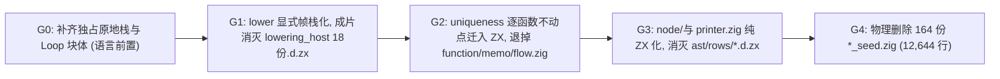

# `packages/genz` 自举诊断与执行计划

> 归属角色：唯一性/所有权分析、IR 降低与 Zig 代码生成器 · 状态：**核心重灾区 #1（Zig 胶水比例 51.0%，最近仍在制造大量乒乓跳板与新 `.d.zx`）** · 总览：[README.md](README.md) · 上位报告：[自举进度诊断和指导报告.md](自举进度诊断和指导报告.md)

---

## 一、现状总账（`HEAD 4a1a0c5a`）

| 维度                                    |                                           数值 | 说明                                                          |
| --------------------------------------- | ---------------------------------------------: | ------------------------------------------------------------- |
| 非 seed Zig (`src/`)                    |                       **400 文件 / 35,150 行** | 仍保留超过 3.5 万行手写 Zig                                   |
| seed Zig (`*seed*.zig`)                 |                       **164 文件 / 12,644 行** | 全仓最大 seed 滞留区（占全仓 seed 的 60.4%）                  |
| RX / ZX 源码                            | **556 份 (19,823 行) / 2,981 份 (146,375 行)** | 存在 **606 份 ≤20 行的碎片 ZX** 与 **101 份 ≤15 行的碎片 RX** |
| `.d.zx` 接口                            |      **27 份 / 2,792 行 / 534 个原生宿主函数** | 刚在 `4a1a0c5a` 前后又新增 4 份 `.d.zx`                       |
| `@ptrCast` / `anyopaque` / `@constCast` |                              **1,288 / 61 处** | 大量回调与类型擦除                                            |

### `src/` 非 seed Zig 职责拆解

| 类别                                      | 文件数 |   行数 |      占比 | 核心代表目录 / 文件                                                                                                                      |
| ----------------------------------------- | -----: | -----: | --------: | ---------------------------------------------------------------------------------------------------------------------------------------- |
| 纯 Zig 算法与未迁逻辑                     |    207 | 16,271 |     45.8% | `zx/uniqueness/function.zig`（994L）、`printer.zig`（655L）、`zx/uniqueness/memo.zig`（576L）、`zx/lower.zig`（358L）、`node/`（1,853L） |
| **宿主回调 / 不透明桥接**                 |     76 |  7,782 | **21.9%** | `zx/construction/publication.zig`（634L）、`zx/iteration_value/`（1,684L）、`zx/state_value/`（1,659L）                                  |
| **双向跳板**（`executeIn` + `anyopaque`） |     59 |  6,869 | **19.3%** | `zx/scope/execute.zig`、`zx/value_call/`（1,138L）、`zx/inline_call/`（827L）                                                            |
| **Zig→Source 封送包装**                   |     50 |  3,474 |  **9.8%** | 各类只传参调用 `generated_*` 的外层函数                                                                                                  |
| 平台 I/O / 线程 / 外部边界                |      7 |  1,129 |      3.2% | 并行工作池、线程原语等                                                                                                                   |

> **关键警报**：胶水 + 跳板 + 封送合计 **18,125 行（51.0%）**，再加上 **12,644 行**活体 seed，实质上整个 `genz` 被切成了“Zig 互递归驱动 + 数百个 RX/ZX 碎片 + 534 个逆向宿主函数”。

---

## 二、核心病灶诊断

1. **互递归降低了“按单层表达式微切片”的代价，制造了最大规模乒乓跳板**
    - [zx/lower.zig](../../packages/genz/src/zx/lower.zig) → `scope` → `aggregate` → `iteration_value` → `state_value` → `value_call` 本质上是一棵互递归下降树。
    - 过去几天的做法（截至 `4a1a0c5a` 仍在延续）是把树上的每一个小步骤切成独立入口，再通过 `analysis/expressions/evaluate/*.d.zx`（18 份 `.d.zx`，其中仅 `iteration.d.zx` 81 个函数、`optimization.d.zx` 44 个、`statement.d.zx` 39 个、`publication.d.zx` 38 个、`call.d.zx` 36 个、`native.d.zx` 34 个）和 `ast/rows/*.d.zx`（含刚新增的 `operands.d.zx`、`statement_sequence.d.zx`、`value_expressions.d.zx`、`write_values.d.zx`）跳回 Zig 调 `lowerExpression` / `lowerValueExpression`。
    - **直接后果**：`zx/construction/publication.zig` 膨胀到 **634 行**；每消除几十行 Zig，就增加几十个 `.d.zx` 回调和数百行 ZX/RX 碎片。
2. **全程序唯一性分析仍留 Zig 逐函数求解内核**
    - [zx/uniqueness/function.zig](../../packages/genz/src/zx/uniqueness/function.zig)（994L）、[memo.zig](../../packages/genz/src/zx/uniqueness/memo.zig)（576L）、[flow.zig](../../packages/genz/src/zx/uniqueness/flow.zig)（318L）与 `zx/uniqueness/program/`（1,272L）加起来仍近 **6,400 行 Zig**。虽然外层 `program/run.rx` 已接入，但核心不动点求解器与 memo 仍通过 `uniqueness/program/driver/native.d.zx`（37 函数）留在 Zig。
3. **`node/` 与 `printer.zig`（655L）双头并行**
    - `printer/render.rx` 已接入，但底层结构化 AST/节点构建（`node/` 1,853L）与 `printer.zig`（655L）中的 Zig 语句拼接与缓冲写入仍大量暴露给 `.d.zx`。

---

## 三、最终保留边界与待退出清单

| 分类                                               | 具体对象                                                                                                                                                                                                                                                                                             | 处置                                                             |
| -------------------------------------------------- | ---------------------------------------------------------------------------------------------------------------------------------------------------------------------------------------------------------------------------------------------------------------------------------------------------- | ---------------------------------------------------------------- |
| **可保留（最小平台/并发边界）**                    | OS 线程池调度/互斥原语（如 `Parallel` 编译时多核执行，~300–500 行）                                                                                                                                                                                                                                  | 保留纯系统并发边界                                               |
| **必须退出（~34,000 行非 seed + 12,644 行 seed）** | `zx/lower.zig` 及其全套子目录（`scope`、`aggregate`、`iteration_value`、`state_value`、`value_call`、`inline_call`、`construction`、`functions`、`collections`、`tasks`）、`zx/uniqueness/*`、`node/*`、`printer.zig`、`host/*`（`node`/`wasm`/`library`/`cli`/`gateway`）及全部 164 份 `*_seed.zig` | 按“显式帧栈 + `<Loop>`”与“独占原地缓冲”成片迁入 RX/ZX 并物理删除 |

---

## 四、分阶段大步执行计划

### Phase G0（P1 前置 · 语言/生成器能力补齐，~1 批）：为自举打通两项关键语义

1. **放宽 RX `<Loop>` 块体支持**：允许 `<Loop on={...}>` 直接包裹 `<Switch>` / `<If>` / 顺序 `<Call>`（底层复用现有 `Iteration IR`），避免状态机每轮强拆 `step.rx`。
2. **编译器独占可变缓冲/栈原语**：在 `genz` 自身为已知独占所有权的循环状态数组生成原地 `push/pop/set` 代码，不再迫使编译器源代码手动调用 `core/memory` 读写 U32/U64 列。

### Phase G1（大步 #1 · 预计净减 8,000~10,000 行 Zig）：`zx/lower` 树改造成“显式帧栈 + RX `<Loop>`”

- **禁止继续拆 `scope/binding`/`operands`/`value_expressions` 等叶子回调**！
- **执行路线**：
    1. 定义统一的 `LowerFrame` 显式栈（在 ZX 中持有）替代 Zig 调用栈；
    2. 在上层建立单一 `analysis/lower/run.rx`（`<Loop>` + `<Switch>` 按 `FrameKind` 分派）；
    3. **成批吞并** `zx/scope`、`zx/aggregate`、`zx/construction/publication.zig`（634L）、`zx/iteration_value`（1,684L）、`zx/state_value`（1,659L）、`zx/value_call`（1,138L）、`zx/inline_call`（827L）；
    4. **整批注销** `analysis/expressions/evaluate/*.d.zx`（18 份文件、300+ 个回调）与对应 Zig `execute.zig` 跳板。
- **门禁**：Zig 换手率 **≤ 0.20**，`.d.zx` 宿主函数净减 **≥ 250** 个，`@ptrCast`/`anyopaque` 净减 **≥ 500** 处。

### Phase G2（大步 #2 · 预计净减 6,000+ 行 Zig）：收口 `zx/uniqueness/` 全程序与逐函数分析

- 将 [function.zig](../../packages/genz/src/zx/uniqueness/function.zig)（994L）、[memo.zig](../../packages/genz/src/zx/uniqueness/memo.zig)（576L）、[flow.zig](../../packages/genz/src/zx/uniqueness/flow.zig)（318L）及 `program/` / `replay/` 内部不动点求解迁入单向 `uniqueness/run.rx` + 内聚 ZX 算法文件（纯递归留于同文件内聚 ZX，不跨文件强拆）；
- 同步回收 `std:bytes` 中暴露的 `AtomicRows`（联动 `std.md` Phase S2），退掉 `uniqueness/program/driver/native.d.zx`（37 函数）。

### Phase G3（大步 #3 · 预计净减 3,500+ 行 Zig）：`node/`、`printer.zig` 与 `host/*` 纯化

- 将 Zig AST 结构构造（`node/` 1,853L）与 `printer.zig`（655L）缓冲输出转为纯 ZX 结构（直接构造不可变/独占 AST 节点并打印），删除 `ast/rows/*.d.zx`；
- 将 `host/{node,wasm,library,cli,gateway}` 中的 Zig 适配与转发桥全部收回 RX/ZX（同时解决复核报告中的 `wasm → node` 耦合）。

### Phase G4（收口）：切换固定 `stage0`，物理删除 164 份 `*_seed.zig`

- 一次性 `git rm` 164 份 `*_seed.zig`（净减 **12,644 行** Zig），`genz` 非 seed Zig 收敛至仅保留并发线程池接口（≤ 500 行）。

---

## 五、验收与回测口径

- **已完成进展（Wave 1 · 2026-11-25）**：已物理删除 `genz/src/gateway/*_seed.zig`（8 份）与 `genz/src/host/` 非自举 `*seed*.zig` / `seed/*.zig`（27 份，保留 `catalog_seed.zig` 与 `bindings_seed.zig` 的 `bootstrapReexports` 供 `stage0 == ""` 使用），并移除对应 `genz_options.generated_analysis` 双轨退路分支；通过 `ReleaseSmall -Dgenerated-partitions=4` 三阶段自编译与 `compiler`/`cli` 全量测试。
- **已完成进展（Wave 4 · 2026-11-25）**：完成叶子表达式与路径投影去跳板，将 `Unary`、`Binary`、`Conditional`、9 类 `Literal`、`Read` 分发、`Optional`、`Length`、`Field`、`FieldPath`/`ProjectionPath` 迁为直接 ZX 调用（通过 `lower` 的 `[512]u8` 栈空间 + `ArenaAllocator` 直传 IR/类型/AstWriter）；物理删除 `literals/build.rx`、`operators/build.rx`、`access/projection/fields.zx`、`read/{columns,const}.zx`、`zx/literals.zig` 与 `zx/operators/{unary,binary}.zig` 共 8 份文件，减少 `entries.zig` 10 条入口、`evaluate/*.d.zx` 13 个宿主回调及 2 个枚举，并在 `compiler/build/parser.zig` 为 `.execution` 补齐 `.ast`/`.printer` `addSubtree` 缓存输入；三阶段 `ReleaseSmall -Dgenerated-partitions=4` 校验与 `main` 清单冷/热生成（`3,180.9 ms` / `39.8 ms`）全部通过。
- **已完成进展（Wave 5 · 2026-11-25）**：彻底清零 `packages/genz/src/` 全部 **61 处 `@constCast`**：将 `ast/rows/write.d.zx`、`analysis/expressions/evaluate/{frames,iteration_frames}.d.zx` 及 `analysis/uniqueness/program/driver/native.d.zx` 中的 45 个可变宿主句柄迁移为 `mutable_opaque`（`*anyopaque`，保留 17 个只读句柄为 `opaque`）并同步更新全部 Zig 宿主桥；改造 `types/state.zig`、`uniqueness/flow*` 及 `uniqueness/summaries/{allocate,create,model,storage.zig}`（通过 `memory.allocateU8Buffer` 直接填充宿主 `[]u8` 缓冲，在 `executeIn` 下保持 `RowBuffer` 零拷贝别名）；同步完成 `match` 与 `capture` 去跳板（移除 `lowerMatchEquality` / `lowerMatchLiteral` 回调并在 `analysis/match/evaluate.zx` 直接调用 `binary` 与 `host.lowerRegular`，将 `capture_names` 并入 `analysis/capture/prepare.zx` 并从 `entries.zig` 注销）；通过 Zig `0.17.1` `ReleaseSmall -Dgenerated-partitions=4` 三阶段自编译校验（`stage2`/`stage3` SHA-256 一致：`422ff2fa...`，`main` 非驻留冷/热生成 `3,255.6 ms` / `39.8 ms`）。
- **已完成进展（Wave 7 · 2026-11-25）**：完成 `store_access`、`execute_task_future`、`checked_index` 与 `projection_result` 四组表达式降低跳板向 ZX 的直接下沉（`evaluate/{store,future,future_complete}.zx`、`read/{emit_index,list,path,segment}.zx`、`tasks/parallel/execute/branch.rx` 及 `consumer/read/{model,run.rx,prepare,execute}.zx`），注销 [entries.zig](../../packages/compiler/build/entries.zig) **4 条**入口、移除 `evaluate/{native,read,optimization}.d.zx` **5 个**回调，并物理删除 `zx/access/store.zig`、`zx/intrinsics/index.zig` 与 `analysis/{access/store,intrinsics/index,tasks/future/execute}` 共 **13 份**死文件（`intrinsics/index` 仅余 seed 退路）；通过 Zig `0.17.1` `stage0 == ""` 种子构建与 `ReleaseSmall -Dgenerated-partitions=4` 三阶段自编译校验（`stage2`/`stage3` SHA-256 一致：`ea56b109...`，`main` 非驻留冷/热生成 `3,181.5 ms` / `42.1 ms`）。
- **已完成进展（Wave 8 · 2026-11-25）**：完成语句降低管线去跳板收口：将 `statement_block_plan`、`statement_run_commit`、`statement_evaluation`、`statement_branch`、`statement_store_write`、`publish_destructure` 与 `publish_statement_result` 直接下沉入 `analysis/statements/{emit,traversal/execute}/`，在 `zx/statements/traversal/host.zig` 用 LIFO `defer` 替代 `rollback.zx` 并消去逐语句 4 KB 栈 arena 往返；注销 [entries.zig](../../packages/compiler/build/entries.zig) **7 条**入口、将 `statement.d.zx` 回调由 **39 降至 27**（−12 个，零新增 `.d.zx`），并物理删除 `zx/statements/{block,publication}.zig`、`zx/statements/{destructure,result}/lower.zig` 及 `analysis/statements/{basic,destructure,result,rollback}` 等 **16 份**死文件；通过 Zig `0.17.1` `stage0 == ""` 种子构建与 `ReleaseSmall -Dgenerated-partitions=4` 三阶段自编译校验（`stage2`/`stage3` SHA-256 一致：`c9a758bc...`，`main` 非驻留冷/热生成 `3,213.0 ms` / `43.7 ms`）。
- **已完成进展（Wave 9 · 2026-11-25）**：完成语句 `switch` / 常量标签选择去跳板收口：将 `selection_labels`、`switch_name`、`switch_reference` 与 `switch_labels` 直接下沉入 `analysis/statements/traversal/execute/{selection_open,selection_resolve,case,step}.zx`；精简 `zx/statements/switch/state.zig` 与 `zx/statements/traversal/host.zig`，将 `seed.zig` 直指 `selection/seed.zig`；注销 [entries.zig](../../packages/compiler/build/entries.zig) **4 条**入口、将 `statement.d.zx` 回调由 **27 降至 21**（−6 个，零新增 `.d.zx`），并物理删除 `zx/selection.zig`、`zx/statements/switch/references.zig` 与 `analysis/statements/switch/labels.zx` 共 **3 份**死文件；通过 Zig `0.17.1` `stage0 == ""` 种子构建与 `ReleaseSmall -Dgenerated-partitions=4` 三阶段自编译校验（`stage2`/`stage3` SHA-256 一致：`319d9caf...`，`main` 非驻留冷/热生成 `3,234.2 ms` / `41.9 ms`）。
- **Phase G0**：独立验证 `<Loop>` 块体与独占原地栈的 IR/生成 Zig 零拷贝形态及 `DebugAllocator` 无泄漏。
- **Phase G1–G3**：开发期只跑 `packages/genz` 与受影响生成的编译器测试用例；每完成一个大阶段（G1/G2/G3），运行一次 `ReleaseSmall` 16 分区编译 + 冻结清单冷/热生成计时与 RSS 对照，确保相比基线性能不退化、内存峰值不反弹。
