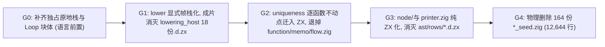

# `packages/genz` 自举诊断与执行计划

> 归属角色：唯一性/所有权分析、IR 降低与 Zig 代码生成器 · 状态：**核心重灾区 #1（Zig 胶水比例 51.0%，最近仍在制造大量乒乓跳板与新 `.d.zx`）** · 总览：[README.md](README.md) · 上位报告：[自举进度诊断和指导报告.md](自举进度诊断和指导报告.md)

---

## 一、现状总账（`HEAD 4a1a0c5a`）

| 维度                                    |                                           数值 | 说明                                                          |
| --------------------------------------- | ---------------------------------------------: | ------------------------------------------------------------- |
| 非 seed Zig (`src/`)                    |                       **400 文件 / 35,150 行** | 仍保留超过 3.5 万行手写 Zig                                   |
| seed Zig (`*seed*.zig`)                 |                       **164 文件 / 12,644 行** | 全仓最大 seed 滞留区（占全仓 seed 的 60.4%）                  |
| RX / ZX 源码                            | **556 份 (19,823 行) / 2,981 份 (146,375 行)** | 存在 **606 份 ≤20 行的碎片 ZX** 与 **101 份 ≤15 行的碎片 RX** |
| `.d.zx` 接口                            |      **27 份 / 2,792 行 / 534 个原生宿主函数** | 刚在 `4a1a0c5a` 前后又新增 4 份 `.d.zx`                       |
| `@ptrCast` / `anyopaque` / `@constCast` |                              **1,288 / 61 处** | 大量回调与类型擦除                                            |

### `src/` 非 seed Zig 职责拆解

| 类别                                      | 文件数 |   行数 |      占比 | 核心代表目录 / 文件                                                                                                                      |
| ----------------------------------------- | -----: | -----: | --------: | ---------------------------------------------------------------------------------------------------------------------------------------- |
| 纯 Zig 算法与未迁逻辑                     |    207 | 16,271 |     45.8% | `zx/uniqueness/function.zig`（994L）、`printer.zig`（655L）、`zx/uniqueness/memo.zig`（576L）、`zx/lower.zig`（358L）、`node/`（1,853L） |
| **宿主回调 / 不透明桥接**                 |     76 |  7,782 | **21.9%** | `zx/construction/publication.zig`（634L）、`zx/iteration_value/`（1,684L）、`zx/state_value/`（1,659L）                                  |
| **双向跳板**（`executeIn` + `anyopaque`） |     59 |  6,869 | **19.3%** | `zx/scope/execute.zig`、`zx/value_call/`（1,138L）、`zx/inline_call/`（827L）                                                            |
| **Zig→Source 封送包装**                   |     50 |  3,474 |  **9.8%** | 各类只传参调用 `generated_*` 的外层函数                                                                                                  |
| 平台 I/O / 线程 / 外部边界                |      7 |  1,129 |      3.2% | 并行工作池、线程原语等                                                                                                                   |

> **关键警报**：胶水 + 跳板 + 封送合计 **18,125 行（51.0%）**，再加上 **12,644 行**活体 seed，实质上整个 `genz` 被切成了“Zig 互递归驱动 + 数百个 RX/ZX 碎片 + 534 个逆向宿主函数”。

---

## 二、核心病灶诊断

1. **互递归降低了“按单层表达式微切片”的代价，制造了最大规模乒乓跳板**
    - [zx/lower.zig](../../packages/genz/src/zx/lower.zig) → `scope` → `aggregate` → `iteration_value` → `state_value` → `value_call` 本质上是一棵互递归下降树。
    - 过去几天的做法（截至 `4a1a0c5a` 仍在延续）是把树上的每一个小步骤切成独立入口，再通过 `analysis/expressions/evaluate/*.d.zx`（18 份 `.d.zx`，其中仅 `iteration.d.zx` 81 个函数、`optimization.d.zx` 44 个、`statement.d.zx` 39 个、`publication.d.zx` 38 个、`call.d.zx` 36 个、`native.d.zx` 34 个）和 `ast/rows/*.d.zx`（含刚新增的 `operands.d.zx`、`statement_sequence.d.zx`、`value_expressions.d.zx`、`write_values.d.zx`）跳回 Zig 调 `lowerExpression` / `lowerValueExpression`。
    - **直接后果**：`zx/construction/publication.zig` 膨胀到 **634 行**；每消除几十行 Zig，就增加几十个 `.d.zx` 回调和数百行 ZX/RX 碎片。
2. **全程序唯一性分析仍留 Zig 逐函数求解内核**
    - [zx/uniqueness/function.zig](../../packages/genz/src/zx/uniqueness/function.zig)（994L）、[memo.zig](../../packages/genz/src/zx/uniqueness/memo.zig)（576L）、[flow.zig](../../packages/genz/src/zx/uniqueness/flow.zig)（318L）与 `zx/uniqueness/program/`（1,272L）加起来仍近 **6,400 行 Zig**。虽然外层 `program/run.rx` 已接入，但核心不动点求解器与 memo 仍通过 `uniqueness/program/driver/native.d.zx`（37 函数）留在 Zig。
3. **`node/` 与 `printer.zig`（655L）双头并行**
    - `printer/render.rx` 已接入，但底层结构化 AST/节点构建（`node/` 1,853L）与 `printer.zig`（655L）中的 Zig 语句拼接与缓冲写入仍大量暴露给 `.d.zx`。

---

## 三、最终保留边界与待退出清单

| 分类                                               | 具体对象                                                                                                                                                                                                                                                                                             | 处置                                                             |
| -------------------------------------------------- | ---------------------------------------------------------------------------------------------------------------------------------------------------------------------------------------------------------------------------------------------------------------------------------------------------- | ---------------------------------------------------------------- |
| **可保留（最小平台/并发边界）**                    | OS 线程池调度/互斥原语（如 `Parallel` 编译时多核执行，~300–500 行）                                                                                                                                                                                                                                  | 保留纯系统并发边界                                               |
| **必须退出（~34,000 行非 seed + 12,644 行 seed）** | `zx/lower.zig` 及其全套子目录（`scope`、`aggregate`、`iteration_value`、`state_value`、`value_call`、`inline_call`、`construction`、`functions`、`collections`、`tasks`）、`zx/uniqueness/*`、`node/*`、`printer.zig`、`host/*`（`node`/`wasm`/`library`/`cli`/`gateway`）及全部 164 份 `*_seed.zig` | 按“显式帧栈 + `<Loop>`”与“独占原地缓冲”成片迁入 RX/ZX 并物理删除 |

---

## 四、分阶段大步执行计划

### Phase G0（P1 前置 · 语言/生成器能力补齐，~1 批）：为自举打通两项关键语义

1. **放宽 RX `<Loop>` 块体支持**：允许 `<Loop on={...}>` 直接包裹 `<Switch>` / `<If>` / 顺序 `<Call>`（底层复用现有 `Iteration IR`），避免状态机每轮强拆 `step.rx`。
2. **编译器独占可变缓冲/栈原语**：在 `genz` 自身为已知独占所有权的循环状态数组生成原地 `push/pop/set` 代码，不再迫使编译器源代码手动调用 `core/memory` 读写 U32/U64 列。

### Phase G1（大步 #1 · 预计净减 8,000~10,000 行 Zig）：`zx/lower` 树改造成“显式帧栈 + RX `<Loop>`”

- **禁止继续拆 `scope/binding`/`operands`/`value_expressions` 等叶子回调**！
- **执行路线**：
    1. 定义统一的 `LowerFrame` 显式栈（在 ZX 中持有）替代 Zig 调用栈；
    2. 在上层建立单一 `analysis/lower/run.rx`（`<Loop>` + `<Switch>` 按 `FrameKind` 分派）；
    3. **成批吞并** `zx/scope`、`zx/aggregate`、`zx/construction/publication.zig`（634L）、`zx/iteration_value`（1,684L）、`zx/state_value`（1,659L）、`zx/value_call`（1,138L）、`zx/inline_call`（827L）；
    4. **整批注销** `analysis/expressions/evaluate/*.d.zx`（18 份文件、300+ 个回调）与对应 Zig `execute.zig` 跳板。
- **门禁**：Zig 换手率 **≤ 0.20**，`.d.zx` 宿主函数净减 **≥ 250** 个，`@ptrCast`/`anyopaque` 净减 **≥ 500** 处。

### Phase G2（大步 #2 · 预计净减 6,000+ 行 Zig）：收口 `zx/uniqueness/` 全程序与逐函数分析

- 将 [function.zig](../../packages/genz/src/zx/uniqueness/function.zig)（994L）、[memo.zig](../../packages/genz/src/zx/uniqueness/memo.zig)（576L）、[flow.zig](../../packages/genz/src/zx/uniqueness/flow.zig)（318L）及 `program/` / `replay/` 内部不动点求解迁入单向 `uniqueness/run.rx` + 内聚 ZX 算法文件（纯递归留于同文件内聚 ZX，不跨文件强拆）；
- 同步回收 `std:bytes` 中暴露的 `AtomicRows`（联动 `std.md` Phase S2），退掉 `uniqueness/program/driver/native.d.zx`（37 函数）。

### Phase G3（大步 #3 · 预计净减 3,500+ 行 Zig）：`node/`、`printer.zig` 与 `host/*` 纯化

- 将 Zig AST 结构构造（`node/` 1,853L）与 `printer.zig`（655L）缓冲输出转为纯 ZX 结构（直接构造不可变/独占 AST 节点并打印），删除 `ast/rows/*.d.zx`；
- 将 `host/{node,wasm,library,cli,gateway}` 中的 Zig 适配与转发桥全部收回 RX/ZX（同时解决复核报告中的 `wasm → node` 耦合）。

### Phase G4（收口）：切换固定 `stage0`，物理删除 164 份 `*_seed.zig`

- 一次性 `git rm` 164 份 `*_seed.zig`（净减 **12,644 行** Zig），`genz` 非 seed Zig 收敛至仅保留并发线程池接口（≤ 500 行）。

---

## 五、验收与回测口径

- **已完成进展（Wave 1 · 2026-11-25）**：已物理删除 `genz/src/gateway/*_seed.zig`（8 份）与 `genz/src/host/` 非自举 `*seed*.zig` / `seed/*.zig`（27 份，保留 `catalog_seed.zig` 与 `bindings_seed.zig` 的 `bootstrapReexports` 供 `stage0 == ""` 使用），并移除对应 `genz_options.generated_analysis` 双轨退路分支；通过 `ReleaseSmall -Dgenerated-partitions=4` 三阶段自编译与 `compiler`/`cli` 全量测试。
- **已完成进展（Wave 4 · 2026-11-25）**：完成叶子表达式与路径投影去跳板，将 `Unary`、`Binary`、`Conditional`、9 类 `Literal`、`Read` 分发、`Optional`、`Length`、`Field`、`FieldPath`/`ProjectionPath` 迁为直接 ZX 调用（通过 `lower` 的 `[512]u8` 栈空间 + `ArenaAllocator` 直传 IR/类型/AstWriter）；物理删除 `literals/build.rx`、`operators/build.rx`、`access/projection/fields.zx`、`read/{columns,const}.zx`、`zx/literals.zig` 与 `zx/operators/{unary,binary}.zig` 共 8 份文件，减少 `entries.zig` 10 条入口、`evaluate/*.d.zx` 13 个宿主回调及 2 个枚举，并在 `compiler/build/parser.zig` 为 `.execution` 补齐 `.ast`/`.printer` `addSubtree` 缓存输入；三阶段 `ReleaseSmall -Dgenerated-partitions=4` 校验与 `main` 清单冷/热生成（`3,180.9 ms` / `39.8 ms`）全部通过。
- **已完成进展（Wave 5 · 2026-11-25）**：彻底清零 `packages/genz/src/` 全部 **61 处 `@constCast`**：将 `ast/rows/write.d.zx`、`analysis/expressions/evaluate/{frames,iteration_frames}.d.zx` 及 `analysis/uniqueness/program/driver/native.d.zx` 中的 45 个可变宿主句柄迁移为 `mutable_opaque`（`*anyopaque`，保留 17 个只读句柄为 `opaque`）并同步更新全部 Zig 宿主桥；改造 `types/state.zig`、`uniqueness/flow*` 及 `uniqueness/summaries/{allocate,create,model,storage.zig}`（通过 `memory.allocateU8Buffer` 直接填充宿主 `[]u8` 缓冲，在 `executeIn` 下保持 `RowBuffer` 零拷贝别名）；同步完成 `match` 与 `capture` 去跳板（移除 `lowerMatchEquality` / `lowerMatchLiteral` 回调并在 `analysis/match/evaluate.zx` 直接调用 `binary` 与 `host.lowerRegular`，将 `capture_names` 并入 `analysis/capture/prepare.zx` 并从 `entries.zig` 注销）；通过 Zig `0.17.1` `ReleaseSmall -Dgenerated-partitions=4` 三阶段自编译校验（`stage2`/`stage3` SHA-256 一致：`422ff2fa...`，`main` 非驻留冷/热生成 `3,255.6 ms` / `39.8 ms`）。
- **已完成进展（Wave 7 · 2026-11-25）**：完成 `store_access`、`execute_task_future`、`checked_index` 与 `projection_result` 四组表达式降低跳板向 ZX 的直接下沉（`evaluate/{store,future,future_complete}.zx`、`read/{emit_index,list,path,segment}.zx`、`tasks/parallel/execute/branch.rx` 及 `consumer/read/{model,run.rx,prepare,execute}.zx`），注销 [entries.zig](../../packages/compiler/build/entries.zig) **4 条**入口、移除 `evaluate/{native,read,optimization}.d.zx` **5 个**回调，并物理删除 `zx/access/store.zig`、`zx/intrinsics/index.zig` 与 `analysis/{access/store,intrinsics/index,tasks/future/execute}` 共 **13 份**死文件（`intrinsics/index` 仅余 seed 退路）；通过 Zig `0.17.1` `stage0 == ""` 种子构建与 `ReleaseSmall -Dgenerated-partitions=4` 三阶段自编译校验（`stage2`/`stage3` SHA-256 一致：`ea56b109...`，`main` 非驻留冷/热生成 `3,181.5 ms` / `42.1 ms`）。
- **已完成进展（Wave 8 · 2026-11-25）**：完成语句降低管线去跳板收口：将 `statement_block_plan`、`statement_run_commit`、`statement_evaluation`、`statement_branch`、`statement_store_write`、`publish_destructure` 与 `publish_statement_result` 直接下沉入 `analysis/statements/{emit,traversal/execute}/`，在 `zx/statements/traversal/host.zig` 用 LIFO `defer` 替代 `rollback.zx` 并消去逐语句 4 KB 栈 arena 往返；注销 [entries.zig](../../packages/compiler/build/entries.zig) **7 条**入口、将 `statement.d.zx` 回调由 **39 降至 27**（−12 个，零新增 `.d.zx`），并物理删除 `zx/statements/{block,publication}.zig`、`zx/statements/{destructure,result}/lower.zig` 及 `analysis/statements/{basic,destructure,result,rollback}` 等 **16 份**死文件；通过 Zig `0.17.1` `stage0 == ""` 种子构建与 `ReleaseSmall -Dgenerated-partitions=4` 三阶段自编译校验（`stage2`/`stage3` SHA-256 一致：`c9a758bc...`，`main` 非驻留冷/热生成 `3,213.0 ms` / `43.7 ms`）。
- **已完成进展（Wave 9 · 2026-11-25）**：完成语句 `switch` / 常量标签选择去跳板收口：将 `selection_labels`、`switch_name`、`switch_reference` 与 `switch_labels` 直接下沉入 `analysis/statements/traversal/execute/{selection_open,selection_resolve,case,step}.zx`；精简 `zx/statements/switch/state.zig` 与 `zx/statements/traversal/host.zig`，将 `seed.zig` 直指 `selection/seed.zig`；注销 [entries.zig](../../packages/compiler/build/entries.zig) **4 条**入口、将 `statement.d.zx` 回调由 **27 降至 21**（−6 个，零新增 `.d.zx`），并物理删除 `zx/selection.zig`、`zx/statements/switch/references.zig` 与 `analysis/statements/switch/labels.zx` 共 **3 份**死文件；通过 Zig `0.17.1` `stage0 == ""` 种子构建与 `ReleaseSmall -Dgenerated-partitions=4` 三阶段自编译校验（`stage2`/`stage3` SHA-256 一致：`319d9caf...`，`main` 非驻留冷/热生成 `3,234.2 ms` / `41.9 ms`）。
- **已完成进展（Wave 10 · 2026-11-25）**：完成聚合（对象/序列/借用实参/迭代操作数）去跳板收口：在 `analysis/aggregate/execute/` 新增 `bind_operand.zx`、`retire_operands.zx`、`finish_block.zx`、`borrowed_field.zx` 与 `object_literal.zx`，将对象执行下沉入 `expressions/aggregate/execute/object/{model,operands,fields}.zx` 与 `object.zx`，将序列/迭代操作数整合入 `expressions/aggregate/execute/{sequence,iteration}.zx`，并将借用实参对象/元组物化整合入 `value/call/argument/materialize/{model,evaluation,fields,prepare_object,object.rx,prepare_tuple,tuple.rx,index.zx}`；精简 `zx/aggregate/{object_execution,sequence}.zig`、`zx/iteration_value/operands.zig` 与 `zx/value_call/{argument_object,argument,borrowed_argument}.zig` 并收口 `zx/aggregate/{operands,object,layout,borrowed}.zig` 为纯 seed；注销 [entries.zig](../../packages/compiler/build/entries.zig) **7 条**入口（`main` 入口 **621 → 618**），从 `evaluate/{aggregate,call,frames}.d.zx` 移除 **11 个**宿主回调（零新增 `.d.zx`）与 2 个不透明句柄，并物理删除 `operands/{publish_bindings.rx,publish_retirement.rx,publication.zx}`、`layout/borrowed/{build.rx,model.zx}`、`object/{publish.rx,publication.zx}`、`aggregate/tuple.zx`、`materialize/tuple.zx`、`zx/aggregate/literals.zig` 共 **10 份**死文件；通过 Zig `0.17.1` `stage0 == ""` 种子构建与 `ReleaseSmall -Dgenerated-partitions=4` 三阶段自编译校验（`stage2`/`stage3` SHA-256 一致：`f72e4314...`，`main` 非驻留冷/热生成 `3.46 s` / `0.04 s`）。
- **已完成进展（Wave 11 · 2026-11-25）**：完成 `collections`、`list_update`、`transform` 与 `scope` 降低去跳板收口：在 `aggregate/execute/` 抽取 `finish_stored.zx`，在 `collections/workflow/` 新增 `emit_{flag,unit,length,cast}.zx`，内联 `list_update_bounds` 为 `collections/update/check_bounds.zx` 并删除 `bounds.rx`；在 `transform/execute/` 新增 `fresh_name.zx`、`reduce_initial.zx` 与 `renewal.rx` 直接完成变换上下文绑定、命名与归约初始化；在 `scope/bindings/` 将丢弃求值切换至 `lowerDiscardedExpression` 并通过 `finish_stored` 收口常规块；共精简 `collections.d.zx`（23→14）、`transform.d.zx`（23→11）与 `scope.d.zx`（8→6）净减 **23 个**宿主回调（零新增 `.d.zx`），注销 [entries.zig](../../packages/compiler/build/entries.zig) `list_update_bounds` 入口；通过 Zig `0.17.1` `stage0 == ""` 种子构建与 `ReleaseSmall -Dgenerated-partitions=4` 三阶段自编译校验（`stage2`/`stage3` SHA-256 一致：`895c156a...`，`main` 非驻留冷/热生成 `3.16 s` / `0.04 s`）。
- **已完成进展（Wave 12 · 2026-11-25）**：完成 `optimization.d.zx`（43→21，−22 个回调：排序 `sorting/{root,worker}`、任务 `tasks/{root,worker,parallel}`、并行语句与工作器 `parallel/{root,worker}`）与 `call.d.zx`（29→20，−9 个回调：`invocation/execute`、`iteration_value/invocation`、`value_call/argument`）共 **31 个**宿主回调去跳板收口（零新增 `.d.zx` 函数）：在 `sorting/execute/` 新增 `bind_environment.zx`，在 `tasks/parallel/execute/` 与 `parallel/emit/execute/` 新增 `branches.zx`（物理删除 `branch.rx` ×2 与 `tasks/parallel/execute/index.zx`），移除 `ParallelFrame`/`ParallelRecords` 不透明句柄、`TaskParallelNames`/`ParallelRecord` 结构体及 `packages/genz/src/root.zig` 中 `zx/tasks/parallel.zig` 原生宿主模块注册，将块收口与并行/调用分支下沉入 `finish_stored` 与直接 host 原语；通过 Zig `0.17.1` `stage0 == ""` 种子构建与 `ReleaseSmall -Dgenerated-partitions=4` 三阶段自编译校验（`stage2`/`stage3` SHA-256 一致：`810881c4...`，`main` 非驻留冷/热生成 `3.20 s` / `0.05 s`）。
- **已完成进展（Wave 13 · 2026-11-25）**：完成 `iteration.d.zx`（81→50，−31 个回调，零新增 `.d.zx` 函数）垂直去跳板收口：在 `zx/iteration/execution/frame.zig` 内联 `Frame.release()` 并注销 [entries.zig](../../packages/compiler/build/entries.zig) `release_loop` 入口，物理删除 `release.rx`、`close_update.zx` 与 `parameters/{restore,remove_pair}.zx`（**4 份**死文件）；在 `iteration/workflow/execute/` 新增 `emit_dereference.zx`、`parameter_layout.zx` 与 `prepare_fields.zx`，将解引用/单元值/块收尾/守卫标识符发射与字段布局解析直接下沉入 `bind_operand`、`finish_block`、`emit_unit`、`lowerLayout`、`setLoweringSerial` 与 `ast_rows`，精简 `zx/iteration/execution/{prepare,emission}.zig`、`zx/iteration/result.zig` 及 `zx/iteration/fields/ownership.zig` 并移除 `LoopInitial`/`LoopStorage` 枚举；通过 Zig `0.17.1` `stage0 == ""` 种子构建与 `ReleaseSmall -Dgenerated-partitions=4` 三阶段自编译校验（`stage2`/`stage3` SHA-256 一致：`ee7e0144...`，`main` 非驻留冷/热生成 `3.22 s` / `0.06 s`）。
- **已完成进展（Wave 14 · 2026-11-25）**：完成循环发布（`iteration_state_declaration`、`iteration_assignment`）、字段所有权投影（`rebuild_loop_fields`）、消费投影判断（`iteration_layout/select`）、前置条件（`preconditions`）、表示布局/槽位预留（`list_emission`、`element_emission`、`iteration_value/result`）与作用域任务绑定（`scope/execute`）共 **16 个**宿主回调垂直去跳板收口（`publication.d.zx` 38→31、`iteration.d.zx` 50→47、`function.d.zx` 33→31、`resources.d.zx` 22→19、`scope.d.zx` 6→5，零新增 `.d.zx` 函数）：将 `iteration_state_declaration` 与 `iteration_assignment` 迁入 `entries.execution` 直接通过 `ast_rows` 发布并注销 [entries.zig](../../packages/compiler/build/entries.zig) `publish_loop_state`/`publish_loop_assignment`/`apply_loop_field_projection`/`precondition_guard` **4 条**入口；合并字段投影应用与操作数发布入 `rebuild_loop_fields`；内联 `precondition_guard` 入 `lower_preconditions` 并删除 `zx/intrinsics/guard.zig`、`FragmentKind.Guard` 与 `FragmentBody.BorrowedRoots`；将 `loopConsumerProjection`、`reserveIterationTransferSlots`、`listRepresentationLayout`、`elementStoredLayout` 与 `emitScopeTask` 分别收口至宿主预计算、预分配、`materializeType` 与 `startInlineTask`；移除 `LoopStatePublication`/`LoopAssignmentPublication` 句柄与 `LoopNameStorage` 枚举，注销 `packages/genz/src/root.zig` 中 `zx/iteration/{state,assignment}.zig` 并物理删除 **5 份**死文件；通过 Zig `0.17.1` `stage0 == ""` 种子构建与 `ReleaseSmall -Dgenerated-partitions=4` 三阶段自编译校验（`stage2`/`stage3` SHA-256 一致：`288812fd...`，`main` 非驻留冷生成 `3.21 s`、CPU `15.38 s`）。
- **已完成进展（Wave 15 · 2026-11-25）**：完成资源缓冲预留（`resources.d.zx` 19→16：`reserveIterationResources`、`reserveIterationProjectionColumns`、`reserveConversionResources` 切换至 `memory.allocate{U32,U64,U8List}Views`）、迭代类型缓存内联（`publication.d.zx` 31→30：`cachePublishedIterationTypes` 并入 `publish_iteration_ast`，为 `evaluate.zig` 新增 `executeWith`）、消费者路径转换（`consumer.d.zx` 5→4：`convertLoopPath` 收口为 `readBorrowedList` / `readElement` / `readRepresentedValue`，本地化 `Representation` 枚举）、循环结果发布（`iteration.d.zx` 47→46：`publishLoopResult` 收口至 `statementSequenceBlock` + `tailAstPackedStatements` + 带可选 `guard` 的 `finish_stored`）、集合结果基址刷新（`collections.d.zx` 14→13：`refreshCollectionResultBases` → `collections/result/refresh_bases.zx`）、filter 变换写入（`transform.d.zx` 11→10：`storeFilterTransformValue` → `Identifier` + `storeMapTransformValue` + `memory.writeU8`）及调用/借用元组降低（`call.d.zx` 20→17：`lowerCallTuple`、`lowerCallStack`、`materializeBorrowedTuple` 收口至 `invocation/execution/bind_address.zx` 与 `value/call/argument/materialize/run.rx`）共 **11 个**宿主回调去跳板收口（零新增 `.d.zx` 函数）；注销 [entries.zig](../../packages/compiler/build/entries.zig) `publish_iteration_type_cache`、`value_argument_borrow`、`materialize_borrowed_tuple` **3 条**入口，移除 `IterationResourceStorage`/`ConversionResources` 句柄与 `PathConversion` 枚举，注销 `packages/genz/src/root.zig` 中 `zx/state_value/conversion_emission.zig` 并删除 `fill.rx`/`tuple.rx` **2 份**死文件；通过 Zig `0.17.1` `stage0 == ""` 种子构建与 `ReleaseSmall -Dgenerated-partitions=4` 三阶段自编译校验（`stage2`/`stage3` SHA-256 一致：`612cf9e3...`，`main` 非驻留冷生成 `3.28 s` / 热生成 `0.04 s`）。
- **已完成进展（Wave 16 · 2026-11-25）**：完成常规调用规划纯化（`call.d.zx` 17→14：`lower_planned_call` 返回纯计划并迁入 `entries.main`，注销 `invokePlannedRegularCall`/`invokePlannedValueCall`/`invokePlannedPointerCall`、`RegularCallFrame`/`RegularCallArgument` 与 `invocation/regular/index.zx`）、循环字段发布内联（`publication.d.zx` 30→25：`loop_fields_projection` 与 `loop_fields_layout` 迁入 `entries.execution` 直接通过 `ast_rows`/`retainLoweringText`/`setLoweringSerial` 发射，注销 `publish_loop_fields` 与 `LoopFieldPublication` 并删除 `fields.rx` 与 `zx/iteration/fields/publication.zig`）、调用发布收尾（`publication.d.zx` 25→24：`finishCallPublication` 收口至 `publishTaskEffects` 与 `finishGeneratedAst`）以及优化宿主收薄（`optimization.d.zx` 21→17：消除 `publishSortEffects`、`markParallelStatement`、`parallelWorkerCallee`、`buildTaskWorker` 并删除 `tasks/start/execute/index.zx`）共 **13 个**宿主回调去跳板收口（零新增 `.d.zx` 函数）；注销 `packages/genz/src/root.zig` 中 `zx/regular_call/root.zig`、`zx/iteration/fields/publication.zig`、`zx/parallel/worker.zig` **3 个**宿主模块并物理删除 **4 份**死文件；通过 Zig `0.17.1` `stage0 == ""` 种子构建与 `ReleaseSmall -Dgenerated-partitions=4` 三阶段自编译校验（`stage2`/`stage3` SHA-256 一致：`ec692fbb...`，`main` 非驻留冷生成 `3.18 s` / 热生成 `0.04 s`）。
- **已完成进展（Wave 17 · 2026-11-25）**：完成循环布局选择纯化（`iteration.d.zx` 46→38：移除全部 8 个 `loop*` 回调与 `LoopLayout` 句柄，新增 `iteration/layout/request.zx`、改写 `advance.rx` 直接调度 `analyze`/`forwarding/build`/`abi/build`/`buffers/analyze` 并删除 `probe.zx`；将 `execute_loop_layout` 迁入 `entries.main`，注销 [entries.zig](../../packages/compiler/build/entries.zig) `iteration_{layout,forwarding,abi,buffers}` 4 条入口与 `packages/genz/src/root.zig` 中 `zx/iteration_layout/select.zig`）与迭代变更（`iteration_mutation`）执行/发布内联（`resources.d.zx` 16→14、`publication.d.zx` 24→21：在 `iteration/mutation/execute/` 新增 `bind_operand.zx` 与 `prepare.zx`、改写 `publish.zx` 直接保留块标签并经 `ast_rows` 写入表达式/语句/字段行，删除 `bind_target.zx`/`bind_arguments.zx` 与 `zx/iteration_value/mutation_emission.zig`；移除 `Mode.Mutation`、`ownIterationLabel`/`repairIterationBlockLabel`/`repairIterationBreakLabel`、`IterationMutationFrame`/`IterationMutationMode`/`IterationOperandSlot`，注销 `iteration_mutation` 入口与 `packages/genz/src/root.zig` 中 `zx/iteration_value/mutation.zig`）共 **13 个**宿主回调去跳板收口（零新增 `.d.zx` 函数、−5 `entries.zig` 入口、−2 句柄、−2 枚举、−2 宿主模块、−4 死文件）；通过 Zig `0.17.1` `stage0 == ""` 种子构建与 `ReleaseSmall -Dgenerated-partitions=4` 三阶段自编译校验（`stage2`/`stage3` SHA-256 一致：`095f85eb...`，`main` 610 入口非驻留冷生成 `stage2` `3.27 s` / `stage3` `3.58 s`、热生成 `0.04 s`）。
- **已完成进展（Wave 18 · 2026-11-25）**：完成 `iteration_scope` 内联（`scope.d.zx` 5→4：消除 `completeIterationScope`、`IterationScopeBindings`、`zx/iteration_value/scope.zig` `noinline emit` 与 [entries.zig](../../packages/compiler/build/entries.zig) `iteration_scope` 入口）、`iteration.d.zx` 7 项回调清理（38→31：消除 `requireLoopPath`、`prepareLoopInitial`、`loopForwardedCall`、`createLoopSeed`、`trackLoopChange`、`resetLoopResult` 与 `finishGuardedLoop`，新增 `create_seed.zx`/`track_change.zx`，并将 `iteration/parameters/` 迁至 `U8ListBuffer` / `u8[]`）以及 `statement.d.zx` 5 项回调清理（21→16：在 `emit/{binding,result}.zx` 直接调用 `startInlineTask`/`lowerValueExpression`/`lowerExpression`，令 `borrowStatementBinding`/`fuseStatementResult` 直接返回 `u32? throws { OutOfMemory }`，消除 `emitTaskStatement`、`borrowedStatementValue`、`lowerStatementExpression`、`statementResultUsesValue`、`statementResultMode` 与 `StatementResultMode`）共 **13 个**宿主回调去跳板收口（零新增 `.d.zx` 函数、−1 `entries.zig` 入口、−2 ABI 类型、−1 `noinline`、+2 内聚 ZX 辅助）；通过 Zig `0.17.1` `stage0 == ""` 种子构建与 `ReleaseSmall -Dgenerated-partitions=4` 三阶段自编译校验（`stage2`/`stage3` SHA-256 一致：`e3a781b6...`，`main` 610 入口非驻留冷生成 `stage2` `3.15 s` / `stage3` `4.16 s`、热生成 `0.06 s`）。
- **已完成进展（Wave 19 / 全局 Wave 38 · 2026-11-26）**：完成 `iteration/frame`、`functions/body`、`functions/value` 与 `module/workflow` 四组正向去跳板与 RX 编排收口：新增 `ast/rows/statement_sequence.d.zx:appendAstWhileLoop` 与 `zx/construction/publication.zig` 写入原语，将循环守卫/前缀/`while`/入口 AST 发布直接内联至 `analysis/iteration/frame/` 并删去 `publish_loop_frame` 入口（`entries.zig` `609 → 608`）、`publication.d.zx` 4 项 `appendLoop*` 回调、`LoopFramePublication` 与 `zx/iteration/frame.zig` 原生宿主模块（仅留 `seed()`）；将 `FunctionBody` 升为 `mutable_opaque` 并移除 `BodySection`，令 6 个 `lowerFunction*` 直接返回打包 `u64` span 并在 `functions/body/execute/{run.rx,join.zx}` 编排合并后传入 `publishFunctionBody(body, start, count)`（删除 `Frame.sections` 与 `blocks.join`）；将 `functions/value/execute` 与 `module/workflow/execute` 的纯转发包装删并回 `run.rx`/`entry.rx`/`function.rx`，以 `ModuleSuffix` + `readModuleSuffix` 合并并行/比较后缀查询，并将 `zx/module/execution/{entry,function}.zig` 切至 `evaluation.executeWith(self, ...)`；通过 Zig `0.17.1` `stage0 == ""` 种子构建、`ReleaseSmall -Dgenerated-partitions=4` 三阶段自编译校验（`stage2`/`stage3` SHA-256 一致：`1921b7a4...`，`main` 608 入口冷生成 `stage2` `2.90 s` / `stage3` `3.98 s`）与 `compiler`/`cli` 全量测试。
- **已完成进展（Wave 20 / 全局 Wave 41 · 2026-11-26）**：完成状态/调用/构造 AST 发布正向内联收口：在 [write.d.zx](../../packages/genz/src/ast/rows/write.d.zx) 为 `AstPayloadOwnership` 新增 `Selected` 并引入 `AstSequenceMode`（升级 `appendStatementSequence` 与 5 处已有调用方），新增通用 `hoistStatementRows`、`appendAuxiliaryFunction` 与 [call.d.zx](../../packages/genz/src/analysis/expressions/evaluate/call.d.zx):`requestFunction`；将 `publish_state_ast` 内联至 `ownership/projection/{execute.rx,publish_ast.zx,execute_model.zx}`，将 `publish_call_ast` 内联至 `function_reference`、`regular_call_emit` 与 `value_call_emit` 的 `{execute.rx,publish*.zx,execute_model.zx}`，并将 AST 发布内联至 `tuple_origin/execute.zx` 与 `construction/{execute.rx,publish_ast.zx,execute_model.zx}`（`entries.main` 入口 **594 → 590**）；物理删除 `zx/state_value/publication.zig`、`zx/invocation/publication.zig`、9 份 `analysis/{state,invocation}/publication/` 跳板、`root.zig` 2 项宿主模块注册、8 项 `publication.d.zx` 回调（**17 → 9**）、`AstPublication`/`CallAstPublication`、`FragmentKind.{Origin,Construction}` 与 `publish_state_ast`/`publish_call_ast` 入口；通过 Zig `0.17.1` `stage0 == ""` 种子构建、`ReleaseSmall -Dgenerated-partitions=4` 三阶段自编译校验（`stage2`/`stage3` SHA-256 一致：`7a66339e...`，`main` 590 入口冷生成 `stage2` `3.10 s` / `stage3` `4.09 s`，CPU `14.93 s` / `14.89 s`）及 `compiler`/`cli` 全量测试。
- **已完成进展（Wave 21 / 全局 Wave 42 · 2026-11-26）**：完成全部剩余碎片 AST 发布（`publish_ast_fragment`）与 `conversion_emission.apply` 正向内联收口（零新增 `.d.zx` 回调）：新建共享 `state/conversion/emit/{execute_model.zx,publish_ast.zx,execute.rx}` 直接发布转换 AST 并覆盖 `state_conversion_emit`、`state_element_emit`、`state_entry_emit`、`collection_result` 与 `collection_pop`（删除 `conversion_emission.zig:apply`），同步为 `state_list`、`list_update`、`emit_collection_rows` 与 `growth_delivery` 引入 `{execute_model.zx,publish_ast.zx,execute.rx}` 并迁入 `entries.execution`（`entries.main` **590 → 587**、`entries.growth` **34 → 30**）；注销 `publish_ast_fragment` 入口，物理删除 `analysis/node_headers/publication/{run.rx,model.zx,body_mode.zx,statement_mode.zx,storage.rx}` 5 份跳板并收薄 `host.zx`，移除 `frames.d.zx` 中 `FragmentKind` 及 7 项死枚举成员，删除 [publication.zig](../../packages/genz/src/zx/construction/publication.zig) 中 `pub fn write` 与全部分支；通过 Zig `0.17.1` `stage0 == ""` 种子构建、`ReleaseSmall -Dgenerated-partitions=4` 三阶段自编译校验（`stage2`/`stage3` SHA-256 一致：`65d07b87...`，`main` 587 入口冷生成 `stage2` `3.05 s` / `stage3` `4.47 s`，CPU `14.83 s` / `14.69 s`）及 `compiler`/`cli` 全量测试。
- **已完成进展（Wave 22 / 全局 Wave 43 · 2026-11-26）**：完成迭代 AST 发布（`publish_iteration_ast`）正向内联收口，彻底删除 `zx/iteration_value/publication.zig`、`analysis/iteration/publication/`（6 份文件）及全部 6 项 `appendFragment*` 宿主回调：在 `ast/rows/{value_expressions,write_values}.d.zx` 新增通用 `ExpressionLayouts` 与 `appendLayoutExpressions`，将 `recordIterationTransfer` 迁入 `resources.d.zx` / `iteration_value/resources.zig`（简化 `transfers.zig:retain` 直接构造成员），并从 `publication.d.zx` 净减 7 项回调（**9 → 2**，仅留 `prepareDirectAstRow` 与 `finishGeneratedAst`），删除 `FragmentPublication`/`FragmentBody`/`FragmentStatements`/`IterationPublication` 及 `zx/construction/publication.zig` 中 `Frame`/`Targets`/`IterationTypes`/6 项 `appendFragment*` 实现；为 `conversion/emit`、`conversion/output`、`transfer`、`buffer/{view,redirect,prepare}`、`types/emit`、`borrow/emit` 与 `projection/emit` 9 处发射器补充 `{execute_model.zx,publish_ast.zx,execute*.rx}` 直接发布 AST，同步更新 7 个 Zig 调用方并将 9 条入口从 `entries.main`（**587 → 578**）迁入 `entries.execution`、注销 `publish_iteration_ast`；通过 Zig `0.17.1` `stage0 == ""` 种子构建、`ReleaseSmall -Dgenerated-partitions=4` 三阶段自编译校验（`stage2`/`stage3` SHA-256 一致：`3b43c5ff...`，`main` 578 入口 / 5,209 模块 / 4,790 函数文件 / 5,555 单元，冷生成 `stage2` `2.96 s` / `stage3` `4.07 s`，CPU `14.66 s` / `14.52 s`）及 `compiler`/`cli` 全量测试。
- **已完成进展（Wave 23 / 全局 Wave 44 · 2026-11-26）**：完成 `state/list` 单路执行收口与元素/列表包装回调清理（净减 **11 项** `.d.zx` 回调：移除 13 项、合并为 2 项通用 `Lowering` 回调）：合并 `run_state_list` 与 `emitListRepresentation` 为单一直接 [state/list/execute.rx](../../packages/genz/src/analysis/state/list/execute.rx)，新增 `state/list/{known_model,read_boolean,resolve_known,choose_known,prepare_layout,emit_permission,emit_owned}.zx` 并更新 `model`/`initialize`/`record`/`value`，删除 `ListRepresentation` 句柄、`state/list/{run.rx,workflow.zx}`、`root.zig` 中 `zx/state_value/list_emission.zig` 注册与 [entries.zig](../../packages/compiler/build/entries.zig) 中 `run_state_list` 入口；在 `resources.d.zx` 令 `emitElement` 返回 `ElementEmission` 并新增 `materializeElementType`，在 `read.d.zx` 新增 `readListItems`，在 `transform/execute/` 新增 `bind_source.zx` 与 `finish_collection.zx`；清除 `elementCaptureName`、`collectionHeader`、`collectionElementType`、`readCollectionItems`、`sortElementType`、`readSortItems`、`sortWritable`、`readSortHeader`、`finishSortResult`、`bindTransformSource`、`transformCollectionElement`、`finishTransformCollection` 与对应 Zig 胶水并由 RX/ZX 直接组合通用原语；通过 Zig `0.17.1` `stage0 == ""` 种子构建、`ReleaseSmall -Dgenerated-partitions=4` 三阶段自编译校验（`stage2`/`stage3` SHA-256 一致：`e51cb36b...`，`main` 578 入口 / 5,209 模块 / 4,790 函数文件 / 5,555 单元，冷生成 `stage2` `2.93 s` / `stage3` `4.09 s`，CPU `14.55 s` / `14.66 s`）及 `compiler`/`cli` 全量测试。
- **Phase G0**：独立验证 `<Loop>` 块体与独占原地栈的 IR/生成 Zig 零拷贝形态及 `DebugAllocator` 无泄漏。
- **Phase G1–G3**：开发期只跑 `packages/genz` 与受影响生成的编译器测试用例；每完成一个大阶段（G1/G2/G3），运行一次 `ReleaseSmall` 16 分区编译 + 冻结清单冷/热生成计时与 RSS 对照，确保相比基线性能不退化、内存峰值不反弹。
