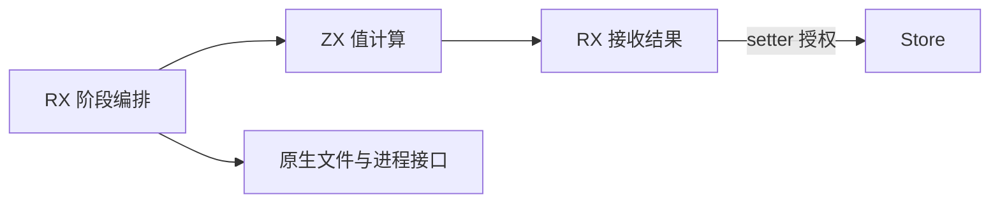

# Wave 109 自举执行记录（已验收 · 2026-11-28）

> 返回 [总览](../README.md) · [越界台账](../越界写法治理清单.md)

| IDEA          | 本轮范围                                                                                   |
| ------------- | ------------------------------------------------------------------------------------------ |
| Intent · 目标 | 贯通首轮整包迁移，清理失去调用者的宿主桥和缓冲接口，完成自举验收。                         |
| Data · 证据   | 对照提交 `14c7acb2a`、Wave 108 stage2、Wave 80 固定基线、逐文件检查和六套构建测试。        |
| Edges · 边界  | RX 负责编排，ZX 处理计算，跨调用写入经 Store 授权；Genz 唯一性分析的原子写入目录保持原样。 |
| Answer · 验收 | 三阶段二进制相同；三轮冷生成逐文件一致并通过时间门限；六套验收全部通过。                   |

## 核心改动

1. **Compiler 分析与联结。** 项目工作流、推理登记、求解和签名发布使用有类型的值，并通过 Store 提交跨阶段状态。删除 8 份已空的项目工作流宿主声明和失效注册。种子求解直接读取同一图的修订号，修复无 stage0 构建。
2. **Compiler 输出与验证。** 保留 Zig 输出与硬件视图仍使用的类型声明。验证证据的原生 I/O 使用既有序列化字段，证据汇总由 ZX 负责。清理失去调用者的 Zig 入口与模块注册。
3. **Genz 与 Core。** 调用和 AST 行传递有类型的字段和视图；循环语句的 AST 行始终提供捕获列，包括空列。注销已删除的 `stream.d.zx` 与 `core/column_ranges`，核对旧缓冲类型的全包引用。保留仍被调用的 `RowBuffer`、`WriteColumn`、`TextSlots` 等接口。
4. **CLI 与 Pkgs。** 构建、检查、项目作用域和归档路径通过值及 Store 传递状态。修正作用域准入、可选配置与原生字符串注册的集成问题。

## 治理审计

比较 `14c7acb2a` 的 Git 快照与 Wave 109 工作树。包含未跟踪源文件，排除示例及测试。逐一解析 RX 中的 `setter={[$store.*]}`，未解析目标为 0。

| 指标                  |     CLI | Compiler |    Genz |    Core | Pkgs |     Std |          合计 |
| --------------------- | ------: | -------: | ------: | ------: | ---: | ------: | ------------: |
| `mutable_opaque`      |     0→0 |      6→0 |     5→5 |    14→3 |  0→0 |     0→0 |      **25→8** |
| `opaque`              |   39→39 |     10→4 |     1→1 |   30→28 |  0→0 |     0→0 |     **80→72** |
| `.d.zx` 函数声明      | 388→368 |    81→27 | 176→165 | 187→141 |  0→0 | 180→180 | **1,012→881** |
| RX `fn="host.*"`      |     0→0 |    86→16 |   28→27 |     0→0 |  0→0 |     0→0 |    **114→43** |
| `.store.rx`           |   14→14 |    48→55 |     6→6 |     0→0 |  0→1 |     0→0 |     **68→76** |
| `U32Buffer`（`src`）  |     0→0 |     25→0 |     0→0 |     0→0 |  0→0 |     0→0 |      **25→0** |
| `U32Buffer`（含接口） |     0→0 |     25→0 |     0→0 |     3→0 |  0→0 |     0→0 |      **28→0** |
| `void` ZX             |   16→16 |    39→46 |     7→7 |   28→20 |  0→1 |     0→0 |         90→90 |
| 授权 `$store` setter  |   16→16 |    39→46 |     7→7 |     0→0 |  0→1 |     0→0 |         62→70 |
| 非 setter `void` ZX   |     0→0 |      0→0 |     0→0 |   28→20 |  0→0 |     0→0 |     **28→20** |

业务 `.d.zx` 声明 **832→701**，非 CLI Store **54→62**。Core 直接内存写 **3→2**、列写 **6→4**。新增直接内存写、列写、原子操作、手动 Arena 管理、`zig:*` 导入、RX `memory.*` 调用、标准库原生句柄及原子接口、非 setter `void` ZX 均为 0。`packages/genz/src/analysis/uniqueness/atomic` 的跟踪和未跟踪差异均为 0。

## 静态检查与三阶段自编译

- `git diff --check` 通过。Zig 逐文件 `zig ast-check` **112/112**。RX/ZX 逐文件 `zxc fmt "$f" --check` 和 `zxc lint "$f"` 各 **446/446**，新增错误 0。
- 从 Wave 108 stage2 开始，串行执行 `zig build bootstrap-stage -Doptimize=ReleaseSmall -Dgenerated-partitions=4`，三个阶段各 **30/30** 步。各次构建及生成均设置 `ZXC_RESIDENT_GENERATOR=0`。
- stage1 的构建生成版 `main.json` 在 30 秒限制内完成。冷探活耗时 **4.75 秒**，分析 547 个入口和 5,099 个模块，生成 5,098 项、复用 0 项。ReleaseSafe CLI **76/76** 步。

| 阶段   | SHA-256                                                            |
| ------ | ------------------------------------------------------------------ |
| stage1 | `b258d1bb2eca2e3d51f1f93547cf59cb7e073336a5e622189b0e35f630ccae62` |
| stage2 | `b258d1bb2eca2e3d51f1f93547cf59cb7e073336a5e622189b0e35f630ccae62` |
| stage3 | `b258d1bb2eca2e3d51f1f93547cf59cb7e073336a5e622189b0e35f630ccae62` |

`cmp` 确认三个二进制逐字节一致。修复种子路径后，从最终工作树重跑三阶段，所得哈希与基准和六套验收使用的引导器一致。

## 冷生成基准与产物比对

在 Darwin arm64、Zig 0.17.1 环境中，以同一份构建生成的 `main.json` 和 `--partitions 4` 比较两个 ReleaseSmall stage2。清单 SHA-256 为 `50f9067220c7b27171e66891896bd7016ef47854b19e8e7b77deee23b58f3681`。六次以独立的空输出及缓存运行，零复用，以 `/usr/bin/time -lp` 测量生成阶段。

| 轮次 | 先运行   | Wave 108 墙钟 / 用户 / 系统（秒） | Wave 109 墙钟 / 用户 / 系统（秒） |
| ---: | -------- | --------------------------------: | --------------------------------: |
|    1 | Wave 108 |               4.32 / 12.73 / 2.81 |               4.39 / 12.81 / 2.89 |
|    2 | Wave 109 |               4.33 / 12.76 / 2.77 |               4.34 / 12.78 / 2.73 |
|    3 | Wave 108 |               4.34 / 12.74 / 2.86 |               4.44 / 12.77 / 2.88 |

配对中位数墙钟 **4.33→4.39 秒**，CPU **15.54→15.65 秒**，分别增加 **0.06**、**0.11 秒**。相对 Wave 108 记录的中位数，墙钟增加 **0.01 秒**，CPU 减少 **0.04 秒**。相对 Wave 80 固定基线，墙钟增加 **1.38 秒**，CPU 增加 **1.06 秒**。单阶段与累计时间差均通过 1.00 秒和 3.00 秒门限。峰值 RSS 中位数从 1,574,338,560 增至 1,757,822,976 字节，增加 175 MiB（11.7%）。 [Wave 80 固定基线](wave-076-080.md)

三轮各自比对 **11,004** 个生成 Zig 文件的相对路径及 SHA-256。排除 `.zxc-inputs`，三轮均为 **PARITY_EXACT**。

## 六套串行验收

各命令均加 `--summary all`。`$STAGE2` 指向 Wave 109 stage2 引导器。

| 顺序 | 目录                | 命令                                                                                | 结果                                      |
| ---: | ------------------- | ----------------------------------------------------------------------------------- | ----------------------------------------- |
|    1 | `packages/compiler` | `zig build -Doptimize=ReleaseSafe -Dstage0=""`                                      | 42/42 步                                  |
|    2 | `packages/compiler` | `zig build test -Doptimize=ReleaseSafe -Dgenerated-partitions=4 -Dstage0="$STAGE2"` | 34/34 步，372/372 测试                    |
|    3 | `packages/pkgs`     | `zig build -Doptimize=ReleaseSafe -Dgenerated-partitions=4 -Dstage0="$STAGE2"`      | 7/7 步                                    |
|    4 | `packages/cli`      | `zig build test -Doptimize=ReleaseSafe -Dgenerated-partitions=4 -Dstage0="$STAGE2"` | 105/105 步，34/34 测试，0 泄漏            |
|    5 | `packages/cli`      | `zig build -Doptimize=ReleaseSmall -Dgenerated-partitions=4 -Dstage0="$STAGE2"`     | 76/76 步，格式及 lint 复检各 446/446      |
|    6 | `packages/test`     | `zig build test-verification -Doptimize=ReleaseSafe -Dstage0="$STAGE2"`             | 72/72 步，公开 8/8、枚举 74/74、CLI 20/20 |

六套验证通过后，`.zig-cache/.cleanup-keep` 已登记 `.zig-cache/verification-tmp/wave109/stage2/bin/zxc-bootstrap`。已清理 Wave 108 验收目录和 Wave 109 临时产物，复查保留二进制的 SHA-256，并确认 `NO_SERVE`。仓库清理脚本额外回收约 2.22 GiB，保留 Compiler、CLI、验证套件和共享核验的增量缓存。
