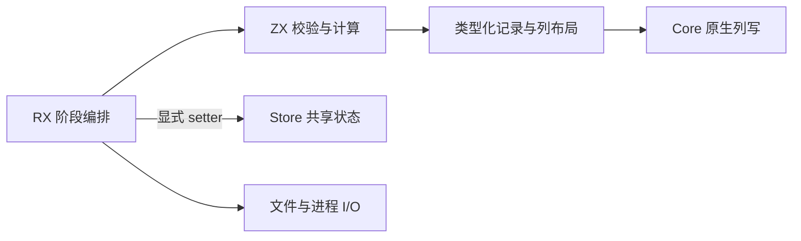
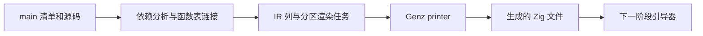

# Wave 110 自举执行记录（已验收 · 2026-11-28）

> 返回 [总览](../README.md) · [越界台账](../越界写法治理清单.md)

| IDEA          | 本轮范围                                                                                                          |
| ------------- | ----------------------------------------------------------------------------------------------------------------- |
| Intent · 目标 | 集成第二轮六路迁移，打通种子、自举和下游构建，验证代码生成及性能。                                                |
| Data · 证据   | 提交 `567c93c3c`、Wave 109 stage2、Wave 80 固定基线、逐文件检查和六套串行验证。                                   |
| Edges · 边界  | RX 负责编排，ZX 负责纯值计算，跨调用状态经显式 Store 授权。检查 Genz 唯一性分析的原子写入目录及现存 Core 写接口。 |
| Answer · 验收 | 三阶段二进制逐字节相同，三轮冷生成产物精确一致并通过两道时间门限，六套验证通过后保留 Wave 110 stage2。            |

## 集成与缺陷修复

1. **Genz 与 Core。** 集合行发布、结果转换、容量投影和元素类型选择改由 RX/ZX 处理。注销 `emit_collection_rows`、`collection_result` 两个独立 Zig 入口，结果转换由 RX 调用。删除 `WriteColumn` 及其直接写函数，`write_column.zig` 仍承载现有调用者使用的 `RowBuffer`、`RowOutput` 和 `RowGrowth`。集合工作流共享同一个只读类型表描述符。
2. **Compiler。** 生成请求在 RX 中编排包表读取，注销已无 Zig 调用方的 `generation_packages`。分区缓存键编码、文件放置与渲染任务组装由 RX/ZX 承担，删除 `partition/placement.zig`。数值位宽由 ZX 计算，硬件端口改用整数特征接口。删除 `lexical.d.zx` 中已无调用方的 `pathBasename`，其余三个路径声明有实际调用者。检查范围内无空 `.d.zx` 文件。
3. **CLI 与 Pkgs。** 原生资源路径、库导出选择、watch 比对及重启步骤由 RX/ZX 处理。删除 `native_sources/include/storage.zig` 与旧 watch 目录宿主。包图入口传入 RX 所需的 I/O，watch 比对与逐条读取使用各自生命周期的临时内存。工作区依赖边同步接入新版 ZX specifier。
4. **自举探活。** 类型化列布局进入原生写接口时触发了生成代码的参数分配，旧调用路径使用零字节分配器，递归函数尾表为空。ZX 保留类型化列布局并向现有写接口传递列号、偏移与宽度。检查生成代码确认函数表发布路径已消除这些临时分配，随后完整 `main` 探活通过。

## 治理审计

以 `567c93c3c` 的 Git 快照对照工作树，包含未跟踪源码，排除测试和示例。RX 显式 `$store` setter 的目标全部可解析。辅助检查包含 Lint 包，其下列越界指标均为 0。

| 指标                  |     CLI | Compiler |    Genz |    Core | Pkgs |     Std |        合计 |
| --------------------- | ------: | -------: | ------: | ------: | ---: | ------: | ----------: |
| `mutable_opaque`      |     0→0 |      0→0 |     5→5 |     3→2 |  0→0 |     0→0 |     **8→7** |
| `opaque`              |   39→38 |      4→4 |     1→1 |   28→24 |  0→0 |     0→0 |   **72→67** |
| `.d.zx` 函数声明      | 368→350 |    27→23 | 165→159 | 141→131 |  0→0 | 180→180 | **881→843** |
| RX `fn="host.*"`      |     0→0 |    16→14 |   27→13 |     0→0 |  0→0 |     0→0 |   **43→27** |
| `.store.rx`           |   14→14 |    55→55 |     6→6 |     0→0 |  1→1 |     0→0 |   **76→76** |
| `U32Buffer`（含接口） |     0→0 |      0→0 |     0→0 |     0→0 |  0→0 |     0→0 |     **0→0** |
| `void` ZX             |   16→16 |    46→46 |     7→7 |   20→20 |  1→1 |     0→0 |   **90→90** |
| 授权 `$store` setter  |   16→16 |    46→46 |     7→7 |     0→0 |  1→1 |     0→0 |   **70→70** |
| 非 setter `void` ZX   |     0→0 |      0→0 |     0→0 |   20→20 |  0→0 |     0→0 |   **20→20** |
| `memory_writes`       |     0→0 |      0→0 |     0→0 |     2→2 |  0→0 |     0→0 |     **2→2** |
| `column_writes`       |     0→0 |      0→0 |     0→0 |     4→4 |  0→0 |     0→0 |     **4→4** |

业务 `.d.zx` 函数声明 **701→663**，非 CLI Store **62→62**。两类写入、原子操作、手动 Arena 操作、`zig:*` 导入、RX `memory.*` 调用、标准库原生句柄及原子接口、非 setter `void` ZX 的新增数均为 0。`packages/genz/src/analysis/uniqueness/atomic/` 的跟踪及未跟踪差异均为 0。唯一性重放模块移除了失去用途的 `WriteColumn` 类型，原子操作检查结果为 0 项新增。

## 静态检查与三阶段自编译

- `git diff --check` 通过。修改与新增 Zig 源码逐文件 `zig ast-check` **70/70**，以本轮 ReleaseSmall CLI 逐文件运行 `zxc fmt --check` 和 `zxc lint` 各 **262/262**，新增错误 0。
- 以 Wave 109 stage2 为 `stage0`，串行运行 `zig build bootstrap-stage -Doptimize=ReleaseSmall -Dgenerated-partitions=4`，各阶段 **30/30** 步。生成器运行时均设置 `ZXC_RESIDENT_GENERATOR=0`。
- stage1 在启动 stage2 前完成 30 秒限时 `main` 冷探活，实际耗时 **4.68 秒**，分析 547 个入口、5,105 个模块，生成 5,101 项、复用 0 项。

| 阶段   | SHA-256                                                            |
| ------ | ------------------------------------------------------------------ |
| stage1 | `42ce56a02e8bde6e0ac364b2b153b092d4a6c823f505603305f5f345aa6bd668` |
| stage2 | `42ce56a02e8bde6e0ac364b2b153b092d4a6c823f505603305f5f345aa6bd668` |
| stage3 | `42ce56a02e8bde6e0ac364b2b153b092d4a6c823f505603305f5f345aa6bd668` |

`cmp` 确认三个二进制逐字节相同。后续集成修复位于下游 CLI 和 Pkgs，两个包均在 Compiler 引导器依赖闭包之外。

## 冷生成基准与精确比对

Darwin arm64、Zig 0.17.1。两套 ReleaseSmall stage2 使用同一份构建生成的 `main.json`，清单 SHA-256 为 `187a197e6d0bac5bc9258b722cd8c66de03cc0956abedfb102022259b4aa5fde`。以 `--partitions 4` 运行，每次使用独立的空输出和缓存目录，用 `/usr/bin/time -lp` 测量生成阶段。

| 轮次 | 先运行   | Wave 109 墙钟 / 用户 / 系统（秒） | Wave 110 墙钟 / 用户 / 系统（秒） |
| ---: | -------- | --------------------------------: | --------------------------------: |
|    1 | Wave 109 |               4.37 / 12.76 / 2.80 |               4.29 / 12.66 / 2.68 |
|    2 | Wave 110 |               4.43 / 12.78 / 2.67 |               4.44 / 12.61 / 2.81 |
|    3 | Wave 109 |               4.38 / 12.74 / 2.85 |               4.31 / 12.55 / 2.82 |

墙钟中位数 **4.38→4.31 秒**，CPU 中位数 **15.56→15.37 秒**，分别减少 **0.07**、**0.19 秒**，通过单阶段 1.00 秒门限。相对 Wave 80 的 **3.01 秒墙钟、14.59 秒 CPU**，分别增加 **1.30**、**0.78 秒**，通过累计 3.00 秒门限。峰值 RSS 中位数 **1,751,728,128→1,774,747,648 字节**，增加 **21.95 MiB（1.31%）**。 [Wave 80 固定基线](wave-076-080.md)

六次均为零复用。每轮以相对路径和 SHA-256 比对 **11,007** 个生成的 Zig 文件，排除 `.zxc-inputs`，三轮均为 **PARITY_EXACT**。

## 六套串行验证与清理

各命令均加 `--summary all`。`$STAGE2` 指向 Wave 110 stage2。

| 顺序 | 目录                | 命令                                                                                | 结果                                                                  |
| ---: | ------------------- | ----------------------------------------------------------------------------------- | --------------------------------------------------------------------- |
|    1 | `packages/compiler` | `zig build -Doptimize=ReleaseSafe -Dstage0=""`                                      | 42/42 步                                                              |
|    2 | `packages/compiler` | `zig build test -Doptimize=ReleaseSafe -Dgenerated-partitions=4 -Dstage0="$STAGE2"` | 34/34 步，372/372 测试                                                |
|    3 | `packages/pkgs`     | `zig build -Doptimize=ReleaseSafe -Dgenerated-partitions=4 -Dstage0="$STAGE2"`      | 7/7 步                                                                |
|    4 | `packages/cli`      | `zig build test -Doptimize=ReleaseSafe -Dgenerated-partitions=4 -Dstage0="$STAGE2"` | 105/105 步，运行时测试 30/30，4 项 Store 测试步骤命中缓存，0 泄漏报告 |
|    5 | `packages/cli`      | `zig build -Doptimize=ReleaseSmall -Dgenerated-partitions=4 -Dstage0="$STAGE2"`     | 76/76 步，格式与 lint 复检各 262/262                                  |
|    6 | `packages/test`     | `zig build test-verification -Doptimize=ReleaseSafe -Dstage0="$STAGE2"`             | 72/72 步，公开 8/8、枚举 74/74、CLI 20/20                             |

通过后将 `.zig-cache/.cleanup-keep` 切换到 `.zig-cache/verification-tmp/wave110/stage2/bin/zxc-bootstrap`，清理 Wave 109、Genz 并行探针与 Wave 110 临时产物。仓库清理脚本完成预览和应用。保留二进制复核哈希一致，进程检查为 `NO_SERVE`。

## 第三轮（3/3）Wave 111 待办

- **Core。** 为 `RowBuffer` 和 `TextSlots` 明确发布所有权与失败回滚，收口 `owned_text`、`column_transfer` 的两处直接写、四处列写及 20 个非 setter `void`。
- **Genz。** 把 `Lowering`、`LoopFrame`、`IterationResourceFrame`、`AstWriter` 和 `AstSequence` 承担的共享计算状态按完整调用链迁入 RX/ZX 与显式 Store。继续核查唯一性分析原子路径。
- **Compiler 与 CLI。** 优先吸收生成请求、分区缓存、库发布、归档和 watch 的剩余业务宿主逻辑，保留所需的平台 I/O 和 Windows 路径语义。重复冷生成和 RSS 对照，关注本轮测到的约 22 MiB 中位数增长。
