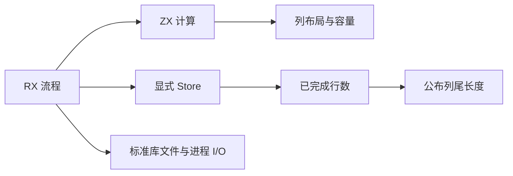
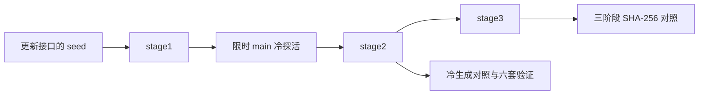

# Wave 111 自举执行记录（已验收 · 2026-11-28）

> 返回 [总览](../README.md) · [越界台账](../越界写法治理清单.md)

| IDEA          | 内容                                                                                          |
| ------------- | --------------------------------------------------------------------------------------------- |
| Intent · 目标 | 串行集成六路迁移，验证生成一致性、所有权和冷生成性能。                                        |
| Data · 证据   | 基线 `5e60a8b10`、Wave 110 stage2、Wave 80 固定基线、逐文件检查与六套串行验证。               |
| Edges · 边界  | RX 承担编排，ZX 计算纯值，共享状态经显式 Store 更新。标准库提供纯值和受控 I/O，保留平台边界。 |
| Answer · 验收 | 三阶段二进制一致，三轮冷生成逐文件一致，六套验证通过，固定 Wave 111 stage2。                  |

## 集成与所有权

- 生成请求和目录遍历恢复由 RX 编排，`documents.store.rx` 与 `entries.store.rx` 保持原有职责。请求读取 stamp 时通过 `std:fs.readFilePrefix` 多读一个字节，以拒绝过长的 stamp。失效删除用 `std:fs.unlinkIfExists`，两个成功分支合用一个快照提交。Darwin 批量目录读取继续向驻留版本判定提供纳秒级 ctime。
- Genz 集合请求、比较器登记和密集节点提交以显式 Store 承接。分区缓存保留 RX 调度，移除 `partition_host` 和手写缓存键、状态、进程调度模块，使用纯值 BLAKE3 与受控文件、子进程接口。BLAKE3 接口放在 `std:crypto/blake3`，避免 `main` 仅调用 SHA-256 时将新增声明写进 `types.zig`。
- Core 列传输区分连续、跨步与重复来源。已有前缀保留已发布长度，新增列值在容量预留后写入尾段，RX Store 记录实际完成的行数，宿主提交只对应更新已完成的列长度。检查热追加路径沿原列写入，无整表 AoS 重建，长度发布只计算两个标量之和。函数表保留 13 字段 `Table` 与独立 `Complete`，追加调用已对齐 W1 更新后的签名。
- CLI 保留 RX 文档收集、工作区收集与 watch 状态迁移，移除三个无 ZX 消费者的 `.d.zx` 和对应生成端注册。仍有手写 Zig 调用者的 YAML 扫描与依赖观测保留原生导入。修复 watch 快照错误声明、两个生成入口和 `rename` 的跨模块参数类型。
- **Wave 112 待验证。** W1 窄生成发现，借用数组执行 `.with()` 会分配新存储并复制前缀，类型化函数行发布试作生成了四次 `allocator.create`，零字节分配器无法执行。该试作已撤回。后续收口应检查生成代码中的分配点，保持旧前缀可读和列尾原位发布。

## 五类治理审计

基线与工作树对照含未跟踪源码，排除测试、示例和生成快照。Lint 包也纳入扫描，其各项指标均为 0。

| 指标                 |     CLI | Compiler |    Genz |    Core | Pkgs |     Std |        合计 |
| -------------------- | ------: | -------: | ------: | ------: | ---: | ------: | ----------: |
| `mutable_opaque`     |     0→0 |      0→0 |     5→5 |     2→2 |  0→0 |     0→0 |     **7→7** |
| `opaque`             |   38→36 |      4→3 |     1→1 |   24→24 |  0→0 |     0→0 |   **67→64** |
| `.d.zx` 函数声明     | 350→319 |    23→16 | 159→156 | 131→131 |  0→0 | 180→190 | **843→812** |
| RX `fn="host.*"`     |     0→0 |    14→11 |    13→0 |     0→0 |  0→0 |     0→0 |   **27→11** |
| `.store.rx`          |   14→15 |    55→55 |     6→9 |     0→0 |  1→1 |     0→0 |   **76→80** |
| `void` ZX            |   16→19 |    46→45 |    7→11 |   20→18 |  1→1 |     0→0 |   **90→94** |
| 授权 `$store` setter |   16→19 |    46→45 |    7→11 |     0→0 |  1→1 |     0→0 |   **70→76** |
| 非 setter `void` ZX  |     0→0 |      0→0 |     0→0 |   20→18 |  0→0 |     0→0 |   **20→18** |
| `memory_writes`      |     0→0 |      0→0 |     0→0 |     2→2 |  0→0 |     0→0 |     **2→2** |
| `column_writes`      |     0→0 |      0→0 |     0→0 |     4→4 |  0→0 |     0→0 |     **4→4** |
| 原子调用             |     0→0 |      0→0 |     8→8 |     0→0 |  0→0 |     0→0 |     **8→8** |
| `U32Buffer`          |     0→0 |      0→0 |     0→0 |     0→0 |  0→0 |     0→0 |     **0→0** |

正向自举通过，业务声明 **663→622**，非 CLI Store **62→65**。手动 Arena、RX `memory.*`、`zig:*` 导入和 `storeAtomicCell` 均为 0。Std 的 `opaque`、`mutable_opaque` 与原子并发接口为 0。Genz 唯一性分析原子目录的已跟踪及未跟踪差异均为 0。

## 静态检查与三阶段自编译

- `git diff --check` 通过。逐文件 `zig ast-check` 92/92，`zxc fmt --check` 和 `zxc lint` 各 275/275。
- `-Dstage0=""` 编出含新标准库声明的过渡 seed。直接从手写 seed 生成的工具存在局部变量编号差异，因此用该过渡工具作为固定起点，再依次生成三个 ReleaseSmall、四分区阶段，均通过 30/30 步。
- stage1 在 stage2 启动前通过 30 秒限时冷探活，实际 4.74 秒，547 个入口、5,108 个分析模块、5,096 项生成、0 项复用。

| 阶段   | SHA-256                                                            |
| ------ | ------------------------------------------------------------------ |
| stage1 | `13f413bd060dfa1db7930e6871867aa7f862410fcd9fe8fec473b1c8464c91d7` |
| stage2 | `13f413bd060dfa1db7930e6871867aa7f862410fcd9fe8fec473b1c8464c91d7` |
| stage3 | `13f413bd060dfa1db7930e6871867aa7f862410fcd9fe8fec473b1c8464c91d7` |

`cmp` 确认三阶段二进制逐字节相同。CLI 接口修复后重建 stage3，复核哈希相同。

## 冷生成基准和精确比对

Darwin arm64、Zig 0.17.1。两个 ReleaseSmall stage2 使用同一份构建生成的 `main.json`，SHA-256 为 `1b92475c965ee3dbe133d5366c44db16b36846e20781991e293a8974cead052b`。四分区，逐次使用空输出、空缓存，以 `/usr/bin/time -lp` 测量。六次均为零复用。

| 轮次 | 先运行   | Wave 110 墙钟 / 用户 / 系统（秒） | Wave 111 墙钟 / 用户 / 系统（秒） | Wave 110 / 111 峰值 RSS（字节） |
| ---: | -------- | --------------------------------: | --------------------------------: | ------------------------------: |
|    1 | Wave 110 |               4.22 / 12.62 / 2.65 |               4.34 / 12.69 / 2.75 |   1,790,263,296 / 1,792,196,608 |
|    2 | Wave 111 |               4.33 / 12.66 / 2.85 |               4.34 / 12.68 / 2.86 |   1,787,904,000 / 1,792,606,208 |
|    3 | Wave 110 |               4.30 / 12.63 / 2.78 |               4.42 / 12.67 / 2.95 |   1,587,085,312 / 1,795,309,568 |

同机重测中位数墙钟 **4.30→4.34 秒**、CPU **15.41→15.54 秒**，峰值 RSS **1,787,904,000→1,792,606,208 字节**（增加 4.48 MiB）。相对 Wave 110 上轮记录，墙钟增加 **0.03 秒**、CPU 增加 **0.17 秒**、峰值 RSS 增加 **17.03 MiB**。相对 Wave 80 固定基线，墙钟增加 **1.33 秒**、CPU 增加 **0.95 秒**。时间通过单阶段 1.00 秒及累计 3.00 秒门限。 [Wave 80 固定基线](wave-076-080.md)

每轮逐路径和 SHA-256 比对 **11,003** 个生成 Zig 文件，排除 `.zxc-inputs`，三轮均为 **PARITY_EXACT**。

## 六套串行验证

各命令均加 `--summary all`，`$STAGE2` 指向 Wave 111 stage2。Compiler 套件包含同函数递归的 IR 验证，CLI 套件无泄漏报告。

| 顺序 | 目录                | 命令                                                                                | 结果                                      |
| ---: | ------------------- | ----------------------------------------------------------------------------------- | ----------------------------------------- |
|    1 | `packages/compiler` | `zig build -Doptimize=ReleaseSafe -Dstage0=""`                                      | 42/42 步                                  |
|    2 | `packages/compiler` | `zig build test -Doptimize=ReleaseSafe -Dgenerated-partitions=4 -Dstage0="$STAGE2"` | 34/34 步，372/372 测试                    |
|    3 | `packages/pkgs`     | `zig build -Doptimize=ReleaseSafe -Dgenerated-partitions=4 -Dstage0="$STAGE2"`      | 7/7 步                                    |
|    4 | `packages/cli`      | `zig build test -Doptimize=ReleaseSafe -Dgenerated-partitions=4 -Dstage0="$STAGE2"` | 105/105 步，34/34 测试                    |
|    5 | `packages/cli`      | `zig build -Doptimize=ReleaseSmall -Dgenerated-partitions=4 -Dstage0="$STAGE2"`     | 76/76 步，重建后格式与 lint 各 275/275    |
|    6 | `packages/test`     | `zig build test-verification -Doptimize=ReleaseSafe -Dstage0="$STAGE2"`             | 72/72 步，公开 8/8、枚举 74/74、CLI 20/20 |

## 产物清理

清理脚本按同一保留项分别完成预览与应用，移除 Wave 110 和本轮临时目录。`.zig-cache/.cleanup-keep` 固定 `.zig-cache/verification-tmp/wave111/stage2/bin/zxc-bootstrap`，保留的引导器复核哈希一致，进程检查为 `NO_SERVE`。修改保留在工作树供审阅。
