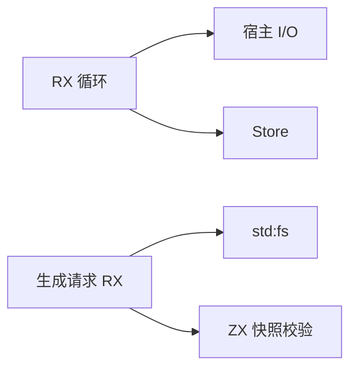
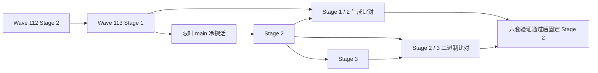

# Wave 113 自举执行记录（已验收 · 2026-11-28）

> 返回 [总览](../README.md) · [越界台账](../越界写法治理清单.md)

| IDEA          | 内容                                                                                                                              |
| ------------- | --------------------------------------------------------------------------------------------------------------------------------- |
| Intent · 目标 | 恢复 CLI 原有 RX 编排，定位并消除冷生成 RSS 尖峰，完成自举和串行验证。                                                            |
| Data · 证据   | 基线 `809ad89b2`、Wave 112 stage2、同一份 `main` 清单、Wave 80 固定性能记录及六套验证。                                           |
| Edges · 边界  | RX 保留流程和作用域，ZX 计算，Store 保存运行时共享状态，Zig 宿主执行 I/O。                                                        |
| Answer · 验收 | 静态和治理检查通过，Stage 2 与 Stage 3 的 SHA-256 一致，Stage 1 与 Stage 2 的生成文件逐一一致，完成冷基准和六套回归后切换引导器。 |

## 集成与职责

- 将原生作用域、原生资源发现、项目作用域绑定、工作区收集和搜索恢复到 `809ad89b2`，包括三个注册点和资源遍历所依赖的四条原有宿主声明。库发布及退役循环仍由 RX 执行。Watch 的观测登记保留 RX 对读取、比较和发布的编排。
- Genz 在 `Lower` 上以类型化栈传递迭代状态。RX/ZX 继续控制迭代和语句选择。移除 `LoopFrame`、`IterationResourceFrame`、两个空的求值声明文件及语句选择的旧 Zig 发布实现。同步调用在证明借用期后使用栈槽。列表更新与对象更新使用基线的所有权判定。
- Compiler 的快照读取改由 RX 调用 `std:fs.readFile`，ZX 验证快照记录。目录收集省去累计批次复制，文件路径与相对路径共享字节，文档借用常驻缓存已持有的路径。移除无消费方的 `observe_input_interfaces` 入口。源文件索引适配生成 ABI 中的类型化分桶视图，借用现有切片。
- Core 用类型化列描述替代不透明的列分组。文本列表传输复用目标分配器，移除 `writeTransferTextList`。CLI 的库和 Gateway 可达源检查继续由 RX 编排。Pkgs 的工作区相对路径验证由 ZX 承担，Lint 的 YAML 路径移除旧 Zig 实现。

## 五类治理审计

基线和工作树按相同范围统计，含未跟踪源码，排除测试、示例和生成快照。Lint 各项均为 0。

| 指标                 |     CLI | Compiler |    Genz |    Core | Pkgs |     Std |        合计 |
| -------------------- | ------: | -------: | ------: | ------: | ---: | ------: | ----------: |
| `mutable_opaque`     |     0→0 |      0→0 |     5→3 |     0→0 |  0→0 |     0→0 |     **5→3** |
| `opaque`             |   35→35 |      3→3 |     0→0 |   23→20 |  0→0 |     0→0 |   **61→58** |
| `.d.zx` 函数声明     | 309→300 |    11→10 | 138→120 | 119→105 |  0→0 | 190→190 | **767→725** |
| RX `fn="host.*"`     |     0→0 |      6→5 |     0→0 |     0→0 |  0→0 |     0→0 |     **6→5** |
| `.store.rx`          |   16→16 |    55→55 |   12→12 |     0→0 |  1→1 |     0→0 |   **84→84** |
| `void` ZX            |   20→20 |    47→47 |   18→21 |    10→5 |  1→1 |     0→0 |   **96→94** |
| 授权 `$store` setter |   20→20 |    47→47 |   18→21 |     0→0 |  1→1 |     0→0 |   **86→89** |
| 非 setter `void` ZX  |     0→0 |      0→0 |     0→0 |    10→5 |  0→0 |     0→0 |    **10→5** |
| `memory_writes`      |     0→0 |      0→0 |     0→0 |     1→0 |  0→0 |     0→0 |     **1→0** |
| `column_writes`      |     0→0 |      0→0 |     0→0 |     2→2 |  0→0 |     0→0 |     **2→2** |
| 原子调用             |     0→0 |      0→0 |     8→8 |     0→0 |  0→0 |     0→0 |     **8→8** |
| `U32Buffer`          |     0→0 |      0→0 |     0→0 |     0→0 |  0→0 |     0→0 |     **0→0** |

正式调用链正向自举审计通过。业务声明 **577→535**，非 CLI Store **68→68**，Core 的 `column_writes.d.zx` 声明 **19→5**。手动 Arena 操作、RX `memory.*`、`zig:*` 导入及 `storeAtomicCell` 均为 0。标准库的两类不透明类型及原子并发接口均为 0。Genz 唯一性分析的原子目录无差异。

## 三阶段自举与生成比对

固定起点为 Wave 112 Stage 2，SHA-256 为 `b7b66ad1f321408251b8eba0bea8c88560e424b0d2bc57128c66cd025209a97b`。三个 ReleaseSmall 四分区阶段均通过 **30/30** 构建步骤。Stage 1 在 Stage 2 启动前通过 30 秒限时冷探活，用时 **4.62 秒**，分析 5,101 个模块，生成 5,061 项，复用 0 项。

| 阶段    | SHA-256                                                            |
| ------- | ------------------------------------------------------------------ |
| Stage 1 | `fbd5fce3b911ef1cb5cd134ed4f6b116739a92af0124de9ac6d36f2f883a203c` |
| Stage 2 | `f42ac4a77d7f6212cf24fc80f0d8217c740f1404c6421cc5b9e174f2ecba8125` |
| Stage 3 | `f42ac4a77d7f6212cf24fc80f0d8217c740f1404c6421cc5b9e174f2ecba8125` |

`cmp` 确认 Stage 2 与 Stage 3 逐字节一致。Stage 1 由 Wave 112 的生成代码编译。Stage 2 和 Stage 3 已使用本波的同步 ABI 栈槽规则。Wave 113 Stage 1 与 Stage 2 对同一清单的 **10,927/10,927** 个 Zig 文件逐路径、逐 SHA-256 一致，三轮均为 **PARITY_EXACT**，排除 `.zxc-inputs`。二进制和内部生成结果同时达到固定点验收标准。

相对 Wave 112 的同输入生成结果，两版的文件路径集合相同，61 个文件内容变化。差异包括 27 个原始模块、18 个分区文件及 16 个根目录文件。在共同的原始模块中，栈槽替代了 37 个 `allocator.create` 调用点。三轮的跨版本差异清单一致。

## RSS 定位与冷基准

列表回退将 `list_update.zig` 的 `.in_place` 恢复为 `flags.in_place or fresh`、`.transfer` 恢复为 `represented and transfer`，seed 也恢复 `plan.in_place and !plan.deferred`。同一 `main` 的 10,927 个生成 Zig 文件未改变，RSS 尖峰仍能复现。

第二次对照保持栈槽规则不变，仅回退对象更新的 `match/root.zx`、`match/eligible.zx` 和配套 `emit.zig`、`seed.zig`。该组曾允许在 `state_active == false` 时对已求值的 ABI 记录走直接借用，并在 boxed 字段发射时跳过布局转换。回退后 227 个生成文件改变，栈槽引用和 `allocator.create` 调用点的计数保持一致。跨波冷测中的 Stage 2 RSS 中位数由 1,790,935,040 降至 1,608,105,984 字节，减少 174.36 MiB。这个对照将尖峰定位到对象更新的直接借用路径。

| 对照版本       | Wave 113 Stage 1 RSS 中位数（字节） | Wave 113 Stage 2 RSS 中位数（字节） |        差值 |
| -------------- | ----------------------------------: | ----------------------------------: | ----------: |
| 两项回退前     |                       1,593,704,448 |                       1,776,566,272 | +174.39 MiB |
| 仅回退列表     |                       1,592,885,248 |                       1,780,514,816 | +178.94 MiB |
| 再回退对象更新 |                       1,600,421,888 |                       1,615,413,248 |  +14.30 MiB |

Darwin arm64，Zig 0.17.1。最终对照使用同一 `main.json`，SHA-256 为 `0f29a83820a3146f2e98970d6d6e4056aa9ae210ebaecbe680f27a668b9a4bd7`。每次以空输出和空缓存运行，`/usr/bin/time -lp` 计量。两版工具均为四分区 ReleaseSmall Stage 2，六次均为零复用。

| 轮次 | 先运行   | Wave 112 墙钟 / 用户 / 系统（秒） | Wave 113 墙钟 / 用户 / 系统（秒） | Wave 112 / 113 峰值 RSS（字节） |
| ---: | -------- | --------------------------------: | --------------------------------: | ------------------------------: |
|    1 | Wave 112 |               4.33 / 12.55 / 2.76 |               4.34 / 12.82 / 2.78 |   1,595,211,776 / 1,604,386,816 |
|    2 | Wave 113 |               4.30 / 12.55 / 2.77 |               4.39 / 12.80 / 2.93 |   1,600,618,496 / 1,613,168,640 |
|    3 | Wave 112 |               4.38 / 12.61 / 2.86 |               4.29 / 12.80 / 2.69 |   1,596,080,128 / 1,608,105,984 |

同次对照的中位数墙钟 **4.33→4.34 秒**，CPU **15.32→15.60 秒**，RSS **1,596,080,128→1,608,105,984 字节**（**+11.47 MiB / +0.75%**）。相对 Wave 112 留档值，墙钟增加 **0.01 秒**，CPU 增加 **0.18 秒**，RSS 下降 **2.48 MiB**。相对 Wave 80 固定基线，墙钟增加 **1.33 秒**，CPU 增加 **1.01 秒**。时间均在门限内。 [Wave 80 固定基线](wave-076-080.md)

单入口 `function_table_publish` 沿用同一组源码根，三轮配对均分析 195 个模块，生成 11 项，零复用。RSS 中位数 **268,435,456→267,419,648 字节**（**−0.97 MiB**）。

## 静态检查与六套串行验证

`git diff --check` 通过。工作树中变更的 Zig 文件经 `zig ast-check` **61/61**。另对恢复到基线的四个 Zig 文件逐一检查。ReleaseSmall CLI 的逐文件 `zxc fmt --check` 和 `zxc lint` 各 **179/179**。

各套构建使用 `--summary all`，`$STAGE2` 指 Wave 113 Stage 2。

| 顺序 | 目录                | 命令                                                                                | 结果                                                                |
| ---: | ------------------- | ----------------------------------------------------------------------------------- | ------------------------------------------------------------------- |
|    1 | `packages/compiler` | `zig build -Doptimize=ReleaseSafe -Dstage0=""`                                      | 42/42 步                                                            |
|    2 | `packages/compiler` | `zig build test -Doptimize=ReleaseSafe -Dgenerated-partitions=4 -Dstage0="$STAGE2"` | 34/34 步，372/372 测试                                              |
|    3 | `packages/pkgs`     | `zig build -Doptimize=ReleaseSafe -Dgenerated-partitions=4 -Dstage0="$STAGE2"`      | 7/7 步                                                              |
|    4 | `packages/cli`      | `zig build test -Doptimize=ReleaseSafe -Dgenerated-partitions=4 -Dstage0="$STAGE2"` | 105/105 步，运行时 30/30，Store 4/4，Store 独立复跑 4/4，无泄漏报告 |
|    5 | `packages/cli`      | `zig build -Doptimize=ReleaseSmall -Dgenerated-partitions=4 -Dstage0="$STAGE2"`     | 76/76 步                                                            |
|    6 | `packages/test`     | `zig build test-verification -Doptimize=ReleaseSafe -Dstage0="$STAGE2"`             | 72/72 步，公开 8/8、枚举 74/74、CLI 20/20                           |

## 产物清理

`.zig-cache/.cleanup-keep` 仅保留 `.zig-cache/verification-tmp/wave113/stage2/bin/zxc-bootstrap`。已移除 Wave 112 和 Wave 113 临时核验目录及日志，完成清理脚本预览和 `--apply`，并复核 Stage 2 SHA-256 与执行权限。进程检查为 `NO_SERVE`。日期目录没有临时文件，改动留给 Orchestrator 复核。
