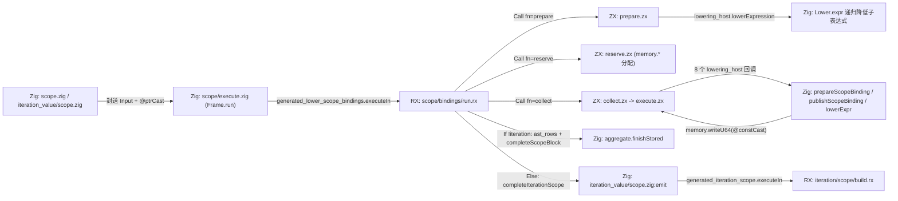

# zray 自举进度诊断和指导报告

> 日期：2026-11-25 · 诊断基线：`f84e3d06a`（`origin/master` 最新已拉取至 `1f08c03d`）· 覆盖范围：`packages/{compiler,genz,cli,core,lint,pkgs}` 与近 198 笔主线提交（`970ba1a5c..f84e3d06a`）

---

## 一、核心结论（Executive Summary）

自举之所以**推进极慢**，且几乎每一批都在**同时暴增 ZX/RX 代码与大量 Zig 代码**，根本原因不是“工作量本来就大”，而是**迁移模式、工具链架构与语言边界产生了结构性内耗**：

1. **正在制造“乒乓跳板（Ping-Pong Trampoline）”而非消除 Zig**：当前大量批次采用“由内向外、逐小步包壳”的迁移方式——把原本一段连贯的 Zig 算法切成一个微入口（`entries.zig` 已膨胀至 **954** 个入口，加上 CLI 的 **127** 个共 **1,081** 个），每次从 Zig 封送 `@ptrCast`/`anyopaque` 进 Source（RX/ZX），Source 执行几行判断或循环后，再通过 `.d.zx` 声明的宿主回调（全仓已有 **120** 份 `.d.zx`、**2,480** 个原生函数）跳回 Zig，Zig 再递归调用下一层 `executeIn(...)`。
2. **近半数“非 seed Zig”已是纯胶水**：对 6 大核心包 `src/` 的静态盘点显示，当前已写出 **1,441** 份 RX（53,013 行）+ **7,095** 份 ZX（326,928 行）+ **120** 份 `.d.zx`（10,449 行），但仍留存 **1,460** 份非 seed Zig（**130,531** 行）+ **265** 份 seed Zig（**20,932** 行），手写 Zig 总计 **151,463** 行。其中 **49.0%（63,939 行）的非 seed Zig** 属于宿主回调、双端跳板、封送包装与 `core/memory` 胶水，全仓非 seed 源码出现 **5,267 处 `@ptrCast` / `anyopaque`**。
3. **高换手率（Churn Ratio ≈ 1.00）吞噬了所有净收益**：在 `970ba1a5c..f84e3d06a`（2026-11-22 08:39 至 2026-11-25 02:16，共 **198** 笔提交）中，新增 **RX 24,320 行 + ZX 34,064 行 + `.d.zx` 6,502 行 = 64,886 行**，删除非 seed Zig **29,938** 行，却同时**新增了 29,831 行非 seed Zig**（换手率 **0.996**，净减仅 **107** 行；若计入 seed 与测试/构建全仓 Zig 甚至净增 **+1,360** 行，换手率 **1.043**）。有 **125 / 198** 笔提交单次新增 Zig ≥ 100 行，**89 / 198** 笔提交全仓 Zig 净增。
4. **活体 `seed` 与双轨分支锁死删码**：[packages/compiler/build.zig](file:///Users/xiewendao/Documents/Projects/zray/packages/compiler/build.zig) 默认 `stage0 == ""` 编译主干 [bootstrap_tool.zig](file:///Users/xiewendao/Documents/Projects/zray/packages/compiler/build/bootstrap_tool.zig) 作为引导生成器，迫使迁移时大量保留 `if (generated)` 双分支（**372** 个文件、**38,730** 行）或将旧实现切入 `*_seed.zig`（**20,932** 行），导致旧逻辑名义上“退出正式路径”却无法从代码库物理消除。
5. **三项 ZX/RX 语言与语义缺口未补齐，只能拿 Zig 补洞**：（1）RX 强无环与禁止 ZX 导入 RX，无法直接表达编译器互递归，被迫用 Zig 宿主函数做递归跳板；（2）缺少零拷贝可控原地可变容器，不可变 `.with`/Map 在循环中触发平方级复制（如 11-25 诊断图探针峰值飙到 742 MB），被迫持续扩写 `core/memory` 桥接层（3,566 行）；（3）`core/memory` 普遍通过 `*const anyopaque` + `@constCast`（仅 `packages/core/src/memory/` 就达 **36** 处，6 大核心包 `src/` 共 **242** 处）修改宿主状态，已连续两天在 `ReleaseSmall` 下触发 LLVM `readonly` 别名误优化（11-25 甚至用 `noinline` 掩盖症状）。
6. **微批交付税极高**：`goal.md` 与 `docs/user_request.jsonl` 明确要求“3,000 行级规划大步迁移”，但实际执行退化为中位数 **16.6 分钟/提交**的微批循环——每批仅净减数行至数十行 Zig，却往往伴随全套双生成器 **17,560+** 文件逐字节比对、`ReleaseSmall` 16 分区编译、数百至上万回归和三轮交错基准，以及 3 份文档更新。

---

## 二、量化证据：近期提交画像与代码结构总账

### 2.1 近 198 笔提交统计（`970ba1a5c..f84e3d06a`）

> 说明：`970ba1a5c` 为当前浅克隆截断基点（含基线导入），以下统计均自其下一笔提交起计算（共 198 笔提交，时间跨度约 65.6 小时，提交间隔中位数 **16.6 分钟**、均值 **19.9 分钟**）。

| 日期                     |  提交数 |      全仓 Zig `+ / -`（净变化 / 换手率） |             非 seed 包源码 Zig `+ / -` |     RX 新增 |     ZX 新增 | `.d.zx` 新增 | 全仓 Zig 净增提交数 |
| ------------------------ | ------: | ---------------------------------------: | -------------------------------------: | ----------: | ----------: | -----------: | ------------------: |
| 2026-11-22               |      51 |    +9,756 / -6,070（**+3,686** / 1.61x） |              +9,229 / -5,827（+3,402） |      +9,753 |     +13,329 |       +1,874 |                  42 |
| 2026-11-23               |      88 |        +14,006 / -14,337（-331 / 0.98x） |            +11,958 / -13,567（-1,609） |      +7,188 |     +10,772 |       +1,439 |                  38 |
| 2026-11-24               |      54 |       +8,501 / -10,399（-1,898 / 0.82x） |             +8,272 / -10,068（-1,796） |      +7,208 |      +9,219 |       +3,095 |                   8 |
| 2026-11-25（截至 02:16） |       5 |               +385 / -482（-97 / 0.80x） |                    +372 / -476（-104） |        +171 |        +744 |          +94 |                   1 |
| **合计（198 笔）**       | **198** | **+32,648 / -31,288（+1,360 / 1.043x）** | **+29,831 / -29,938（-107 / 0.996x）** | **+24,320** | **+34,064** |   **+6,502** |        **89 / 198** |

- **“双增/高换手”是常态而非个例**：198 笔提交中，**125 笔（63.1%）**单次新增 Zig ≥ 100 行，**116 笔（58.6%）**同时新增 ≥ 100 行 Zig 与 ≥ 100 行 RX/ZX。
- 11-24 虽然换手率从 1.61x 降至 0.82x，但 `.d.zx` 新增飙升至 **+3,095** 行——说明 Zig 删除的只是局部逻辑，代价是向 `.d.zx` 与宿主胶水大量扩散接口边界。

### 2.2 典型“同时新增大量 RX/ZX 与大量 Zig”提交样本

| 提交        | 时间        |        全仓 Zig `+ / -`（净变化） | RX / ZX / `.d.zx` 新增 | 反映的病灶                                                                                                                                |
| ----------- | ----------- | --------------------------------: | ---------------------: | ----------------------------------------------------------------------------------------------------------------------------------------- |
| `15f0d597b` | 11-24 15:12 |             +1,713 / -1,716（-3） |   +912 / +1,981 / +343 | 改写 3,236 行 Source 仅换来全仓 Zig 净减 3 行，大量修改 `host.d.zx` 与跳板文件                                                            |
| `0b096d57f` | 11-23 03:03 |               +821 / -526（+295） |       +199 / +48 / +78 | 迁移 RX flow effects 反而净增 295 行 Zig                                                                                                  |
| `c00597a74` | 11-22 17:32 |               +549 / -339（+210） |       +32 / +159 / +65 | 图构造迁出后，宿主状态与桥接层净增 210 行 Zig                                                                                             |
| `887143a1b` | 11-23 23:34 |                +513 / -573（-60） |      +465 / +184 / +81 | 列表操作编排删除 573 行 Zig 却新写 513 行 Zig 胶水与 seed 拆出                                                                            |
| `806f2a6ba` | 11-22 16:42 |               +489 / -198（+291） |       +94 / +160 / +82 | 混合正文联结净增 291 行 Zig                                                                                                               |
| `3d0e7174d` | 11-23 03:21 |               +475 / -251（+224） |       +447 / +97 / +80 | RX IR 语句执行迁入 Source 净增 224 行 Zig                                                                                                 |
| `fae33d07c` | 11-24 04:22 |                +411 / -509（-98） |   +1,147 / +411 / +149 | Task/Parallel 一次拆出大量微文件，新增 411 行 Zig 与 149 行 `.d.zx`                                                                       |
| `98c1a6eca` | 11-24 18:23 |               +320 / -183（+137） |       +83 / +199 / +46 | CLI `project/scopes` 仅删 34 行 `native.zig` 与部分旧逻辑，却新建 `scopes/host.zig`（193 行）+ `state.zig`（81 行）+ `host.d.zx`（46 行） |
| `f84e3d06a` | 11-25 02:16 | +233（推估自 425/261 全量含文档） |             见下节剖析 | `HEAD` 最新批：`scope/execute.zig` 与 `iteration_value/scope.zig` 仍留 235 行双端跳板，并新增 `noinline` 补丁                             |

### 2.3 当前 6 大核心包 `src/` 代码结构总账

| 包         | 非 seed Zig（文件 / 行） | seed Zig（文件 / 行） | RX（文件 / 行 / 均行） |  ZX（文件 / 行 / 均行） |                                   `.d.zx`（文件 / 行） | 微文件比例（ZX≤20行 / RX≤15行） |
| ---------- | -----------------------: | --------------------: | ---------------------: | ----------------------: | -----------------------------------------------------: | ------------------------------: |
| `compiler` |             760 / 66,500 |           101 / 8,288 |   689 / 26,603（38.6） | 3,301 / 150,426（45.6） |                                             27 / 2,938 |              796/3,301 / 96/689 |
| `genz`     |             399 / 35,213 |          164 / 12,644 |   550 / 19,390（35.3） | 2,973 / 146,328（49.2） |                                             23 / 2,652 |             606/2,973 / 101/550 |
| `cli`      |             174 / 15,606 |                 0 / 0 |    181 / 6,338（35.0） |    441 / 14,411（32.7） |                                             30 / 1,563 |                156/441 / 16/181 |
| `core`     |               88 / 9,041 |                 0 / 0 |         4 / 88（22.0） |    267 / 10,351（38.8） |                                                  0 / 0 |                    59/267 / 1/4 |
| `lint`     |               27 / 1,808 |                 0 / 0 |       11 / 298（27.1） |      36 / 1,699（47.2） |                                                  0 / 0 |                    12/36 / 4/11 |
| `pkgs`     |                 12 / 903 |                 0 / 0 |        6 / 296（49.3） |      77 / 3,713（48.2） |                                                  0 / 0 |                     13/77 / 0/6 |
| **合计**   |      **1,460 / 130,531** |      **265 / 20,932** |     **1,441 / 53,013** |     **7,095 / 326,928** | **80 / 7,153**（全仓 120 份 / 10,449 行 / 2,480 函数） |         **1,642/7,095 (23.1%)** |

> 全仓共 120 份 `.d.zx`（含 `std`、`compiler/packages` 外及测试外接口路径），累计声明 **2,480** 个 `declare function`。

### 2.4 剩余 130,531 行“非 seed Zig”的真实成分拆解

按文件是否调用 `executeIn()`、是否使用 `anyopaque`/`borrow()`、是否属 `core/memory` 或 OS/C I/O，对 6 大核心包 `src/` 的 1,460 份非 seed Zig 分类统计如下：

| 职责类别                                               |    文件数 |        行数 |       占比 | 实质含义                                           |
| ------------------------------------------------------ | --------: | ----------: | ---------: | -------------------------------------------------- |
| 纯 Zig 状态机或未迁逻辑                                |       777 |      54,232 |      41.5% | 真正待迁的编译器/CLI/工具算法与数据结构            |
| **宿主回调 / 不透明指针桥接**（`anyopaque`/`borrow`）  |       284 |      28,405 |  **21.8%** | 为 Source 提供逆向回调与状态句柄的 Zig 胶水        |
| **双向跳板**（既调 `executeIn` 又接 `anyopaque` 回调） |       174 |      25,404 |  **19.5%** | 上下两头都靠 Zig 穿线，每层微切都在复制的“壳”      |
| **Zig→Source 封送包装**（仅调 `executeIn`）            |        88 |       6,564 |   **5.0%** | 只做参数打包、切片转指针与错误翻译的薄壳           |
| **`core/memory` 底层原语**                             |        20 |       3,566 |   **2.7%** | 绕过 ZX 不可变限制的指针读写、arena 与缓冲区原语   |
| 平台 I/O / 进程 / OS / C 库边界                        |       117 |      12,360 |       9.5% | 最终应保留的系统边界（文件、子进程、`libyaml` 等） |
| **合计**                                               | **1,460** | **130,531** | **100.0%** | **胶水+跳板+封送+内存原语共 63,939 行（49.0%）**   |

重灾区子目录前五位：

1. `compiler/rx/analysis/project`：**9,834** 行（其中 `mixed.zig`、`ahead.zig`、`invocation/host.zig`、`source_graph/construct.zig` 等均是数百行重度跳板）
2. `compiler/rx/analysis/inference`：**4,964** 行
3. `genz/zx`（含 `uniqueness`、`iteration_value`、`state_value`、`value_call`、`scope`）：合计 **13,959+** 行（其中 `construction/publication.zig` 562 行、`scope/execute.zig` 153 行）
4. `core/memory`：**3,546** 行（全 `src` 共 3,566 行）
5. `compiler/zx/modules`（含 `project`、`link`、`semantic_cache`、`artifact`、`compiled`）：合计 **13,000+** 行（其中 `parse_cache.zig` 700 行）

---

## 三、根因深挖：为什么越迁越慢、且同时暴增 ZX/RX 与 Zig？

### 根因 1：由内向外的“微切片 + 乒乓跳板（Ping-Pong Trampoline）”迁移模式

这是最致命的架构病灶。以今天 `HEAD`（`f84e3d06a`）刚合入的 `genz 作用域绑定与结果交付` 为例，实际执行路径如下：



可以看到：

- 原本在 [scope.zig](file:///Users/xiewendao/Documents/Projects/zray/packages/genz/src/zx/scope.zig) 里几十行的逻辑，在迁移后变成了 **Zig → 封送桥 (`execute.zig` 153 行) → RX (`run.rx` 72 行) → 9 个 ZX 文件 → `.d.zx` 接口 (`scope.d.zx` 8 个宿主函数 + `ast/rows/write.d.zx`) → 回调 Zig (`prepareScopeBinding` / `publishScopeBinding` / `lowerExpression`) → 再通过 Zig (`iteration_value/scope.zig:emit`) 调另一个生成入口 `generated_iteration_scope`**！
- **为什么这么做必导致“三倍膨胀”？**
    - 每在调用链中段切出一个微入口，就要在 `entries.zig`（已达 **954** 个入口）或 `cli/build/*.json`（**127** 个入口）注册新编译单元；
    - 需要在 `.d.zx`（已达 **120** 份、**2,480** 个函数）里把原本可以直接在同语言内互调的函数全部写成 FFI 声明；
    - 需要在 Zig 侧写一对一的 `Frame`、字段收集、切片指针绑定（`@ptrCast(&spans)`、`@ptrCast(&stack.keys.items)`）、`anyopaque` 拆箱（`borrow(handle)`）和错误码映射（`failure(err)`）；
    - 当这些中间层的上下游都还是 Zig（或各自独立的生成入口）时，**被替换的只是中间 50~150 行 `while/switch`，新写入的却是一整套跨边界协议（150~300 行 Zig 胶水 + 300~500 行 RX/ZX）**。
- 在 CLI 中同样严重：例如 `98c1a6eca` 为了将 `cli/project/scopes` 迁入 Source，只删掉了 34 行的 `native.zig` 与部分旧函数，却新建了 [scopes/host.zig](file:///Users/xiewendao/Documents/Projects/zray/packages/cli/src/cli/project/scopes/host.zig)（193 行，现已 287 行）、`scopes/state.zig`（81 行）、`scopes/host.d.zx`（46 行）以及 11 个微小 `.zx`/`.rx` 文件。

### 根因 2：活体 `seed` 与 `if (generated)` 双轨制锁死了删除能力

查看 [packages/compiler/build.zig](file:///Users/xiewendao/Documents/Projects/zray/packages/compiler/build.zig#L6-L20) 与 [packages/compiler/build/bootstrap_tool.zig](file:///Users/xiewendao/Documents/Projects/zray/packages/compiler/build/bootstrap_tool.zig)：

- 当未显式传递 `-Dstage0=...` 时，构建系统默认从头编译**纯手写 Zig 的 `generate-parser`（`seed_rx.zig` + `compiler.zig(..., null, ...)`）**作为代码生成器。
- 这意味着每一次常规 `zig build`，**旧 Zig seed 都在活体编译并必须能够生成整个自举系统**。
- 直接后果就是：**372** 个非 seed Zig 文件（**38,730** 行）不得不保留 `if (comptime generated) { ... } else { return self.executeSeed(); }`（如 [mixed.zig](file:///Users/xiewendao/Documents/Projects/zray/packages/compiler/src/rx/analysis/project/mixed.zig#L73-L94)、[scope.zig](file:///Users/xiewendao/Documents/Projects/zray/packages/genz/src/zx/scope.zig#L31-L75)），或者把被替换掉的 Zig 算法移入 `*_seed.zig`（目前全仓 **265 份 seed 文件，20,932 行**）。
- 只要活体 seed 还要求在每次默认构建时从源码编译并完整运行，迁移者就**绝对不敢删除底层 Zig 算法和数据结构**，只能不断往上叠加“Source 分支 + 兼容适配器”，全仓 Zig 自然越删越多。

### 根因 3：ZX/RX 面向编译器自举的三项真实语言与底层缺口

过去几天的验收记录已经用真实故障证明，以下问题不是编码风格问题，而是当前 ZX/RX 支撑自举时的**能力缺口**：

1. **无环约束与编译器天然互递归的矛盾**
    - RX 强制无环 DAG，且规则严格禁止 ZX 导入 RX。但编译器降低（`lowerExpression ↔ lowerScope ↔ lowerStatement`）、类型求解（`unify ↔ fields ↔ object_closure`）天生存在互递归。
    - 由于缺少跨模块相互调用或语言内显式递归栈的惯用表达，实现者唯一绕开无环检查的手段就是**退回 Zig**：在 `.d.zx` 中声明 `host.lowerExpression`，让 RX/ZX 跳回 Zig，再由 Zig 重新进入下一次 `executeIn`（即“Zig 跳板递归”）。
2. **缺少零拷贝可控原地可变容器，被迫堆砌 `core/memory`（3,566 行）**
    - ZX 复合值是不可变值语义（`.with` 更新），这在普通业务流中安全清晰，但在编译器这种高频更新符号表、AST 节点数组、访问集合（`visited`）、开放寻址哈希表的场景下会触发灾难性复制。
    - **实证 1**：[docs/2026-11-25/后端回执路径与诊断状态自举.md](file:///Users/xiewendao/Documents/Projects/zray/docs/2026-11-25/后端回执路径与诊断状态自举.md#L39) 明确记录：“初版 ZX 不可变整数映射在分支写入时复制在用列。5,000 个子节点的探针峰值达到约 742 MB。保留 ZX 遍历，改用编译器内部通用整数表原地写入”。
    - **实证 2**：[docs/2026-11-25/genz局部作用域收敛.md](file:///Users/xiewendao/Documents/Projects/zray/docs/2026-11-25/genz局部作用域收敛.md#L43) 记录：“最初用 `.with` 生成的循环会续借数组并可能触发复制，最终让内部 `memory` 绑定已预留的可写切片”。
    - 正因为语言层没有给编译器提供受控的“线性独占可变切片/缓冲”语法原语，只好把几百个 `readU32` / `writeU64` / `reserveTail` 全部做成 `core/memory`（3,566 行 Zig + 大量 `.d.zx`），既破坏零抽象读写的简洁性，又制造了严重的安全性漏洞（见下条）。
3. **`*const anyopaque` + `@constCast` 引发的系统性 LLVM `readonly` UB（未定义行为）**
    - 查阅 [packages/core/src/memory/root.zig](file:///Users/xiewendao/Documents/Projects/zray/packages/core/src/memory/root.zig#L161-L263) 及第 784–831 行可见：`memory` 接口在 ZX 侧按只读句柄传入，Zig 侧却用 `*const anyopaque` 接收再执行 `@constCast` 写入！全仓 6 大包 `src/` 共存在 **242 处 `@constCast`**（仅 `packages/core/src/memory/` 就占 **36 处**）。
    - 这直接欺骗了 Zig 与 LLVM 优化器（生成的 IR 对参数标注 `readonly`），导致**连续两天在 `ReleaseSmall` 出现真实崩溃**：
        - 11-24 [输入观测与快照复用自举.md](file:///Users/xiewendao/Documents/Projects/zray/docs/2026-11-24/输入观测与快照复用自举.md#L48-L50)：“正式 ReleaseSmall 验证曾在首次消费记录时崩溃。优化后的 LLVM IR 对 ZX 原生引用参数标记 `readonly`，而宿主把该实参直接转回可写状态，后续读取的路径被优化为未定义值。”
        - 11-25 [genz作用域绑定与结果交付.md](file:///Users/xiewendao/Documents/Projects/zray/docs/2026-11-25/genz作用域绑定与结果交付.md#L44)：“候选接手生成时，输入目录扫描在带子目录的情况下报 `IndexOutOfBounds`……把目录扫描使用的字符串写入、文本列列表读取和列表长度读取保留为非内联调用后，候选在无探针的 ReleaseSmall 配置下通过复现。”——查看源码，[root.zig:784](file:///Users/xiewendao/Documents/Projects/zray/packages/core/src/memory/root.zig#L784)（`writeString`）和 `rows.zig:279,393` 被加上了 `pub noinline fn` 来阻止内联暴露 UB！**用 `noinline` 掩盖 `readonly` `@constCast` UB 是极其危险的定时炸弹**。

### 根因 4：指标异化（Goodhart's Law）与每微批全量验证税

对比 `docs/user_request.jsonl` 中用户 11-23 的原始要求与实际执行：

- 用户要求：“**先以三千行左右代码设计一个迁移计划，然后执行迁移，然后性能回测……每完成一个阶段（完成一个大的特性自举，大量代码变更）提交 git 并推送**”。
- 实际 `docs/手写Zig净减少长执行计划.md` 与执行过程把关注点压缩成了“**连续两批非 seed Zig 净减 ≥ 1 行**”：
    - 于是出现了净减 **−1、−3、−4、−5、−6、−7** 行的“微型批次”，平均 **16.6 分钟**就要收口提交一次；
    - 然而**每微批的固定验证税极高**：对照两套 Source 引导器生成 **17,560+** 个文件逐字节一致、编译 `ReleaseSmall` 16 分区、`zxc` 回归 + 数百至上万应用用例、冻结清单冷/热/无变更三轮交错计时与 RSS 采样、再同步更新 3 份文档（批验收文档 + `自举收敛计划.md` + `手写Zig净减少长执行计划.md`）。
    - **更隐蔽的构建拖累**：在 [packages/cli/build/source.zig](file:///Users/xiewendao/Documents/Projects/zray/packages/cli/build/source.zig#L276-L290) 中，CLI 的 7 组清单（`source.json` 97 项、`backend` 7、`observation` 7、`watch` 5、`store` 5、`packages` 3、`toolchain` 3）每次都通过 `ZXC_RESIDENT_GENERATOR=0` **冷启动 7 次独立的生成器进程**；而 `packages/compiler/build/parser.zig` 也拆成 `main`、`checks`、`collections`、`growth`、`execution`、`host` 等多套独立生成步骤与编译单元（954 个微入口）。

---

## 四、不纠偏的趋势判断

如果放任当前模式继续按 16 分钟/批、每批拆数十个微文件的方式跑下去：

1. **永远无法通过终局验收**：即便 54,232 行“纯 Zig 算法”全部拆迁完毕，留下的仍是 **6~8 万行删不掉的 Zig 跳板/封送/内存胶水壳** 与 **50~60 万行碎片化 RX/ZX**，依然无法满足 [rules/自举完成标准.md](file:///Users/xiewendao/Documents/Projects/zray/rules/自举完成标准.md) 的“传递依赖闭包无手写编译器核心逻辑/状态桥”要求。
2. **构建与自编译复杂度持续恶化**：1,081 个分散入口和 2,480 个 `.d.zx` 接口会持续推高 `build.zig` 配置时间、生成分区数与 LLVM 链接成本。
3. **稳定性风险累积**：242 处 `@constCast` 悬在 `ReleaseSmall`/`ReleaseFast` 优化器上方，只要 LLVM 内联策略或跨过程别名分析略微变化，就会在看似无关的模块爆发 `IndexOutOfBounds` 或内存损坏。

---

## 五、系统性整改与加速指导方案

### P0：立刻止血（1~2 个大阶段内完成）

1. **物理剥离“活体 seed”出日常编译关键路径**
    - 制定一个固定的已验证二进制 `stage0`（如 CI/本地固定归档的可执行引导器，或将 seed 冻结为只读归档目录，仅在 `stage0 == ""` 的显式 seed 校验步骤构建）。
    - 日常自举开发统一基于固定 `stage0` 运行，**立即停止**编写新的 `*_seed.zig` 与 `if (comptime generated)` 双轨分支；迁完一个完整子系统后，**直接 `git rm` 删掉对应的旧 Zig 实现**，真正做到“写一处、删一处”。
2. **冻结微入口与 `.d.zx` 边界（只减不增硬门禁）**
    - 设定硬性红线：`packages/compiler/build/entries.zig`（当前 **954** 项）与全仓 `.d.zx` `declare function` 总数（当前 **2,480** 个）**只允许净减少，禁止任何新迁移批次净增入口数或宿主函数数**。
3. **彻底根治 `core/memory` 的 `*const anyopaque` + `@constCast` UB**
    - 移除 `noinline` 临时补丁，改变 ZX/Zig FFI 对可变缓冲区的 ABI 表达：凡需宿主写入的内存视图/表句柄，必须显式以**可变指针（`*T` / `[*]T` / 明确标注可写句柄的结构体）**或线性所有权句柄传递，绝对禁止对 `*const anyopaque` 执行 `@constCast` 后写内存；同时开启 `-Doptimize=ReleaseSafe` 与 `-Doptimize=ReleaseSmall` 双重指针/别名验证回归。

### P1：补齐语言/架构根因后“成片消桥”（3,000 行级大步推进）

1. **给自举编译器补齐“受控原地可变集合/缓冲”能力，淘汰 `core/memory` 胶水**
    - 在编译器内部或标准库私有契约层，为线性独占或作用域限定的数组/映射提供**直接编译为 Zig 原生 `ArrayListUnmanaged` / `AutoHashMapUnmanaged` 原地读写**的结构化原语（由 `genz` 负责在独占路径生成零拷贝原地更新，而不是让 ZX 代码逐个调用 `memory.writeU32` / `memory.readTextColumn`）。
    - 这一步到位后，`core/memory` 的 3,566 行与数百个 `.d.zx` 读写声明可成片退场。
2. **用“显式工作栈 + 自有帧栈”打破互递归，彻底消灭 `execute.zig` 类双向跳板**
    - 编译器降级（`genz/src/zx/lower.zig` ↔ `scope` ↔ `expressions` ↔ `statements`）与类型推理（`unify` ↔ `fields`）**不要按单层叶子节点切片**，而是把**整个遍历状态机（工作栈 + 局部帧栈）连同所有分支处理一起迁入 ZX 的 `loop` + RX 阶段编排**。
    - 迁完后，`scope/execute.zig`、`iteration_value/scope.zig`、各种 `workflow/host.zig` 这种“Zig 调 Source、Source 回调 Zig、Zig 再调 Source”的 174 个双向跳板文件（**25,404 行**）才能整批删除。
3. **自外向内合并微入口，按 4 大高收益子系统成片收口**
    - 按照 [WAY.md](file:///Users/xiewendao/Documents/Projects/zray/WAY.md)“3,000 行级完整职责迁移”的原定设计，**不再迁新叶子碎片**，优先选择“外部调用已收口、中间全是胶水壳”的 4 个子系统做大步合并：
        1. **`genz/src/zx/` 降低主干（~1.4 万行非 seed Zig）**：合并 `scope`、`iteration_value`、`state_value`、`value_call` 与 `construction/publication.zig`，把 `lowering_host` 从数百个碎片回调收口为极少数字节码/AST 缓冲写入接口，最终全部由 ZX/RX 完成降低。
        2. **`compiler/src/rx/analysis/project/`（9,834 行 Zig）**：把 `mixed.zig`、`ahead.zig`、`invocation/host.zig`、`source_graph/construct.zig` 的双端跳板合并为少数粗粒度 RX 管线，消灭 `rx_project_host` 下 11 份零散 `.d.zx`。
        3. **`compiler/src/zx/modules/`（~1.3 万行 Zig）**：收口 `parse_cache.zig`（700 行）、`link/`、`semantic_cache/` 与 `compiled/` 的宿主驱动。
        4. **`cli/src/cli/`（15,606 行 Zig）**：收口 `cli/rx/`（1,287 行）与 `project/scopes/host.zig` 等多达 144 个宿主函数的 `cli/rx/execution/host.d.zx`，同时把 `packages/cli/build/source.zig` 中 7 次独立的冷生成进程合并为单次/常驻生成调用。

### P2：重构 Codex 工作流与验收门禁（把时间花在真实推进上）

1. **废弃“单行净减驱动”的微批模式，恢复 1,500–3,000 行阶段制**
    - 一次规划覆盖一个完整子系统或一条端到端调用链（约 1,500–3,000 行 Zig 退出），批内允许中间状态临时增删，**只按大阶段整批验收、整批提交推送**。
2. **改用三项硬指标替代单一的“Zig 行数净减 ≥ 1”**：
    - **Zig 换手率（`新增 Zig / 删除 Zig`）≤ 0.25**：每删除 100 行旧 Zig，新增 Zig 胶水不得超过 25 行；若被迫新增 > 25 行胶水，说明切片层级太碎或缺少语言原语，必须先合并上层调用链再迁。
    - **边界收敛指标**：每阶段结束时，`entries.zig` 入口数、`.d.zx` 宿主函数数、`@ptrCast`/`anyopaque` 出现次数三项必须**净下降**。
    - **文件粒度约束**：禁止为单次逻辑制造大量 ≤ 20 行的碎片 ZX 文件（当前已占 23.1%）。
3. **分层验证、取消微批全量税**
    - **开发迭代期**：仅跑受影响模块的局部测试 + 最小复现清单，禁用全量 17,560 文件比对与三轮交错基准。
    - **大阶段收口期**：集中执行一次 `ReleaseSmall` 分区构建、阶段一致性、受影响回归与性能基准。
    - **文档精简**：取消每批生成独立长篇验收报告的做法，直接将简洁证据（起止提交、退出文件清单、3 项边界指标变化、核心耗时/RSS）更新至 [docs/自举执行计划/README.md](file:///Users/xiewendao/Documents/Projects/zray/docs/%E8%87%AA%E4%B8%BE%E6%89%A7%E8%A1%8C%E8%AE%A1%E5%88%92/README.md) 与对应分包计划。

---

## 六、可直接下发给 Codex（`gpt-sol-6.2`）的纠偏指令

> 可直接复制以下内容作为下一轮指令，或合入 `goal.md`：

```text
立即停止当前“微切片 + 乒乓跳板”式的低效自举迁移。从下一批开始严格执行以下纠偏约束：

1. 禁止继续拆碎片微入口：
   - packages/compiler/build/entries.zig 的入口总数与全仓 .d.zx 的 declare function 总数只允许净减少，禁止新增入口或宿主回调来拆解单个函数。
   - 禁止新建 <=20 行的碎片 ZX 包装文件。

2. 严控 Zig 胶水与双轨保留（硬门禁）：
   - 单个迁移阶段规划规模恢复为 1,500~3,000 行级完整调用链（由外向内整块吞并，优先消除 compiler/rx/analysis/project、genz/src/zx、compiler/zx/modules、cli/rx 中的双向跳板）。
   - 每阶段 Zig 换手率（新增 Zig / 删除 Zig）必须 <= 0.25；严禁新建 *_seed.zig 或 if (generated) 双分支；基于固定 stage0 引导器推进，迁完即物理删除旧 Zig 与中间 host.zig / execute.zig。
   - 若因互递归或缺少原地可变容器导致不得不写 Zig 跳板/core/memory 读写，先在编译器/genz 层补齐工作栈 loop 支持或可控原地可变原语并独立验收，不得靠堆砌 .d.zx 绕路。

3. 立即修复 ReleaseSmall @constCast UB：
   - 清理 packages/core/src/memory/ 中以 *const anyopaque + @constCast 写入宿主的未定义行为及 noinline 掩盖补丁，改为显式可变指针/句柄契约。

4. 降低验证税与文档税：
   - 开发期间只跑受影响包/最小复现；仅在完整大阶段（1,500~3,000 行级）收口时跑一次全量产物比对与性能回测。
   - 停止每批单开验收文档，仅在 docs/自举执行计划/ 对应分包计划与 README.md 中登记阶段总账（附 Zig 换手率、入口数、.d.zx 函数数及 @ptrCast/anyopaque 净变化）。
```

---

## 附录：本机依赖安装与核验状态

- **Node / pnpm 工作区依赖（已就绪）**：`pnpm` 版本 `12.5.1`，根目录及工作区 `node_modules`、`packages/test/node_modules`、`packages/website/node_modules` 均已就绪，`pnpm-lock.yaml` 无脏改动。
- **Zig 工具链（已安装 `0.17.1`，与仓库锁定 `0.17.0` 存在 `.zon` 哈希差异）**：
    - 已从 `/Users/xiewendao/Downloads/zig-aarch64-macos-0.17.1` 安装至 `~/.local/zig-0.17.1` 并软链至 `~/.local/bin/zig`（`which zig` 为 `/Users/xiewendao/.local/bin/zig`，`zig version` 为 `0.17.1`），并已清理中断的 `/tmp/zig-aarch64-macos-0.17.0.tar.xz`。
    - 在 `Zig 0.17.1` 下执行 `zig build --fetch` 时，[packages/cli/build.zig.zon](file:///Users/xiewendao/Documents/Projects/zray/packages/cli/build.zig.zon) 中的远程依赖 `libyaml` 与 `translate_c` 触发包哈希不匹配（仓库通过 [releases.json](file:///Users/xiewendao/Documents/Projects/zray/packages/cli/build/toolchain/releases.json) 锁定 `Zig 0.17.0`；`~/.cache/zig/p/` 中已存有对应 `0.17.0` 缓存归档 `N-V-__8AAFisCAAMQCHLFuzfjTcHCY_2lOFAyfksvXa7HzDL.tar.gz`、`translate_c-2.0.2-Q_BUWvBNBwBgPKQJPblip6M7AHNK_IPNPmyv4rSIQMQc.tar.gz`、`aro-0.0.0-JSD1QvCRNwC2O1Jkop9TO6sXb1U1vhrH8FnYK1VdEMKn.tar.gz`）。
    - 为保持仓库受控文件干净与 `0.17.0` 兼容性，本次未修改 `packages/cli/build.zig.zon`。如需使用 `Zig 0.17.1` 执行完整构建，需换用 `Zig 0.17.0` 或显式升级 `build.zig.zon` 哈希。
