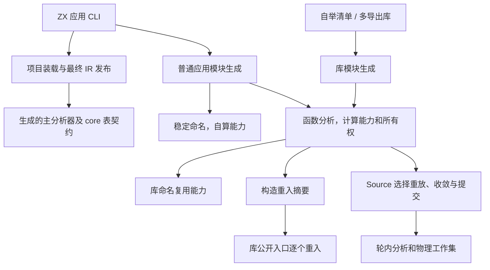

# 自举架构边界与代码冗余诊断

2026-11-17 · 核对基线 `bd70f979` · 交付《继续自举并保障性能》goal，接续[已有整改报告](自举设计复核与整改报告.md)。

## Intent · 架构是否违背原设定

**局部存在明确违背。** 最重要的一处在全程序所有权分析。读 RX 能看到一轮内部的操作，但要知道何时重放、何时退回重算、需求传播后何时重新求稳、何时发布结果，仍要读手写 Zig。它直接关系到编译器会生成借用、原地更新还是复制，是应由 Source 掌握的编译器语义。

**也存在可消除的膨胀。** 普通应用生成器为库专用的操作预建全程序工作区，命名和分析各自遍历相同函数表推导相同能力，摘要初始化保留了一段永远不能执行的异常处理；另有同一目录、同一类型、同一行为的两份生成器代码。这几项分别增加分配、计算或维护成本。只有第一项能从调用链证明有额外活跃工作区，其余项目的收益口径各不相同。

原设定中值得保留的部分也能在正式入口找到。编译器、core 和 genz 通过共享 IR 契约衔接；索引语法输入确实调用生成的 RX 主分析器；普通 Zig 仍经结构化节点与 printer 输出。现有证据支持修具体职责边界。全仓重分包、全面删校验、把单调用 RX 批量消灭，会破坏已经符合设定的部分。[统一库设计](2026-10-05/统一库设计.md) · [RX 开发约定](../rules/RX开发约定.md) · [自举完成标准](../rules/自举完成标准.md)

## Data · 每项要求如何判定

| 用户设定                             | 当前正式路径                                                                                        | 判定与影响                                                                                             |
| ------------------------------------ | --------------------------------------------------------------------------------------------------- | ------------------------------------------------------------------------------------------------------ |
| RX 显式表达阶段与短路，ZX 做原子算法 | ZX 主分析器的准入、正文、导出、契约与所有权由 RX 连接。genz 的全程序重放、收敛和提交也已接入 Source | 逐函数求解、持久 memo 和线程池仍由宿主持有。[全程序所有权调度自举](2026-11-17/全程序所有权调度自举.md) |
| 按真实消费者组织数据，复合值优先借用 | 普通应用、多导出库共用同一分析构造器，库专属重入摘要无条件创建                                      | 对普通应用是确定的无消费者分配。库有跨导出重入需求，应继续共享                                         |
| 推导事实应能复用，保持零成本抽象     | 普通应用命名与分析独立计算 I/O、process 能力；多导出库已有事实复用                                  | 同仓已有更简单的表达。无需新增缓存层或改变语言                                                         |
| 最小范围、不过度兜底                 | 同一编译期布尔量已提前返回，后段仍保留完整调用与 catch；最终 IR 校验在部分内部路径发生重叠          | 第一处可删。第二处要区分调用者、结构验证、契约求解与外部输入                                           |
| 按语义职责组织文件，不机械拆分       | 同一 N-API codec 有两个等价操作；Wasm 在源码层通过 Node/task 访问通用 AST 能力                      | 前者可直接收敛；后者要纠正共享能力归属，同时保留两个目标各自的状态和错误语义                           |
| 统一模块、静态链接、无专用运行时     | genz 的包级依赖指向 core；Wasm 生成器在构建时借用 Node 目录下的构造逻辑                             | 这里查到源码耦合，未查到应用动态装载 Node，也没有证据据此认定 zero runtime 已失效                      |

### 当前架构中两条容易混淆的边界

这里的构建时宿主是**编译器进程**。Wasm/Node 的 AST 构造代码在这个进程运行，最终用户应用另有自己的 ABI 和资源边界。宿主源码行数、生成 Zig 体积和用户程序运行时开销应各自计量。[应用生成](../packages/compiler/src/backends/zig/modules.zig) · [库生成](../packages/compiler/src/backends/zig/library.zig) · [生成器契约](../packages/genz/README.md)

## 已确认的问题与整改

### 1. 全程序所有权的阶段决策与跨层阶段编号

本项的阶段决策已迁入 Source。收敛循环直接传递预算耗尽及增长变化两个事实，原有阶段编号和对应桥接已移除。逐函数工作与状态的后续迁移边界见[实施与验收](2026-11-17/全程序所有权调度自举.md)。

正式调用从 shared_generation 经库分析构造，进入 genz 的 function_analysis 和 uniqueness/root。迁移前，root 自行选择轨迹重放、轮次推进和提交，round/prepare 再根据阶段计算该轮的重置和预算。现在 run.rx 显示重放短路、收敛、计划发布及轨迹提交。converge.zx 驱动工作轮次，round/prepare 继续执行摘要重置和队列准备。[构建入口](../packages/compiler/build/shared_generation.zig) · [Source 编排](../packages/genz/src/analysis/uniqueness/program/run.rx) · [轮次准备](../packages/genz/src/analysis/uniqueness/work/round/prepare.rx) · [重放记录契约](2026-11-11/所有权重放记录自举.md)

### 2. 普通应用为从未调用的库重入操作分配摘要

应用 modules.createCached 创建 Batch，Batch.createRemembered 调用 Analysis.createRemembered。函数分析结束后，公共构造器额外创建 entry_summaries 并挂到结果。Source 构造路径会计算布局、创建底层单元，四次建立按函数切分的行描述符并初始化。F 个函数对应四组共 4F 个行描述符，数据单元另计。普通应用随后只发射入口、函数和类型，直至 batch 释放，没有一次 reentry。仓库生产代码里唯一的 reentry 调用在 library.zig 的导出循环。是否命中生成文本缓存不改变该构造器的职责。[应用批次](../packages/compiler/src/backends/zig/modules.zig) · [共享构造器](../packages/genz/src/zx/function_analysis.zig) · [实际分配](../packages/genz/src/zx/uniqueness/summaries/storage.zig) · [唯一生产消费者](../packages/compiler/src/backends/zig/library.zig)

**修复**：把额外摘要的创建所有权交给多入口库，在有重入需求时准备一次，各导出复用；普通应用不建。避免把延迟构造放到每个导出的临时 batch 副本。保留真正用于第一次全程序分析的摘要，两份摘要的初始状态、最后读者不同。与首报 C 的逐入口清表可同批取证，两个问题分别验收。应用路径额外构造次数应降到零，多个实际重入入口共享一份；检查输出、错误路径与实际分配。未测绝对 RSS 降幅。

### 3. 普通应用的稳定命名与函数分析各做了一次相同的能力传播

应用先在 names.create 中以 known=false 请求命名，names/capabilities.rx 对函数表执行 capability/io 和 capability/process。随后同一已准备的 Program 进入函数分析，facts/analyze.rx 对同一函数表再次调用这两个算法。io 路径会建布尔列，按函数遍历并读取函数体/契约所引用的能力。这里是相同语义的两次求值。库的正式路径已经用分析结果调用 names.createWith，再用 Batch.fromAnalysis 接管原结果。[应用入口](../packages/compiler/src/backends/zig/modules.zig) · [命名能力](../packages/genz/src/analysis/names/capabilities.rx) · [函数分析](../packages/genz/src/analysis/facts/analyze.rx) · [能力算法](../packages/genz/src/analysis/capability/io.zx) · [库的对照](../packages/compiler/src/backends/zig/library.zig)

**修复**：优先复用库的事实传递方式。若把分析提前会改变无效名义来源的首错顺序，保留命名准入顺序，只共享已计算的能力。不要在项目级注册新缓存。选含普通、I/O、process 和间接调用的现有应用，核对名称、签名、缓存键和错误行为；Source 路径两种传播各一次。该结论不外推为多导出自举库的耗时回退。

### 4. 摘要初始化有不可达的兜底；分析器阶段接口还携带未读取的输入

- **可直接删除的死分支。** summaries.create 开头在 generated_analysis=true 时已返回 storage.create。后段又用相同的编译期常量决定是否调用 Generated.executeIn 并捕获错误。Source 早已返回，seed 的条件恒假。删除后段真分支，seed 直接提供空 effects，保留 Source 的真正实现。收益是减少一份误导维护者的初始化/错误处理逻辑；编译期已排除的分支没有可节省的运行时间。[两次判定](../packages/genz/src/zx/uniqueness/summaries.zig) · [真正的 Source 初始化](../packages/genz/src/zx/uniqueness/summaries/storage.zig)
- **可直接收窄的私有输入。** analyzer/analyze.rx 将完整 ModuleInput 连同 Analysis 传给 module/exports.rx。该阶段不读 module，只读 analysis；仓库内这条直接调用是其唯一命名引用。改为只接收 Analysis，同步简化唯一调用点。保留诊断短路和类型/导出发布；相邻 contracts 阶段确实读取 module 的源码、语法和契约，不能一并缩窄。这里证明的是不必要的参数和组装，尚无证据说整个 ModuleInput 在机器码中被深复制。[阶段调用](../packages/compiler/src/zx/analysis/analyzer/analyze.rx) · [导出阶段](../packages/compiler/src/zx/analysis/analyzer/module/exports.rx) · [有实际需要的契约阶段](../packages/compiler/src/zx/analysis/analyzer/module/contracts.rx)

### 5. 最终 IR 在项目内已校验，CLI 随即从空前缀再次校验

真实路径为 CLI compile → compileProjectVerified 或 compileProjectModulesVerified → verified_compile.analyze → 项目分析。项目装配最终 types、exports、native_modules 和函数可见前缀后调用 validateProjectPrefix。正常返回后同一调用栈的 checkProgram 对这个 IR 调用 validateIr，后者以空 Verified 前缀开始。中间可能发布语义缓存，但 publication 接收只读结果，作用是提取工件并写缓存。在成功的内部项目路径上，**已经通过结构校验的最终结果，又经过一次从空前缀开始的结构校验**。这两次的工作量并不相同。[CLI 实际入口](../packages/cli/src/cli/compile.zig) · [项目发布与第一次校验](../packages/compiler/src/zx/modules/project.zig) · [缓存发布](../packages/compiler/src/zx/modules/semantic_cache/publication.zig) · [第二次校验](../packages/compiler/src/verified_compile.zig) · [校验前缀](../packages/compiler/src/zx/ir/validate.zig)

**整改边界**：历史修复明确要求 emit 前对最终 Program 有完整校验，曾修掉的推导期平方级检查不是这次发现。先核对成功返回的三种项目入口、数据冻结时点、增量前缀对最终行的保证，以及未命中和缓存恢复时的校验覆盖。若等价，则选择一个明确的最终结构校验位置。内部已校验路径继续做依赖登记、契约求解与错误输出；接受调用者提供 AnalysisResult 的 emit、反序列化、跨模块重映射和 Debug 内部断言分别保留必要检查。若某个断言只有 emit 前的全表检查能验证，就指出该断言及具体入口，把双检缩到那个边界。禁止用可随意传递的 trusted=true 跳过验证。[早期决策及实测](2026-10-11/编译性能优化实施/架构诊断复核.md) · [外部结果入口](../packages/compiler/src/verified_compile.zig) · [缓存恢复与失败回滚](../packages/compiler/src/zx/modules/semantic_cache/restore.zig)

**验收**：记录一次成功 CLI 编译中两次结构校验各自覆盖了什么以及耗时；项目编译、公开 emit、损坏缓存和有契约程序都须保持原有结果。该重复调用已证实；其中可安全省去的检查范围和端到端时间尚待执行会话验证。

### 6. 同一语义有两份实现；跨目标共享的代码又挂在一个目标内部

**N-API codec 有一份可合并的实质重复。** 同目录的 read_result.zx 与 return_result.zx 各 29 行，原始字节完全相同，导入的同一个 model、常量与 AST 原语也相同。两者都在生成获取 result 并 return 的语句；read/list 与写入链均有真实调用。保留一个准确命名的操作，直接改调用者；无需兼容转发文件。若路径参与稳定名称，核对导入、生成树、对外 Node ABI 与行为，解释允许变化的内部名。[读结果实现](../packages/genz/src/analysis/host/node/napi/codec/read_result.zx) · [另一份实现](../packages/genz/src/analysis/host/node/napi/codec/return_result.zx) · [调用者](../packages/genz/src/analysis/host/node/napi/codec/extend.rx)

**Wasm 通过 Node 私有目录借用生成器能力。** 已注册的 wasm_host 入口进入 wasm/build.rx，初始化依赖 node/task/initialize；Wasm 的 Tree 也来自 node/task/model。本次枚举到 Wasm 子树 30 份 RX/ZX 源码内共 43 条指向 Node 目录的显式引用，涉及 8 个源模块，其中 invoke 18 条、method 16 条。沿 invoke 再下一层会转回 host/cli/invoke。通用“生成调用/方法”的变化横跨三个目标目录；它是源码职责倒置，不意味着 Wasm 用户程序链接 N-API。[正式 Wasm 入口](../packages/genz/src/host/wasm/root.zig) · [Wasm 数据模型](../packages/genz/src/analysis/host/wasm/model.zx) · [经 Node 到 CLI 的调用构造](../packages/genz/src/analysis/host/node/task/invoke.zx)

**修复**：先把两个目标确实用到且不携带 Node 语义的 AST 构造操作及最小字段放回已有的 ast 或 host 共同职责处，Node 和 Wasm 直接消费。对已有的 host/cli/invoke 先比较输入契约；如现有 AST 原语可直接表达，就消除转发。保留 Node 的排队、busy 清理、引用计数和环境销毁，以及 Wasm 的准备/执行/结果 ABI；不另建 host 框架，不在上层共享完整 State。runner 与 enqueue 的 busy.zx 虽然也逐字节一致，其各自导入的 State 不同，公共的底层 Tree 才是恰当的复用候选。若抽取后净增适配或中间复制，保留内聚代码并说明原因。[两种状态的定义](../packages/genz/src/analysis/host/node/runner/model.zx) · [队列状态](../packages/genz/src/analysis/host/node/enqueue/model.zx) · [Node 生命周期契约](2026-11-10/Node宿主入口自举.md)

## Edges · 哪些看起来像膨胀，却有独立责任

| 候选                                                                  | 核对后的结论                                                                                                                                                                                                                                                                                                                                                         |
| --------------------------------------------------------------------- | -------------------------------------------------------------------------------------------------------------------------------------------------------------------------------------------------------------------------------------------------------------------------------------------------------------------------------------------------------------------- |
| 主分析器同时留有手写 Analyzer 和 analyze.rx                           | Indexed.analyze 已调用 generated_analyzer。Native 输入在启用索引时也能转换后进入同一 Source 入口；初始 seed 另有手写入口。两条路都出现于仓库不能证明正式编译做两遍分析。旧 runView 目前仅找到定义，可在确认非外部 API 后清理，不能连带删仍工作的 seed。[分流](../packages/compiler/src/zx/modules/module_input.zig) · [迁移历史](2026-10-10/主分析器正式入口接线.md) |
| 按大小、对齐、字段偏移校验的列借用；失败时还原类型表与 payload 检查点 | 前者保护零复制 ABI，后者解决发布一半的可见状态。重复外观不足以证明它们可删。尤其外部工件、可变别名、失败后重试都可能使“上次检查过”失效。[列契约](../packages/core/src/columns.zig) · [恢复实现](../packages/compiler/src/zx/modules/semantic_cache/restore.zig)                                                                                                      |
| 单调用 RX、语句长、单个 ZX 引用多个规则                               | 四个自举源码根共有 707 个 RX，44 个是纯 Module.fn 简写。它是仓库明确支持的原子模块形式。判断依据是有没有跨阶段决策藏在被调函数里。表达式合法性分派只回答一项问题；一个文件导入 15 个检查并不足以证明错误拆分。[内聚分派实例](../packages/compiler/src/zx/ir/canonical/expressions/rules/validate.zx)                                                                 |
| 全文件重复与代码量                                                    | 四个自举源码根共 1,303 个 Zig、707 个 RX、4,976 个 ZX。按完整原始字节匹配，Zig 有 0 组重复，RX 有 3 组、ZX 有 9 组。每组仅计额外副本，共 27 行 RX 和 264 行 ZX。这不是可以删去的行数，也捕捉不到别名、改名或分布在不同层的重复工作。[取证口径](2026-11-17/设计复核/架构取证记录.md)                                                                                  |

## Answer · goal 的执行与收口

| 顺序                               | 整改与可核对的结果                                                                                                                                   |
| ---------------------------------- | ---------------------------------------------------------------------------------------------------------------------------------------------------- |
| 先与现有 C 合批，处理第 2、3、4 项 | 普通应用没有库专用摘要；能力传播各一次；库仍只准备所需共享状态；不可达分支与未读输入退出源码。静态清理不额外做性能回测，分配和遍历改动只测受影响入口 |
| 同批或紧接核对第 5 项              | 给出同一 Program 的生产者、校验时点、最后修改点、外部入口及保留检查。如果存在独立保证则记录并保留，否则撤掉内部重复                                  |
| 将第 1 项并入已有 F 的职责清单     | Source 掌握所有权的下一轮和提交时机，单边修改枚举不会静默变更宿主解释；以真实入口、失败行为及种子兼容验收                                            |
| 按目标生成边界完成第 6 项          | 已确认同语义实现合一；Wasm 和 Node 通过恰当的共同所有者获取通用构造能力。按改动范围复用现有 Wasm/Node 验收；记录仍须保留的目标专用状态               |
| 恢复常规自举                       | 在现有整改执行记录逐项写明修复提交、验证，或待证建议的反证、保留理由。与 A–I 复用同一组证据与 goal，不新增常驻审计机制或按删行数设门禁               |

**自我复核。** 本报告提供源码基线、正式可达路径、可推翻结论的条件和对应修法。只对四个自举根做全文重复普查，重点语义路径做人工追踪；未测得到“全仓冗余率”，也没有把源码字节、编译器 RSS 和最终二进制体积互相换算。跨目标 API 移位与内部 IR 去重的最终边界，仍需由执行会话根据真实契约和原有回归决定。
