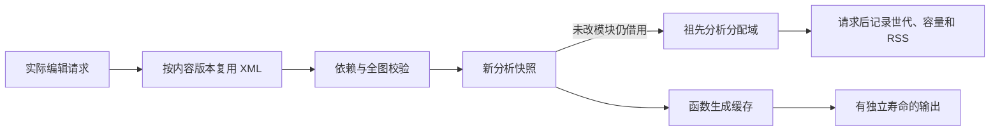
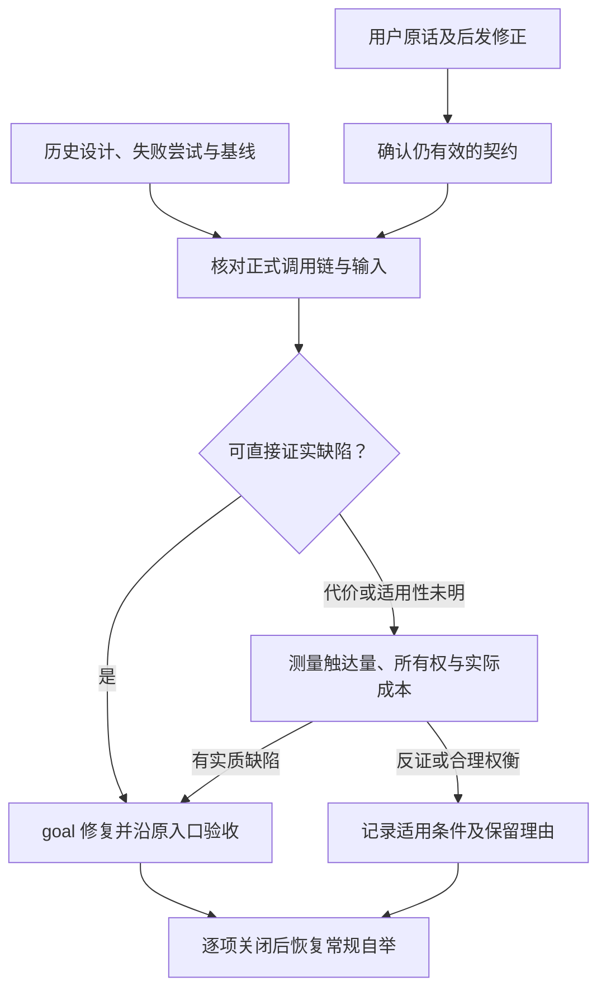

# 自举设计复核与整改报告

2026-11-17 · 交付给《继续自举并保障性能》goal · 诊断起点 `3aff0196`，修复后复核版本 `8bbf61bd`

按用户后续要求，架构职责、代码冗余和过度防御的专项核对见[自举架构边界与代码冗余诊断](自举架构边界与代码冗余诊断.md)，由同一 goal 承接。

## Intent · 先解决哪些问题

**先修常驻服务在多个文件间切换时保留历史分析的问题。** 在同一份 725 入口清单、同一 Source 工具和相同编辑次数下，第 12 次编辑后，连续改同一个文件保留 2 个分析世代，RSS 为 1,115.0 MB；交替改两个文件保留 13 个，RSS 为 1,465.5 MB。两组还原后 12,190 个 Zig 文件逐字节一致。首轮修复适用于同文件编辑。交接期间 goal 已将多路径修补推送为 `e3a5d6b6`，第 12 次编辑降至 2 代、1,144.0 MB，完整状态见末节。

**上一版报告有一处判断过度。** 我把普通生成器能接收的非空根工作表，当成了自举函数批次的真实输入。该批次的根符号表和表达式表为空。撤回把三个被覆盖的字段列为这条路径有效分配成本的判断。仍应核实每个冷生成函数按全项目类型数初始化五张表的实际代价。此更正直接改变 goal 的实施范围。

**另有三项可由源码或现有工具独立确认。** CLI 构建辅助用字符串生成完整 Zig 声明，同一辅助的并行错误路径存在未同步的共享写入，两个内部 ZX 声明文件超过仓库规定的 240 行。它们各有独立修复理由，不能用来解释上述 RSS 差值。其余优化按下表所列证据决定是否实施。

| 项                 | 目前能确认什么                                              | goal 如何关闭                                                            |
| ------------------ | ----------------------------------------------------------- | ------------------------------------------------------------------------ |
| A 常驻版本         | 同文件改善，交替编辑可复现分析世代和请求后驻留增长          | 修复并以两种序列、失败恢复、还原正确性复查                               |
| B 生成文本         | 未命中路径有整段复制，缓存和产物分属不同生命周期            | 量出未命中字节和峰值重叠，去掉已证明可省的复制，或以所有权及对照解释保留 |
| C 公开入口         | 经过 reentry 的入口成对重置整张摘要表                       | 测实际清表比例，保持所有权事实和固定点语义后裁决                         |
| D 类型工作表       | 基线根表为空；五张稠密表仍按全部类型初始化                  | 关闭前一主张，测触达密度，再决定稀疏化或保留                             |
| E 类型与绑定查找   | 有重复扫描和描述符复制，不同查找有不同遮蔽次序              | 按实际命中分布定热点，小表与失败诊断对照                                 |
| F RX/ZX 职责       | 三条正式宿主路径仍拥有自有流程或状态                        | 按调用链迁出并复核；保留通用 I/O、分配、平台 ABI 与内聚遍历              |
| G 缓存身份构建     | 字符串构造完整 Zig 声明；并行失败写共享槽                   | 分别修复生成边界与并发所有权，核对两种构建消费者                         |
| H 内部声明与公开面 | 两份声明 lint 超限；公开 std:bytes 暴露 AtomicRows 和行操作 | 修复超限；核实公开契约与消费者后处理专用接口                             |
| I 内联临时存储     | scratch 和发布区用同一上游，未测到额外保留量                | 一次针对性取证，可凭反证或无实质成本关闭                                 |

本报告更新[首轮诊断](自举架构与性能诊断.md)的结论和关闭标准。正在开发的修补由同一 goal 继续，涉及它的判断标明提交边界。以下方案都允许以准确反证关闭假设；确认的缺陷要有修复与验收。

## Data · 用户究竟要求了什么

取 `8bbf61bd` 的 Git 树，逐份检索当时 docs 下 2,014 份已跟踪 Markdown 正文，保存每份相对路径、原文定位和行号。对需求档案截至第 498 行逐条登记适用范围，额外核对后发修正。来源分三层：用户原话和生效规则决定要求，设计与历史实验证明某条件下尝试过什么，当前调用关系和可比重放决定今天能认定什么。索引覆盖数不等于功能重验数。四卷共 466、658、347、543 份。[逐条需求核对](2026-11-17/设计复核/用户原话逐条核对.md) · [原始设计](2026-11-17/设计复核/原始设计与早期实现文献索引.md) · [接口与编译路径](2026-11-17/设计复核/接口修订与编译路径文献索引.md) · [自举与增量过渡](2026-11-17/设计复核/自举与增量编译过渡文献索引.md) · [自编译与性能验收](2026-11-17/设计复核/自编译与性能验收文献索引.md)

| 原话定位                        | 后发修正与落实口径                                                                                                   | 改变本次判断之处                                                                                                                                                               |
| ------------------------------- | -------------------------------------------------------------------------------------------------------------------- | ------------------------------------------------------------------------------------------------------------------------------------------------------------------------------ |
| #84、#282，要求 AI 能读出数据流 | 模块内的阶段、依赖、短路、汇合应在 RX 可读。包依赖图、静态环检查、用户想要的数据流说明分别核对                       | F 沿真实边界检查。函数调用数、文件长度与包图都不能证明编排完成；AI 阅读质量亦无本轮实测                                                                                        |
| #112、#247–248、#394            | 结构化原语和统一 printer 覆盖实际生成的 Zig。构建阶段产生的完整 Zig 声明也在规则内                                   | G 查到真实生产路径；汇编、SMT 文件各按自己的语言边界处理                                                                                                                       |
| #115、#142–152、#172–178        | 静态链接；取消旧语言 Context；库有统一公开面；Store 为显式的应用生命周期内共享状态                                   | 宿主编译器的局部 context 与已取消语法无关；应用 Store 的存活不构成编译器编辑历史无限保留的理由。[Store 设计](2026-10-05/Store设计.md) · [统一库设计](2026-10-05/统一库设计.md) |
| #201–239、#355–374、#400–421    | loop 和借用依词法作用域；RX 属性只做简单组装，静态字段选择；Type 与 Args 按修订后的接口；集合与元组以最终签名为准    | F 不能靠给 RX 属性放开函数调用来消除宿主编排，也不能为每个循环新造标签。按同一语义模块组织                                                                                     |
| #297、#301、#327–328、#335 起   | 编辑变化要区分语义、依赖和代码生成；分别核算 Source→Zig、Zig→目标文件与链接。内存要独立观察                          | A 用真实文件编辑而非 no-op；B–E 的成本发生在特定阶段，不能由整机或 LLVM 峰值倒推。[早期构想](zxc_raw_thinking.md)                                                              |
| #411、#462–465                  | 现行单阶段 CPU、墙钟波动口径各 1 秒，按规则允许 CPU/墙钟权衡，固定基线累计超过 3 秒要定位，持续增长也要关注          | 不将旧的 0.1 秒、6 GB/10 GB 对话变为新的硬阈值，也不滚动重设基线。A 的几百 MB 增幅单列                                                                                         |
| #442、#452–456、#490–491        | ZX 行数属 lint；用户用普通值，生命周期由编译器处理。内部原生借用适配有专属边界。曾讨论过的函数末释放并未变成通用语义 | B、C、H、I 保留最后读者、共享快照和外部 ABI。已有论文与小范围验证可复用。[所有权研究](2026-11-07/所有权分析论文与小范围验证.md)                                                |
| #476–489、#492–498              | 约三千行用于阶段规划，完整特性集中验收；难题可调用一个 Astra high；修复全部已确认问题再继续常规自举                  | 以真实退出的 Zig 职责和修复证据收口，不能按行数、提交数或列举论文计完成。[迁移方法](../WAY.md) · [完成标准](../rules/自举完成标准.md)                                          |

### 旧产品目标与本次自举的关系

历史总表含 F01–F18。这里沿当时的目标号交代去向，避免把旧计划当成当前故障。能定位入口、旧验收通过、当前实际运行三者分别记录。以下产品路径本轮未全平台重跑。[逐项历史盘点与证据](2026-10-11/旧目标完成度核对/完成度与后续执行清单.md)

| 原目标                                                | 现有边界与审计处理                                                                                                                                                                                                                                                                                                                                                                                                |
| ----------------------------------------------------- | ----------------------------------------------------------------------------------------------------------------------------------------------------------------------------------------------------------------------------------------------------------------------------------------------------------------------------------------------------------------------------------------------------------------- |
| F01 导入、F03 插件、F10 app/lib                       | 显式原生注册和静态链接，动态加载已被用户取消。统一库有接入路径，F 项保留其公开成员与诊断次序，避免为自举再造一套 RX 或 ZX 库。[库生成](../packages/compiler/src/backends/zig/library.zig)                                                                                                                                                                                                                         |
| F02 标准库、F04 命名、F14 lint                        | std 模块以注册及声明为准；旧清单不能代表今日标准库覆盖率。命名检查、排版与 ZX 长度是不同规则。H 直接使用现有 lint 检出内部声明超限。[模块注册](../packages/std/modules.json) · [lint](../packages/lint/src)                                                                                                                                                                                                       |
| F05 形式证明、F06 SIMD、F07 WASM、F08 N-API、F09 FPGA | 旧记录分别覆盖可验证的类型/调用子集、适用 map 的向量化、指定 wasm32 目标、Node 绑定及硬件代码生成。各自有实现入口；全语言证明、任意自动向量化和 FPGA 上板性能没有当前证据。JS 宿主加载扩展属于已定义 ABI。[验证入口](../packages/cli/src/cli/verify.zig) · [SIMD](../packages/genz/src/zx/simd) · [WASM](../packages/cli/src/cli/wasm) · [N-API](../packages/napi) · [硬件入口](../packages/cli/src/cli/fpga.zig) |
| F11 包管理、F12 六平台发布、F13 translib              | 包管理、生成的 CI 工作流、移库工具有对应文件；六平台本轮发行成功与否仍须发布记录。包图回答包依赖，不能代替模块内部 RX 数据流。[包管理](../packages/pkgs) · [发布工作流](../.github/workflows/build.generated.yml) · [移库工具](../packages/translib)                                                                                                                                                              |
| F15 分包、F16 增量、F17 热重载、F18 RX 属性           | 包存在还需看正式调用是否经过；增量有文件、语义、函数、分区几层，A 正是层间生命周期问题；watch 重编译重启与常驻编译服务各有所有者；Call 属性由现行规则决定。[混合输入失效记录](2026-11-14/混合项目正文准入与增量失效.md) · [watch](../packages/cli/src/cli/watch.zig) · [RX 约定](../rules/RX开发约定.md)                                                                                                          |

## Data · 实测、调用链与整改方案

### A · 同文件修补后，交替编辑仍保留连续分析世代

| 请求后  | 同文件 RSS / 分析容量 MB | 同文件世代 | 交替 RSS / 分析容量 MB | 交替世代 |
| ------- | -----------------------: | ---------: | ---------------------: | -------: |
| 冷启动  |            788.5 / 301.8 |          1 |          790.3 / 301.8 |        1 |
| 编辑 1  |          1,072.6 / 350.5 |          2 |        1,074.5 / 350.5 |        2 |
| 编辑 6  |          1,113.8 / 350.5 |          2 |        1,249.1 / 558.9 |        7 |
| 编辑 12 |          1,115.0 / 350.5 |          2 |        1,465.5 / 826.8 |       13 |
| 还原    |          1,132.7 / 317.2 |          2 |        1,495.5 / 875.5 |       14 |

两组第 12 轮都只重解析 1 份 XML、复用 706 份。交替组多保留约 476.4 MB 分析容量，XML 容量只多 12,438 B，请求后 RSS 多 350.5 MB。两组这一轮都命中全部 5,519 个生成单元，infer/emit/write 分别为 79/362/15 ms、76/363/16 ms。说明本次差异优先沿分析快照的所有权追踪。不能把容量相减当作操作系统的页归因。12 次编辑墙钟中位数约 496 与 513 ms，每组单条轨迹，不足以认定时间回退。[执行条件、14 个采样点及输出摘要](2026-11-17/设计复核/取证与复现.md)

`8bbf61bd` 在版本相容且 `latest.edited_rx == row` 时，可跳过直接上一轮并借用旧基点；换到另一行时回到保留上一轮的路径。新分析可以借用旧世代的模块、签名或 frame，因而旧分析的整个分配域随之存活。文件级 XML 复用和图校验已分离，不能再沿旧报告的“全部重解析”前提重做它。系统还设有容量预算；这里复现的是到达预算前随交替编辑增长，未证明进程没有上限。[版本选择与所有权](../packages/compiler/build/resident/state.zig) · [XML 复用](../packages/compiler/build/resident/modules.zig) · [版本标识](../packages/compiler/build/resident/revision.zig)

先选择能证明相容的较早基点，或在确实积累了旧容量时建立可独立释放的检查点。用相同编辑序列测它是否把成本转移到频繁全量分析。如果必须细分所有者，再区分真被新图引用的数据和整轮附带留下的容量。不能按文件名简单丢祖先，也不能针对仅两个文件写特殊路径。还原、改依赖、错误后恢复、无需改动继续命中，均应保持正确；找出收缩点最慢一轮和保留容量，保留已有效的 XML 复用。[既有生命周期研究](2026-11-14/常驻生成请求的内存生命周期.md)

### B · 生成文本的复制应按命中路径和最后读者判断

printer 暂存后复制到调用者，worker 的结果再复制到连续 bundle，未命中的文本入缓存时另有一次拥有副本。一次确实经过整条链的 L 字节承受三次整段复制；命中直接跳过 printer。缓存替换或销毁后，已交付的 bundle 仍需有效。后台写缓存使用已拥有的字节，不能凭线程数额外计算一份。之前已经把偏移计算与每段最多 16 个位置的发布迁入 Source。734 入口旧对照冷墙钟 2.82→2.80 s、CPU 12.50→12.50 s、树峰值 767.0→761.2 MB、单进程 843.3→844.1 MB。原发布方案有所有权收益。[printer](../packages/genz/src/printer/host.zig) · [发布](../packages/compiler/src/backends/zig/function_sources/publication.zig) · [历史实现与验证](2026-11-16/生成缓存文本发布自举.md)

从 printer 的遍历暂存和返回文本分离开始，记录未命中字节及 worker 返回值、bundle 与缓存副本同时存活的窗口。如果可移交最终文本，只移交输出；不要把整座 worker arena 挂入缓存。是否保留连续打包依实际开销及旧 bundle 销毁次序决定。重用已有的空文本、替换缓存、分配失败重试、销毁缓存后读取输出的验收。将冷未命中和全命中分别计数。A 中全部命中时仍有约 360 ms emit，这一时间不能归因于冷路径文本复制。[批次工作集](2026-11-16/生成批次工作集自举.md) · [缓存所有权](../packages/compiler/src/backends/zig/cache.zig)

### C · 公开入口重入会重置整个摘要表，优化不能丢失未知状态

库生成逐个公开入口 reentry，对实际进入独立分析的入口，Source 两次调用 summaries/clear，共清四个方向表。设 E 为进入此路径的入口数、F 为表中的函数数、S 为全体函数输入与输出槽数之和，源码进行 4EF 次行填充、2ES 次字节原子写。初始事实为 Knowledge.None，含义是尚无知识。入口和 type-only 分支、已命中的 memo、重复的初始状态各自影响实际工作量。[入口重入](../packages/compiler/src/backends/zig/library.zig) · [清表 RX](../packages/genz/src/analysis/uniqueness/function/entry/analyze.rx) · [行写入](../packages/std/src/bytes/atomic_rows.zig)

先计有效 E、清表字节、实际写过的槽和清表时间。若密度低且重要，候选是只恢复被实际写过的行。现有 converge 关闭 record_marks，现有 changed 列不能直接充当完整写入日志，必须包括需求、事实、重放与回滚的写入。若密度高，整行清零可能更合适。保持固定点顺序、并发可见性和每个入口自己的初态。以不同公开入口先后顺序、缓存重放、现有所有权/转移生成及失败回退核对产物。[收敛规则](../packages/genz/src/analysis/uniqueness/function/entry/converge.zx) · [标记条件](../packages/genz/src/analysis/uniqueness/function/demand/mark.zx) · [既有语义与验证](2026-11-09/普通调用需求分析自举.md)

### D · 自举空根表撤项，保留全类型表初始化的密度问题

`shared_generation.run` 构造 type_only 的根 Program，symbols、expressions 和 body 都为空。库生成将独立的 public batch 交给 .entry，实际函数作业用基础 batch。因此生成器在选择函数前为根准备的 names、used、cache_reads 在该路径对应零个元素。上一版把字段覆盖直接计为这批函数的重复成本，证据不足。普通应用传非空 Program 的路径可另测。[自举输入](../packages/compiler/build/shared_generation.zig) · [作业分配](../packages/compiler/src/backends/zig/library.zig) · [函数生成](../packages/genz/src/zx/modules.zig)

已有类型节点按需构造，但五张共享类型 u32 ID 表仍按全部 T 个类型填哨兵。F 个未命中函数的源码初始化量为 20FT 字节；它不是峰值，也不等于最终机器实际写入。先测 F、T、实际触达类型和冷生成占比。稀疏度确凿时可比较惰性分块或已有稀疏查询模式；类型节点 ID 属于各自 builder，不能跨 builder 复用。历史尝试中，类型名曾借用临时分配域，局部测试通过而冻结语料暴露了悬空问题。优先核实键与节点的寿命并保留稠密输入对照。[类型表](../packages/genz/src/zx/types.zig) · [按需类型查询的经验](2026-11-02/按需状态视图类型查询自举.md) · [早期全类型构造优化](2026-10-11/增量编译流水线/设计.md)

### E · 类型别名、成员与绑定查找要分别测命中次序

类型解析的 snapshot 从别名记录抽取名字与 ID，已分列的 resolved 可借用已有列，visiting 还需提供键视图。复制的是描述符或列值，并非整份字符串内容。库联结的 wildcard、member 与 type_id 有顺序扫描。模块级公开面已有归并/索引，小表和单成员已有简化路径；不能由某处线性查找推出全链都需加哈希。[别名视图整改与验收](2026-11-17/整体诊断执行记录.md#e--项目类型别名的借用与查找) · [依赖匹配](../packages/compiler/src/zx/modules/link/dependencies) · [公开模块已有复用](2026-11-13/已编译库导入与公开模块复用.md)

分别计每条路径表长、调用数、实际检查元素和重复查询。对宽表多次扫描，优先在拥有表的边界构建一次视图或索引；单次小表保留原查找。别名倒序覆盖与命名成员首次匹配语义不同，保留错误优先级、歧义和可见性。沿用已有窄表、宽表、重名与缺失成员输入核对输出和首条诊断。当前没有此项独立耗时，不能列为已测严重瓶颈。

### F · RX 看得见哪些阶段，哪些仍由宿主管

| 正式入口                              | 已由 Source 表达                                                                                  | 仍在 Zig 执行的职责及修复范围                                                                                                                                                     |
| ------------------------------------- | ------------------------------------------------------------------------------------------------- | --------------------------------------------------------------------------------------------------------------------------------------------------------------------------------- |
| ZX 项目签名/正文 → Project.loadFrames | Source 负责准入、父子帧推进、恢复、导入扫描和选择发布阶段。                                       | 解析版本和帧容器由宿主持有，单条导入的目标处理与绑定、正文分析及缓存事务保留静态内部 ABI。[帧驱动与验收](2026-11-17/项目装载帧驱动自举.md)                                        |
| RX Statements.lower → traversal       | Source 推进帧，分派 Call、Parallel、Return 和 Task/Selection/Case，决定结果发布与绑定恢复的顺序。 | 宿主提供物理帧栈、已有写入器和单条 IR 操作，保留初始 seed 的兼容遍历。[语句帧迁移与验收](2026-11-17/RX语句帧降低自举.md)                                                          |
| 独立库 link → artifact/bind           | Source 生成依赖顺序、登记类型并执行依赖绑定、正文发布、逐模块回收和入口发布                       | 宿主借用工件物理列与独占函数尾列。普通 Source 调用可承载独占尾列或类型化列追加后，可移除正文的静态 ABI 适配。[依赖批次验收](2026-11-17/整体诊断执行记录.md#f--独立联结的依赖批次) |
| genz Uniqueness.analyze → program/run | Source 选择缓存重放、驱动保证和增长需求收敛、发布计划并提交持久轨迹。                             | 宿主提供线程池、可变工作队列的借用、逐函数求解和结果存储。[全程序调度迁移与验收](2026-11-17/全程序所有权调度自举.md)                                                              |

首轮看到的项目专用 effects 草稿不属于 `8bbf61bd` 已合入实现，撤回对该提交含此设计的推断。F 只按表中可追到的正式行为验收。反例是 IR 单条表达式的规则分派：即使调用多个谓词，它们共同回答同一个合法性问题，不能由调用数推导出隐藏业务流程。历史上按依赖层并行推导，1,416 模块分 560 轮，其中 344 轮只有一个模块，infer 由 260 ms 增至 420 ms，输出仍完全相同。把阶段展现于 RX，不要求给每条边加并行调度。[内聚校验入口](../packages/compiler/src/zx/ir/canonical/expressions_check.rx) · [并行反例](2026-10-11/增量编译流水线/设计.md)

### G · 构建缓存身份有两个独立的确定性问题

1. CLI 正式构建创建 cache identity 辅助。digest.emit 将 32 字节转十进制文本，用 allocPrint 拼出完整的 `pub const digest` 声明并写 digest.zig，违反统一 Zig 输出规则。这里同时发行汇编符号，两种消费者都读同一身份。曾把指纹计算移出 configure，历史编辑节省约 0.45 s；修改不应把哈希重新塞回 configure。最小候选是辅助输出固定 32 字节，仓库内维护静态、带类型的 Zig 适配模块，通过构建接线读取这 32 字节，保留原汇编导出。如已有无环的结构化生成依赖更轻，也可复用。验收两种构建形态、值与缓存键一致、内容不变时不触碰时间戳。[构建接线](../packages/cli/build/cache_identity.zig) · [实际输出](../packages/cli/build/cache_identity/digest.zig) · [原语化要求的实施记录](2026-10-06/Zig代码生成全面原语化/实施记录.md)
2. 同一辅助把路径索引通过原子 fetchAdd 分给多个线程，但多个 digestOf 同时失败时，都会写同一普通可选字段 Work.failure，没有互斥或原子协议。join 只保证主线程随后读取，并不串行化两个 worker 的写入。这是代码可达的并发缺陷，未观测到某个发布产物已损坏。让每个工作线程或输入拥有自己的错误槽，join 后在主线程归并；如需要稳定错误，按输入顺序选择。保持正常热路径无需争锁，失败不发布身份。可用隔离副本同时给多个输入造成读取失败，复核退出和输出边界。[线程与错误发布](../packages/cli/build/cache_identity/digest.zig)

### H · 自举内部借用与应用公开面需分开核对

在 packages 各包 src 内 4,976 份受跟踪 ZX 文件中，两份超过 240 行：core/src/memory/index.d.zx 为 331 行，columns.d.zx 为 284 行。对两份文件分别运行留存安装版 zxc lint，均得到长度诊断。它们是声明文件，但当前规则与工具都将其纳入。按拥有的存储类型与借用操作职责提取声明；先核实 native 声明导入/导出能力，保持现有模块标识、名义类型和 ABI。不得机械切片或用删空行解决。安装版 lint 重验受影响文件即可。[整理后的声明目录](../packages/core/interfaces/memory) · [整改验收](2026-11-17/整体诊断执行记录.md#h--内部内存声明与宿主原子行)

普通应用直接导入内部 memory 已有拒绝证据。另一路，std:bytes 公开声明里同时存在 AtomicRows 与 fillAtomicRow，原生实现从借用句柄访问行；自举唯一性分析确实给它提供原生表。公开注册是事实，普通应用能否独立构造句柄、是否有已发布原生消费者、是否应移动整套原子操作仍需验证。先检查注册、构造来源、已安装 ABI 与消费者；若是编译器专用，连同真实内部调用移至引导器注册的私有边界。保留有独立应用意义的字节 API，以及已有外部契约所需的兼容措施。[标准库接口](../packages/std/interfaces/bytes.d.zx) · [行访问实现](../packages/std/src/bytes/atomic_rows.zig) · [内部模块隔离验收](2026-11-16/自举内部内存模块.md)

### I · 内联改写可能延长临时区的驻留，尚待取证

库生成把持久输出分配器传给内联改写。改写函数以同一上游建子 arena，在子 arena 仍活跃时发布最终函数表，退出时 deinit。上游若也是 arena，释放是否能返还内存与分配先后有关。仅有 deinit 调用不足以证明驻留下降，反过来也不能证明额外峰值。用现有实际发生内联改写和未发生改写的输入，区分上游实际释放、保留容量、最终输出字节与峰值。仅在确认成本后分离 scratch 与发布区。以往 Flow 工作区改动在另一条 141 入口路径降低过峰值，该数字不外推至此。[库调用](../packages/compiler/src/backends/zig/library.zig) · [内联实现](../packages/genz/src/zx/inline_call/generated.zig) · [历史工作区实验](2026-11-06/生成器工作区生命周期与峰值收口.md)

## Edges · 性能与内存的证据边界

| 问题                           | 适用的证据                                                                                                                                                                                                                 | 当前能作的决定                                                                                                                                                                                                                                               |
| ------------------------------ | -------------------------------------------------------------------------------------------------------------------------------------------------------------------------------------------------------------------------- | ------------------------------------------------------------------------------------------------------------------------------------------------------------------------------------------------------------------------------------------------------------ |
| Source 生成本身是否越来越慢    | 首轮已记录冻结 735 入口的冷生成 2.88→2.87 s，CPU 12.58→12.60 s；此处另用 725 入口、Source 生成的 Source 工具在服务进程内测真实编辑                                                                                         | 该冻结对照未显示显著累计时间退化；多个编辑请求后增加的 RSS 要独立修。不同 manifest 不能直接相减。[首轮口径](自举架构与性能诊断.md)                                                                                                                           |
| “4 GB”究竟是哪段内存           | 历史 P2 整次冷构建的固定对照中，墙钟 129.74→132.72 s、CPU 216.03→214.55 s、最大单进程约 2,075→2,180 MB、采样进程树约 2,247→2,486 MB。该记录后续调整又测到 130.15 s 和树峰 2,175 MB。另一普通 CLI 冷构建的单进程约 4,295 MB | 记录输入、工具自身的生成阶段、运行后端、分区、冷暖、采样频率、单进程或树。当前 725 入口常驻服务结果不能更新完整冷构建峰值。[历史冷构建口径](2026-11-09/冷构建峰值口径核对.md)                                                                                |
| 零复制修复能否解释 LLVM 和链接 | 一项历史修复使指定函数族 memcpy 静态调用点 263→12，但完整模块 IR 只缩小约 0.032%，普通 CLI 冷构建最大单进程 4,294,721,536→4,276,731,904 B（−0.42%）                                                                        | B–D 分别核对生成 Zig、IR、真实写入/分配和受影响阶段。局部成立的成本模型不能充当整机节省额。[原始对照](2026-11-09/冷编译失败清理工作集验证.md)                                                                                                                |
| 暖重跑能否代表实际编辑         | 分区全命中已有 8 ms 量级的专门记录；混合输入旧样本中改 ZX/改 RX 分别分析 3/2 个模块，改图可使 275 个全部重分析。A 的真实请求仍需要处理输入及进行缓存发布                                                                   | 分开报告无改动、正文改动、接口/依赖变动、失败和还原。只补影响决定的场景。[分区缓存](2026-11-14/分区对象缓存键自举.md) · [混合项目](2026-11-14/混合项目正文准入与增量失效.md)                                                                                 |
| Store、借用和零运行时如何验收  | 应用共享状态能被其他调用或对象引用，回写一个槽不足以证明旧值没有读者。宿主为编译器缓存的快照属于另一条生命周期                                                                                                             | 保留 Store 跨调用语义与公开接口，按最后读者回收；不添加持久化、自动用户借用标注或专用运行时。没有证据说明应用 Store 导致 A。[长期回收边界](2026-10-05/Store长期回收边界核对.md) · [Store 发布](../packages/genz/src/analysis/store/request/commit/commit.rx) |

自举最终完成还要求从正式入口追传递依赖，确认核心算法、规则与状态的所有者已迁出手写 Zig，并用同一源码、工具链和配置复查 seed→stage 1→stage 2→stage 3。Source 开关影响当次分析与生成；工具本体上一阶段怎样生成，决定它已经具备哪些优化。两个二进制相同能支持阶段一致性，但不能独自证明已摆脱手写核心。本次诊断没有重做三阶段自编译或六平台发行。[构建接线](../packages/compiler/build/compiler.zig) · [自举完成标准](../rules/自举完成标准.md)

## Answer · 交接与恢复条件

1. **A 先核对已有修复。** 本报告撰写期间 goal 已根据交替编辑反例完成修复并推送为 `e3a5d6b6`。其阶段记录显示第 12 次编辑由 13 代降至 2 代，分析容量由 826.8 降至 350.5 MB，RSS 由 1,465.5 降至 1,144.0 MB；还原后为 1 代、301.8 MB。四路径 20 次、实际依赖切换、失败恢复与产物对照也已有记录。前一列是本次独立重放，后一列来自执行会话的候选验证。该提交与阶段记录已覆盖上述反例，交接时将 A 按此范围关闭。[整改执行记录](2026-11-17/整体诊断执行记录.md)
2. **处理 G 及 H 的确定缺陷。** 分别交付结构化生成边界、并行失败发布与声明分组的修复，给出字符/字节一致性、失败边界与 lint 结果。H 的公开 API 移动取决于用途与兼容性证据。
3. **B、C、D、E、I 按各自入口取证。** 优先 B 的冷生成与 C/D 可共用的生成基线。每项写出适用输入、分母和影响指标、仍存在的成本、为何选择修改或保留。对未触发的路径说明什么输入能触发；确凿反证或实测无实质收益可关闭。不得为完成清单引入无收益的索引、持久表或引用计数。
4. **F 以完整职责退出宿主为准。** 每条链记录 RX 阶段、ZX 算法、宿主保留的通用边界、对应提交及已有回归。不可把仍在 Zig 的状态操作计入已迁移量。必要的自举迁移可作为整改实施；其他常规扩面等本报告各项关闭后恢复。
5. **在同一 goal 下收口。** 在既有整改执行记录逐项写明“已修复及验证”“原判断撤回”或“已验证保留及理由”。记录工具生成阶段、实际运行后端、相邻/固定基线、内存口径与未测边界。用户要求的修复发生在自举会话，报告递交只是诊断交付。

**自我复核。** 此次纠正了前一版对 D 的实参判断、A 的适用范围和 F 对草稿的归属。文献索引包含计划、旧实验和废止方案，逐条需求表记录适用性；只有正文给出正式入口与当次验证的项目才属于本轮实证。A 的两组是单机各一次序列，B–E 与 I 没有各自的整机收益数字。现有证据足以排序和交接，尚不足以给所有候选分配预计能省的秒数或 MB。
